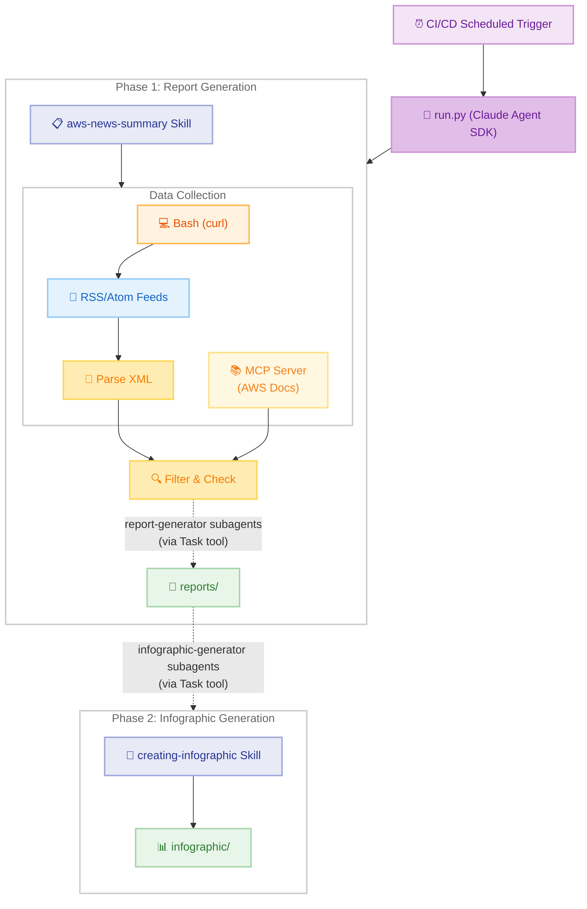
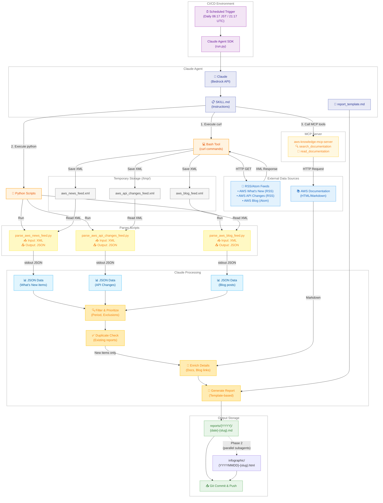
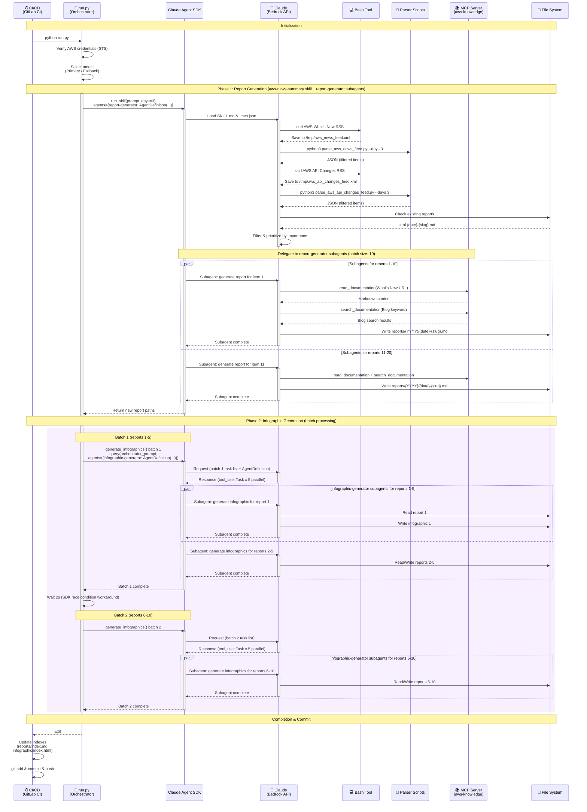
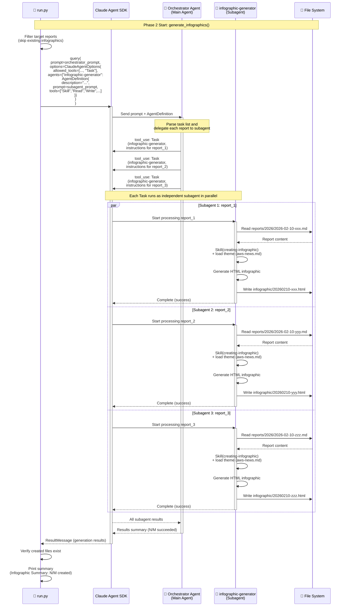

# AWS News Summary <!-- omit in toc -->

**English** | [日本語](README.md)

A Claude Agent SDK skill that retrieves information from AWS What's New and AWS API Changes, and generates detailed explanation reports in Japanese.

- [Architecture](#architecture)
  - [System Overview (High-level)](#system-overview-high-level)
  - [System Overview (Detailed)](#system-overview-detailed)
  - [Sequence Diagram](#sequence-diagram)
  - [Sequence Diagram (Phase 2 Detail: Subagent Internal Processing)](#sequence-diagram-phase-2-detail-subagent-internal-processing)
- [Project Structure](#project-structure)
- [MCP Servers](#mcp-servers)
- [Execution](#execution)
  - [CI/CD with Claude Agent SDK](#cicd-with-claude-agent-sdk)
  - [Local Development](#local-development)
- [Information Sources](#information-sources)
- [Output](#output)
- [References](#references)
  - [Claude Agent SDK](#claude-agent-sdk)
  - [CI/CD Setup](#cicd-setup)
- [License](#license)


## Architecture

This skill uses the Claude Agent SDK and is scheduled to run from GitHub Actions or GitLab CI. `run.py` acts as a two-phase orchestrator: Phase 1 invokes Claude via Bedrock API to generate Japanese reports following the SKILL.md definition. The orchestrator handles RSS feed retrieval, parsing, filtering, and duplicate checking, then delegates individual report creation to `report-generator` subagents via the Task tool for parallel execution. Phase 2 launches `infographic-generator` subagents defined via `AgentDefinition` through the Task tool in batches for parallel infographic generation.

### System Overview (High-level)



**Overall Flow:**

This skill runs periodically from CI/CD, with `run.py` orchestrating two phases.

1. **Phase 1 - Report Generation**: The orchestrator retrieves information from RSS/Atom feeds and AWS documentation, then delegates to `report-generator` subagents via the Task tool for parallel report creation (aws-news-summary skill, batch size: 10)
2. **Phase 2 - Infographic Generation**: The main agent delegates to `infographic-generator` subagents defined via `AgentDefinition`, spawning them in batches via the Task tool to generate HTML infographics (creating-infographic skill, batch size: 5, inter-batch delay: 2s)

### System Overview (Detailed)

The following detailed diagram represents the actual technical implementation and data flow.



**Technical Implementation Details:**

1. **Data Collection Phase**
   - Claude Code executes `curl` commands via Bash Tool
   - Saves RSS/Atom feeds as XML to `/tmp/` directory
   - Fetches 3 feeds in parallel (What's New, API Changes, Blog)

2. **Parsing Phase**
   - Executes Python parser scripts (`parse_*.py`)
   - Each script reads `/tmp/*.xml` files
   - Applies period filtering and outputs JSON to stdout

3. **Detail Retrieval Phase**
   - Fetches additional information via MCP server (`aws-knowledge-mcp-server`)
   - `read_documentation`: Retrieves What's New detail pages as Markdown
   - `search_documentation`: Searches for related blog articles

4. **Report Generation Phase (Phase 1)**
   - Checks for duplicates against existing reports
   - Creates reports based on template (`report_template.md`)
   - Saves to `reports/{YYYY}/{date}-{slug}.md` and commits to Git

5. **Infographic Generation Phase (Phase 2)**
   - `run.py` makes a single `query()` call to launch an orchestrator agent
   - The orchestrator delegates to `infographic-generator` subagents defined via `AgentDefinition`, spawning them in parallel via the Task tool
   - Each subagent runs in an isolated context, using the `creating-infographic` skill to generate HTML infographics
   - Saves to `infographic/{YYYYMMDD}-{slug}.html`

6. **Running on GitHub Actions**
   - Phase 1 and Phase 2 run as separate jobs (`run.py --phase reports` and `run.py --phase infographics`)
   - AWS credentials expire after 1 hour (`role-duration-seconds: 3600`), so each job requests its own credentials, stops after 50 minutes (`--time-budget 50`), and commits and pushes the files it has created
   - When the report job stops at the time budget, the `generate-reports-backlog` job creates the remaining reports with fresh credentials
   - Each run creates up to 60 infographics: new reports first, then existing reports without HTML with the rest of the cap. Both are processed newest date first, so when the cap is reached, the newest articles at the top of the site get their infographics first
   - GitHub Pages is deployed with everything committed so far, even when a generation job fails or stops at the time budget
   - Only one run is in progress at a time (`concurrency`). A run that starts while another is in progress waits for it to finish. Only one run can wait: when a newer run starts, the waiting run is canceled
   - When you run the workflow manually, set `days` in [Run workflow] to choose how many days to look back (default: 3)

### Sequence Diagram

The following sequence diagram shows the complete flow from CI/CD pipeline execution through two-phase report and infographic generation. In Phase 1, the aws-news-summary skill generates reports. In Phase 2, `run.py` launches an orchestrator agent that delegates to `infographic-generator` subagents defined via `AgentDefinition`, spawning them in parallel via the Task tool. Context isolation between phases and between subagents prevents context exhaustion from causing missed generations.



### Sequence Diagram (Phase 2 Detail: Subagent Internal Processing)

The following diagram shows the detailed internal processing flow of subagents in Phase 2. `run.py` makes a single `query()` call to launch an orchestrator agent, which delegates to `infographic-generator` subagents defined via `AgentDefinition` through the Task tool. Each subagent runs in an isolated context, reading a report and generating an HTML infographic using the creating-infographic skill.



## Project Structure

```
aws-news-summary/
├── .claude/                           # Claude Code settings
│   ├── settings.json                  # Permissions & MCP config
│   └── skills/
│       ├── aws-news-summary/          # Skill definition (report generation)
│       │   ├── SKILL.md               # Skill instructions
│       │   ├── report_template.md     # Report template
│       │   └── scripts/               # Parser scripts
│       │       ├── parse_aws_news_feed.py        # AWS What's New parser
│       │       ├── parse_aws_api_changes_feed.py # AWS API Changes parser
│       │       ├── parse_aws_blog_feed.py        # AWS Blog parser
│       │       └── parse_kiro_updates.py         # Kiro Updates parser
│       └── creating-infographic/      # Skill definition (infographic generation)
│           ├── SKILL.md               # Skill instructions
│           └── themes/                # Theme definitions
├── .github/workflows/                 # GitHub Actions
├── .gitlab-ci.yml                     # GitLab CI pipeline
├── .mcp.json                          # MCP server configuration
├── reports/                           # Generated reports (by year)
│   ├── 2025/
│   └── 2026/
├── infographic/                       # Generated infographics (HTML)
├── docs/                              # Documentation
│   ├── SETUP.md                       # CI/CD setup guide (Japanese)
│   └── SETUP-en.md                    # CI/CD setup guide (English)
├── CLAUDE.md                          # Claude Code instructions
├── README.md                          # Japanese documentation
├── README-en.md                       # English documentation
├── requirements.txt                   # Python dependencies
└── run.py                             # CI/CD entry point (two-phase orchestrator)
```

**Note**: Skills are defined at project-level (`.claude/skills/`) to ensure they work in CI/CD environments where user-level skills (`~/.claude/skills/`) are not available. `run.py` orchestrates Phase 1 (report generation) and Phase 2 (parallel infographic generation via subagents).

## MCP Servers

This project uses the following MCP servers configured in `.mcp.json`:

| Server | Type | Purpose |
|--------|------|---------|
| `aws-knowledge-mcp-server` | HTTP | AWS documentation search, documentation reading, AWS Blog search |

**Note**: RSS/Atom feed retrieval uses curl commands and external Python parser scripts (scripts/) instead of MCP servers. This approach improves maintainability by managing RSS/Atom feed parsing logic outside the skill.

The MCP configuration is automatically loaded by the Claude Agent SDK via `setting_sources=["project"]`.

## Execution

### CI/CD with Claude Agent SDK

This skill is automatically executed from GitHub Actions or GitLab CI using the Claude Agent SDK.

**Setup Instructions**: Running in CI/CD requires configuring AWS IAM OIDC provider, IAM role, and CI/CD variables. See the following documentation for detailed instructions:

📖 **[CI/CD Setup Guide (docs/SETUP-en.md)](docs/SETUP-en.md)**

The setup guide includes:

- Creating AWS IAM OIDC provider and IAM role (with automation script)
- Configuring GitHub Actions / GitLab CI variables
- Troubleshooting

**GitHub Actions**:
```yaml
# .github/workflows/aws-news-summary.yml
- name: Configure AWS credentials
  uses: aws-actions/configure-aws-credentials@v6
  with:
    role-to-assume: ${{ vars.AWS_ROLE_ARN }}
    aws-region: ${{ vars.AWS_REGION }}

- name: Run AWS News Summary
  run: python run.py
```

**GitLab CI**:
```yaml
# .gitlab-ci.yml
aws_news_summary:
  id_tokens:
    GITLAB_OIDC_TOKEN:
      aud: https://gitlab.com
  script:
    - python run.py
```

### Local Development

**Using Claude Code CLI**:
```bash
cd ~/.claude/skills/aws-news-summary
claude "Report the latest AWS news"
```

**Using run.py**:
```bash
cd ~/.claude/skills/aws-news-summary
pip install -r requirements.txt

# Default settings (past 3 days)
python run.py

# Specify days (past 7 days)
python run.py --days 7

# Custom prompt - Filter by specific service
python run.py "Report the latest Amazon Bedrock updates"

# Verbose logging
python run.py --verbose

# Debug mode (full message details)
python run.py --debug
```

**Notes**:
- `run.py` requires AWS credentials configured for Bedrock access
- Use `--days` option to specify lookback period (default: 3 days)
- Custom prompts override the `--days` parameter
- Current datetime is automatically added to the prompt for accurate date filtering

## Information Sources

| Source | URL | Format | Retrieval Method |
|--------|-----|--------|------------------|
| AWS What's New | https://aws.amazon.com/new/feed/ | RSS/XML | curl + parse_aws_news_feed.py |
| AWS API Changes | https://awsapichanges.com/feed/feed.rss | RSS/XML | curl + parse_aws_api_changes_feed.py |
| AWS Blog | https://aws.amazon.com/blogs/aws/feed/ | Atom/XML | curl + parse_aws_blog_feed.py (fallback) |
| AWS Blog | - | - | aws-knowledge-mcp-server search (recommended) |
| AWS Documentation | - | Markdown | aws-knowledge-mcp-server read_documentation |
| Kiro Blog | https://kiro.dev/blog/ | HTML | curl + parse_kiro_updates.py |
| Kiro Changelog | https://kiro.dev/changelog/ | HTML | curl + parse_kiro_updates.py |

## Output

Two types of artifacts are generated.

- **Reports**: Japanese Markdown, `reports/{YYYY}/{YYYY}-{MM}-{DD}-{slug}.md`
- **Infographics**: HTML, `infographic/{YYYYMMDD}-{slug}.html`

## References

### Claude Agent SDK
- [Claude Agent SDK - Skills](https://platform.claude.com/docs/en/agent-sdk/skills) - Agent Skills in the SDK
- [Claude Agent SDK - Subagents](https://platform.claude.com/docs/en/agent-sdk/subagents) - Subagents in the SDK (parallel execution)
- [Claude Agent SDK - MCP](https://platform.claude.com/docs/en/agent-sdk/mcp) - MCP in the SDK
- [Claude Agent SDK - Python](https://platform.claude.com/docs/en/agent-sdk/python) - Python SDK Reference
- [Agent Skills Overview](https://platform.claude.com/docs/en/agents-and-tools/agent-skills/overview) - Conceptual overview
- [Agent Skills Best Practices](https://platform.claude.com/docs/en/agents-and-tools/agent-skills/best-practices) - Authoring guidelines
- [Claude Code Skills](https://code.claude.com/docs/en/skills) - Complete Skills guide

### CI/CD Setup
- [aws-actions/configure-aws-credentials](https://github.com/aws-actions/configure-aws-credentials) - Official action to configure AWS credentials in GitHub Actions
- [GitHub Actions: Configuring OpenID Connect in AWS](https://docs.github.com/en/actions/security-for-github-actions/security-hardening-your-deployments/configuring-openid-connect-in-amazon-web-services)
- [GitLab CI: Configure OpenID Connect in AWS](https://docs.gitlab.com/ci/cloud_services/aws/)

## License

MIT License - See [LICENSE](LICENSE) for details.
