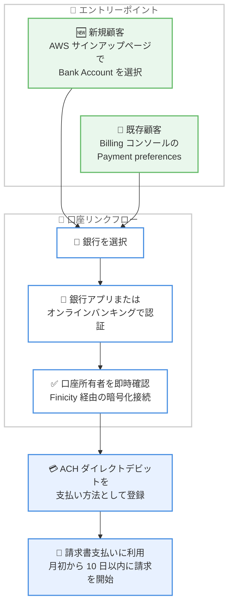

# AWS Billing and Cost Management - ACH ダイレクトデビットによるサインアップと請求書支払い

**リリース日**: 2026 年 10 月 11 日
**サービス**: AWS Billing and Cost Management
**機能**: ACH ダイレクトデビットによる AWS サインアップおよび請求書支払い

📊 [このアップデートのインフォグラフィックを見る](https://takech9203.github.io/aws-news-summary/20261011-aws-sign-up-invoices-ach-direct-debit.html)

## 概要

米国の AWS 顧客が、US 銀行口座を使用した ACH ダイレクトデビット (自動口座引き落とし) で AWS へのサインアップと請求書の支払いを行えるようになりました。個人・法人を問わず、米国内の銀行にある USD 建ての口座を利用できます。

従来、新規顧客が AWS アカウントを作成するには、クレジットカードまたはデビットカードの登録が必須でした。今回のアップデートにより、サインアップページで Bank Account オプションを選択し、利用する銀行を選んで銀行のモバイルアプリまたはオンラインバンキングの認証を完了するだけで、口座の所有者確認と支払い方法の登録が安全に行えます。リンクされた口座は、以降の請求書支払いのデフォルト支払い方法として設定されます。

既存顧客も、AWS Billing and Cost Management コンソールの Payment preferences ページから同様の手順で銀行口座を追加できます。USD 銀行口座向けの本機能は追加料金なしで利用できます。

**アップデート前の課題**

このアップデート以前には、以下の課題がありました。

- 新規顧客は AWS アカウントのサインアップを完了するために、クレジットカードまたはデビットカードが必須だった
- カードを保有していない、またはカード決済を避けたい米国の個人・企業にとってサインアップの障壁となっていた
- 既存顧客が銀行口座を手動で追加する場合、口座番号やルーティング番号の入力に加え、アカウント作成から 60 日以上の経過や過去 12 か月の支払い実績などの条件を満たす必要があった

**アップデート後の改善**

今回のアップデートにより、以下が可能になりました。

- 新規顧客がカードなしで、US 銀行口座のみで AWS にサインアップできるようになった
- 銀行のアプリまたはオンラインバンキング認証による即時の口座所有者確認で、安全かつ簡単に口座をリンクできるようになった
- 既存顧客は Billing コンソールの Payment preferences から銀行口座をリンクし、以降の請求書支払いに利用できるようになった
- USD 銀行口座に対して追加料金なしで利用できる

## アーキテクチャ図



新規顧客はサインアップ時に、既存顧客は Billing コンソールから、銀行認証による口座リンクを行い、ACH ダイレクトデビットを支払い方法として登録するフローを示しています。

## サービスアップデートの詳細

### 主要機能

1. **ACH ダイレクトデビットによるサインアップ**
   - 新規顧客はサインアップページで Bank Account オプションを選択して AWS アカウントを作成できる
   - クレジットカードやデビットカードが不要になり、US 銀行口座のみでサインアップが完結する
   - リンクした口座は、以降の請求書支払いのデフォルト支払い方法として設定される

2. **銀行認証による安全な口座リンク**
   - 利用する銀行を選択し、銀行のモバイルアプリまたはオンラインバンキングのログインで認証する
   - Mastercard 傘下の Finicity と連携し、暗号化されたエンドツーエンド接続で口座の所有者確認を即時に実施する
   - オンラインバンキングの認証情報は銀行側に留まり、AWS がアクセス・保存することはない

3. **既存顧客向けの支払い方法追加**
   - AWS Billing and Cost Management コンソールの Payment preferences ページから [Add payment method] → [Link your bank account] を選択して追加できる
   - 検証が完了すると、以降の請求書支払いに銀行口座を利用できる
   - 従来からの手動入力 (口座番号・ルーティング番号の入力) による追加方法も引き続き利用可能

## 技術仕様

### 利用条件と支払い処理

| 項目 | 詳細 |
|------|------|
| 対象口座 | 米国内の銀行にある個人または法人の銀行口座 (USD 建て) |
| 口座リンク方式 | オンラインバンキング認証による即時検証、または口座番号・ルーティング番号の手動入力 |
| 所有者確認 | Finicity (Mastercard 傘下) 経由の暗号化接続による一回限りの検証 |
| 請求タイミング | 月初から 10 日以内に請求書発行と口座への請求を開始 |
| 支払い完了まで | コンソール上で Succeeded と表示されても、支払い完了まで最大 20 日かかる場合がある |
| 追加料金 | USD 銀行口座に対して追加料金なし |

### 手動追加の場合の利用条件

銀行認証によるリンクではなく、口座番号を手動入力して追加する場合は、以下の条件を満たす必要があります。

| 条件 | 詳細 |
|------|------|
| アカウント作成からの経過期間 | 60 日以上 |
| 支払い実績 | 過去 12 か月に 1 件以上の請求書を全額支払い済み |
| 支払い金額 | 過去 12 か月の累計支払いが $100 以上 |
| 通貨設定 | 優先通貨が USD に設定されている |
| 必要情報 (個人口座) | US 運転免許証番号または州発行 ID 番号 |
| 必要情報 (法人口座) | 連邦税 ID 番号 |

## 設定方法

### 前提条件

1. 米国内の銀行にある個人または法人の銀行口座 (USD 建て) を保有していること
2. 既存顧客の場合、AWS Billing and Cost Management コンソールへのアクセス権限があること
3. 銀行のモバイルアプリまたはオンラインバンキングの認証情報を利用できること

### 手順

#### ステップ 1: 新規顧客 - サインアップ時に銀行口座を選択

1. AWS サインアップページでアカウント情報を入力する
2. 支払い方法の選択で Bank Account オプションを選択する
3. 利用する銀行を一覧から選択する

#### ステップ 2: 銀行認証で口座をリンク

1. 銀行のモバイルアプリまたはオンラインバンキングのログインで認証する (AWS の認証情報ではなく、銀行の認証情報を使用)
2. 銀行によっては多要素認証 (MFA) が求められる場合がある
3. 認証が完了すると口座の所有者確認が即時に行われ、口座がリンクされる

#### ステップ 3: 既存顧客 - Billing コンソールから追加

1. [AWS Billing and Cost Management コンソール](https://console.aws.amazon.com/costmanagement/) を開く
2. ナビゲーションペインで [Payment preferences] を選択する
3. [Add payment method] を選択する
4. [Bank account setup method] で [Link your bank account] を選択する
5. 銀行を選択して認証を完了し、必要に応じてデフォルト支払い方法に設定する
6. 請求先住所を入力し、[Add payment method] を選択して利用規約に同意し、登録を完了する

## メリット

### ビジネス面

- **サインアップ障壁の低減**: クレジットカードを保有していない、またはカード利用を避けたい米国の個人・企業でも AWS を利用開始できる
- **支払い管理の簡素化**: 銀行口座から直接支払うことで、カードの有効期限切れや限度額による支払い失敗のリスクを回避できる
- **追加コストなし**: USD 銀行口座に対して追加料金なしで利用でき、カード決済手数料を意識する必要がない

### 技術面

- **安全な口座検証**: Finicity 経由の暗号化されたエンドツーエンド接続により、口座の所有者確認が安全に行われる
- **認証情報の非保持**: オンラインバンキングの認証情報は銀行側に留まり、AWS がアクセス・保存しない
- **即時検証**: 銀行認証によるリンクでは、手動入力と異なり口座の検証が即時に完了する

## デメリット・制約事項

### 制限事項

- 米国内の銀行にある USD 建て口座のみが対象 (日本の銀行口座は利用不可)
- ACH 支払いは、コンソール上で Succeeded と表示されても完了まで最大 20 日かかる場合がある
- 手動入力による口座追加には、アカウント作成から 60 日以上の経過や過去 12 か月の支払い実績などの条件がある

### 考慮すべき点

- 銀行認証によるリンク時に、銀行から追加情報の共有について同意を求められる場合がある
- 銀行認証情報へのアクセス許可は、現地の規制と銀行のポリシーに基づき期限が設定される
- 口座残高不足による支払い失敗を避けるため、請求タイミング (月初から 10 日以内) を考慮した残高管理が必要

## ユースケース

### ユースケース 1: カードなしでの新規 AWS アカウント作成

**シナリオ**: 米国のスタートアップが法人クレジットカードの発行を待たずに AWS の利用を開始したい。

**実装例**:
```
1. AWS サインアップページでアカウント情報を入力
2. 支払い方法で Bank Account を選択
3. 法人口座のある銀行を選択し、オンラインバンキングで認証
4. 口座がデフォルト支払い方法として登録され、サインアップ完了
```

**効果**: カード発行を待つことなく即日で AWS アカウントを作成でき、ビジネスの立ち上げを加速できる。

### ユースケース 2: カード決済から銀行口座引き落としへの切り替え

**シナリオ**: 月額の AWS 利用料が増加し、クレジットカードの利用限度額に達するリスクがある企業が、支払い方法を銀行口座に切り替えたい。

**実装例**:
```
1. Billing コンソールの Payment preferences を開く
2. Add payment method → Link your bank account を選択
3. 銀行認証を完了し、デフォルト支払い方法に設定
```

**効果**: カード限度額による支払い失敗を回避し、高額な請求書も銀行口座から直接安定して支払える。

### ユースケース 3: 支払い方法の冗長化

**シナリオ**: カードの有効期限切れや再発行時にも請求書の支払いが滞らないよう、バックアップの支払い方法を用意したい。

**実装例**:
```
1. 既存のカードに加えて、Payment preferences から銀行口座をリンク
2. 必要に応じてタグ (最大 50 個) を付与して支払い方法を管理
3. カード利用不可時に銀行口座での支払いに切り替え
```

**効果**: 支払い遅延によるサービス影響のリスクを低減し、支払い方法のガバナンスを強化できる。

## 料金

ACH ダイレクトデビットは、USD 銀行口座に対して追加料金なしで利用できます。

## 利用可能リージョン

米国の顧客が対象です。米国内の銀行にある USD 建ての個人または法人の銀行口座で利用できます。

## 関連サービス・機能

- **AWS Billing and Cost Management**: Payment preferences ページで支払い方法の追加・編集・デフォルト設定を管理
- **AWS アカウントサインアップ**: 新規アカウント作成時の支払い方法として銀行口座を選択可能
- **支払い方法のタグ管理**: 支払い方法に最大 50 個のタグを付与し、アクセス管理に活用可能

## 参考リンク

- 📊 [インフォグラフィック](https://takech9203.github.io/aws-news-summary/20261011-aws-sign-up-invoices-ach-direct-debit.html)
- [公式発表 (What's New)](https://aws.amazon.com/about-aws/whats-new/2026/10/aws-sign-up-invoices-ach-direct-debit/)
- [ドキュメント - Managing ACH direct debit](https://docs.aws.amazon.com/awsaccountbilling/latest/aboutv2/manage-ach-debit.html)

## まとめ

米国の顧客は、クレジットカードやデビットカードなしで US 銀行口座のみを使って AWS にサインアップし、請求書を支払えるようになりました。銀行認証による即時の口座検証で安全かつ簡単に口座をリンクでき、追加料金もかかりません。米国でカード決済に課題を抱える組織は、Billing コンソールの Payment preferences から銀行口座の追加を検討することを推奨します。
