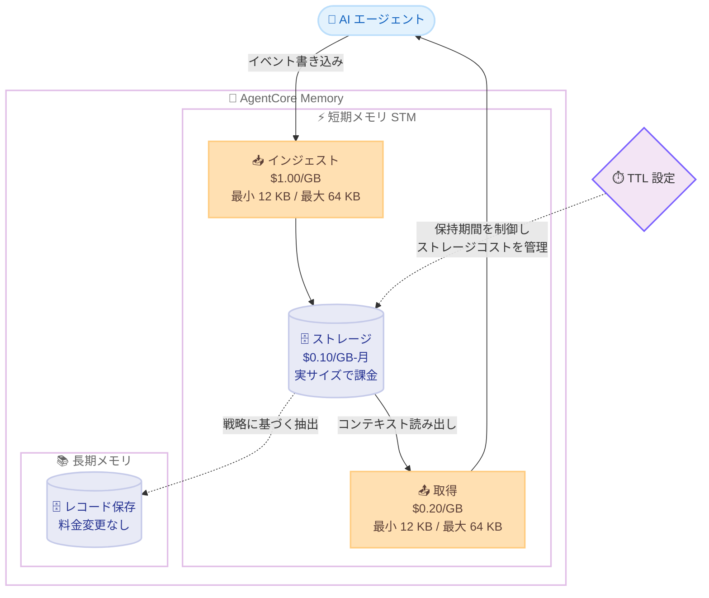

# Amazon Bedrock AgentCore - 短期メモリの従量課金制の発表

**リリース日**: 2026 年 10 月 12 日
**サービス**: Amazon Bedrock AgentCore
**機能**: AgentCore Memory 短期メモリ (STM) の従量課金制 (consumption-based pricing)

📊 [このアップデートのインフォグラフィックを見る](https://takech9203.github.io/aws-news-summary/20261012-agentcore-memory-consumption-based-pricing.html)

## 概要

Amazon Bedrock AgentCore の Memory 機能において、短期メモリ (Short-Term Memory、STM) の料金体系が、従来のイベント数ベースの固定料金から、実際の使用量に基づく従量課金制に変更されました。新しい料金体系では、インジェスト (取り込み)、取得、ストレージという 3 つのディメンションで、処理したデータ量 (GB) に応じて課金されます。

AgentCore Memory は、AI エージェントにセッション内コンテキスト (短期メモリ) とセッションをまたぐ永続的な知識 (長期メモリ) を提供する機能です。今回の変更により、小さなイベントを大量に生成するエージェントを開発している場合でも、実際に使用した分だけ支払う形になります。AWS によると、ほとんどのワークロードでコストが削減され、特に小さなペイロードを扱うユースケースで最も大きな削減効果が見込まれます。なお、長期メモリの料金は変更ありません。

**アップデート前の課題**

- 短期メモリはイベント数ベースの固定料金 (1,000 イベントあたり $0.25) で課金されていた
- イベントのサイズに関係なく一律で課金されるため、小さなペイロードを大量に生成するエージェントではデータ量に対して割高になっていた
- 会話ターンごとに細かくイベントを記録する設計では、コスト効率が悪化しやすかった

**アップデート後の改善**

- インジェスト、取得、ストレージの 3 ディメンションで、実際のデータ量 (GB) に基づいて課金されるようになった
- 小さなペイロードを扱うユースケースを中心に、ほとんどのワークロードでコストが削減される
- メモリリソースに短い TTL (Time to Live) を設定することで、ストレージコストを能動的に管理できる

## アーキテクチャ図



短期メモリの課金が 3 つのディメンション (インジェスト、取得、ストレージ) に分かれ、それぞれデータ量ベースで課金される構造を示しています。TTL 設定によりストレージの保持期間を制御し、コストを管理できます。

## サービスアップデートの詳細

### 主要機能

1. **データ量ベースの従量課金への移行**
   - 従来の「1,000 イベントあたり $0.25」という固定料金から、GB 単位の従量課金に変更
   - インジェスト: $1.00/GB、取得: $0.20/GB、ストレージ: $0.10/GB-月
   - 使用した分だけ支払うモデルのため、実際のデータ量とコストが比例する

2. **イベントあたりの課金サイズルール**
   - インジェストと取得は、イベントごとに最小 12 KB、最大 64 KB として課金サイズが計算される
   - 実際のイベントサイズが 12 KB 未満でも 12 KB 分として、64 KB を超えても 64 KB 分として課金される
   - ストレージは、イベントの実際のサイズに基づいて課金される (最小/最大の丸めなし)

3. **TTL によるストレージコスト管理**
   - メモリリソースに設定する TTL (Time to Live) を短くすることで、ストレージコストを削減できる
   - ストレージ料金は各イベントの TTL 期間にわたって按分され、時間単位で課金される

4. **長期メモリ料金は変更なし**
   - 長期メモリのストレージ (レコード単位) および取得 (リクエスト単位) の料金は従来どおり

## 技術仕様

### 短期メモリの新料金体系

| 課金ディメンション | 料金 | 課金単位・ルール |
|------|------|------|
| インジェスト | $1.00/GB | イベントあたり最小 12 KB、最大 64 KB で計算 |
| 取得 | $0.20/GB | イベントあたり最小 12 KB、最大 64 KB で計算 |
| ストレージ | $0.10/GB-月 | イベントの実サイズで課金。TTL 期間で按分し時間単位で請求 |

### 長期メモリの料金 (変更なし)

| 課金ディメンション | 料金 |
|------|------|
| ストレージ (ビルトイン戦略) | 1,000 レコードあたり月額 $0.75 |
| ストレージ (セルフマネージド戦略) | 1,000 レコードあたり月額 $0.25 (別途モデル利用料が発生する場合あり) |
| 取得 | 1,000 リクエストあたり $0.50 |

### 新旧料金の比較

| 項目 | 旧料金 (2026 年 10 月 5 日まで) | 新料金 (2026 年 10 月 6 日以降) |
|------|------|------|
| STM インジェスト | 1,000 イベントあたり $0.25 | $1.00/GB (イベントサイズベース) |
| STM 取得 | - | $0.20/GB |
| STM ストレージ | - | $0.10/GB-月 |

## 設定方法

### 前提条件

1. AWS アカウントを保有していること
2. Amazon Bedrock AgentCore Memory を利用していること (または利用を検討していること)
3. 料金体系の変更内容を理解し、ワークロードへの影響を把握していること

### 手順

#### ステップ1: 現在のメモリ使用状況の確認

```bash
# メモリリソースの一覧を確認
aws bedrock-agentcore-control list-memories --region us-east-1
```

アカウント内の AgentCore Memory リソースを一覧表示し、現在使用中のメモリリソースを確認します。

#### ステップ2: イベントサイズと件数の把握

エージェントが生成するイベントの平均サイズと月間件数を把握します。イベントあたり最小 12 KB で課金されるため、小さなイベントを大量に生成する場合は 12 KB × 件数がインジェストの課金対象データ量になります。

#### ステップ3: TTL の見直しによるストレージコスト最適化

```bash
# メモリリソースの詳細を確認し、イベントの有効期限設定を確認
aws bedrock-agentcore-control get-memory \
  --memory-id <memory-id> \
  --region us-east-1
```

メモリリソースの設定を確認し、イベントの保持期間 (TTL) がユースケースに対して長すぎる場合は、短い TTL に見直すことでストレージコストを削減できます。

## メリット

### ビジネス面

- **コスト削減**: ほとんどのワークロードでコストが削減され、特に小さなペイロードを扱うユースケースで最も大きな削減効果が見込まれる
- **コストの透明性**: 使用したデータ量に比例した課金のため、コストの予測と説明がしやすい
- **初期コミットメント不要**: 最低料金や前払いの必要がなく、スモールスタートが可能

### 技術面

- **設計の自由度向上**: イベント数ベースの課金ではなくなったため、会話ターンごとに細かくイベントを記録する設計でもコストペナルティが小さい
- **TTL によるコスト制御**: メモリの保持期間をワークロード要件に合わせて調整することで、ストレージコストを直接制御できる
- **コストとデータ量の整合**: 実際に処理・保存するデータ量とコストが比例するため、容量計画とコスト管理を一体で行える

## デメリット・制約事項

### 制限事項

- インジェストと取得には、イベントあたり最小 12 KB の課金サイズが適用される (非常に小さいイベントでも 12 KB 分として課金)
- イベントあたりの課金サイズ上限は 64 KB (これを超えるイベントは 64 KB 分として課金)
- 長期メモリの料金は変更されない

### 考慮すべき点

- 大きなペイロード (12 KB 超) を頻繁にインジェスト・取得するワークロードでは、旧料金と比較してコストへの影響を試算する必要がある
- 取得 (リトリーバル) とストレージが新たに明示的な課金ディメンションとなったため、読み出し頻度の高いワークロードはコスト構造を再確認するべき
- TTL を短くしすぎると、エージェントが必要とするコンテキストが失われる可能性があるため、コストとコンテキスト保持のバランスを検討する必要がある

## ユースケース

### ユースケース1: 会話型コーディングアシスタント

**シナリオ**: 開発者向けのコーディングアシスタントエージェントが、月間 100,000 件の短期イベント (平均 3 KB、TTL 30 日) を生成し、長期メモリに 10,000 レコードを保存、20,000 回の長期メモリ取得を行う。

**実装例**:
```text
短期インジェスト: 100,000 イベント × 12 KB (最小課金サイズ) = 1.2 GB × $1.00 = $1.20
短期取得:       1.2 GB × $0.20 = $0.24
短期ストレージ:  実サイズ 3 KB × 100,000 = 0.3 GB × $0.10 = $0.03
長期ストレージ:  10,000 レコード × $0.75/1,000 = $7.50
長期取得:       20,000 リクエスト × $0.50/1,000 = $10.00
月額合計: $18.97
```

**効果**: 旧料金では短期メモリだけで $25.00 (100,000 イベント × $0.25/1,000) かかっていたインジェストコストが $1.20 に削減され、取得・ストレージを含めても短期メモリのコストが大幅に低下する。

### ユースケース2: 高頻度・小ペイロードのチャットボット

**シナリオ**: カスタマーサポートチャットボットが、短いメッセージ (1〜2 KB) を 1 ターンごとにイベントとして記録する。イベント数が多く、1 件あたりのサイズが小さい。

**実装例**:
```text
旧料金: イベント数に比例して課金されるため、ターン数が増えるほどコストが線形に増加
新料金: 小さいイベントは最小 12 KB で課金されるものの、GB 単価ベースのため
        イベント数あたりのコストは旧料金より大幅に低い
```

**効果**: 小さなペイロードを大量に生成するユースケースは、今回の変更で最も大きなコスト削減効果を得られる。

### ユースケース3: TTL 最適化によるストレージコスト管理

**シナリオ**: セッション中のコンテキスト保持のみが目的で、セッション終了後の短期メモリは不要なエージェント。

**実装例**:
```text
TTL を 30 日 → 1 日に短縮した場合:
ストレージ課金は TTL 期間にわたる按分・時間単位課金のため、
保持期間を 1/30 にすることでストレージコストも約 1/30 に削減
```

**効果**: ユースケースに必要な最小限の保持期間を設定することで、ストレージコストを大幅に削減できる。重要な情報は長期メモリに抽出して永続化する設計と組み合わせると効果的。

## 料金

短期メモリ (STM) は、2026 年 10 月 6 日以降、以下の 3 ディメンションの従量課金制となります。最低料金や前払いコミットメントはありません。

- **インジェスト**: $1.00/GB (イベントあたり最小 12 KB、最大 64 KB で課金サイズを計算)
- **取得**: $0.20/GB (同上)
- **ストレージ**: $0.10/GB-月 (イベントの実サイズで課金。TTL 期間で按分し時間単位で請求)

長期メモリの料金 (ビルトイン戦略ストレージ: $0.75/1,000 レコード-月、セルフマネージド戦略ストレージ: $0.25/1,000 レコード-月、取得: $0.50/1,000 リクエスト) に変更はありません。

### 料金例

| 使用量 | 月額料金 (概算) |
|--------|------------------|
| 短期イベント 100,000 件 (3 KB、TTL 30 日) のインジェスト | $1.20 |
| 上記イベントの取得 (1.2 GB) | $0.24 |
| 上記イベントのストレージ (実サイズ 0.3 GB) | $0.03 |
| 長期メモリ 10,000 レコード保存 + 20,000 回取得 | $17.50 |
| 合計 | $18.97 |

## 利用可能リージョン

AgentCore Memory が提供されているすべての AWS リージョンで、新しい従量課金制が適用されます。

## 関連サービス・機能

- **Amazon Bedrock AgentCore**: AI エージェントを大規模に構築・デプロイ・運用するためのサービス群。Memory はその中核機能のひとつ
- **AgentCore Memory 長期メモリ**: セッションをまたいで知識を永続化する機能。短期メモリから戦略に基づいて情報を抽出して保存する。今回の料金変更の対象外
- **Amazon Bedrock**: 基盤モデルを API 経由で利用できるマネージドサービス。AgentCore と組み合わせてエージェントを構築する

## 参考リンク

- 📊 [インフォグラフィック](https://takech9203.github.io/aws-news-summary/20261012-agentcore-memory-consumption-based-pricing.html)
- [公式発表 (What's New)](https://aws.amazon.com/about-aws/whats-new/2026/10/agentcore-memory-consumption-based-pricing)
- [Amazon Bedrock AgentCore 料金ページ](https://aws.amazon.com/bedrock/agentcore/pricing/)
- [Amazon Bedrock AgentCore](https://aws.amazon.com/bedrock/agentcore/)

## まとめ

AgentCore の短期メモリ料金がイベント数ベースの固定料金からデータ量ベースの従量課金に変わり、ほとんどのワークロード、特に小さなペイロードを大量に扱うエージェントで大幅なコスト削減が期待できます。AgentCore Memory を利用中の場合は、イベントサイズと件数から新料金でのコストを試算し、あわせて TTL 設定を見直してストレージコストを最適化することを推奨します。
