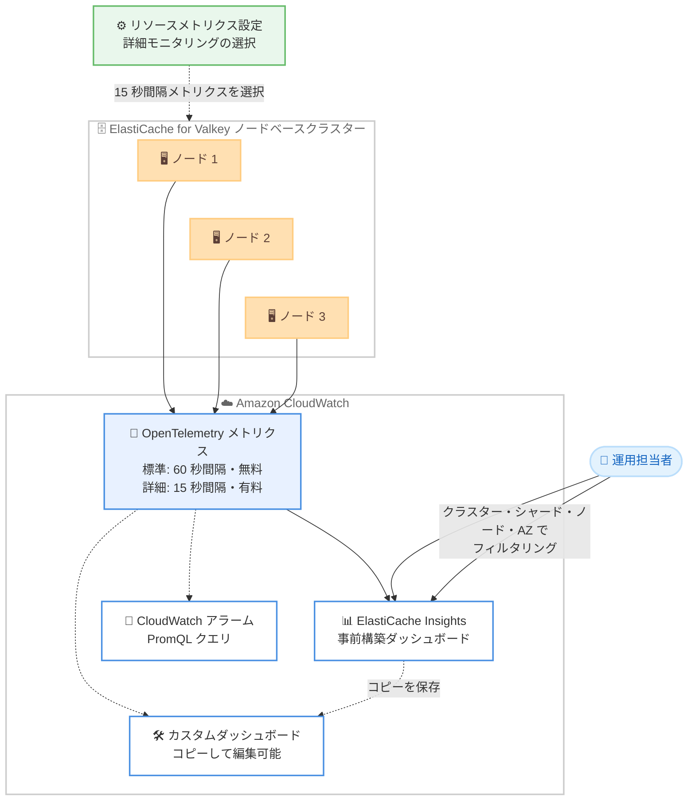

# Amazon ElastiCache for Valkey - ElastiCache Insights の発表

**リリース日**: 2026 年 10 月 12 日
**サービス**: Amazon ElastiCache for Valkey
**機能**: ElastiCache Insights (CloudWatch 事前構築ダッシュボード)

📊 [このアップデートのインフォグラフィックを見る](https://takech9203.github.io/aws-news-summary/20261012-amazon-elasticache-valkey-elasticache-insights.html)

## 概要

Amazon ElastiCache for Valkey のノードベースクラスター向けに、Amazon CloudWatch の事前構築ダッシュボード「ElastiCache Insights」が発表されました。ElastiCache が自動的に発行する OpenTelemetry メトリクスをソースとして、クラスターの健全性、メモリ、コンピューティング、ネットワーク、コマンドスループット、レイテンシー、キースペース、エラーといった情報を単一のビューに集約して表示します。

ダッシュボードはリージョン全体のキャッシュワークロードの健全性を一目で確認でき、ノードがメモリ、ネットワーク、接続数の上限に近づいていることを検出できます。表示はクラスター、シャード、ノード、アベイラビリティーゾーン単位でフィルタリングでき、ダッシュボードのコピーを保存してワークロードに合わせたカスタムダッシュボードの出発点にすることも可能です。さらに、詳細モニタリングを有効化すると、選択したメトリクスを 15 秒間隔で発行し、Metrics タブやカスタムダッシュボードで確認できます。

**アップデート前の課題**

- ElastiCache のメトリクスを俯瞰的に確認するには、CloudWatch でカスタムダッシュボードを自作するか、個別のメトリクスを都度選択して表示する必要があった
- メモリ、ネットワーク、コマンドレイテンシーなど多岐にわたる観点を一元的に確認する標準ビューがなく、ノードが上限に近づいている兆候を見逃しやすかった
- リージョン内の多数のクラスターを横断して健全性を把握するには、運用側での作り込みが必要だった

**アップデート後の改善**

- 事前構築された ElastiCache Insights ダッシュボードにより、設定不要でクラスターの健全性からエラーまでを単一ビューで確認できるようになった
- クラスター、シャード、ノード、アベイラビリティーゾーンによるフィルタリングで、リージョン全体の俯瞰からノード単位の深掘りまでシームレスに行えるようになった
- 詳細モニタリングを選択することで、必要なメトリクスを 15 秒間隔で発行し、より高い粒度での監視が可能になった

## アーキテクチャ図



各ノードがキャッシュエンジンとホストのテレメトリを OpenTelemetry メトリクスとして CloudWatch に自動発行し、ElastiCache Insights ダッシュボードがそれらを単一ビューに集約する構成です。詳細モニタリングを選択すると 15 秒間隔の発行に切り替わります。

## サービスアップデートの詳細

### 主要機能

1. **事前構築ダッシュボード ElastiCache Insights**
   - CloudWatch コンソールの「Infrastructure Monitoring」配下に表示される、設定不要の事前構築ダッシュボード
   - クラスターの健全性、メモリ、コンピューティング、ネットワーク、コマンドスループット、レイテンシー、キースペース、エラーを単一ビューに集約
   - リージョン全体のキャッシュワークロードの健全性を一目で確認し、メモリ、ネットワーク、接続数の上限に近づいているノードを検出できる
   - ElastiCache コンソールのクラスターの Metrics タブから「View in ElastiCache Insights」で直接開くことも可能

2. **柔軟なフィルタリングとカスタマイズ**
   - クラスター、シャード、ノード、アベイラビリティーゾーン単位でビューをフィルタリング可能
   - ダッシュボードのコピーを保存し、ウィジェットの追加・削除や他ソースのメトリクスとの組み合わせなど、ワークロードに合わせたカスタムダッシュボードの出発点にできる
   - コピーへの変更は事前構築ダッシュボードには影響しない

3. **自動発行される OpenTelemetry メトリクス**
   - ノードベースの Valkey クラスターでは、各ノードがキャッシュエンジンとホストのテレメトリを OpenTelemetry メトリクスとして CloudWatch に自動発行 (60 秒間隔、追加料金なし)
   - 各データポイントにはアカウント、リージョン、アベイラビリティーゾーン、レプリケーショングループ、シャード、ノードを識別する属性が付与され、フィルタリングと集計に利用できる
   - PromQL でのクエリ、Query Studio での探索、アラーム作成、独自ダッシュボードの構築にも利用可能

4. **詳細モニタリング (15 秒間隔)**
   - リソースメトリクス設定 (resource metrics configuration) を作成し、発行するメトリクスを選択すると 15 秒間隔で発行される
   - 自動発行されていないメトリクスの追加や、既存メトリクスの粒度向上 (60 秒 → 15 秒) に利用できる
   - 選択したメトリクスは CloudWatch の料金体系に基づいて課金される

## 技術仕様

### ElastiCache Insights の構成要素

| 項目 | 詳細 |
|------|------|
| 対象 | ElastiCache for Valkey のノードベースクラスター (全 Valkey バージョン) |
| メトリクスソース | 自動発行される OpenTelemetry メトリクス |
| 標準メトリクス | 60 秒間隔で自動発行、追加料金なし |
| 詳細モニタリング | 選択したメトリクスを 15 秒間隔で発行、CloudWatch 料金が適用 |
| フィルタリング | クラスター、シャード、ノード、アベイラビリティーゾーン |
| 表示内容 | 健全性、メモリ、コンピューティング、ネットワーク、コマンドスループット、レイテンシー、キースペース、エラー |
| カスタマイズ | ダッシュボードのコピーを保存して編集可能 (コピーはカスタムダッシュボードとして課金) |
| クエリ | PromQL によるクエリ、Query Studio、アラーム作成に対応 |

### 詳細モニタリングに必要な権限

リソースメトリクス設定の作成・取得・更新・削除には、CloudWatch の `cloudwatch:*ResourceMetricsConfiguration` 権限が必要です。これらの操作はリソースレベルの権限をサポートしないため、IAM ポリシーでは `"Resource": "*"` を指定し、`cloudwatch:ResourceArn` 条件キーでアクセス範囲を絞り込みます。これらは ElastiCache API ではなく CloudWatch API の操作である点に注意が必要です。

```json
{
  "Version": "2012-10-17",
  "Statement": [
    {
      "Effect": "Allow",
      "Action": [
        "cloudwatch:CreateResourceMetricsConfiguration",
        "cloudwatch:GetResourceMetricsConfiguration",
        "cloudwatch:UpdateResourceMetricsConfiguration",
        "cloudwatch:DeleteResourceMetricsConfiguration"
      ],
      "Resource": "*",
      "Condition": {
        "StringLike": {
          "cloudwatch:ResourceArn": "arn:aws:elasticache:us-east-1:123456789012:replicationgroup:*"
        }
      }
    }
  ]
}
```

## 設定方法

### 前提条件

1. ElastiCache for Valkey のノードベースクラスター (レプリケーショングループ) が稼働していること
2. OpenTelemetry メトリクスは自動発行されるため、ダッシュボードの閲覧に追加設定は不要
3. 詳細モニタリングを利用する場合は、`cloudwatch:*ResourceMetricsConfiguration` 権限を持つ IAM プリンシパルであること

### 手順

#### ステップ1: ElastiCache Insights ダッシュボードを開く

CloudWatch コンソールのナビゲーションペインで「Infrastructure Monitoring」配下の「ElastiCache Insights」を選択します。または、ElastiCache コンソールでクラスターの Metrics タブを開き、「View in ElastiCache Insights」を選択します。設定は不要で、自動発行されたメトリクスがすぐに表示されます。

#### ステップ2: 詳細モニタリングを有効化する (任意)

```bash
# 選択したメトリクスを 15 秒間隔で発行するリソースメトリクス設定を作成
aws cloudwatch create-resource-metrics-configuration \
    --resource-arn arn:aws:elasticache:us-east-1:123456789012:replicationgroup:my-cluster \
    --metric-selections '[{"IncludeMetrics": ["valkey.memory.used", "valkey.commands.processed"]}]'
```

レプリケーショングループの ARN を指定してリソースメトリクス設定を作成し、15 秒間隔で発行するメトリクスを選択します。`--metric-selections` を省略するとすべてのメトリクスが選択され、自動発行メトリクスも含めて課金対象になるため、必要なメトリクスのみを選択することが推奨されます。コンソールの場合は、クラスターの Metrics タブで「Detailed」→「Configure detailed metrics」から設定できます。

#### ステップ3: 設定の確認と更新

```bash
# 現在発行中のメトリクス設定を確認
aws cloudwatch get-resource-metrics-configuration \
    --resource-arn arn:aws:elasticache:us-east-1:123456789012:replicationgroup:my-cluster

# 選択メトリクスを変更 (以前の設定を完全に置き換える点に注意)
aws cloudwatch update-resource-metrics-configuration \
    --resource-arn arn:aws:elasticache:us-east-1:123456789012:replicationgroup:my-cluster \
    --metric-selections '[{"IncludeMetrics": ["valkey.memory.used", "valkey.keyspace.hits"]}]'
```

現在の設定を取得し、必要に応じて選択メトリクスを更新します。`--metric-selections` は以前の値を完全に置き換えるため、メトリクスを追加する場合は発行したいすべてのメトリクスを列挙します。設定変更の反映には数分かかります。発行を停止する場合は `delete-resource-metrics-configuration` で設定を削除します。

#### ステップ4: カスタムダッシュボードの作成 (任意)

ElastiCache Insights ダッシュボードのコピーをカスタムダッシュボードとして保存すると、ウィジェットの追加・削除、表示メトリクスや属性の変更、他ソースのメトリクスとの組み合わせが可能になります。コピーは CloudWatch カスタムダッシュボードとして課金されます。

## メリット

### ビジネス面

- **運用工数の削減**: ダッシュボードを自作することなく、設定不要で包括的な監視ビューを即座に利用できる
- **障害の早期検出**: ノードがメモリ、ネットワーク、接続数の上限に近づく兆候を事前に把握でき、性能劣化や障害を未然に防ぎやすくなる
- **コスト効率**: 標準の自動発行メトリクスと事前構築ダッシュボードの利用は追加料金なしで、必要な場合のみ詳細モニタリングを有料で追加できる

### 技術面

- **一元的な可視化**: 健全性、メモリ、コンピューティング、ネットワーク、スループット、レイテンシー、キースペース、エラーを単一ビューで確認できる
- **柔軟なドリルダウン**: リージョン全体の俯瞰から、クラスター、シャード、ノード、アベイラビリティーゾーン単位の深掘りまでフィルタリングで対応できる
- **OpenTelemetry 標準との親和性**: 属性付きの OpenTelemetry メトリクスを PromQL でクエリでき、Query Studio、CloudWatch アラーム、Amazon Managed Grafana とも連携できる
- **高粒度の監視**: 詳細モニタリングにより 15 秒間隔のメトリクスで短時間のスパイクやバーストを捉えられる

## デメリット・制約事項

### 制限事項

- 対象は ElastiCache for Valkey のノードベースクラスターのみで、サーバーレスキャッシュ、Redis OSS、Memcached は OpenTelemetry メトリクスを発行しない
- AWS Outposts 上のレプリケーショングループは対象外
- 詳細モニタリング (15 秒間隔) で選択したメトリクスは、発行されるデータポイント量に基づいて CloudWatch で課金される
- リソースメトリクス設定はレプリケーショングループごとに 1 つのみで、グローバルデータストアではリージョンごとに個別に設定する必要がある

### 考慮すべき点

- `valkey.command.calls` のように属性で分解される高カーディナリティのメトリクスは属性値ごとにデータポイントが発行されるため、詳細モニタリングのコストはワークロードに依存する
- 自動発行メトリクスの発行自体は無料だが、CloudWatch API や Grafana 経由のクエリ、PromQL アラームの評価にはクエリ課金が発生する (コンソール内の PromQL クエリは無料)
- ダッシュボードのコピーを保存するとカスタムダッシュボードとして課金される
- リソースメトリクス設定の操作は CloudWatch API であり、ElastiCache の IAM 権限とは別に権限設計が必要

## ユースケース

### ユースケース1: リージョン全体のキャッシュ運用の一元監視

**シナリオ**: 複数の ElastiCache for Valkey クラスターを運用しており、リージョン全体の健全性を日次・常時で俯瞰したい。

**実装例**:
```text
1. CloudWatch コンソール → Infrastructure Monitoring → ElastiCache Insights を開く
2. リージョン全体のビューで、メモリ・ネットワーク・接続数が上限に近いノードを確認
3. 問題のあるクラスターをフィルタリングし、シャード・ノード単位で深掘り
```

**効果**: ダッシュボードを自作することなく、リージョン全体から特定ノードまで一貫した監視フローを確立でき、障害の予兆を早期に発見できる。

### ユースケース2: 詳細モニタリングによるレイテンシースパイクの調査

**シナリオ**: 特定クラスターで散発的なレイテンシースパイクが報告されており、60 秒粒度のメトリクスでは原因箇所を特定できない。

**実装例**:
```bash
aws cloudwatch create-resource-metrics-configuration \
    --resource-arn arn:aws:elasticache:ap-northeast-1:123456789012:replicationgroup:prod-cache \
    --metric-selections '[{"IncludeMetrics": ["valkey.command.duration", "valkey.command.calls", "valkey.commands.processed"]}]'
```

**効果**: 対象メトリクスを 15 秒間隔で発行することで、短時間のスパイクを捉え、コマンド単位の属性でどの操作がレイテンシーに寄与しているかを特定できる。調査完了後に設定を削除すれば課金も停止できる。

### ユースケース3: PromQL アラームによるメモリ逼迫の自動検知

**シナリオ**: 各ノードのメモリ使用率が上限の 90% を超えた場合に、ノード単位で自動的にアラートを発報したい。

**実装例**:
```text
100 * {"valkey.memory.used",
       "@resource.aws.elasticache.replication_group.id"="my-cluster"}
    / {"valkey.memory.max",
       "@resource.aws.elasticache.replication_group.id"="my-cluster"}
    > 90
```

**効果**: 1 つの PromQL アラームで全ノードを独立したコントリビューターとして監視でき、ノードごとに個別のアラームを作成する必要がない。しきい値超過したノードは属性から特定できる。

## 料金

ElastiCache Insights ダッシュボードの利用および自動発行される OpenTelemetry メトリクス (60 秒間隔) に追加料金はかかりません。以下の場合に CloudWatch の料金が適用されます。

- **詳細モニタリング**: 選択したメトリクスは、発行されるデータポイント量に基づいて課金される
- **ダッシュボードのコピー**: カスタムダッシュボードとして課金される
- **コンソール外からのクエリ**: CloudWatch API や Grafana 経由の PromQL クエリは、スキャンしたサンプル数に基づいて課金される (コンソール内のダッシュボードおよび Query Studio でのクエリは無料)
- **アラーム**: PromQL 式を評価するアラームは、アラーム料金と評価ごとのスキャンサンプルに対して課金される

詳細は [Amazon CloudWatch 料金ページ](https://aws.amazon.com/cloudwatch/pricing/) を参照してください。

## 利用可能リージョン

Amazon CloudWatch が OpenTelemetry メトリクスをサポートするすべての AWS リージョンで、ノードベースの Valkey クラスター向けに利用できます。

## 関連サービス・機能

- **Amazon CloudWatch**: ElastiCache Insights ダッシュボードのホスト先。OpenTelemetry メトリクスの保存、PromQL クエリ、Query Studio、アラームを提供する
- **Amazon ElastiCache for Valkey**: 本アップデートの対象サービス。ノードベースクラスターの各ノードがエンジンとホストのテレメトリを自動発行する
- **Amazon Managed Grafana**: CloudWatch の PromQL エンドポイントを Prometheus データソースとして追加することで、ElastiCache の OpenTelemetry メトリクスを可視化できる
- **AWS CloudFormation**: `AWS::CloudWatch::ResourceMetricsConfiguration` リソースタイプで詳細モニタリング設定をコード管理できる

## 参考リンク

- 📊 [インフォグラフィック](https://takech9203.github.io/aws-news-summary/20261012-amazon-elasticache-valkey-elasticache-insights.html)
- [公式発表 (What's New)](https://aws.amazon.com/about-aws/whats-new/2026/10/amazon-elasticache-valkey-elasticache-insights/)
- [ドキュメント: Monitoring ElastiCache with OpenTelemetry metrics](https://docs.aws.amazon.com/AmazonElastiCache/latest/dg/otel-metrics.html)
- [Amazon ElastiCache 製品ページ](https://aws.amazon.com/elasticache/)
- [Amazon CloudWatch 料金ページ](https://aws.amazon.com/cloudwatch/pricing/)

## まとめ

ElastiCache Insights により、ElastiCache for Valkey のノードベースクラスターの監視が、自動発行の OpenTelemetry メトリクスと事前構築ダッシュボードによって設定不要で実現できるようになりました。標準メトリクスは追加料金なしで利用できるため、Valkey クラスターを運用中の場合はまず CloudWatch コンソールの ElastiCache Insights を確認し、より高い粒度が必要なワークロードでは 15 秒間隔の詳細モニタリングの選択的な有効化を検討することを推奨します。
