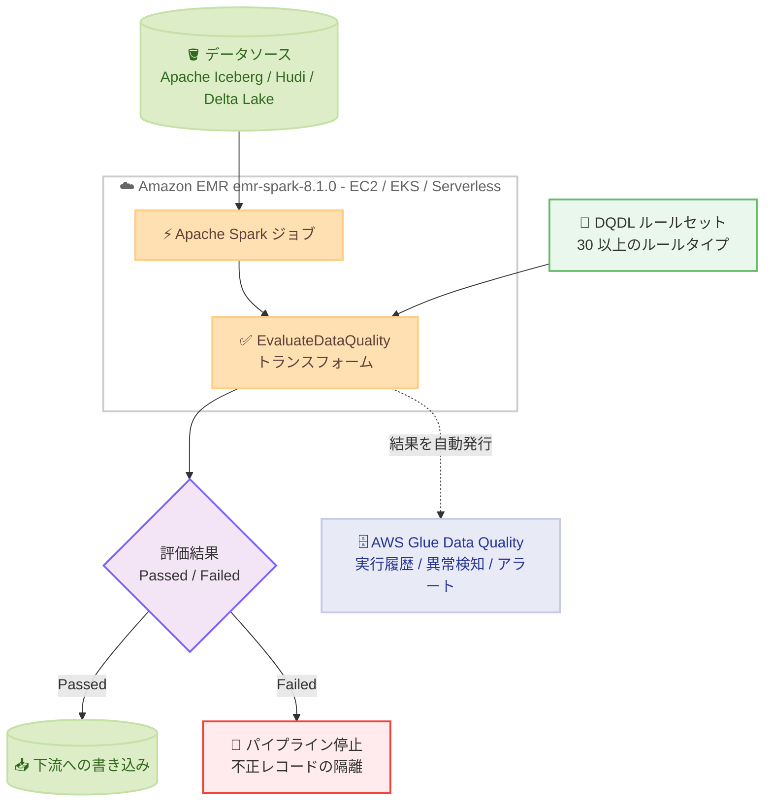

# Amazon EMR - Apache Spark ジョブでのネイティブデータ品質チェック

**リリース日**: 2026 年 10 月 12 日
**サービス**: Amazon EMR
**機能**: Amazon EMR Data Quality (Apache Spark ジョブ内でのネイティブデータ品質チェック)

📊 [このアップデートのインフォグラフィックを見る](https://takech9203.github.io/aws-news-summary/20261012-amazon-emr-data-quality-spark.html)

## 概要

Amazon EMR が、Apache Spark ジョブ内でデータ品質をネイティブに検証できる Amazon EMR Data Quality を発表しました。AWS Glue Data Quality を基盤とするこの機能により、データエンジニアリングチームは別途検証用のインフラストラクチャを構築することなく、Spark アプリケーションの中で直接データ品質の問題をインラインで検出し、不正なデータが下流へ流れる前に対処できます。追加料金なしで利用可能です。

本機能は AWS Glue と同じ宣言型ルール言語である DQDL (Data Quality Definition Language) と同じ API を使用するため、AWS Glue と Amazon EMR の両エンジンにわたって一貫したデータ品質管理の体験が得られます。評価結果は AWS Glue Data Quality サービスにも自動発行されるため、AWS Glue ETL や AWS Glue Data Catalog でのデータ品質実行履歴と並べて確認・アラート設定が可能です。

AWS runtime for Apache Spark のバージョン emr-spark-8.1.0 から利用でき、Amazon EMR on EC2、Amazon EMR on EKS、Amazon EMR Serverless のすべてのデプロイモードに対応します。

**アップデート前の課題**

- 以前は Amazon EMR の Spark ジョブでデータ品質を検証するには、独自の検証ロジックの実装、オープンソースの Deequ の直接組み込み、または AWS Glue Data Quality など別の検証基盤を組み合わせる必要があった
- 検証を別のジョブや別のサービスで行う場合、パイプラインの途中でインラインに品質チェックを行い、その結果に基づいて同一アプリケーション内で処理を分岐させることが難しかった
- AWS Glue と Amazon EMR でデータ品質ルールの記述方法や結果の管理方法が異なり、両エンジンを併用する環境では品質管理が分断されていた

**アップデート後の改善**

- Spark スクリプトに `EvaluateDataQuality` トランスフォームを追加するだけで、Spark アプリケーション内でデータ品質を直接評価できるようになった
- 評価結果が Spark DataFrame としてインプロセスで返却されるため、ルール違反時のパイプライン停止、不正レコードのフィルタリング、隔離先へのルーティングなどのアクションを同一アプリケーション内で実行できるようになった
- AWS Glue と同じ DQDL と API を使用することで、AWS Glue ETL / AWS Glue Data Catalog / Amazon EMR をまたいだ一貫したデータ品質管理と実行履歴の比較が可能になった
- 動的ルールや ML ベースの異常検知を含む 30 以上のルールタイプを、追加料金なしで利用できるようになった

## アーキテクチャ図



Spark ジョブ内の `EvaluateDataQuality` トランスフォームが DQDL ルールセットを DataFrame に対して評価し、その結果に応じて書き込みの実行や不正レコードの隔離を同一アプリケーション内で分岐します。評価結果は AWS Glue Data Quality にも自動発行され、履歴管理や異常検知に活用できます。

## サービスアップデートの詳細

### 主要機能

1. **Spark スクリプト内でのインライン品質評価**
   - `EvaluateDataQuality` トランスフォームに DataFrame と DQDL ルールセットを渡すだけで評価を実行
   - 各ルールの結果 (`Passed` / `Failed` / `Error`) が Spark DataFrame としてインプロセスで返却され、アプリケーション内で分岐・ログ記録・永続化が可能
   - 失敗したルールには観測値が含まれるため、アプリケーションを再実行せずに原因を特定可能
   - ルールは Spark スクリプト内に直接記述するほか、AWS Glue Data Catalog に保存済みのルールを参照することも可能

2. **AWS Glue と共通の DQDL と API**
   - AWS Glue Data Quality と同じ宣言型ルール言語 DQDL と同じ API を使用し、両エンジンで一貫した体験を提供
   - AWS Glue Data Quality と同じオープンソースの Deequ エンジンで評価を実行
   - `EvaluationContext` を共有することで、Amazon EMR と AWS Glue ETL の実行を 1 つの論理データセットとして比較・管理可能

3. **30 以上のルールタイプ**
   - `RowCount`、`IsComplete`、`IsUnique`、`ColumnValues` などの基本ルールに加え、過去の実行結果と比較する動的ルールをサポート
   - 固定しきい値を指定せずに時系列のドリフトを追跡する ML ベースの異常検知に対応
   - 合否判定を行わず統計値のみを収集するアナライザーにより、しきい値の設定や異常検知モデルの学習が可能

4. **パイプラインの任意のステージで検証可能**
   - 事前検証: データ読み込み直後に評価し、上流の問題 (ファイル欠落、スキーマドリフト、空テーブル) を早期検出
   - インライン検証: 結合や集計など特定の変換ステップの出力を途中で検証
   - 事後検証: 書き込み前の最終 DataFrame を評価し、ルール違反時には下流への書き込みを中止

5. **評価結果に基づくアクション**
   - パイプラインの失敗、不正レコードのフィルタリング、隔離先へのルーティングなどを選択可能
   - 結果はデータセットレベル、ルールレベル、行レベルで報告され、どのレコードやルールが失敗の原因かを特定しやすい

6. **オープンテーブルフォーマットと全デプロイモードに対応**
   - Apache Iceberg、Apache Hudi、Delta Lake をサポート
   - Amazon EMR on EC2、Amazon EMR on EKS、Amazon EMR Serverless のすべてのデプロイモードで利用可能

## 技術仕様

### 主要仕様

| 項目 | 詳細 |
|------|------|
| 対応リリース | AWS runtime for Apache Spark (emr-spark-8.1.0) 以降 |
| デプロイモード | Amazon EMR on EC2 / Amazon EMR on EKS / Amazon EMR Serverless |
| 対応エンジン | Apache Spark のみ (Hive、Trino、Flink などは非対応) |
| ルール言語 | DQDL (AWS Glue Data Quality と共通) |
| 評価エンジン | オープンソースの Deequ (AWS Glue Data Quality と共通) |
| ルールタイプ | 30 以上 (動的ルール、ML ベース異常検知を含む) |
| 対応テーブルフォーマット | Apache Iceberg / Apache Hudi / Delta Lake |
| 結果の確認 | AWS Glue Data Quality API (`GetDataQualityResultV2` など)、AWS CLI、AWS Glue コンソール |

### 制限値

| 項目 | 制限 |
|------|------|
| 1 ルールセットあたりのルール数 | 最大 2,000 ルール |
| DQDL ソースのサイズ | 最大 65 KB |
| 統計値の保存数 | アカウントあたり 100,000 (保存は無料) |
| 統計値の保持期間 | 最大 2 年間 |

### DQDL ルールセットの例

```text
Rules = [
    RowCount > 100,
    IsComplete "customer_id",
    IsUnique "customer_id",
    ColumnValues "country" in ["US", "CA", "MX"]
]
```

テーブルの行数が 100 を超えること、`customer_id` 列が欠損なく一意であること、`country` 列が固定の値セットに含まれることを宣言的に検証するルールセットです。

## 設定方法

### 前提条件

1. AWS runtime for Apache Spark (emr-spark-8.1.0) 以降を使用する Amazon EMR 環境 (EC2 / EKS / Serverless のいずれか)
2. 検証対象の Spark アプリケーション
3. 結果を AWS Glue Data Quality に発行するための IAM 権限

### 手順

#### ステップ 1: DQDL ルールセットの定義

```python
ruleset = """
Rules = [
    RowCount > 100,
    IsComplete "customer_id",
    IsUnique "customer_id"
]
"""
```

Spark スクリプト内に DQDL でルールセットを定義します。AWS Glue Data Catalog に保存済みのルールセットを参照することも可能です。

#### ステップ 2: EvaluateDataQuality トランスフォームの適用

```python
results = EvaluateDataQuality.apply(
    frame=final_df,
    ruleset=ruleset,
    publishing_options={
        "dataQualityEvaluationContext": "orders_daily",
        "enableDataQualityResultsPublishing": True,
    },
)
```

最終 DataFrame に対してルールセットを評価します。`dataQualityEvaluationContext` で指定した識別子により、AWS Glue ETL など他エンジンの実行と同一の論理データセットとしてグループ化され、結果が AWS Glue Data Quality に発行されます。

#### ステップ 3: 評価結果に基づく分岐

```python
failed = results.filter("Outcome in ('Failed', 'Error')").count()
if failed > 0:
    raise RuntimeError(f"{failed} data quality rules failed; aborting write")

final_df.write.mode("overwrite").parquet("s3://amzn-s3-demo-bucket/orders_curated/")
```

評価結果の DataFrame から失敗またはエラーのルール数を集計し、違反がある場合は書き込みを中止します。これにより不正なデータが下流へ流れることを防ぎます。

## メリット

### ビジネス面

- **追加コストなしの品質保証**: 追加料金なしで利用でき、別途の検証インフラストラクチャの構築・運用コストが不要
- **データ信頼性の向上**: 不正なデータが下流の分析や ML パイプラインへ流れる前にインラインで検出・遮断でき、データ起因の意思決定ミスを防止
- **ガバナンスの一元化**: AWS Glue ETL、AWS Glue Data Catalog、Amazon EMR の品質評価結果を同じストアで一元管理し、組織全体のデータ品質を可視化

### 技術面

- **既存ワークフローへの最小限の変更**: Spark スクリプトに `EvaluateDataQuality` トランスフォームを追加するだけで導入でき、DQDL ルールセット以外の追加プログラミングは不要
- **インプロセスでの結果ハンドリング**: 評価結果が Spark DataFrame として返却されるため、同一アプリケーション内で書き込みの中止やレコードの隔離などを柔軟に制御可能
- **AWS Glue とのスキル・資産の共通化**: DQDL ルールと API が AWS Glue と共通のため、既存の AWS Glue Data Quality のルール資産や運用ノウハウをそのまま活用可能
- **ML ベースの異常検知**: 固定しきい値を設定しなくても、実行ごとの統計値の時系列からドリフトを自動検出可能

## デメリット・制約事項

### 制限事項

- Apache Spark アプリケーションのみ対応 (Hive、Trino、Flink など他のエンジンでは利用不可)
- AWS runtime for Apache Spark (emr-spark-8.1.0) 以降が必要で、既存の古いリリースでは利用不可
- 1 ルールセットあたり最大 2,000 ルール、DQDL ソースは最大 65 KB
- 統計値はアカウントあたり 100,000 までで、保持期間は最大 2 年間

### 考慮すべき点

- 品質評価は Spark ジョブ内で実行されるため、ルール数やデータ量に応じてジョブの実行時間とクラスターリソース消費が増加する可能性がある
- 異常検知や動的ルールを有効に機能させるには、`EvaluationContext` を一貫して設定し、十分な実行履歴を蓄積する必要がある
- 結果の履歴確認やアラートは AWS Glue Data Quality 側の API / コンソールを使用するため、AWS Glue 側の権限設計も合わせて検討が必要

## ユースケース

### ユースケース 1: データレイクへの書き込み前のゲートチェック

**シナリオ**: Apache Iceberg ベースのデータレイクに日次で注文データを書き込む EMR Serverless の Spark パイプラインで、欠損や重複を含むデータが本番テーブルに混入する事故を防ぎたい。

**実装例**:
```python
results = EvaluateDataQuality.apply(
    frame=orders_df,
    ruleset='Rules = [RowCount > 1000, IsUnique "order_id", IsComplete "order_date"]',
    publishing_options={"dataQualityEvaluationContext": "orders_daily"},
)
if results.filter("Outcome = 'Failed'").count() > 0:
    raise RuntimeError("Data quality check failed")
orders_df.writeTo("glue_catalog.sales.orders").append()
```

**効果**: ルール違反時には Iceberg テーブルへの書き込みが中止されるため、下流の BI やレポートに不正データが波及することを防げる。

### ユースケース 2: AWS Glue と Amazon EMR をまたいだ品質管理の統一

**シナリオ**: 軽量な ETL は AWS Glue、大規模な変換処理は Amazon EMR で実行している組織で、同じデータセットに対する品質ルールと実行履歴を一元管理したい。

**実装例**:
```python
# AWS Glue ETL と同じ EvaluationContext を指定して評価
results = EvaluateDataQuality.apply(
    frame=df,
    ruleset=shared_ruleset,
    publishing_options={
        "dataQualityEvaluationContext": "customer_master",
        "enableDataQualityResultsPublishing": True,
    },
)
```

**効果**: 同じ `EvaluationContext` を共有する実行は AWS Glue コンソール上で 1 つの論理データセットとして表示され、エンジンをまたいだ品質スコアの比較と異常検知モデルの共有が可能になる。

### ユースケース 3: ML ベース異常検知によるデータドリフトの監視

**シナリオ**: 上流システムの仕様変更によるデータ分布の変化 (平均値のずれ、行数の急減など) を、固定しきい値を設定せずに自動検出したい。

**実装例**:
```python
# アナライザーで統計値を収集し、異常検知モデルを学習
analyzers = 'Analyzers = [RowCount, Mean "order_total", Completeness "customer_id"]'
EvaluateDataQuality.apply(
    frame=df,
    ruleset=analyzers,
    publishing_options={"dataQualityEvaluationContext": "orders_daily"},
)
```

**効果**: 実行ごとの統計値の時系列から ML モデルが予測範囲を学習し、範囲外の値を Observation としてフラグする。しきい値のメンテナンスなしでドリフトを早期に発見できる。

## 料金

Amazon EMR Data Quality は**追加料金なし**で利用できます。通常の Amazon EMR の料金 (EC2 / EKS / Serverless の各デプロイモードに応じたコンピューティング料金) のみが発生します。

- ルールやアナライザーの作成時に収集される統計値の保存にもコストは発生しません (アカウントあたり 100,000 統計値まで、保持期間は最大 2 年間)
- 品質評価は Spark ジョブ内で実行されるため、評価処理の分だけジョブの実行時間が延びる場合があります

詳細は [Amazon EMR 料金ページ](https://aws.amazon.com/emr/pricing/) を参照してください。

## 利用可能リージョン

AWS runtime for Apache Spark (emr-spark-8.1.0) が利用可能な、以下のすべてのリージョンで利用できます。

- すべての AWS 商用リージョン
- AWS GovCloud (US) リージョン
- AWS 中国リージョン

## 関連サービス・機能

- **AWS Glue Data Quality**: 本機能の基盤となるサービス。DQDL、API、Deequ エンジン、結果ストアを共有しており、評価結果は AWS Glue Data Quality に発行される
- **AWS Glue Data Catalog**: ルールセットの保存先として参照できるほか、`publishToDataCatalogTarget` を設定するとカタログテーブルの Data quality タブに実行結果が表示される
- **Apache Iceberg / Apache Hudi / Delta Lake**: 本機能がサポートするオープンテーブルフォーマット。データレイクのテーブルに対する品質検証に利用可能
- **Amazon EMR on EC2 / EMR on EKS / EMR Serverless**: 本機能が利用可能な 3 つのデプロイモード

## 参考リンク

- 📊 [インフォグラフィック](https://takech9203.github.io/aws-news-summary/20261012-amazon-emr-data-quality-spark.html)
- [公式発表 (What's New)](https://aws.amazon.com/about-aws/whats-new/2026/10/amazon-emr-data-quality-spark/)
- [ドキュメント - Amazon EMR Data Quality](https://docs.aws.amazon.com/emr/latest/ManagementGuide/emr-data-quality.html)
- [ドキュメント - AWS Glue Data Quality](https://docs.aws.amazon.com/glue/latest/dg/glue-data-quality.html)
- [ドキュメント - DQDL リファレンス](https://docs.aws.amazon.com/glue/latest/dg/dqdl.html)
- [Amazon EMR 料金ページ](https://aws.amazon.com/emr/pricing/)

## まとめ

Amazon EMR Data Quality により、Spark ジョブ内でのインラインなデータ品質検証が追加料金なしで可能になり、別途の検証基盤なしに不正データの下流への流出を防げるようになりました。AWS Glue と共通の DQDL と API を採用しているため、両エンジンを併用する環境でも品質管理を一元化できます。emr-spark-8.1.0 以降へのアップグレードと、重要なパイプラインの書き込み前への `EvaluateDataQuality` の組み込みから始めることを推奨します。
