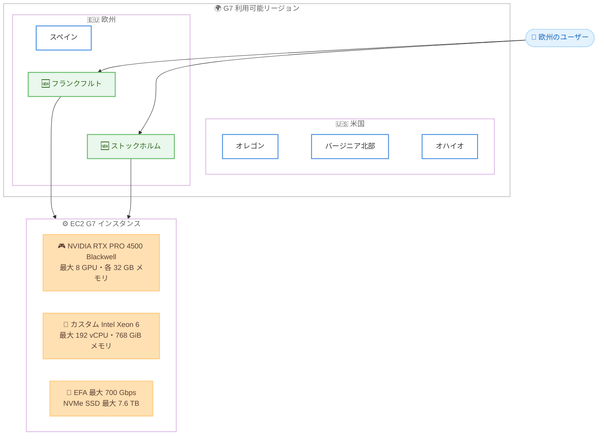

# Amazon EC2 - G7 インスタンスが欧州 (フランクフルト) および欧州 (ストックホルム) リージョンで利用可能に

**リリース日**: 2026 年 10 月 12 日
**サービス**: Amazon EC2
**機能**: Amazon EC2 G7 インスタンスのリージョン拡大

📊 [このアップデートのインフォグラフィックを見る](https://takech9203.github.io/aws-news-summary/20261012-amazon-g7-european-regions.html)

## 概要

NVIDIA RTX PRO 4500 Blackwell Server Edition GPU を搭載した Amazon EC2 G7 インスタンスが、欧州 (フランクフルト) および欧州 (ストックホルム) リージョンで利用可能になりました。これにより、欧州のユーザーは最新世代の GPU インスタンスを低レイテンシーで利用できるようになります。

G7 インスタンスは、前世代の G6 インスタンスと比較して最大 4.6 倍の AI 推論性能、最大 2.1 倍のグラフィックス性能を提供します。言語翻訳、動画・画像分析、音声認識、レコメンダーシステムなどの AI モデルのデプロイや、リアルタイムの映画品質レンダリング、ゲームストリーミングといったグラフィックスワークロードに適しています。

**アップデート前の課題**

このアップデート以前に存在していた課題や制限は以下のとおりです。

- G7 インスタンスは米国西部 (オレゴン)、米国東部 (バージニア北部、オハイオ)、欧州 (スペイン) に限定されており、ドイツや北欧のユーザーは利用できなかった
- 欧州中部・北欧のユーザーが G7 を利用するには、スペインまたは米国リージョンを使用する必要があり、レイテンシーが増加していた
- データレジデンシー要件によりドイツ国内へのデータ保管が必要なワークロードでは、最新世代 GPU インスタンスの選択肢が限られていた

**アップデート後の改善**

今回のアップデートにより可能になったことは以下のとおりです。

- フランクフルトおよびストックホルムリージョンで G7 インスタンスを起動できるようになった
- 欧州中部・北欧のエンドユーザーに近い場所で低レイテンシーの AI 推論やグラフィックス処理を実行できるようになった
- ドイツや北欧のデータレジデンシー要件を満たしながら、最新世代 GPU の性能を活用できるようになった

## アーキテクチャ図



G7 インスタンスの利用可能リージョンと主要ハードウェア構成を示した図です。今回フランクフルトとストックホルムの 2 リージョンが新たに追加されました。

## サービスアップデートの詳細

### 主要機能

1. **欧州 2 リージョンへの拡大**
   - 欧州 (フランクフルト) リージョンで G7 インスタンスが利用可能に
   - 欧州 (ストックホルム) リージョンで G7 インスタンスが利用可能に
   - 既存の米国西部 (オレゴン)、米国東部 (バージニア北部、オハイオ)、欧州 (スペイン) に加えて合計 6 リージョンに拡大

2. **NVIDIA RTX PRO 4500 Blackwell Server Edition GPU**
   - 最新の Blackwell アーキテクチャを採用した GPU を最大 8 基搭載
   - GPU あたり 32 GB の GPU メモリを搭載
   - G6 比で最大 4.6 倍の AI 推論性能、最大 2.1 倍のグラフィックス性能を実現
   - GPU アクセラレーションによるデータ分析処理も高速化

3. **幅広いワークロードへの対応**
   - AI モデルのデプロイ: 言語翻訳、動画・画像分析、音声認識、レコメンダーシステム
   - グラフィックス: リアルタイムの映画品質レンダリング、ゲームストリーミング
   - その他: 動画トランスコーディング、空間コンピューティング、データ分析

## 技術仕様

### G7 インスタンスの主要スペック

| 項目 | 詳細 |
|------|------|
| GPU | NVIDIA RTX PRO 4500 Blackwell Server Edition を最大 8 基 |
| GPU メモリ | GPU あたり 32 GB |
| CPU | カスタム Intel Xeon 6 プロセッサ |
| vCPU | 最大 192 |
| システムメモリ | 最大 768 GiB |
| ネットワーク | 最大 700 Gbps の Elastic Fabric Adapter (EFA) 帯域幅 |
| ローカルストレージ | 最大 7.6 TB の NVMe SSD |

### 性能比較 (G6 比)

| ワークロード | 性能向上 |
|------|------|
| AI 推論 | 最大 4.6 倍 |
| グラフィックス | 最大 2.1 倍 |

## 設定方法

### 前提条件

1. AWS アカウントを保有していること
2. フランクフルト (eu-central-1) またはストックホルム (eu-north-1) リージョンで G7 インスタンスの vCPU クォータが十分であること
3. GPU ドライバーを含む AMI (NVIDIA ドライバー入り Deep Learning AMI など) を選択していること

### 手順

#### ステップ 1: 利用可能なインスタンスタイプの確認

```bash
aws ec2 describe-instance-type-offerings \
  --region eu-central-1 \
  --filters "Name=instance-type,Values=g7.*" \
  --query "InstanceTypeOfferings[].InstanceType"
```

フランクフルトリージョンで利用可能な G7 インスタンスタイプの一覧を取得します。ストックホルムの場合は `--region eu-north-1` を指定します。

#### ステップ 2: G7 インスタンスの起動

```bash
aws ec2 run-instances \
  --region eu-central-1 \
  --instance-type g7.xlarge \
  --image-id ami-xxxxxxxxxxxxxxxxx \
  --key-name my-key-pair \
  --subnet-id subnet-xxxxxxxx \
  --security-group-ids sg-xxxxxxxx
```

フランクフルトリージョンで G7 インスタンスを起動します。AMI には NVIDIA GPU ドライバーを含むイメージを指定してください。

#### ステップ 3: GPU の認識確認

```bash
nvidia-smi
```

インスタンスに SSH 接続後、NVIDIA RTX PRO 4500 Blackwell GPU が正しく認識されていることを確認します。

## メリット

### ビジネス面

- **低レイテンシー**: 欧州中部・北欧のエンドユーザーに近いリージョンで AI 推論やゲームストリーミングを提供でき、ユーザー体験が向上する
- **データレジデンシー対応**: ドイツや北欧の規制・コンプライアンス要件を満たしながら最新 GPU を利用できる
- **柔軟な購入オプション**: オンデマンド、スポットインスタンス、Savings Plans から選択でき、コストを最適化できる

### 技術面

- **大幅な性能向上**: G6 比で最大 4.6 倍の AI 推論性能により、同一コストでより高いスループットを実現できる
- **大容量 GPU メモリ**: GPU あたり 32 GB のメモリにより、より大きな AI モデルのデプロイが可能
- **高速ネットワーク**: 最大 700 Gbps の EFA 帯域幅により、分散推論やマルチノード処理にも対応

## デメリット・制約事項

### 制限事項

- 利用可能リージョンは米国西部 (オレゴン)、米国東部 (バージニア北部、オハイオ)、欧州 (スペイン、フランクフルト、ストックホルム) の 6 リージョンに限定される (2026 年 10 月時点)
- 東京リージョンを含むアジアパシフィックリージョンではまだ利用できない
- RTX PRO 4500 は GPU あたり 32 GB のメモリであるため、超大規模モデルの学習には P 系インスタンスなどの検討が必要

### 考慮すべき点

- 新しいリージョンでの提供開始直後はキャパシティが限られる場合があるため、大規模利用時はキャパシティ予約の検討を推奨
- G7 インスタンスの vCPU クォータが不足している場合は、事前にクォータの引き上げ申請が必要
- 既存の G6 ワークロードを移行する際は、ドライバーや CUDA バージョンの互換性を確認する必要がある

## ユースケース

### ユースケース 1: 欧州向け AI 推論サービスの提供

**シナリオ**: ドイツのエンタープライズ企業が、データレジデンシー要件を満たしながら社内向けの画像分析・音声認識 API を提供する。

**実装例**:
```
1. フランクフルトリージョンに G7 インスタンスで推論クラスターを構築
2. Auto Scaling グループで需要に応じて GPU インスタンスをスケール
3. Application Load Balancer 経由で推論 API を提供
```

**効果**: データをドイツ国内に保持しながら、G6 比最大 4.6 倍の推論性能で高スループットな AI サービスを低レイテンシーで提供できる。

### ユースケース 2: 北欧ユーザー向けゲームストリーミング

**シナリオ**: ゲーム企業が北欧のプレイヤー向けにクラウドゲームストリーミングサービスを展開する。

**実装例**:
```
1. ストックホルムリージョンに G7 インスタンスでストリーミング基盤を構築
2. RTX PRO 4500 Blackwell GPU でリアルタイムレンダリングを実行
3. 低レイテンシーで映像をプレイヤーにストリーミング配信
```

**効果**: 北欧のプレイヤーに対して低レイテンシーかつ映画品質のレンダリングによる高品質なゲーム体験を提供できる。

### ユースケース 3: スポットインスタンスを活用した動画トランスコーディング

**シナリオ**: メディア企業が大量の動画コンテンツを GPU アクセラレーションでトランスコードする。

**実装例**:
```
1. フランクフルトまたはストックホルムで G7 のスポットインスタンスを利用
2. SQS キューにトランスコードジョブを登録
3. スポット中断に備えてチェックポイント機構を実装し、バッチ処理を実行
```

**効果**: スポットインスタンスの活用により、オンデマンド比で大幅にコストを削減しながら高速な GPU トランスコーディングを実現できる。

## 料金

G7 インスタンスは以下の購入オプションで利用できます。

- **オンデマンドインスタンス**: 初期費用なし、秒単位の従量課金
- **スポットインスタンス**: 中断を許容できるワークロードで大幅なコスト削減が可能
- **Savings Plans**: 1 年または 3 年のコミットメントによる割引

リージョンおよびインスタンスサイズごとの最新料金は [EC2 料金ページ](https://aws.amazon.com/ec2/pricing/) を参照してください。

## 利用可能リージョン

2026 年 10 月時点で、G7 インスタンスは以下のリージョンで利用可能です。

- 米国西部 (オレゴン)
- 米国東部 (バージニア北部)
- 米国東部 (オハイオ)
- 欧州 (スペイン)
- 欧州 (フランクフルト) 🆕
- 欧州 (ストックホルム) 🆕

## 関連サービス・機能

- **Amazon EC2 G6 インスタンス**: 前世代の NVIDIA L4 GPU 搭載インスタンス。G7 への移行で最大 4.6 倍の AI 推論性能向上が見込める
- **Elastic Fabric Adapter (EFA)**: G7 では最大 700 Gbps の帯域幅をサポートし、分散ワークロードの通信を高速化
- **Amazon EC2 Capacity Blocks / キャパシティ予約**: GPU キャパシティを確実に確保したい場合に活用
- **AWS Savings Plans**: 継続利用時のコスト最適化に有効

## 参考リンク

- 📊 [インフォグラフィック](https://takech9203.github.io/aws-news-summary/20261012-amazon-g7-european-regions.html)
- [公式発表 (What's New)](https://aws.amazon.com/about-aws/whats-new/2026/10/amazon-g7-european-regions/)
- [Amazon EC2 G7 インスタンス](https://aws.amazon.com/ec2/instance-types/g7/)
- [EC2 料金ページ](https://aws.amazon.com/ec2/pricing/)

## まとめ

NVIDIA RTX PRO 4500 Blackwell GPU を搭載した EC2 G7 インスタンスがフランクフルトとストックホルムに拡大し、欧州のユーザーがデータレジデンシー要件を満たしながら最新世代 GPU を利用できるようになりました。欧州で AI 推論やグラフィックスワークロードを運用している場合は、G6 からの移行による性能向上 (AI 推論で最大 4.6 倍) とコスト効率を評価することを推奨します。
