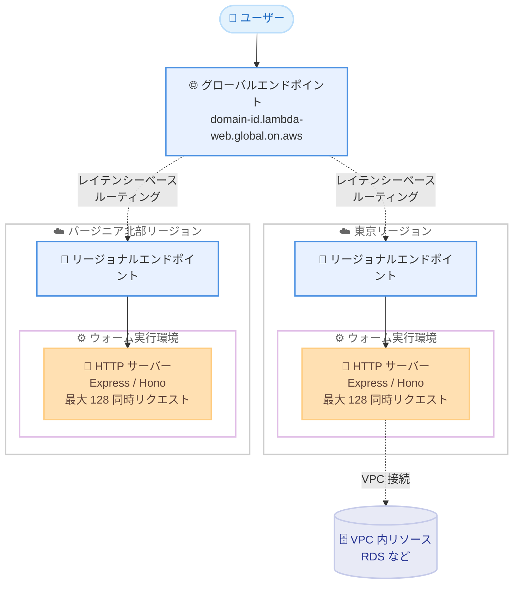

# AWS Lambda - Lambda Web Functions

**リリース日**: 2026 年 10 月 12 日
**サービス**: AWS Lambda
**機能**: Lambda Web Functions

📊 [このアップデートのインフォグラフィックを見る](https://takech9203.github.io/aws-news-summary/20261012-aws-lambda-web-functions.html)

## 概要

AWS Lambda が新しいサーバーレスコンピューティングプリミティブである Lambda Web Functions を発表しました。Lambda Web Functions では、コードがポートをリッスンする標準的な HTTP サーバーとして HTTP リクエストを直接処理します。Express、Hono、Fastify などの使い慣れた Web フレームワークを、アダプタやカスタム設定なしでそのまま利用できます。AI 推論エンドポイント、サーバーサイドレンダリング (SSR) の Web アプリケーション、ストリーミング API エンドポイント、マイクロサービスや Webhook などのユースケースに適しています。

料金モデルも新しくなり、アクティブ CPU 時間と実行環境が保持するメモリに対して課金されます。データベースや下流サービスの応答を待機しているアイドル CPU 時間には課金されないため、I/O 待ちの多い Web ワークロードでコスト効率が向上します。また、1 つのウォーム実行環境が複数の同時リクエストを処理するため、コールドスタートの発生を大幅に削減できます。

今回の発表に伴い、既存の Lambda 関数は Lambda Event Functions という名称に変更されます。これは名称変更のみであり、コードの変更や再デプロイは不要です。

**アップデート前の課題**

- 以前は Lambda でリクエスト / レスポンス型のイベントハンドラモデルに合わせてコードを記述する必要があり、Express や Hono などの HTTP フレームワークを利用するにはアダプタ (例: Lambda Web Adapter) やカスタム設定が必要だった
- 以前は 1 つの実行環境が同時に 1 リクエストしか処理できず、トラフィックのバースト時に多数のコールドスタートが発生していた
- 以前はウォールクロック時間に基づく課金のため、データベース応答や外部 API 待ちなどのアイドル時間にも実行時間として課金されていた
- マルチリージョンに Web アプリケーションを展開するには、リージョンごとのデプロイとルーティング構成を個別に管理する必要があった

**アップデート後の改善**

- HTTP サーバーとしてポートをリッスンする標準的なコードをそのまま Lambda にデプロイできるようになり、フレームワークのアダプタが不要になった
- 1 つのウォーム実行環境が最大 128 の同時リクエストを処理できるようになり、コールドスタートが桁違いに削減された
- アクティブ CPU 時間と保持メモリに基づく課金により、I/O 待ちの多いワークロードのコストが低減された
- 1 回のデプロイで複数リージョンへコードを複製し、ユーザーに最も近いリージョンから自動的にリクエストを処理するマルチリージョンルーティングが可能になった
- ネイティブの HTTP ストリーミングにより、AI 推論のトークンストリーミングなど段階的なレスポンス返却が容易になった

## アーキテクチャ図



Lambda Web Functions のマルチリージョン構成の例です。1 つのグローバル URL へのリクエストがユーザーに最も近いリージョンへルーティングされ、各リージョンのウォーム実行環境が複数の同時リクエストを処理します。

## サービスアップデートの詳細

### 主要機能

1. **HTTP ネイティブなプログラミングモデル**
   - コードが環境変数 `AWS_LAMBDA_HTTP_ENDPOINT` で指定されたホストとポートをリッスンし、HTTP リクエストを直接処理する
   - Express、Hono、Fastify、Next.js などの Node.js フレームワークをアダプタなしでそのまま利用可能
   - ローカル実行も `AWS_LAMBDA_HTTP_ENDPOINT=127.0.0.1:3000 node index.js` のように標準的な方法で可能

2. **マルチ同時リクエスト処理によるコールドスタート削減**
   - 1 つのウォーム実行環境が最大 128 の同時リクエストを処理
   - トラフィックのバースト時にもウォーム環境を共有するため、コールドスタートの発生を桁違いに削減

3. **アクティブ CPU 課金モデル**
   - アクティブ CPU 時間と実行環境が保持するメモリに対して課金
   - データベースクエリや外部 API 呼び出しの待機中はほとんど CPU を消費しないため、I/O 待ちの多いワークロードでコスト効率が向上

4. **HTTP ストリーミング**
   - ネイティブの HTTP ストリーミングにより、結果を段階的に返却可能
   - AI 推論エンドポイントのトークンストリーミングなどに有効

5. **マルチリージョンルーティング**
   - 1 回のデプロイコマンドで複数リージョンへコードを複製
   - グローバル URL (`<domain-id>.lambda-web.global.on.aws`) により、ユーザーに最も近いリージョンへレイテンシーベース (ベストエフォート) でルーティング

6. **リビジョンとエンドポイントによるデプロイ管理**
   - リビジョン: デプロイされたコードの不変スナップショット
   - エンドポイント: 1 つのリビジョン、または複数リビジョンへの重み付きトラフィック分割を行う HTTPS URL
   - 重み付きルーティングによるカナリアリリースを 1 回の API 呼び出しで実現

7. **VPC 接続と CloudFront 統合**
   - Amazon VPC 内のリソース (RDS など) へのアクセスをサポート
   - Web Function のエンドポイントを CloudFront のオリジンとして利用可能で、オリジンアクセスコントロール (OAC) によるプライベートオリジン構成にも対応

8. **Lambda Event Functions への名称変更**
   - 既存の Lambda 関数は Lambda Event Functions に改名
   - 名称変更のみであり、コードの変更や再デプロイは不要

## 技術仕様

### Event Functions と Web Functions の比較

| 項目 | Lambda Event Functions | Lambda Web Functions |
|------|------------------------|----------------------|
| プログラミングモデル | イベントハンドラ (イベント受信 → レスポンス返却) | ポートをリッスンする HTTP サーバー |
| 同時実行 | 実行環境ごとに 1 リクエスト | 実行環境ごとに最大 128 同時リクエスト |
| 課金 | ウォールクロック時間 | アクティブ CPU 時間 + 実行環境の保持メモリ |
| 適したワークロード | キュー処理、イベント処理、AWS サービストリガー | Web アプリ、API バックエンド、SSR、ストリーミングレスポンス |

### 起動時の仕様

| 項目 | 詳細 |
|------|------|
| 対応ランタイム | Node.js 24 (`nodejs24.x`) のみ |
| アーキテクチャ | Arm64 のみ |
| 同時リクエスト数 | 実行環境ごとに最大 128 |
| エンドポイント URL (リージョナル) | `https://<domain-id>.<shard-id>.lambda-web.<region>.on.aws/` |
| エンドポイント URL (グローバル) | `https://<domain-id>.lambda-web.global.on.aws/` |
| ネットワーク | VPC 接続をサポート |
| 設定ツール | Lambda API、Agent Toolkit for AWS、マネジメントコンソール、AWS CLI、CloudFormation、SAM、CDK、AWS SDK |

### コード例

```javascript
import express from 'express';

const app = express();
const [host, port] = process.env.AWS_LAMBDA_HTTP_ENDPOINT.split(':');

app.get('/', (req, res) => {
  res.json({ message: 'Hello from Lambda Web Functions!' });
});

app.listen(port, host, () => {
  console.log(`Server running on port ${port}`);
});
```

環境変数 `AWS_LAMBDA_HTTP_ENDPOINT` から提供されるホストとポートでリッスンする標準的な Express アプリケーションです。アダプタやハンドラの記述は不要です。

## 設定方法

### 前提条件

1. AWS アカウントと AWS CLI の最新バージョン
2. Node.js 24 で動作するアプリケーションコード (Express、Hono など)
3. Lambda Web Functions をデプロイするための IAM 権限

### 手順

#### ステップ 1: Hello World アプリケーションのデプロイ

```bash
aws lambda-web deploy --name hello-world --hello-world
```

サンプルの Hello World アプリケーションをデプロイします。関数の作成、リビジョンの発行、エンドポイントのアタッチが行われ、1 分以内に稼働中の HTTPS URL が返却されます。

#### ステップ 2: 独自アプリケーションのデプロイ

```bash
aws lambda-web deploy --name my-web-app --code ./my-app
```

ローカルディレクトリのソースコードをバンドルし、Web Function としてデプロイします。1 つのコマンドで関数作成からエンドポイント発行までが完了します。

#### ステップ 3: マルチリージョンへのデプロイ

```bash
aws lambda-web deploy --name my-web-app --code ./my-app \
    --regions us-east-1,eu-west-1,ap-northeast-1
```

指定した複数リージョンにコードを複製してデプロイします。グローバル URL が発行され、ユーザーに最も近いリージョンへ自動的にルーティングされます。

#### ステップ 4: カナリアリリースの設定

```bash
aws lambda-web update-web-function-endpoint \
    --function-name my-web-app --endpoint-name dev \
    --auto-deployment-mode Disabled \
    --revision-weights '[{"revisionId": "<current>", "weight": 90}, {"revisionId": "<new>", "weight": 10}]'
```

エンドポイントのトラフィックをリビジョン間で重み付けし、新リビジョンへ 10% のトラフィックを流すカナリアリリースを構成します。

## メリット

### ビジネス面

- **開発速度の向上**: 既存の Web フレームワークの知識とコードをそのまま活用でき、Lambda 固有のプログラミングモデルの学習やコード書き換えが不要
- **コスト最適化**: アクティブ CPU 課金により、I/O 待ちの多い Web アプリケーションや API バックエンドのコンピューティングコストを削減
- **グローバル展開の簡素化**: 1 コマンドのマルチリージョンデプロイにより、世界中のユーザーへ低レイテンシーなサービスを容易に提供

### 技術面

- **コールドスタートの大幅削減**: 1 つの実行環境で最大 128 同時リクエストを処理し、バーストトラフィックでもウォーム環境を共有
- **ネイティブ HTTP ストリーミング**: AI 推論のトークンストリーミングや大きなレスポンスの段階的返却に対応
- **安全なデプロイ**: 不変のリビジョンと重み付きトラフィック分割により、カナリアリリースやロールバックを API 1 回で実現
- **既存エコシステムとの統合**: VPC 接続、CloudFront オリジン + OAC、CloudFormation / SAM / CDK など既存の AWS ツールチェーンと連携可能

## デメリット・制約事項

### 制限事項

- 起動時点でサポートされるランタイムは Node.js 24 (`nodejs24.x`) のみ (Python や Java などは未対応)
- アーキテクチャは Arm64 のみ
- 利用可能リージョンは起動時点で 5 リージョンに限定
- マルチリージョンルーティングのレイテンシーベースルーティングはベストエフォート

### 考慮すべき点

- 1 つの実行環境で複数リクエストを同時処理するため、アプリケーションコードはマルチ同時実行を前提とした実装 (グローバル状態の扱いなど) が必要
- 課金モデルが従来のウォールクロック課金と異なるため、CPU バウンドなワークロードではコスト特性を事前に検証することを推奨
- キュー処理や AWS サービストリガーによるイベント駆動処理には、引き続き Lambda Event Functions が適している
- 既存 Lambda 関数の Lambda Event Functions への改名は名称のみの変更だが、社内ドキュメントや IaC コメントなどの表記更新を検討する

## ユースケース

### ユースケース 1: AI 推論エンドポイントのストリーミング配信

**シナリオ**: LLM を利用したチャットアプリケーションで、生成されたトークンを順次ユーザーへストリーミング返却したい。モデル応答の待機時間が長く、従来のウォールクロック課金ではコストが高くなっていた。

**実装例**:
```javascript
app.post('/chat', async (req, res) => {
  res.setHeader('Content-Type', 'text/event-stream');
  const stream = await bedrock.converseStream(params);
  for await (const chunk of stream) {
    res.write(`data: ${JSON.stringify(chunk)}\n\n`);
  }
  res.end();
});
```

**効果**: ネイティブ HTTP ストリーミングでトークンを順次返却でき、モデル応答待ちのアイドル時間には CPU 課金が発生しないため、コストを抑えつつ応答性の高い体験を提供できる。

### ユースケース 2: Next.js による SSR Web アプリケーションのグローバル展開

**シナリオ**: Next.js の SSR アプリケーションを日本・米国・欧州のユーザーへ低レイテンシーで提供したい。従来はリージョンごとのデプロイとルーティング構成の管理が負担だった。

**実装例**:
```bash
aws lambda-web deploy --name my-ssr-app --code ./my-ssr-app \
    --regions ap-northeast-1,us-east-1,eu-west-1
```

**効果**: 1 コマンドで 3 リージョンへデプロイされ、グローバル URL により各ユーザーに最も近いリージョンから SSR レスポンスを返却できる。CloudFront をオリジンとして組み合わせれば静的アセットのキャッシュも可能。

### ユースケース 3: Express ベースのマイクロサービス移行

**シナリオ**: コンテナや EC2 で稼働中の Express ベースの API マイクロサービスをサーバーレス化したいが、Lambda のイベントハンドラモデルへの書き換えコストが障壁となっていた。

**実装例**:
```bash
# 既存の Express アプリをほぼそのままデプロイ
aws lambda-web deploy --name orders-api --code ./orders-api
```

**効果**: アダプタやコード書き換えなしで既存アプリケーションを移行でき、VPC 接続により既存の RDS などへもアクセス可能。重み付きルーティングで段階的な移行も安全に実施できる。

## 料金

Lambda Web Functions では、アクティブ CPU 時間と実行環境が保持するメモリに対して課金されます。

- **CPU**: アクティブに CPU を使用した時間に対して課金。データベースクエリや API 呼び出しの待機中はほとんど CPU を消費しないため、課金が最小限に抑えられる
- **メモリ**: 実行環境が存在している間、保持しているメモリに対して課金

I/O 待ちの多い SSR、API バックエンド、トークンストリーミング型の AI 推論などのワークロードでは、従来のウォールクロック課金と比較してコンピューティングコストを削減できる可能性があります。詳細は [AWS Lambda 料金ページ](https://aws.amazon.com/lambda/pricing/) を参照してください。

## 利用可能リージョン

起動時点で以下の 5 リージョンで利用可能です。

- 米国東部 (バージニア北部)
- 米国東部 (オハイオ)
- 米国西部 (オレゴン)
- アジアパシフィック (東京)
- 欧州 (アイルランド)

リージョンごとの機能対応状況は [AWS Capabilities by Region](https://builder.aws.com/build/capabilities) で確認できます。

## 関連サービス・機能

- **AWS Lambda (Event Functions)**: 従来のイベント駆動型 Lambda 関数。今回 Lambda Event Functions に改名 (名称変更のみ)。キュー処理やイベント処理には引き続きこちらが適する
- **Amazon CloudFront**: Web Function のエンドポイントをオリジンとして利用可能。OAC により CloudFront 経由のみのアクセスに制限するプライベートオリジン構成に対応
- **Amazon VPC**: Web Functions から VPC 内のリソース (Amazon RDS など) へのアクセスをサポート
- **AWS SAM / AWS CDK / AWS CloudFormation**: Web Functions の IaC によるデプロイと管理に対応
- **Lambda Web Adapter**: 従来、HTTP フレームワークを Lambda で動かすために利用されていたアダプタ。Web Functions ではアダプタ自体が不要になる

## 参考リンク

- 📊 [インフォグラフィック](https://takech9203.github.io/aws-news-summary/20261012-aws-lambda-web-functions.html)
- [公式発表 (What's New)](https://aws.amazon.com/about-aws/whats-new/2026/10/aws-lambda-web-functions/)
- [AWS News Blog - Announcing AWS Lambda Web Functions](https://aws.amazon.com/blogs/aws/announcing-aws-lambda-web-functions-for-fast-consistent-web-app-performance-anywhere/)
- [開発者ガイド - Lambda Web Functions](https://docs.aws.amazon.com/lambda/latest/dg/web-functions.html)
- [開発者ガイド - Web Functions のネットワーキング](https://docs.aws.amazon.com/lambda/latest/dg/web-functions-networking.html)
- [開発者ガイド - Agent Toolkit for AWS のセットアップ](https://docs.aws.amazon.com/lambda/latest/dg/agent-setup-guide.html)
- [AWS Lambda 料金ページ](https://aws.amazon.com/lambda/pricing/)

## まとめ

Lambda Web Functions は、HTTP サーバーをそのまま動かせるプログラミングモデル、最大 128 同時リクエストによるコールドスタート削減、アクティブ CPU 課金という 3 つの大きな変化をもたらす、Lambda の新しいフォームファクターです。Web アプリケーション、API バックエンド、AI 推論エンドポイントをサーバーレスで構築する際の第一の選択肢となる可能性があり、東京リージョンでも利用可能なため、まずは `aws lambda-web deploy --hello-world` での検証から始めることを推奨します。
