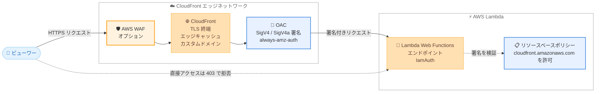

# Amazon CloudFront - AWS Lambda Web Functions オリジンサポート

**リリース日**: 2026 年 10 月 12 日
**サービス**: Amazon CloudFront / AWS Lambda
**機能**: AWS Lambda Web Functions を CloudFront のオリジンとして利用可能に

📊 [このアップデートのインフォグラフィックを見る](https://takech9203.github.io/aws-news-summary/20261012-cloudfront-lambda-web-functions-origin.html)

## 概要

Amazon CloudFront が、AWS Lambda Web Functions をオリジンとしてサポートしました。Lambda Web Functions 上に構築した Web アプリケーションを、CloudFront のグローバルエッジネットワークを通じて配信できるようになります。アプリケーションコードの変更は不要で、CloudFront コンソール、SDK、CLI、CloudFormation から設定できます。

今回のアップデートにより、エッジロケーションでの TLS 終端による接続高速化、エッジキャッシュによるパフォーマンス向上、マネージド TLS 証明書を使用したカスタムドメインの利用が可能になります。さらに、オリジンアクセスコントロール (OAC) を使用して Lambda Web Functions エンドポイントへのアクセスを CloudFront 経由のみに制限でき、ネットワークレイヤーの DDoS 攻撃からアプリケーションを保護できます。AWS WAF を組み合わせることで、アプリケーションレイヤーの防御も追加できます。

独自のユーザー認証を実装しているアプリケーションでも、OAC の新しい署名動作 `always-amz-auth` により、ビューワーの `Authorization` ヘッダーが変更されずにオリジンへ届くため、既存のサインインフローを維持したまま CloudFront を導入できます。

**アップデート前の課題**

- Lambda Web Functions のエンドポイントを直接公開する必要があり、エッジキャッシュや TLS 終端によるレイテンシー改善の恩恵を受けられなかった
- エンドポイントへの直接アクセスを防ぐ CloudFront ネイティブの仕組みがなく、CloudFront や AWS WAF の保護をバイパスされるリスクがあった
- カスタムドメインとマネージド TLS 証明書を CloudFront 経由で利用する構成が取れなかった

**アップデート後の改善**

- Lambda Web Functions を CloudFront のオリジンとして直接指定し、グローバルエッジネットワーク経由で配信できるようになった
- OAC により Lambda Web Functions へのアクセスを CloudFront 経由のみに制限し、DDoS 攻撃や保護のバイパスを防止できるようになった
- 新しい署名動作 `always-amz-auth` により、CloudFront の署名とビューワーの `Authorization` ヘッダーを両立できるようになった
- アプリケーションコードを変更せずに、キャッシュ、カスタムドメイン、AWS WAF 連携を利用できるようになった

## アーキテクチャ図



ビューワーからのリクエストは CloudFront エッジで TLS 終端とキャッシュ処理が行われ、OAC が SigV4 / SigV4a で署名したリクエストのみが Lambda Web Functions エンドポイントに到達します。エンドポイントを直接呼び出すリクエストは、リソースベースポリシーの検証により HTTP 403 で拒否されます。

## サービスアップデートの詳細

### 主要機能

1. **Lambda Web Functions のオリジン指定**
   - Lambda Web Functions の HTTPS エンドポイントのホスト名を、CloudFront ディストリビューションのオリジンドメインとして指定可能
   - リージョナルエンドポイント (`HomeRegion` / `PerRegion`): ホスト名が `.lambda-web.{AWS-Region}.on.aws` で終わる
   - グローバルエンドポイント (`MultiRegion`): ホスト名が `.lambda-web.global.on.aws` で終わる
   - CloudFront はホスト名からエンドポイントタイプを自動的に識別する

2. **OAC によるアクセス制限**
   - エンドポイントの認証タイプを `IamAuth` に設定し、CloudFront がビューワーに代わってリクエストに署名する
   - リージョナルエンドポイントは SigV4、グローバルエンドポイントは SigV4a で署名する
   - Lambda Web Functions のリソースベースポリシーで、CloudFront サービスプリンシパルからの `lambda:InvokeWebFunctionEndpoint` アクションを許可する
   - `aws:SourceArn` 条件により、特定のディストリビューション経由のリクエストのみに制限できる

3. **新しい署名動作 `always-amz-auth`**
   - CloudFront はすべてのオリジンリクエストに署名するが、ビューワーの `Authorization` ヘッダーを置き換えない
   - CloudFront の署名は専用ヘッダーに付与され、ビューワーの `Authorization` ヘッダーはそのままオリジンへ転送される
   - アプリケーション独自の認証・認可を維持したまま OAC を利用できる
   - この署名動作は Lambda Web Functions オリジン専用で、Lambda 関数 URL など他のオリジンタイプでは利用不可

4. **エッジ配信によるパフォーマンスとセキュリティの向上**
   - エッジロケーションでの TLS 終端により接続時間を短縮
   - エッジキャッシュによりオリジンへのリクエストを削減
   - カスタムドメインとマネージド TLS 証明書をサポート
   - OAC 有効時は CloudFront のエッジネットワークがネットワークレイヤーの DDoS 攻撃を吸収し、AWS WAF でアプリケーションレイヤーの防御を追加可能

## 技術仕様

### OAC 設定要件

| 項目 | 詳細 |
|------|------|
| エンドポイント認証タイプ | `IamAuth` が必須 |
| OAC オリジンタイプ | `lambda` (Lambda 関数 URL と共通) |
| 署名動作 | `always-amz-auth` のみサポート (`always` / `never` / `no-override` は不可) |
| 署名プロトコル | リージョナルエンドポイント: `sigv4`、グローバルエンドポイント: `sigv4a` |
| IAM アクション | `lambda:InvokeWebFunctionEndpoint` |
| キャッシュポリシー | ビューワーの `Authorization` ヘッダーを使用する場合、キャッシュポリシーへの追加が必須 |
| オリジンリクエストポリシー | ビューワーの `Host` ヘッダーを除外するポリシーが必要 (`AllViewerExceptHostHeader` を推奨、`AllViewer` は不可) |
| ペイロード署名 | `PUT` / `POST` / `PATCH` は `UNSIGNED-PAYLOAD` で署名 (ボディは HTTPS で保護) |

### API 変更履歴

| 日付 | サービス | 変更内容 |
|------|----------|----------|
| 2026/10/01 | [Amazon CloudFront](https://awsapichanges.com/archive/changes/646bd4-cloudfront.html) | 5 updated api methods - OAC の署名動作に `always-amz-auth` を追加し、Lambda Web オリジンへの認証リクエストを有効化 |
| 2026/10/12 | [Lambda Web](https://awsapichanges.com/archive/changes/05bce7-lambda.html) | 19 new api methods - Lambda Web Functions 関連 API の追加 |

### リソースベースポリシーの例

CloudFront サービスプリンシパルに、特定のディストリビューション経由でのエンドポイント呼び出しを許可する例です。

```json
{
    "Version": "2012-10-17",
    "Statement": [
        {
            "Sid": "AllowCloudFrontOACAccess",
            "Effect": "Allow",
            "Principal": {
                "Service": "cloudfront.amazonaws.com"
            },
            "Action": "lambda:InvokeWebFunctionEndpoint",
            "Resource": "arn:aws:lambda:us-east-1:111122223333:web-function/my-function/endpoint/prod",
            "Condition": {
                "StringEquals": {
                    "aws:SourceArn": "arn:aws:cloudfront::111122223333:distribution/EDFDVBD6EXAMPLE"
                }
            }
        }
    ]
}
```

## 設定方法

### 前提条件

1. Lambda Web Functions をオリジンとする CloudFront ディストリビューションを作成済みであること (オリジンドメイン名は Lambda Web Functions エンドポイントのホスト名)
2. OAC を使用する場合、エンドポイントの認証タイプが `IamAuth` であること
3. ビューワーの `Host` ヘッダーを除外するオリジンリクエストポリシー (`AllViewerExceptHostHeader` など) を使用すること

### 手順

#### ステップ 1: リソースベースポリシーの付与

```bash
aws lambda-web put-resource-policy \
  --resource-arn "arn:aws:lambda:us-east-1:111122223333:web-function/my-function" \
  --policy file://policy.json \
  --region us-east-1
```

Lambda Web Functions の関数 ARN に対してリソースベースポリシーを付与し、CloudFront サービスプリンシパルからのエンドポイント呼び出しを許可します。複数リージョンにまたがるエンドポイントの場合、ポリシーの変更がすべてのリージョンに複製されるまで短時間かかります。

#### ステップ 2: OAC の作成

```bash
# リージョナルエンドポイントの場合 (sigv4)
aws cloudfront create-origin-access-control \
    --origin-access-control-config '{
        "Name": "my-lambda-web-oac",
        "Description": "OAC for Lambda Web Function origin",
        "SigningProtocol": "sigv4",
        "SigningBehavior": "always-amz-auth",
        "OriginAccessControlOriginType": "lambda"
    }'
```

Lambda Web Functions オリジン用の OAC を作成します。グローバルエンドポイント (`.lambda-web.global.on.aws`) の場合は `SigningProtocol` に `sigv4a` を指定します。署名動作は `always-amz-auth` のみサポートされます。

#### ステップ 3: ディストリビューションのオリジンに OAC を関連付け

CloudFront コンソールで対象ディストリビューションの [Origins] タブを開き、Lambda Web Functions オリジンを編集して [Origin access control settings] から作成した OAC を選択します。ディストリビューションのデプロイ完了後、エッジロケーションはオリジンへのすべてのリクエストに署名を付与します。デプロイとポリシー複製が完了するまでの間、一時的に HTTP 403 が返る場合がありますが、完了後に自動的に解消します。

## メリット

### ビジネス面

- **追加コストなし**: この機能は追加料金なしで利用でき、既存の CloudFront と Lambda の料金体系のまま導入できる
- **ユーザー体験の向上**: エッジでの TLS 終端とキャッシュにより、世界中のユーザーに対するレスポンスを高速化できる
- **移行の容易さ**: アプリケーションコードの変更が不要なため、既存の Lambda Web Functions アプリケーションに低リスクで CDN と WAF の保護を追加できる

### 技術面

- **多層防御の実現**: OAC によるオリジンアクセス制限、CloudFront による DDoS 吸収、AWS WAF によるアプリケーションレイヤー防御を組み合わせられる
- **認証フローの維持**: `always-amz-auth` 署名動作により、ビューワーの `Authorization` ヘッダーがそのままオリジンに届くため、アプリケーション独自の認証を変更せずに済む
- **カスタムドメイン対応**: マネージド TLS 証明書を使用した独自ドメインでの配信が可能になる
- **IaC 対応**: コンソールに加えて CLI、SDK、CloudFormation で構成を自動化できる

## デメリット・制約事項

### 制限事項

- OAC は、オプトインリージョンを含むグローバルエンドポイントではサポートされない。オプトインリージョンにルーティングされたリクエストは署名できず、オリジンが HTTP 403 を返す。グローバルエンドポイントに関連付けるリージョンは、すべてデフォルトで有効なリージョンである必要がある
- OAC 使用時、Lambda Web Functions オリジンを使用するキャッシュビヘイビアでは Lambda@Edge のオリジンリクエスト / オリジンレスポンストリガーがサポートされない (直接アクセス、オリジングループ経由の両方に適用)
- 署名動作は `always-amz-auth` のみで、`always` / `never` / `no-override` は選択できない
- CloudFront 中国リージョンでは利用できない

### 考慮すべき点

- ビューワーの `Authorization` ヘッダーをオリジンで使用する場合、該当するすべてのキャッシュビヘイビアのキャッシュポリシーに `Authorization` ヘッダーを追加する必要がある (`GET` / `HEAD` リクエストでは、キャッシュポリシーに含めない限り CloudFront がヘッダーを削除する)
- オリジンリクエストポリシーに `AllViewer` を使用すると、`Host` ヘッダーにディストリビューションのドメイン名が入り、エンドポイントが HTTP 404 を返すため、`AllViewerExceptHostHeader` を使用する
- `PUT` / `POST` / `PATCH` リクエストのボディは CloudFront の署名対象外 (`UNSIGNED-PAYLOAD`) であり、HTTPS による転送時保護に依存する
- ディストリビューションのデプロイとリソースベースポリシーの複製が完了するまで、一時的な HTTP 403 エラーが発生する可能性がある

## ユースケース

### ユースケース 1: サーバーレス Web アプリケーションのグローバル配信

**シナリオ**: Lambda Web Functions で構築した Web アプリケーションを、世界中のユーザーに低レイテンシーで提供したい。

**実装例**:
```
1. Lambda Web Functions のエンドポイントホスト名を CloudFront のオリジンドメインに設定
2. 静的アセット向けのキャッシュビヘイビアでエッジキャッシュを有効化
3. カスタムドメインとマネージド TLS 証明書を設定
```

**効果**: エッジでの TLS 終端とキャッシュにより接続時間とオリジン負荷を削減し、コード変更なしでグローバル配信を実現できる。

### ユースケース 2: OAC と AWS WAF による多層防御

**シナリオ**: 公開 Web アプリケーションを DDoS 攻撃や不正アクセスから保護し、オリジンへの直接アクセスを遮断したい。

**実装例**:
```
1. エンドポイントの認証タイプを IamAuth に設定
2. リソースベースポリシーで cloudfront.amazonaws.com からの
   lambda:InvokeWebFunctionEndpoint を特定ディストリビューションに限定して許可
3. OAC (SigningBehavior: always-amz-auth) をオリジンに関連付け
4. ディストリビューションに AWS WAF の Web ACL をアタッチ
```

**効果**: オリジンは CloudFront 経由のリクエストのみを受け付け、ネットワークレイヤーの DDoS は CloudFront が吸収し、アプリケーションレイヤーの攻撃は AWS WAF がブロックする多層防御を構築できる。

### ユースケース 3: 独自認証を持つアプリケーションへの CDN 導入

**シナリオ**: JWT ベースの独自認証を実装済みのアプリケーションに、認証フローを変更せずに CloudFront を導入したい。

**実装例**:
```
1. OAC の署名動作 always-amz-auth を使用 (CloudFront の署名は専用ヘッダーに付与)
2. キャッシュポリシーに Authorization ヘッダーを追加し、オリジンへ転送
3. オリジンリクエストポリシーに AllViewerExceptHostHeader を使用
```

**効果**: ビューワーの `Authorization` ヘッダーが変更されずにオリジンへ届くため、既存のサインインフローを維持したままエッジ配信とオリジン保護を実現できる。

## 料金

この機能自体に追加料金はありません。CloudFront のデータ転送・リクエスト料金と、AWS Lambda の実行料金がそれぞれの料金体系に基づいて発生します。AWS WAF を併用する場合は、AWS WAF の料金が別途発生します。

## 利用可能リージョン

CloudFront 中国リージョンを除く、全世界の CloudFront エッジロケーションで利用可能です。

## 関連サービス・機能

- **AWS Lambda Web Functions**: Web アプリケーション向けの HTTPS エンドポイントを提供する Lambda の機能。リージョナルエンドポイントとグローバルエンドポイント (マルチリージョン) をサポート
- **CloudFront オリジンアクセスコントロール (OAC)**: S3、Lambda 関数 URL などに加え、Lambda Web Functions オリジンへのアクセス制限に対応
- **AWS WAF**: CloudFront ディストリビューションにアタッチして、アプリケーションレイヤーの攻撃を防御
- **AWS Certificate Manager (ACM)**: カスタムドメイン用のマネージド TLS 証明書を提供

## 参考リンク

- 📊 [インフォグラフィック](https://takech9203.github.io/aws-news-summary/20261012-cloudfront-lambda-web-functions-origin.html)
- [公式発表 (What's New)](https://aws.amazon.com/about-aws/whats-new/2026/10/cloudfront-lambda-web-functions-origin/)
- [ドキュメント: Restrict access to an AWS Lambda Web Function origin](https://docs.aws.amazon.com/AmazonCloudFront/latest/DeveloperGuide/private-content-restricting-access-to-lambda-web.html)
- [ドキュメント: AWS Lambda Web Functions](https://docs.aws.amazon.com/lambda/latest/dg/web-functions.html)
- [料金ページ: Amazon CloudFront](https://aws.amazon.com/cloudfront/pricing/)

## まとめ

Lambda Web Functions で構築した Web アプリケーションに、コード変更なしで CloudFront のエッジ配信、キャッシュ、カスタムドメイン、OAC によるオリジン保護、AWS WAF 連携を追加できるようになりました。Lambda Web Functions を公開エンドポイントとして直接運用している場合は、OAC と `always-amz-auth` 署名動作を活用した CloudFront 経由の構成への移行を検討することを推奨します。
