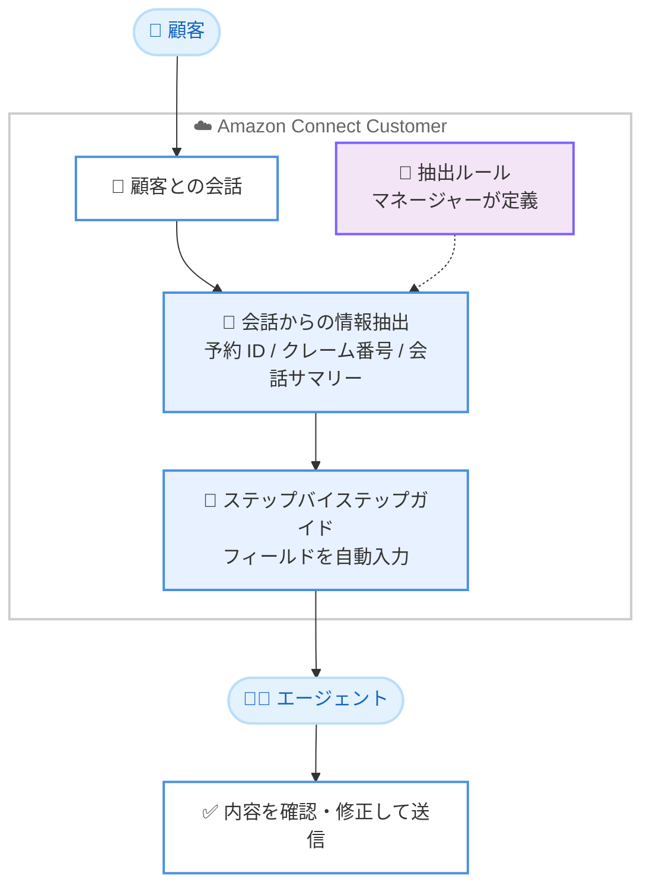

# Amazon Connect Customer - コンタクト後作業向けステップバイステップガイドの自動入力

**リリース日**: 2026 年 10 月 12 日
**サービス**: Amazon Connect Customer
**機能**: ステップバイステップガイドの自動入力 (After Contact Work 向け)

📊 [このアップデートのインフォグラフィックを見る](https://takech9203.github.io/aws-news-summary/20261012-connect-customer-prefills-guides-acw.html)

## 概要

Amazon Connect Customer が、顧客との会話から抽出した情報を使用して、コンタクト後にエージェントが記入するステップバイステップガイドを自動入力できるようになりました。予約 ID、クレーム番号、会話サマリーといった情報が会話から直接抽出され、ガイドの各フィールドにあらかじめ入力されます。

マネージャーは、どの抽出情報をガイドのどのフィールドにマッピングするかを抽出ルールとして定義できます。エージェントは自動入力された内容を確認し、必要に応じて修正して送信するだけでよくなり、各フィールドへの手動入力が不要になります。これにより、コンタクト後作業 (After Contact Work、ACW) の時間短縮とデータ精度の向上が期待できます。

コンタクトセンターでエージェントの後処理時間 (ACW 時間) の削減やデータ入力品質の改善に取り組む企業にとって有用なアップデートです。

**アップデート前の課題**

- エージェントはコンタクト終了後、ポリシー番号や通話サマリー、ディスポジションコードなどの定型情報を手動で入力する必要があった
- 手動入力に時間がかかり、コンタクト後作業の時間が長くなっていた
- 手動でのデータ入力は転記ミスなどのヒューマンエラーが発生しやすかった

**アップデート後の改善**

- 会話から抽出された予約 ID、クレーム番号、会話サマリーなどの情報がガイドのフィールドに自動入力されるようになった
- エージェントは入力内容の確認と送信のみでコンタクト後作業を完了できるようになり、処理時間が短縮された
- 手動入力の削減により、データ入力エラーが減少し、記録されるデータの精度が向上した

## アーキテクチャ図



顧客との会話から抽出された情報が、マネージャーの定義した抽出ルールに基づいてステップバイステップガイドのフィールドに自動入力され、エージェントは確認と送信のみを行うフローです。

## サービスアップデートの詳細

### 主要機能

1. **会話情報によるガイドの自動入力**
   - 顧客との会話から抽出された情報をステップバイステップガイドのフィールドに自動入力
   - 予約 ID、クレーム番号、会話サマリーなどの情報が対象
   - エージェントによる手動入力を削減し、コンタクト後作業を効率化

2. **マネージャーによる抽出ルールの定義**
   - どの抽出情報をガイドのどのフィールドにマッピングするかをマネージャーが設定可能
   - 業務要件に合わせて、入力対象のフィールドと会話データの対応関係を柔軟に制御

3. **エージェントによる確認・修正フロー**
   - 自動入力された内容をエージェントが確認し、必要に応じて修正したうえで送信
   - 自動化と人による検証を組み合わせることで、効率とデータ精度を両立

## 技術仕様

### 機能概要

| 項目 | 詳細 |
|------|------|
| 対象機能 | ステップバイステップガイド (After Contact Work) |
| 抽出対象の例 | 予約 ID、クレーム番号、会話サマリー、ディスポジションコードなど |
| 設定主体 | マネージャー (抽出ルールの定義) |
| エージェントの操作 | 自動入力内容の確認、修正、送信 |
| 利用リージョン数 | 9 リージョン (アフリカ・ケープタウンはコンタクトサマリーのみ対応) |

## 設定方法

### 前提条件

1. Amazon Connect インスタンスが利用可能であること
2. ステップバイステップガイドが設定済みであること
3. 会話分析 (コンタクトサマリーなどの会話からの情報抽出機能) が有効化されていること

### 手順

#### ステップ 1: ステップバイステップガイドの準備

コンタクト後作業でエージェントが記入するステップバイステップガイドを作成または確認します。ガイドには、ポリシー番号や通話サマリーなど、自動入力の対象としたいフィールドを含めます。

#### ステップ 2: 抽出ルールの定義

マネージャーが、会話から抽出されるどの情報をガイドのどのフィールドにマッピングするかを定義します。例えば、保険金請求の通話では、ポリシー番号を該当フィールドに、会話サマリーをサマリーフィールドに対応付けます。

#### ステップ 3: エージェントによる確認と送信

コンタクト終了後、エージェントのワークスペースに自動入力済みのガイドが表示されます。エージェントは内容を確認し、必要に応じて修正したうえで送信します。

詳細な設定手順は[ステップバイステップガイドのドキュメント](https://docs.aws.amazon.com/connect/latest/adminguide/integrate-views-conversational-analytics.html)を参照してください。

## メリット

### ビジネス面

- **コンタクト後作業時間の短縮**: エージェントは入力作業ではなく確認作業のみを行うため、ACW 時間が短縮され、1 日に対応できるコンタクト数の増加につながる
- **データ品質の向上**: 手動入力による転記ミスが減少し、CRM やレポートに記録されるデータの精度が向上する
- **エージェント体験の改善**: 定型的な入力作業の負担が減り、エージェントは顧客対応そのものに集中できる

### 技術面

- **ルールベースの柔軟な制御**: マネージャーが抽出ルールを定義できるため、業務要件に合わせたフィールドマッピングが可能
- **既存ガイドとの統合**: 既存のステップバイステップガイドの仕組みをそのまま活用でき、大きな構成変更が不要
- **人による検証の組み込み**: 自動入力後にエージェントの確認・修正ステップがあるため、自動化による誤入力リスクを低減できる

## デメリット・制約事項

### 制限事項

- 利用可能なリージョンは 9 リージョンに限定される (アフリカ・ケープタウンはコンタクトサマリーのみ対応)
- 自動入力の品質は会話からの情報抽出の精度に依存するため、エージェントによる確認作業は引き続き必要

### 考慮すべき点

- 抽出ルールの設計には、どの会話情報をどのフィールドに対応付けるかの業務分析が必要
- 自動入力された内容を無条件に信頼せず、エージェントが確認・修正する運用ルールを整備することが望ましい

## ユースケース

### ユースケース 1: 保険会社のクレーム対応

**シナリオ**: 保険会社のコンタクトセンターで、エージェントは保険金請求の通話後にポリシー番号、通話サマリー、ディスポジションコードを記録する必要がある。

**実装例**:
```text
抽出ルールの定義:
- ポリシー番号 → ガイドの「ポリシー番号」フィールド
- 会話サマリー → ガイドの「通話概要」フィールド
- 通話内容に基づく分類 → ガイドの「ディスポジションコード」フィールド
```

**効果**: エージェントは手動入力の代わりに確認・送信のみを行い、クレーム 1 件あたりの後処理時間を短縮できる。

### ユースケース 2: 旅行会社の予約変更対応

**シナリオ**: 旅行会社のコンタクトセンターで、予約変更の問い合わせ後に予約 ID と変更内容のサマリーを記録している。

**実装例**:
```text
抽出ルールの定義:
- 予約 ID → ガイドの「予約番号」フィールド
- 会話サマリー → ガイドの「対応内容」フィールド
```

**効果**: 予約 ID の転記ミスがなくなり、後続のバックオフィス処理の手戻りを削減できる。

### ユースケース 3: ACW 時間の KPI 改善

**シナリオ**: コンタクトセンターの運用チームが、エージェントの平均 ACW 時間を KPI として改善に取り組んでいる。

**実装例**:
```text
1. 現状の ACW 時間とガイド入力項目を分析
2. 入力頻度の高いフィールドから抽出ルールを定義
3. 導入前後の ACW 時間とデータ精度を比較
```

**効果**: 定型入力の自動化により ACW 時間を削減し、エージェントの生産性指標を改善できる。

## 料金

公式発表には本機能固有の追加料金に関する記載はありません。Amazon Connect の料金体系の詳細は[料金ページ](https://aws.amazon.com/connect/pricing/)を参照してください。

## 利用可能リージョン

以下の 9 リージョンで利用可能です。

- 米国東部 (バージニア北部)
- 米国西部 (オレゴン)
- アジアパシフィック (ソウル)
- アジアパシフィック (シンガポール)
- アジアパシフィック (シドニー)
- アジアパシフィック (東京)
- カナダ (中部)
- 欧州 (フランクフルト)
- 欧州 (ロンドン)

アフリカ (ケープタウン) では、コンタクトサマリーのみ利用可能です。

## 関連サービス・機能

- **Amazon Connect ステップバイステップガイド**: エージェントのワークフローをガイドする機能で、今回のアップデートにより自動入力に対応
- **Amazon Connect Contact Lens**: 会話分析機能を提供し、会話サマリーなどの情報抽出の基盤となる
- **エージェントワークスペース**: エージェントがガイドの確認・修正・送信を行う統合インターフェース

## 参考リンク

- 📊 [インフォグラフィック](https://takech9203.github.io/aws-news-summary/20261012-connect-customer-prefills-guides-acw.html)
- [公式発表 (What's New)](https://aws.amazon.com/about-aws/whats-new/2026/10/connect-customer-prefills-guides-acw)
- [ドキュメント (ステップバイステップガイド)](https://docs.aws.amazon.com/connect/latest/adminguide/integrate-views-conversational-analytics.html)
- [料金ページ](https://aws.amazon.com/connect/pricing/)

## まとめ

Amazon Connect Customer のステップバイステップガイド自動入力により、エージェントのコンタクト後作業が「入力」から「確認」へと変わり、ACW 時間の短縮とデータ精度の向上を同時に実現できます。東京リージョンを含む 9 リージョンで利用可能なため、ACW 時間の削減に取り組むコンタクトセンターは、入力頻度の高いフィールドから抽出ルールの定義を検討することを推奨します。
