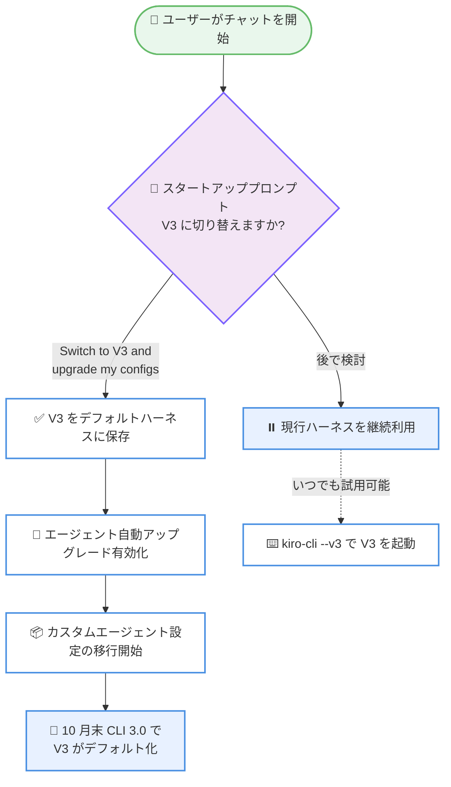
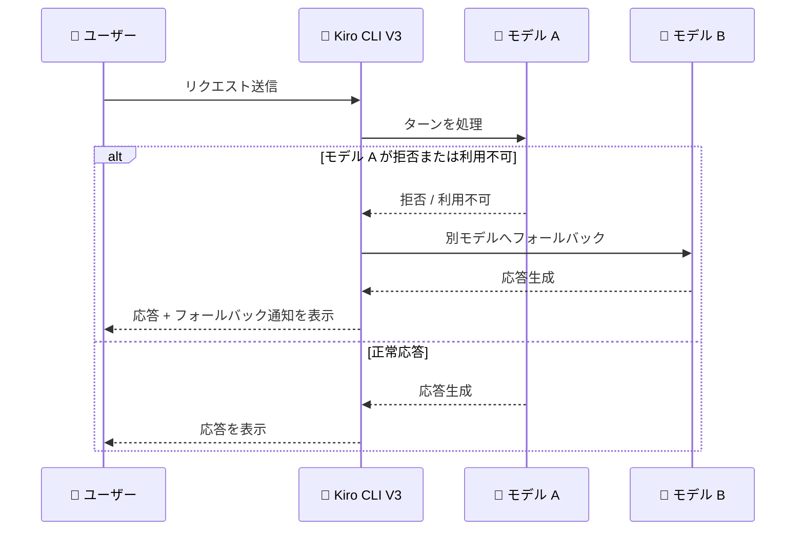

# Kiro - チャット開始時の V3 切り替えプロンプトとモデルフォールバック通知 (CLI 2.30.0)

**リリース日**: 2026 年 10 月 12 日
**サービス**: Kiro (AWS が提供する AI 搭載 IDE / CLI)
**機能**: Switch to V3 at Chat Start and Model Fallback Notices

📊 [このアップデートのインフォグラフィックを見る](https://takech9203.github.io/aws-news-summary/20261012-kiro-changelog-2026-10-12.html)

## 概要

Kiro CLI 2.30.0 がリリースされ、チャット開始時に V3 への切り替えを促すスタートアッププロンプトの段階的ロールアウトが始まりました。V3 は 10 月末にリリース予定の CLI 3.0 でデフォルトのハーネスとなる計画であり、今回のプロンプトはその移行を円滑に進めるための準備段階という位置づけです。プロンプトで「Switch to V3 and upgrade my configs」を選択すると、V3 がデフォルトハーネスとして保存され、エージェントの自動アップグレードが有効化され、カスタムエージェント設定の移行が開始されます。

また、V3 セッションにおけるモデルフォールバック通知が追加されました。モデルがリクエストを拒否した場合や利用できない場合に、ターンが別のモデルへ移行したことがトランスクリプト上の通知で確認できるようになり、「なぜ応答の傾向が変わったのか」と推測する必要がなくなります。

このほか、エージェントを V3 にアップグレードした際に V2 のワークスペース読み取りアクセスやスキル信頼設定を維持する改善、スクリーンリーダー / tmux / ナレッジ検索に関する複数の問題修正が含まれています。

**アップデート前の課題**

このアップデート以前には、以下のような課題がありました。

- Classic / V2 ユーザーが V3 へ移行するには、ロールアウト情報を自分で把握し、手動で切り替える必要があった
- V3 セッションでモデルが拒否や利用不可によって別モデルにフォールバックしても通知がなく、応答の変化の理由がわからなかった
- エージェントを V3 にアップグレードすると、V2 のワークスペース読み取りアクセスやスキル信頼設定の一部が引き継がれなかった
- スクリーンリーダーがフル TUI でストリーミング応答を追従できない、tmux でのスクロールバック時に空白行が表示される、小規模ナレッジベースの検索でチャンクが欠落するなどの問題があった

**アップデート後の改善**

今回のアップデートにより、以下が可能になりました。

- チャット開始時のスタートアッププロンプトから、デフォルトハーネスの V3 への切り替えとエージェント設定の移行をワンステップで開始できるようになった
- V3 セッションでターンが別モデルに移行した際、トランスクリプトに通知が表示され、どのモデルが応答を継続したかを把握できるようになった
- V3 へのエージェントアップグレード時に V2 のワークスペース読み取りアクセスとスキル信頼設定が維持されるようになった
- アップグレード済みエージェントで V2 の信頼設定を変更すると、生成された V3 フィールドが未変更の場合に対応する V3 権限が自動的に更新されるようになった
- スクリーンリーダー、tmux、ナレッジ検索、Linux ターミナルでの文字化けなどの問題が修正された

## アーキテクチャ図



チャット開始時のスタートアッププロンプトから V3 への切り替えとエージェント設定移行が開始される流れを示しています。切り替えを選択しない場合も `kiro-cli --v3` でいつでも V3 を試用できます。



V3 セッションにおけるモデルフォールバック通知の流れです。別のモデルがターンを継続した場合、その事実がトランスクリプトに明示されます。

## サービスアップデートの詳細

### 主要機能

1. **チャット開始時の V3 切り替えプロンプト**
   - チャット開始時に V3 への切り替えを促すスタートアッププロンプトを表示
   - 段階的ロールアウトのため、すぐには表示されない場合がある
   - 「Switch to V3 and upgrade my configs」を選択すると、V3 のデフォルトハーネス化、エージェント自動アップグレードの有効化、カスタムエージェント設定の移行開始が一度に行われる
   - 10 月末の CLI 3.0 リリースで V3 がデフォルトになる予定
   - プロンプトを待たずに `kiro-cli --v3` でいつでも V3 を試用可能

2. **V3 モデルフォールバック通知**
   - V3 セッションにおいて、モデルがリクエストを拒否した場合や利用できない場合に、ターンが別のモデルへ移行したことをトランスクリプト上の通知で表示
   - 応答の変化の理由を推測する必要がなくなり、どのモデルが応答を継続したかを明確に把握できる

3. **アップグレード済みエージェントの権限維持と更新 (改善)**
   - アップグレード済みエージェントで V2 の信頼設定を変更した際、生成された V3 フィールドが未変更であれば、対応する V3 権限が自動的に更新される
   - エージェントを V3 にアップグレードした際に、V2 のワークスペース読み取りアクセスとコード / スキル信頼設定が維持されるようになった (修正)

4. **各種問題の修正**
   - スクリーンリーダーが `/settings display` の Screen reader オプションを通じて、フル TUI でのストリーミング応答を追従できるようになった
   - tmux でのスクロールバック時に、長い応答の後に空白行の画面が表示される問題を修正
   - 末尾に改行のない出力の後に Kiro CLI を起動すると、UI の描画位置がずれる問題を修正
   - Classic および V2 のナレッジ検索で、小規模なナレッジベースからチャンクが暗黙的に欠落する問題を修正
   - 一部の Linux ターミナルやリモートデスクトップで、チャット内のアイコン周辺に文字化けや不要な文字が表示される問題を修正

## 技術仕様

### アップデート内容の分類

| 分類 | 項目 | 内容 |
|------|------|------|
| 新機能 | V3 切り替えプロンプト | チャット開始時に段階的ロールアウトで表示。V3 のデフォルト化と設定移行を開始 |
| 新機能 | モデルフォールバック通知 | V3 セッションでターンが別モデルに移行した際にトランスクリプトへ通知を表示 |
| 改善 | アップグレード済みエージェントの権限更新 | V2 信頼設定の変更時に、未変更の生成済み V3 フィールドの権限を自動更新 |
| 修正 | V2 アクセス維持 | V3 アップグレード時に V2 ワークスペース読み取りアクセスとスキル信頼設定を維持 |
| 修正 | アクセシビリティ | スクリーンリーダーがフル TUI のストリーミング応答を追従可能に |
| 修正 | ターミナル表示 | tmux スクロールバックの空白行、UI 描画オフセット、Linux ターミナルの文字化けを修正 |
| 修正 | ナレッジ検索 | Classic / V2 で小規模ナレッジベースのチャンク欠落を修正 |

### V3 ロールアウトのスケジュール

| 時期 | 内容 |
|------|------|
| 2026 年 10 月 12 日 (CLI 2.30.0) | スタートアッププロンプトの段階的ロールアウト開始 |
| 2026 年 10 月末 (CLI 3.0) | V3 がデフォルトハーネスに |

## 設定方法

### 前提条件

1. Kiro CLI がインストールされていること
2. 最新バージョン (2.30.0 以降) にアップデートされていること

### 手順

#### ステップ 1: Kiro CLI を最新バージョンに更新

```bash
kiro-cli update
```

Kiro CLI を最新バージョンに更新します。更新後に CLI を再起動すると、新機能が利用可能になります。

#### ステップ 2: スタートアッププロンプトで V3 への切り替えを選択

```bash
kiro-cli
```

チャットを開始すると、段階的ロールアウトの対象になっている場合にスタートアッププロンプトが表示されます。「Switch to V3 and upgrade my configs」を選択すると、V3 がデフォルトハーネスとして保存され、エージェントの自動アップグレードが有効化され、カスタムエージェント設定の移行が開始されます。

#### ステップ 3: プロンプトを待たずに V3 を試用する場合

```bash
kiro-cli --v3
```

`--v3` フラグを付けて起動すると、スタートアッププロンプトの表示を待たずにいつでも V3 セッションを開始できます。デフォルト設定は変更されないため、気軽に試用できます。

## メリット

### ビジネス面

- **移行コストの低減**: ワンステップで V3 への切り替えとエージェント設定の移行が開始できるため、チーム全体の V3 移行をスムーズに進められる
- **計画的な移行**: 10 月末の CLI 3.0 での V3 デフォルト化に先立って段階的に移行できるため、デフォルト変更時の混乱を回避できる
- **アクセシビリティの向上**: スクリーンリーダー対応の修正により、より多くの開発者が Kiro CLI を利用できる

### 技術面

- **透明性の向上**: モデルフォールバック通知により、どのモデルが応答を生成したかを把握でき、応答品質の変化を正しく解釈できる
- **権限設定の継続性**: V3 アップグレード時に V2 のワークスペース読み取りアクセスとスキル信頼設定が維持され、再設定の手間が不要になった
- **ターミナル環境の安定性**: tmux や Linux ターミナルでの表示問題が修正され、リモート環境での利用体験が向上した

## デメリット・制約事項

### 制限事項

- スタートアッププロンプトは段階的ロールアウトのため、すべてのユーザーにすぐ表示されるわけではない
- 10 月末の CLI 3.0 で V3 がデフォルトになる予定のため、Classic / V2 を利用し続けるワークフローは早めの移行計画が必要
- 信頼していないワークスペースでは、一部の V3 機能の動作が制限される場合がある

### 考慮すべき点

- カスタムエージェント設定を利用している場合、V3 への移行で設定がどのように変換されるかを事前にドキュメントで確認することを推奨
- モデルフォールバックが発生した場合、意図したモデルと異なるモデルが応答している可能性があるため、通知を確認する運用を取り入れると良い

## ユースケース

### ユースケース 1: チームの V3 への計画的移行

**シナリオ**: 開発チームが Classic / V2 ハーネスで Kiro CLI を利用しており、10 月末の V3 デフォルト化に備えて段階的に移行したい。

**実装例**:
```bash
# 各メンバーが最新バージョンに更新
kiro-cli update

# スタートアッププロンプトで「Switch to V3 and upgrade my configs」を選択
kiro-cli
```

**効果**: デフォルト化前に V3 への切り替えとエージェント設定の移行を完了でき、CLI 3.0 リリース時の業務影響を最小化できる。

### ユースケース 2: モデルフォールバック発生時の応答品質の検証

**シナリオ**: V3 セッションでコード生成を行っている際、応答の傾向が急に変化したため、原因を確認したい。

**実装例**:
```text
トランスクリプトに表示されるフォールバック通知を確認し、
ターンが別のモデルに移行していたかを判断する
```

**効果**: 応答の変化がモデルフォールバックによるものかを即座に判断でき、必要に応じてリクエストの再実行やモデル選択の見直しができる。

### ユースケース 3: tmux を利用したリモート開発環境での利用

**シナリオ**: SSH 先のサーバーで tmux セッション内から Kiro CLI を利用しており、長い応答の後にスクロールバックすると空白行が表示されて作業しづらかった。

**実装例**:
```bash
# 最新バージョンに更新するだけで修正が適用される
kiro-cli update
```

**効果**: tmux スクロールバックの空白行問題と UI 描画オフセット問題が解消され、リモート環境でも快適に過去の応答を参照できる。

## 利用可能リージョン

Kiro はグローバルに利用可能です。

## 関連サービス・機能

- **Kiro CLI V3**: 今回のアップデートの中心となる新ハーネス。10 月末の CLI 3.0 でデフォルト化予定
- **Kiro エージェント設定**: V2 から V3 へのアップグレードで信頼設定や権限が変換・維持される
- **Kiro ナレッジ検索**: Classic / V2 のナレッジ検索におけるチャンク欠落が修正された

## 参考リンク

- 📊 [インフォグラフィック](https://takech9203.github.io/aws-news-summary/20261012-kiro-changelog-2026-10-12.html)
- [Kiro Changelog](https://kiro.dev/changelog/)
- [Kiro CLI V3 ロールアウト発表 (Blog)](https://kiro.dev/blog/cli-3)
- [ドキュメント: モデルフォールバック通知](https://kiro.dev/docs/cli/terminal-ui/#model-fallback-notices)
- [ドキュメント: エージェントの V3 アップグレード](https://kiro.dev/docs/cli/v3/upgrade-agent/)
- [ドキュメント: スクリーンリーダーサポート](https://kiro.dev/docs/cli/chat/settings/#screen-reader-support)

## まとめ

Kiro CLI 2.30.0 は、10 月末の CLI 3.0 における V3 デフォルト化に向けた移行支援を本格化させるリリースです。スタートアッププロンプトによるワンステップの切り替えとモデルフォールバック通知により、移行の手間と V3 セッションの不透明さが大きく軽減されます。Classic / V2 を利用中のユーザーは、`kiro-cli --v3` での試用やエージェント設定の移行確認を早めに進めることを推奨します。
