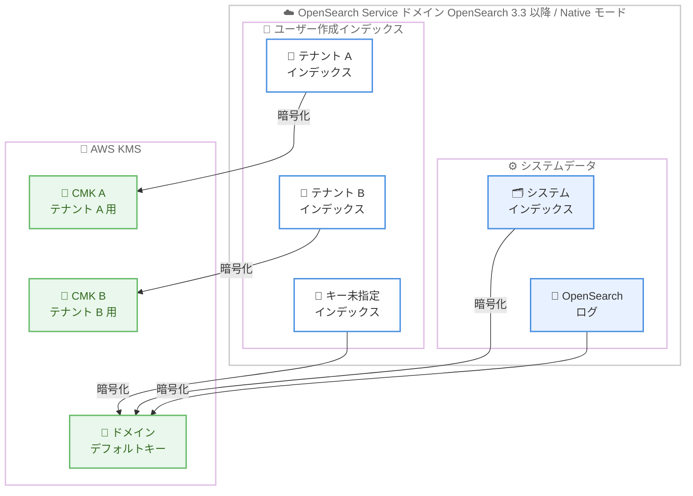

# Amazon OpenSearch Service - インデックスレベル暗号化のサポート

**リリース日**: 2026 年 10 月 12 日
**サービス**: Amazon OpenSearch Service
**機能**: インデックスレベル暗号化 (Index-level encryption)

📊 [このアップデートのインフォグラフィックを見る](https://takech9203.github.io/aws-news-summary/20261012-opensearch-index-level-encryption.html)

## 概要

Amazon OpenSearch Service が、インデックス単位での保管時暗号化 (インデックスレベル暗号化) をサポートしました。インデックスごとに独自の AWS KMS カスタマーマネージドキー (CMK) を指定できるため、同一ドメイン上で所有者や機密性レベルが異なるデータを、それぞれ別のキーで保護できます。

この機能は、既存のドメインレベルの保管時暗号化を拡張するものです。従来はドメイン全体を単一の KMS キーで暗号化していましたが、今回のアップデートにより、ユーザー作成のインデックスごとに異なる CMK を割り当てられるようになりました。特にマルチテナントアプリケーションにおいて、テナントごとにキーを分離してデータを保護するという要件を、ドメインを分割することなく実現できます。

有効化するには、新規ドメイン作成時に暗号化モードを「Native」に設定し、カスタマーマネージドキーを指定します。OpenSearch 3.3 以降を実行するドメインが対象で、東京を含む 14 リージョンで利用可能です。

**アップデート前の課題**

このアップデート以前には、以下の課題がありました。

- 保管時暗号化はドメイン単位の単一 KMS キーのみで、インデックスごとにキーを分けることができなかった
- マルチテナントアプリケーションでテナントごとのキー分離を実現するには、テナントごとにドメインを分割する必要があり、コストと運用負荷が増大していた
- 機密性レベルが異なるデータを同一ドメインに格納する場合、すべて同じキーで暗号化されるため、キー単位でのアクセス制御や失効ができなかった

**アップデート後の改善**

今回のアップデートにより、以下が可能になりました。

- インデックスごとに独自の AWS KMS カスタマーマネージドキーを指定した保管時暗号化が可能になった
- 単一ドメイン上でテナントごとのキー分離が実現でき、ドメイン分割が不要になった
- キー未指定のインデックス、システムインデックス、OpenSearch ログはドメインのデフォルトキーで暗号化され、ドメイン全体の暗号化は引き続き維持される

## アーキテクチャ図



単一の OpenSearch Service ドメイン上で、テナントごとのインデックスを異なる KMS カスタマーマネージドキーで暗号化する構成です。キー未指定のインデックスやシステムデータは、ドメイン作成時に指定したデフォルトキーで暗号化されます。

## サービスアップデートの詳細

### 主要機能

1. **インデックスごとの KMS キー指定**
   - ユーザー作成のインデックスごとに、異なる AWS KMS カスタマーマネージドキーを指定して保管時暗号化が可能
   - 1 ドメインあたり最大 10,000 個のユニークな KMS キーを使用可能
   - キーを指定せずに作成したインデックスは、ドメインのデフォルトキーで暗号化
   - システムインデックスと OpenSearch ログは、常にドメインのデフォルトキーで暗号化

2. **暗号化モード「Native」の追加**
   - 新規ドメイン作成時に、暗号化モードとして「Disk」(従来のドメイン全体の暗号化) と「Native」(インデックスレベル暗号化) を選択可能
   - Native モードでは、データがディスクに書き込まれる前に暗号化される
   - AWS Management Console または AWS CLI で設定可能
   - API では `EncryptionAtRestOptions` の `EncryptionMode` パラメータに `NATIVE` を指定

3. **2 段階の認可モデルによるキー管理**
   - キー登録フェーズ: `_plugins/_opensearch_storage_encryption/_register_key` API でキーを登録。この時点で KMS の認可チェックが実行され、KMS グラントが作成される
   - インデックス作成フェーズ: 登録済みキーを参照してインデックスを作成。登録時のグラントを使用するため、インデックス作成者は KMS への直接の権限が不要
   - オプションの暗号化コンテキストを指定して、キー使用の文脈を制限することも可能

4. **モニタリングメトリクスの提供**
   - 復号済みデータを保持するオフヒープメモリプールの状態を CloudWatch メトリクス (`IleDirectMemoryReserved`、`IleDirectMemoryWorkingSetPercentage`、`IleDirectMemoryBlockReloadPercentage`、`IleDirectMemoryCircuitBreakerTriggered`) で監視可能
   - キー登録時の KMS グラント作成は AWS CloudTrail に `CreateGrant` イベントとして記録され、監査に利用可能

## 技術仕様

### 機能要件

| 項目 | 詳細 |
|------|------|
| 対応バージョン | OpenSearch 3.3 以降 |
| 有効化のタイミング | 新規ドメイン作成時のみ (既存ドメインへの追加は不可、有効化後の無効化も不可) |
| 暗号化モード | `NATIVE` (インデックスレベル暗号化) / `DISK` (従来のドメイン全体暗号化) |
| 対応キータイプ | 対称暗号化キー (SYMMETRIC_DEFAULT) のみ。シングルリージョンキーとマルチリージョンキーの両方に対応 |
| キー数の上限 | 1 ドメインあたり最大 10,000 個のユニークな KMS キー |
| 必要なインスタンス | メモリ 16 GB 以上のデータノードインスタンスタイプ |
| 非対応機能 | UltraWarm、Multi-Tier Storage と Writable Warm、Optimized Engine、S3 Vectors、クロスクラスターレプリケーション |
| k-NN プラグイン | Lucene エンジンのみ対応 (FAISS エンジンは非対応) |

### API 変更履歴

| 日付 | サービス | 変更内容 |
|------|----------|----------|
| 2026/10/08 | [Amazon OpenSearch Service](https://awsapichanges.com/archive/changes/6b8067-es.html) | 7 updated api methods - `CreateDomain` および `UpdateDomainConfig` の `EncryptionAtRestOptions` に `EncryptionMode` オプション (DISK または NATIVE) を追加 |

### 必要な IAM 権限 (キー登録を行うプリンシパル)

```json
{
  "Version": "2012-10-17",
  "Statement": [
    {
      "Effect": "Allow",
      "Action": [
        "kms:CreateGrant",
        "kms:DescribeKey",
        "kms:GenerateDataKey",
        "kms:Encrypt",
        "kms:Decrypt"
      ],
      "Resource": "arn:aws:kms:{region}:{account-id}:key/{key-id}"
    },
    {
      "Effect": "Allow",
      "Action": ["es:ESHttpPost"],
      "Resource": [
        "arn:aws:es:{region}:{account-id}:domain/{domain-name}/_plugins/_opensearch_storage_encryption/_register_key",
        "arn:aws:es:{region}:{account-id}:domain/{domain-name}/_plugins/_opensearch_storage_encryption/_unregister_key"
      ]
    }
  ]
}
```

## 設定方法

### 前提条件

1. OpenSearch 3.3 以降で新規ドメインを作成すること (既存ドメインでは有効化不可)
2. 保管時暗号化 (`EncryptionAtRestOptions`) を有効にし、カスタマーマネージドキーをドメインデフォルトキーとして指定すること
3. キー登録を行う IAM プリンシパルに、KMS キーへの権限 (`kms:CreateGrant` など) と `es:ESHttpPost` 権限があること
4. データノードにメモリ 16 GB 以上のインスタンスタイプを使用すること

### 手順

#### ステップ 1: Native モードで新規ドメインを作成

```bash
aws opensearch create-domain \
  --domain-name my-encrypted-domain \
  --engine-version OpenSearch_3.3 \
  --cluster-config InstanceType=r6g.large.search,InstanceCount=1 \
  --ebs-options EBSEnabled=true,VolumeType=gp3,VolumeSize=20 \
  --encryption-at-rest-options Enabled=true,KmsKeyId=arn:aws:kms:ap-northeast-1:123456789012:key/12345678-1234-1234-1234-123456789012,EncryptionMode=NATIVE \
  --node-to-node-encryption-options Enabled=true \
  --domain-endpoint-options EnforceHTTPS=true
```

OpenSearch 3.3 のドメインを、保管時暗号化を有効にして作成するコマンドです。`EncryptionMode=NATIVE` を指定することでインデックスレベル暗号化が有効になり、`KmsKeyId` で指定したカスタマーマネージドキーがドメインのデフォルトキーになります。コンソールの場合は、ドメイン作成時のセキュリティ設定で暗号化モードに [Native] を選択します。

#### ステップ 2: 追加の KMS キーをドメインに登録

```bash
POST _plugins/_opensearch_storage_encryption/_register_key
{
  "key_id": "arn:aws:kms:ap-northeast-1:123456789012:key/abcd1234-5678-90ab-cdef-1234567890ab",
  "encryption_context": "tenant=tenant-a,environment=production"
}
```

テナント用の KMS キーをドメインに登録する OpenSearch API です (SigV4 署名が必要)。登録時に KMS の認可チェックが実行され、KMS グラントが作成されます。`key_id` には完全なキー ARN を指定する必要があります。`encryption_context` はオプションですが、指定した場合はインデックス作成時とキー登録解除時に同じ値を渡す必要があります。

#### ステップ 3: 登録済みキーを指定してインデックスを作成

```bash
PUT /tenant-a-logs
{
  "settings": {
    "index.store.type": "cryptofs",
    "index.store.crypto.key_provider": "aws-kms",
    "index.store.crypto.kms.key_arn": "arn:aws:kms:ap-northeast-1:123456789012:key/abcd1234-5678-90ab-cdef-1234567890ab",
    "index.store.crypto.kms.encryption_context": "tenant=tenant-a,environment=production"
  }
}
```

登録済みの KMS キーで暗号化されたインデックスを作成するコマンドです。`index.store.type` に `cryptofs`、`index.store.crypto.key_provider` に `aws-kms` を指定します。以降、このインデックスに書き込まれるデータは自動的に指定のキーで暗号化されます。インデックステンプレートを使用すれば、`logs-*` などのパターンに一致する新規インデックスに暗号化設定を自動適用することも可能です。

## メリット

### ビジネス面

- **マルチテナントのキー分離要件に対応**: テナントごとに専用の暗号化キーを割り当てる要件を、ドメインを分割せずに実現でき、SaaS 事業者のコンプライアンス対応が容易になる
- **ドメイン集約によるコスト削減**: キー分離のためだけに複数ドメインを運用する必要がなくなり、インフラコストと運用負荷を削減できる
- **追加料金なし**: 機能自体に追加料金は発生せず、標準の KMS 料金と OpenSearch Service 料金のみで利用できる

### 技術面

- **柔軟なキー管理**: キー単位での無効化・削除により、特定テナントのデータだけをアクセス不能にする暗号的消去 (crypto-shredding) が可能
- **安全な認可モデル**: キー登録時に KMS グラントが作成されるため、インデックス作成者に KMS への直接権限を付与する必要がない
- **透過的なキーローテーション**: KMS の自動キーローテーションに対応しており、キー ARN は変わらないため、ユーザーやクライアント側の変更は不要
- **監査性**: キー登録時の `CreateGrant` イベントが CloudTrail に記録され、キーライフサイクルの監査が可能

## デメリット・制約事項

### 制限事項

- 新規ドメイン作成時のみ有効化可能で、既存ドメインでは利用できない。また、一度有効化すると無効化できない
- UltraWarm、Multi-Tier Storage と Writable Warm、Optimized Engine、S3 Vectors、クロスクラスターレプリケーションとは併用できない
- k-NN プラグイン使用時は Lucene エンジンのみ対応で、FAISS エンジンは使用できない
- データノードにメモリ 16 GB 以上のインスタンスタイプが必要
- 手動スナップショットのデータはインデックスレベルのキーでは暗号化されないため、スナップショット用 S3 バケットに SSE-S3 または SSE-KMS によるサーバー側暗号化を設定する必要がある

### 考慮すべき点

- キーを登録解除せずに KMS キーを無効化・削除すると、該当インデックスは red 状態になる。キーを削除すると、そのキーで暗号化されたデータは復旧できないため、キーのライフサイクル管理を徹底する必要がある
- マルチターム集約を使用する検索・分析クエリは、暗号化インデックスでレイテンシが増加する可能性があるため、本番導入前に性能テストを実施すべき
- インデックスレベル暗号化はきめ細かなアクセス制御 (FGAC) の代替ではないため、両者を併用した多層防御が推奨される
- 復号済みデータ用のオフヒープメモリプールの逼迫に備えて、`IleDirectMemoryWorkingSetPercentage` などの CloudWatch メトリクスにアラームを設定し、必要に応じてスケールアップ・スケールアウトを検討する

## ユースケース

### ユースケース 1: マルチテナント SaaS でのテナントごとのキー分離

**シナリオ**: SaaS 事業者が、単一の OpenSearch ドメイン上で複数顧客の検索データを管理しており、顧客ごとに専用の暗号化キーでデータを保護するというセキュリティ要件がある。

**実装例**:
```
# テナントごとに CMK を作成・登録し、テナント専用インデックスに割り当てる
POST _plugins/_opensearch_storage_encryption/_register_key
{
  "key_id": "arn:aws:kms:ap-northeast-1:123456789012:key/tenant-a-key-id",
  "encryption_context": "tenant=tenant-a"
}

PUT /tenant-a-data
{
  "settings": {
    "index.store.type": "cryptofs",
    "index.store.crypto.key_provider": "aws-kms",
    "index.store.crypto.kms.key_arn": "arn:aws:kms:ap-northeast-1:123456789012:key/tenant-a-key-id",
    "index.store.crypto.kms.encryption_context": "tenant=tenant-a"
  }
}
```

**効果**: ドメインを分割せずにテナントごとのキー分離を実現でき、顧客の解約時には該当キーの削除によりデータを暗号的に消去できる。インフラコストを抑えながらコンプライアンス要件を満たせる。

### ユースケース 2: 機密性レベルが異なるデータの同居

**シナリオ**: 社内の検索基盤で、一般的なアプリケーションログと個人情報を含む監査データを同一ドメインに格納しており、機密データのみ厳格に管理されたキーで暗号化したい。

**実装例**:
```
# 個人情報を含むインデックスのみ、キーポリシーを厳格化した専用 CMK で暗号化
PUT /pii-audit-logs
{
  "settings": {
    "index.store.type": "cryptofs",
    "index.store.crypto.key_provider": "aws-kms",
    "index.store.crypto.kms.key_arn": "arn:aws:kms:ap-northeast-1:123456789012:key/pii-key-id"
  }
}

# 一般ログはキー未指定で作成し、ドメインデフォルトキーで暗号化
PUT /app-logs
```

**効果**: データの機密性レベルに応じたキー管理ポリシーを適用でき、個人情報を含むデータへの暗号化キーのアクセスを最小限の管理者に限定できる。

### ユースケース 3: インデックステンプレートによる暗号化の自動適用

**シナリオ**: 日次ローテーションされるログインデックス (`logs-2026-10-12` など) に対して、作成のたびに手動で暗号化設定を行うのではなく、自動的に暗号化を適用したい。

**実装例**:
```
PUT _index_template/encrypted-logs-template
{
  "index_patterns": ["logs-*"],
  "template": {
    "settings": {
      "index": {
        "store.type": "cryptofs",
        "store.crypto.key_provider": "aws-kms",
        "store.crypto.kms.key_arn": "arn:aws:kms:ap-northeast-1:123456789012:key/logs-key-id"
      }
    }
  }
}
```

**効果**: パターンに一致する新規インデックスに暗号化設定が自動適用され、設定漏れによる暗号化されていないインデックスの作成を防止できる。

## 料金

インデックスレベル暗号化の利用に追加料金はありません。以下の標準料金のみが適用されます。

- **AWS KMS**: カスタマーマネージドキーの保管料金と、API リクエスト (`GenerateDataKey`、`Decrypt` など) の料金
- **Amazon OpenSearch Service**: 標準のドメイン料金 (インスタンス、ストレージなど)

テナント数に応じて CMK の数が増えるため、キー保管料金は使用するキー数に比例して増加する点に注意してください。詳細は [AWS KMS 料金ページ](https://aws.amazon.com/kms/pricing/)および [Amazon OpenSearch Service 料金ページ](https://aws.amazon.com/opensearch-service/pricing/)を参照してください。

## 利用可能リージョン

以下の 14 リージョンで利用可能です (OpenSearch 3.3 以降のドメインが対象)。

- 米国東部 (バージニア北部、オハイオ)
- 米国西部 (オレゴン)
- カナダ (中部)
- アジアパシフィック (ムンバイ、ソウル、シンガポール、シドニー、東京)
- 欧州 (フランクフルト、アイルランド、ロンドン、パリ)
- 南米 (サンパウロ)

## 関連サービス・機能

- **AWS KMS**: インデックスごとの暗号化に使用するカスタマーマネージドキーを管理。グラント、自動キーローテーション、暗号化コンテキストなどの機能と連携
- **AWS CloudTrail**: キー登録時に作成される KMS グラント (`CreateGrant` イベント) を記録し、キーライフサイクルの監査を実現
- **Amazon CloudWatch**: 暗号化用オフヒープメモリプールの使用状況を示す `IleDirectMemory*` メトリクスを提供し、スケーリング判断を支援
- **きめ細かなアクセス制御 (FGAC)**: キー登録・登録解除 API の実行権限を FGAC のアクショングループとロールで制御。暗号化と組み合わせた多層防御を実現

## 参考リンク

- 📊 [インフォグラフィック](https://takech9203.github.io/aws-news-summary/20261012-opensearch-index-level-encryption.html)
- [公式発表 (What's New)](https://aws.amazon.com/about-aws/whats-new/2026/10/opensearch-index-level-encryption)
- [ドキュメント: Index level encryption for Amazon OpenSearch Service](https://docs.aws.amazon.com/opensearch-service/latest/developerguide/index-level-encryption.html)
- [ドキュメント: Encryption of data at rest for Amazon OpenSearch Service](https://docs.aws.amazon.com/opensearch-service/latest/developerguide/encryption-at-rest.html)
- [API 変更履歴 (awsapichanges.com)](https://awsapichanges.com/archive/changes/6b8067-es.html)
- [料金ページ](https://aws.amazon.com/opensearch-service/pricing/)

## まとめ

Amazon OpenSearch Service のインデックスレベル暗号化により、単一ドメイン上でインデックスごとに異なる KMS カスタマーマネージドキーを使用した保管時暗号化が可能になりました。マルチテナントアプリケーションでテナントごとのキー分離が求められる場合、ドメイン分割なしで要件を満たせるため、SaaS 事業者には特に有用なアップデートです。新規ドメイン作成時のみ有効化できる機能のため、キー分離要件のあるワークロードでは、次回のドメイン設計・移行時に暗号化モード Native の採用を検討することを推奨します。
