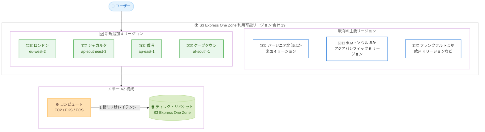

# Amazon S3 - S3 Express One Zone が 4 つの追加リージョンで利用可能に

**リリース日**: 2026 年 10 月 12 日
**サービス**: Amazon S3
**機能**: S3 Express One Zone ストレージクラスのリージョン拡大

📊 [このアップデートのインフォグラフィックを見る](https://takech9203.github.io/aws-news-summary/20261012-s3-express-one-zone-4-additional-regions.html)

## 概要

Amazon S3 Express One Zone ストレージクラスが、欧州 (ロンドン)、アジアパシフィック (ジャカルタ)、アジアパシフィック (香港)、アフリカ (ケープタウン) の 4 リージョンで新たに利用可能になりました。これにより、利用可能リージョンは合計 19 リージョンに拡大しました。

S3 Express One Zone は、単一のアベイラビリティゾーン (AZ) 内にデータを保存する高性能ストレージクラスで、頻繁にアクセスされるデータやレイテンシーに敏感なワークロードに対して、一貫した 1 桁ミリ秒のレイテンシーを提供します。S3 Standard と比較して最大 10 倍高速なデータアクセスと、最大 80% 低いリクエストコストを実現します。機械学習のトレーニング、インタラクティブ分析、AI 検索エンジン向けのキーバリューキャッシュなどのワークロードに適しています。

**アップデート前の課題**

このアップデート以前に存在していた課題や制限は以下のとおりです。

- 英国、インドネシア、香港、南アフリカのユーザーは、S3 Express One Zone を利用するために他のリージョンを使用する必要があり、コンピュートとストレージの距離によるレイテンシー増加が発生していた
- データレジデンシー要件により国内へのデータ保管が必要なワークロードでは、これらの地域で高性能ストレージクラスの選択肢がなかった
- これらの地域の機械学習トレーニングやインタラクティブ分析ワークロードでは、S3 Standard のリクエストレイテンシーとリクエストコストが性能とコストのボトルネックになる場合があった

**アップデート後の改善**

今回のアップデートにより可能になったことは以下のとおりです。

- ロンドン、ジャカルタ、香港、ケープタウンの各リージョンで、コンピュートワークロードと同じ AZ にディレクトリバケットを作成し、1 桁ミリ秒のレイテンシーでデータにアクセスできるようになった
- 各地域のデータレジデンシー要件を満たしながら、S3 Standard 比で最大 10 倍高速なデータアクセスを利用できるようになった
- リクエスト集約型ワークロードにおいて、最大 80% 低いリクエストコストによるコスト最適化が可能になった

## アーキテクチャ図



S3 Express One Zone の利用可能リージョンと単一 AZ 構成の概要を示した図です。今回ロンドン、ジャカルタ、香港、ケープタウンの 4 リージョンが新たに追加され、コンピュートと同じ AZ にディレクトリバケットを配置することで低レイテンシーアクセスを実現します。

## サービスアップデートの詳細

### 主要機能

1. **4 リージョンへの新規展開**
   - 欧州 (ロンドン、eu-west-2) で利用可能に
   - アジアパシフィック (ジャカルタ、ap-southeast-3) で利用可能に
   - アジアパシフィック (香港、ap-east-1) で利用可能に
   - アフリカ (ケープタウン、af-south-1) で利用可能に
   - 既存リージョンと合わせて合計 19 リージョンに拡大

2. **一貫した 1 桁ミリ秒レイテンシー**
   - データはコンピュートワークロードに近い単一 AZ 内のディレクトリバケットに保存される
   - S3 Standard と比較して最大 10 倍高速なデータアクセスを実現
   - 頻繁にアクセスされるデータやレイテンシーに敏感なアプリケーションに最適化

3. **低いリクエストコスト**
   - リクエストコストは S3 Standard と比較して最大 80% 低い
   - 小さなオブジェクトへの大量リクエストが発生するワークロードでコスト効率が高い

4. **高い耐久性と可用性**
   - 単一 AZ 内の複数デバイスにデータを冗長的に保存
   - 単一 AZ 内で 99.95% の可用性を実現する設計で、Amazon S3 の SLA の対象

## 技術仕様

### 新規追加リージョンの詳細

| リージョン | リージョンコード | アベイラビリティゾーン ID |
|------|------|------|
| 欧州 (ロンドン) | eu-west-2 | euw2-az1 |
| アジアパシフィック (ジャカルタ) | ap-southeast-3 | apse3-az1 |
| アジアパシフィック (香港) | ap-east-1 | ape1-az1 |
| アフリカ (ケープタウン) | af-south-1 | afs1-az1 |

### S3 Express One Zone の主な特徴

| 項目 | 詳細 |
|------|------|
| バケットタイプ | ディレクトリバケット (汎用バケットとは別のタイプ) |
| データ配置 | 単一 AZ 内の複数デバイスに冗長保存 |
| レイテンシー | 一貫した 1 桁ミリ秒 |
| データアクセス速度 | S3 Standard 比で最大 10 倍高速 |
| リクエストコスト | S3 Standard 比で最大 80% 低い |
| 可用性 | 単一 AZ 内で 99.95% の設計 |
| バケット名形式 | `{ベース名}--{AZ ID}--x-s3` |

## 設定方法

### 前提条件

1. AWS アカウントを保有していること
2. 新規追加リージョン (eu-west-2、ap-southeast-3、ap-east-1、af-south-1) のいずれかを利用できること
3. ディレクトリバケットの作成に必要な IAM 権限 (`s3express:CreateBucket`、`s3express:CreateSession` など) を保有していること

### 手順

#### ステップ 1: ディレクトリバケットの作成

```bash
aws s3api create-bucket \
  --bucket my-express-bucket--euw2-az1--x-s3 \
  --region eu-west-2 \
  --create-bucket-configuration 'Location={Type=AvailabilityZone,Name=euw2-az1},Bucket={DataRedundancy=SingleAvailabilityZone,Type=Directory}'
```

ロンドンリージョンの AZ ID `euw2-az1` にディレクトリバケットを作成します。バケット名は `{ベース名}--{AZ ID}--x-s3` の形式に従う必要があります。コンピュートワークロードと同じ AZ を指定することで、最も低いレイテンシーを実現できます。

#### ステップ 2: オブジェクトのアップロード

```bash
aws s3api put-object \
  --bucket my-express-bucket--euw2-az1--x-s3 \
  --key training-data/sample.parquet \
  --body ./sample.parquet \
  --region eu-west-2
```

作成したディレクトリバケットにオブジェクトをアップロードします。AWS CLI や SDK は、ディレクトリバケットへのアクセス時にセッションベース認証 (CreateSession) を自動的に処理します。

#### ステップ 3: オブジェクトの取得確認

```bash
aws s3api get-object \
  --bucket my-express-bucket--euw2-az1--x-s3 \
  --key training-data/sample.parquet \
  --region eu-west-2 \
  ./downloaded-sample.parquet
```

アップロードしたオブジェクトを取得し、低レイテンシーでアクセスできることを確認します。

## メリット

### ビジネス面

- **データレジデンシー対応**: 英国、インドネシア、香港、南アフリカの規制・コンプライアンス要件を満たしながら高性能ストレージを利用できる
- **コスト削減**: S3 Standard 比で最大 80% 低いリクエストコストにより、リクエスト集約型ワークロードの運用コストを削減できる
- **ユーザー体験の向上**: エンドユーザーやコンピュート基盤に近い場所でデータを提供し、アプリケーションの応答性を向上できる

### 技術面

- **低レイテンシー**: コンピュートと同じ AZ にデータを配置することで、一貫した 1 桁ミリ秒のアクセスレイテンシーを実現できる
- **高スループット**: S3 Standard 比で最大 10 倍高速なデータアクセスにより、機械学習トレーニングや分析ジョブの実行時間を短縮できる
- **S3 API との互換性**: 既存の S3 API (ディレクトリバケット対応分) をそのまま利用でき、アプリケーションの移行が容易

## デメリット・制約事項

### 制限事項

- データは単一 AZ にのみ保存されるため、AZ 障害時にはデータが利用できなくなる、または失われるリスクがある
- 新規追加 4 リージョンでは利用可能な AZ がそれぞれ 1 つに限定される (2026 年 10 月時点)
- ディレクトリバケットは汎用バケットと異なり、一部の S3 機能 (ライフサイクル設定の一部、レプリケーションなど) に制約がある

### 考慮すべき点

- 耐障害性が求められる一次データは S3 Standard などのマルチ AZ ストレージクラスに保存し、S3 Express One Zone は再生成可能なデータやキャッシュ用途に使用することを推奨
- ストレージ単価は S3 Standard より高いため、アクセス頻度とリクエストコスト削減効果を踏まえた総コスト評価が必要
- 最大の性能を得るには、コンピュートリソースとディレクトリバケットを同じ AZ に配置する設計が必要

## ユースケース

### ユースケース 1: 英国内での機械学習トレーニングの高速化

**シナリオ**: 英国の金融機関が、データレジデンシー要件を満たしながら大量の小さなファイルを使用する機械学習トレーニングを高速化する。

**実装例**:
```
1. ロンドンリージョンの euw2-az1 にディレクトリバケットを作成
2. 同じ AZ に GPU インスタンスのトレーニングクラスターを配置
3. トレーニングデータを S3 Express One Zone に配置し、高速に読み込み
```

**効果**: データを英国内に保持しながら、S3 Standard 比で最大 10 倍高速なデータアクセスにより GPU の待機時間を削減し、トレーニング時間を短縮できる。

### ユースケース 2: 東南アジア向けインタラクティブ分析

**シナリオ**: インドネシアの企業が、ジャカルタリージョンで頻繁にクエリされるホットデータに対するインタラクティブ分析基盤を構築する。

**実装例**:
```
1. ジャカルタリージョンの apse3-az1 にディレクトリバケットを作成
2. 頻繁にアクセスされるホットデータを S3 Express One Zone に配置
3. 同じ AZ の分析エンジンから低レイテンシーでクエリを実行
```

**効果**: 一貫した 1 桁ミリ秒のレイテンシーにより、ダッシュボードやアドホッククエリの応答時間を改善し、分析者の生産性を向上できる。

### ユースケース 3: AI 検索エンジン向けキーバリューキャッシュ

**シナリオ**: 香港でサービスを展開する企業が、AI 検索エンジンのキーバリューキャッシュ層を低コストで構築する。

**実装例**:
```
1. 香港リージョンの ape1-az1 にディレクトリバケットを作成
2. 検索インデックスや埋め込みベクトルのキャッシュを S3 Express One Zone に保存
3. 大量の小さな GET リクエストを低レイテンシー・低コストで処理
```

**効果**: S3 Standard 比で最大 80% 低いリクエストコストにより、大量リクエストが発生するキャッシュワークロードのコストを大幅に削減できる。

## 料金

S3 Express One Zone の料金は以下の要素で構成されます。

- **ストレージ料金**: 保存データ量 (GB 単位) に応じた従量課金
- **リクエスト料金**: PUT、GET などのリクエスト数に応じた課金 (S3 Standard 比で最大 80% 低い)
- **データ転送**: 同一リージョン内の AWS サービスからのアクセスは追加のデータ転送料金なし

リージョンごとの最新料金は [Amazon S3 料金ページ](https://aws.amazon.com/s3/pricing/) を参照してください。

## 利用可能リージョン

2026 年 10 月時点で、S3 Express One Zone は以下の 19 リージョンで利用可能です。

- 米国東部 (バージニア北部、オハイオ)
- 米国西部 (北カリフォルニア、オレゴン)
- アジアパシフィック (東京、ソウル、シンガポール、シドニー、ムンバイ)
- アジアパシフィック (ジャカルタ) 🆕
- アジアパシフィック (香港) 🆕
- 欧州 (フランクフルト、アイルランド、パリ、ストックホルム)
- 欧州 (ロンドン) 🆕
- アフリカ (ケープタウン) 🆕
- カナダ (中部)
- 南米 (サンパウロ)

## 関連サービス・機能

- **S3 ディレクトリバケット**: S3 Express One Zone 専用のバケットタイプ。AZ を指定して作成し、セッションベース認証で高速アクセスを実現
- **Amazon S3 Standard**: マルチ AZ の標準ストレージクラス。耐障害性が必要な一次データの保存に適しており、S3 Express One Zone と使い分ける
- **Amazon EC2 / Amazon EKS / Amazon ECS**: ディレクトリバケットと同じ AZ にコンピュートを配置することで、最小のレイテンシーを実現
- **Mountpoint for Amazon S3**: S3 をファイルシステムとしてマウントするクライアント。S3 Express One Zone と組み合わせて機械学習ワークロードで活用可能

## 参考リンク

- 📊 [インフォグラフィック](https://takech9203.github.io/aws-news-summary/20261012-s3-express-one-zone-4-additional-regions.html)
- [公式発表 (What's New)](https://aws.amazon.com/about-aws/whats-new/2026/10/s3-express-one-zone-4-additional-regions/)
- [S3 Express One Zone 製品ページ](https://aws.amazon.com/s3/storage-classes/express-one-zone/)
- [利用可能なリージョンと AZ (ドキュメント)](https://docs.aws.amazon.com/AmazonS3/latest/userguide/s3-express-Endpoints.html)
- [S3 Express One Zone の開始方法 (ドキュメント)](https://docs.aws.amazon.com/AmazonS3/latest/userguide/s3-express-getting-started.html)
- [Amazon S3 料金ページ](https://aws.amazon.com/s3/pricing/)

## まとめ

S3 Express One Zone がロンドン、ジャカルタ、香港、ケープタウンに拡大し、合計 19 リージョンで利用可能になりました。これらの地域でデータレジデンシー要件を満たしながら、S3 Standard 比で最大 10 倍高速なデータアクセスと最大 80% 低いリクエストコストを活用できます。機械学習トレーニングやインタラクティブ分析など、レイテンシーに敏感なワークロードを運用している場合は、ホットデータの配置先として S3 Express One Zone の採用を検討することを推奨します。
