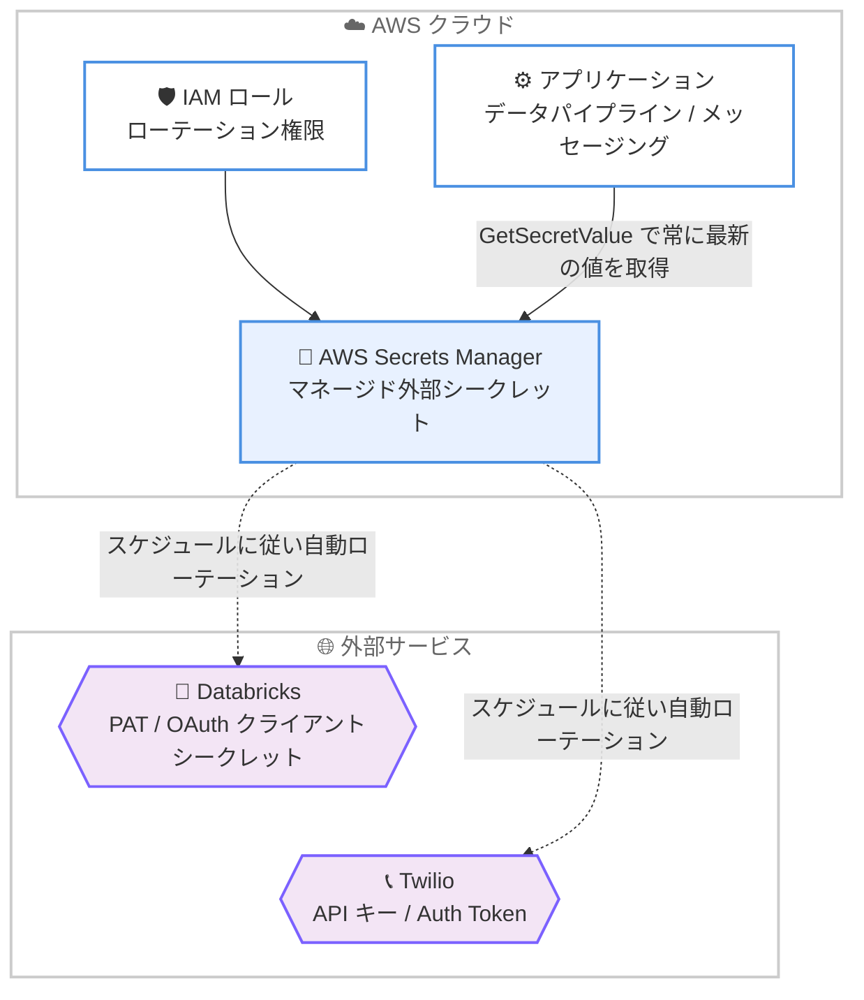

# AWS Secrets Manager - マネージド外部シークレットの Databricks / Twilio 対応

**リリース日**: 2026 年 10 月 12 日
**サービス**: AWS Secrets Manager
**機能**: Managed external secrets support for Databricks and Twilio

📊 [このアップデートのインフォグラフィックを見る](https://takech9203.github.io/aws-news-summary/20261012-secrets-manager-managed-external-secrets-databricks-twilio.html)

## 概要

AWS Secrets Manager のマネージド外部シークレット (managed external secrets) 機能が、新たに Databricks と Twilio に対応しました。データパイプラインやメッセージングアプリケーションがこれらのサービスを呼び出す際に使用する認証情報を、カスタムローテーション Lambda 関数を作成・保守することなく、AWS Management Console または API から直接自動ローテーションできるようになります。

Databricks では、ジョブや CI/CD パイプラインが使用するパーソナルアクセストークン (PAT) と、自動化ワークフローが使用するサービスプリンシパルの OAuth クライアントシークレットをローテーションできます。置き換え後の PAT は置き換え前のトークンのスコープを維持するため、狭いスコープのトークンは狭いスコープのまま保たれます。Twilio では、アプリケーションがメッセージ送信や発信に使用する API キーと Auth Token をローテーションできます。

Secrets Manager は常に現在有効な認証情報を返すため、アプリケーションはコード変更なしでローテーション後の値を自動的に取得できます。今回の対応により、既存の BigID、Cisco Security Platform、Confluent Cloud、Datadog、GitLab、Jenkins、MongoDB Atlas、Netskope、Paddle、Salesforce、Snowflake、SonarQube に加え、対応パートナーは 14 社に拡大しました。

**アップデート前の課題**

- Databricks の PAT や Twilio の API キーなどサードパーティーの認証情報をローテーションするには、パートナーごとに固有のカスタムローテーション Lambda 関数を開発・保守する必要があった
- ローテーションの設定が難しく、更新後の認証情報を利用側アプリケーションへ安全に配布することも困難だったため、長期間有効な認証情報がローテーションされないまま放置されがちだった
- パートナーごとに異なる API 仕様やトークン形式に合わせたローテーションロジックの実装と、その継続的なメンテナンスが運用負荷となっていた

**アップデート後の改善**

- Databricks の PAT とサービスプリンシパル OAuth クライアントシークレット、Twilio の API キーと Auth Token を、Lambda 関数なしでコンソールまたは API から自動ローテーションできるようになった
- 置き換え後の PAT は元のトークンのスコープを維持するため、最小権限の原則を保ったままローテーションできる
- アプリケーションは `GetSecretValue` で常に最新の認証情報を取得でき、ローテーションに伴うコード変更や配布作業が不要になった

## アーキテクチャ図



Secrets Manager がスケジュールに従って Databricks / Twilio の認証情報を直接ローテーションし、アプリケーションは `GetSecretValue` を通じて常に最新の認証情報を取得します。アカウント内に Lambda 関数はデプロイされません。

## サービスアップデートの詳細

### 主要機能

1. **Databricks 認証情報の自動ローテーション**
   - ジョブや CI/CD パイプラインが使用するパーソナルアクセストークン (PAT) をローテーション可能
   - 自動化ワークフローが使用するサービスプリンシパルの OAuth クライアントシークレットもローテーション可能
   - 置き換え後の PAT は元のトークンのスコープを維持し、権限が拡大することはない

2. **Twilio 認証情報の自動ローテーション**
   - メッセージ送信や発信に使用する API キーと Auth Token をローテーション可能
   - シークレットタイプとして `TwilioApiKey`、`TwilioAuthToken`、`TwilioMainApiKey` が定義されている

3. **Lambda 不要のマネージドローテーション**
   - カスタムローテーション Lambda 関数の作成・保守が不要で、アカウント内に Lambda はデプロイされない
   - コンソールでのシークレット作成時にはローテーションがデフォルトで有効化される
   - すべてのローテーション操作やシークレット値の更新は AWS CloudTrail に記録され、完全な監査性を確保

4. **アプリケーション側の変更不要**
   - Secrets Manager は常に現在有効な認証情報を返すため、アプリケーションはコード変更なしでローテーション後の値を利用可能
   - 細かな権限管理、可観測性、ガバナンス、ディザスタリカバリなど Secrets Manager の全機能をそのまま利用可能

## 技術仕様

### 今回追加されたシークレットタイプ

| パートナー | シークレットタイプ | 対象の認証情報 |
|------|------|------|
| Databricks | DatabricksPAT | パーソナルアクセストークン |
| Databricks | DatabricksSPSecret | サービスプリンシパル OAuth クライアントシークレット |
| Twilio | TwilioApiKey | API キー |
| Twilio | TwilioAuthToken | Auth Token |
| Twilio | TwilioMainApiKey | メイン API キー |

### 対応パートナー一覧

| 区分 | パートナー |
|------|------|
| 新規追加 | Databricks、Twilio |
| 既存対応 | BigID、Cisco Security Platform、Confluent Cloud、Datadog、GitLab、Jenkins、MongoDB Atlas、Netskope、Paddle、Salesforce、Snowflake、SonarQube |

### ローテーション設定のメタデータ

| フィールド | 説明 |
|------|------|
| ExternalSecretRotationMetadata | ローテーションに必要なパートナー固有のメタデータ |
| ExternalSecretRotationRoleArn | ローテーションに使用する IAM ロールの ARN。権限はシークレットを作成したリージョンの対象パートナーにスコープされる |

## 設定方法

### 前提条件

1. Databricks または Twilio のアカウントと、ローテーション対象の認証情報 (PAT、OAuth クライアントシークレット、API キー、Auth Token)
2. マネージド外部シークレットがサポートされているリージョンの AWS Secrets Manager
3. Secrets Manager がシークレットのライフサイクルを管理するための IAM ロール (コンソールから自動作成も可能)

### 手順

#### ステップ 1: マネージド外部シークレットの作成

パートナーが定義する形式に従い、Databricks または Twilio の認証情報をマネージド外部シークレットとして Secrets Manager に保存します。コンソールではシークレットタイプ (例: `DatabricksPAT`、`TwilioApiKey`) を選択し、必要なフィールドを入力します。コンソールから作成した場合、自動ローテーションはデフォルトで有効になります。

#### ステップ 2: ローテーションの設定 (コンソール)

1. Secrets Manager コンソールで対象のマネージド外部シークレットを選択
2. [設定] タブの [ローテーション設定] で [ローテーションを編集] を選択
3. 自動ローテーションを有効化し、パートナーが要求するローテーションメタデータを入力
4. ローテーション用の IAM ロールを新規作成または選択
5. ローテーションスケジュール (例: 30 日ごと) を設定して保存

#### ステップ 3: ローテーションの設定 (CLI)

```bash
aws secretsmanager rotate-secret \
  --secret-id SampleSecret \
  --external-secret-rotation-role-arn arn:aws:iam::123412341234:role/xyz \
  --rotation-rules AutomaticallyAfterDays=30 \
  --external-secret-rotation-metadata '[{"Key":"example-key","Value":"example-value"}]'
```

`rotate-secret` コマンドでシークレット ID、ローテーション用 IAM ロールの ARN、ローテーションスケジュール、パートナー固有のメタデータを指定し、マネージドローテーションを有効化します。メタデータの必須フィールドはパートナーごとに異なるため、各パートナーのドキュメントに従って設定します。

#### ステップ 4: アプリケーションからの利用

```bash
aws secretsmanager get-secret-value --secret-id SampleSecret
```

アプリケーションは `GetSecretValue` を呼び出すだけで常に最新の認証情報を取得できます。ローテーション後も同じ呼び出しで新しい値が返されるため、アプリケーション側の変更は不要です。

## メリット

### ビジネス面

- **セキュリティ態勢の強化**: 設定の難しさから放置されがちだった長期有効な認証情報を、定期的に自動ローテーションすることで漏えいリスクを低減できる
- **運用コストの削減**: パートナーごとのカスタムローテーション Lambda の開発・保守が不要になり、エンジニアリングリソースを本来の業務に集中できる
- **コンプライアンス対応**: すべてのローテーション操作が CloudTrail に記録されるため、監査要件への対応が容易になる

### 技術面

- **Lambda 不要のローテーション**: アカウント内に Lambda 関数をデプロイせずにローテーションが完結し、関数のランタイム更新や障害対応が不要
- **スコープの維持**: Databricks PAT のローテーションでは元のトークンのスコープが維持され、最小権限の原則を保てる
- **アプリケーション変更不要**: Secrets Manager が常に最新の認証情報を返すため、ローテーションに伴うコード変更や再デプロイが不要

## デメリット・制約事項

### 制限事項

- 対応する認証情報の種類はパートナーごとに定義されたシークレットタイプに限定される
- シークレット値とローテーションメタデータは、各パートナーが定義する所定の形式で保存する必要がある
- マネージド外部シークレットがサポートされているリージョンでのみ利用可能

### 考慮すべき点

- ローテーションを機能させるには、パートナーにスコープされた適切な権限を持つ IAM ロールを Secrets Manager に付与する必要がある
- 認証情報をキャッシュしているアプリケーションは、ローテーション間隔に応じたキャッシュの更新 (TTL 設定) を考慮する必要がある
- 既存のカスタム Lambda ローテーションからの移行時は、シークレットの形式をパートナー所定のマネージド外部シークレット形式に合わせる必要がある

## ユースケース

### ユースケース 1: Databricks ジョブ / CI/CD パイプラインの PAT 管理

**シナリオ**: データエンジニアリングチームが、Databricks のジョブ実行や CI/CD パイプラインからのデプロイに PAT を使用しており、トークンが長期間ローテーションされないままになっている。

**実装例**:
```bash
# DatabricksPAT タイプのマネージド外部シークレットに対しローテーションを設定
aws secretsmanager rotate-secret \
  --secret-id prod/databricks/ci-cd-pat \
  --external-secret-rotation-role-arn arn:aws:iam::123412341234:role/SecretsManagerDatabricksRotation \
  --rotation-rules AutomaticallyAfterDays=30
```

**効果**: PAT が 30 日ごとに自動ローテーションされ、置き換え後も元のスコープが維持されるため、最小権限を保ちながら漏えいリスクを低減できる。

### ユースケース 2: Twilio を利用する通知基盤の Auth Token 保護

**シナリオ**: カスタマーサポート基盤が SMS 通知や音声通話に Twilio を利用しており、Auth Token の手動ローテーションが運用負荷となっている。

**実装例**:
```bash
# アプリケーションは常に GetSecretValue で最新のトークンを取得
aws secretsmanager get-secret-value --secret-id prod/twilio/auth-token
```

**効果**: Auth Token が自動ローテーションされ、アプリケーションはコード変更なしで常に最新の認証情報を利用できるため、通知基盤を停止せずにセキュリティを強化できる。

### ユースケース 3: カスタムローテーション Lambda からの移行

**シナリオ**: 複数のサードパーティー認証情報に対して個別のローテーション Lambda を運用しており、ランタイム更新やエラー対応の保守コストが増大している。

**実装例**:
```
1. 対象パートナーの所定形式でマネージド外部シークレットを新規作成
2. コンソールまたは rotate-secret API でマネージドローテーションを有効化
3. アプリケーションの参照先を新しいシークレットに切り替え
4. 動作確認後、旧シークレットとカスタム Lambda を削除
```

**効果**: ローテーション Lambda の保守が不要になり、CloudTrail による一元的な監査と Secrets Manager の標準機能による統一的な管理が実現できる。

## 料金

マネージド外部シークレットには AWS Secrets Manager の標準料金が適用されます。シークレット 1 件あたりの月額料金と API コール数に応じた料金が発生します。マネージドローテーションでは Lambda 関数をデプロイしないため、カスタムローテーションで発生していた Lambda の実行料金は不要です。最新の料金は [Secrets Manager 料金ページ](https://aws.amazon.com/secrets-manager/pricing/) を参照してください。

## 利用可能リージョン

AWS Secrets Manager のマネージド外部シークレットがサポートされているすべての AWS リージョンで、Databricks および Twilio のマネージド外部シークレットを利用できます。

## 関連サービス・機能

- **AWS Lambda**: 従来のカスタムローテーションで必要だった実行基盤。マネージド外部シークレットでは不要になる
- **AWS CloudTrail**: すべてのローテーション操作、シークレット値の更新、管理操作を記録し、監査性を提供
- **AWS IAM**: ローテーション用ロールにより、Secrets Manager がパートナーのシークレットライフサイクルを管理する権限を制御
- **AWS KMS**: Secrets Manager に保存されるシークレット値の暗号化に使用

## 参考リンク

- 📊 [インフォグラフィック](https://takech9203.github.io/aws-news-summary/20261012-secrets-manager-managed-external-secrets-databricks-twilio.html)
- [公式発表 (What's New)](https://aws.amazon.com/about-aws/whats-new/2026/10/secrets-manager-managed-external-secrets-databricks-twilio/)
- [ドキュメント: マネージド外部シークレット](https://docs.aws.amazon.com/secretsmanager/latest/userguide/managed-external-secrets.html)
- [ドキュメント: マネージド外部シークレットのローテーション](https://docs.aws.amazon.com/secretsmanager/latest/userguide/rotate-secrets_external.html)
- [ドキュメント: 対応パートナー一覧](https://docs.aws.amazon.com/secretsmanager/latest/userguide/mes-partners.html)
- [料金ページ](https://aws.amazon.com/secrets-manager/pricing/)

## まとめ

AWS Secrets Manager のマネージド外部シークレットが Databricks と Twilio に対応し、カスタム Lambda なしでサードパーティー認証情報を自動ローテーションできる対象が 14 パートナーに拡大しました。Databricks の PAT や Twilio の Auth Token を手動管理またはカスタム Lambda で運用している場合は、マネージド外部シークレットへの移行を検討することで、セキュリティ強化と運用負荷の削減を同時に実現できます。
