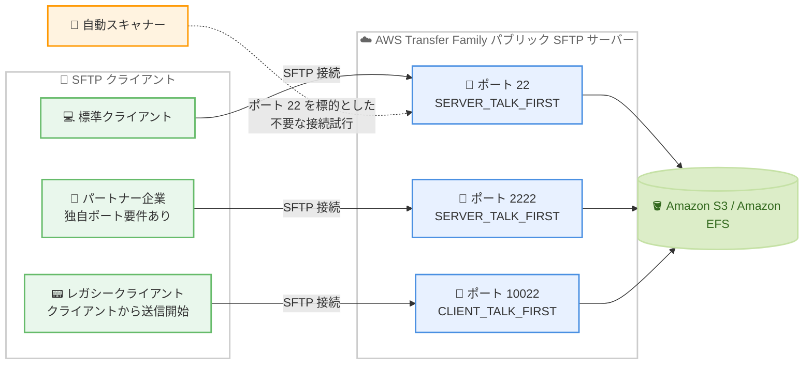

# AWS Transfer Family - パブリック SFTP サーバーのカスタムポートサポート

**リリース日**: 2026 年 10 月 12 日
**サービス**: AWS Transfer Family
**機能**: パブリック SFTP サーバーにおけるカスタムポートと通信モードの設定

📊 [このアップデートのインフォグラフィックを見る](https://takech9203.github.io/aws-news-summary/20261012-transfer-family-custom-ports-sftp.html)

## 概要

AWS Transfer Family が、パブリックエンドポイントの SFTP サーバーでカスタムポートの設定をサポートしました。1 つのサーバーに最大 3 つのポートを設定でき、各ポートにはポート 22 または 2000〜65535 の任意のポート番号を指定できます。さらに、ポートごとに通信モード (クライアントファーストまたはサーバーファースト) を選択できるため、接続開始の挙動が異なる多様な SFTP クライアントを単一のサーバーで確実にサポートできます。

これまでパブリック SFTP サーバーはポート 22 のみ、かつサーバーファースト通信のみに固定されていました。今回のアップデートにより、ビジネス要件やネットワークポリシーで特定のポート番号が求められる場合に柔軟に対応できるほか、ポート 22 以外のポートを使用することで、ポート 22 を標的とする自動スキャナーからの不要な接続試行を削減できます。

自身からデータ送信を開始する一部の SFTP クライアントは、サーバーファーストのポートで接続が停止することがありました。クライアントファーストモードのポートを用意し、該当するクライアントをそのポートに誘導することで、この問題を回避できます。

**アップデート前の課題**

- パブリック SFTP サーバーはポート 22 のみで待ち受けており、組織のネットワークポリシーやパートナー企業の要件で別のポート番号が必要な場合に対応できなかった
- 通信モードはサーバーファーストに固定されており、TCP ピギーバック ACK を利用して自身から通信を開始する一部のクライアントで接続が停止することがあった
- ポート 22 は自動スキャナーの標的になりやすく、不要な接続試行がログのノイズや運用負荷の原因となっていた
- カスタムポートを使用するには VPC ホスト型エンドポイントと NLB などの追加構成が必要だった (VPC ホスト型でもポートは 2222、2223、22000 に限定)

**アップデート後の改善**

- パブリック SFTP サーバーに最大 3 つのポート (22、または 2000〜65535 の任意の整数) を設定できるようになった
- ポートごとにクライアントファースト (`CLIENT_TALK_FIRST`) またはサーバーファースト (`SERVER_TALK_FIRST`) の通信モードを選択できるようになった
- ポート 22 以外のポートを使用することで、自動スキャナーからの不要な接続試行を削減できるようになった
- レガシークライアントとモダンクライアントが混在する環境でも、単一サーバーで複数ポートを提供して両者に対応できるようになった

## アーキテクチャ図



単一のパブリック SFTP サーバーが最大 3 つのポートで待ち受け、クライアントの要件に応じたポートと通信モードで接続を受け付けます。ポート 22 を標的とする自動スキャナーの影響を受けないカスタムポートへクライアントを誘導できます。

## サービスアップデートの詳細

### 主要機能

1. **最大 3 つのカスタムポート設定**
   - パブリックエンドポイントの SFTP サーバーで、`ProtocolDetails` の `SftpPorts` プロパティを使用して最大 3 つのポートを設定可能
   - 各ポートには、ポート 22 または 2000〜65535 の任意の整数を指定可能
   - ビジネス要件やネットワークポリシーで指定されたポート番号をそのまま利用可能

2. **ポートごとの通信モード選択**
   - 各ポートに `CommunicationMode` として `CLIENT_TALK_FIRST` または `SERVER_TALK_FIRST` を設定可能
   - `CLIENT_TALK_FIRST`: TCP ピギーバック ACK (TCP 3 ウェイハンドシェイクの最後の ACK にデータを載せる方式) を必要とするクライアント向け
   - `SERVER_TALK_FIRST`: クライアントの挙動が不明な場合、またはピギーバック ACK に依存しない一般的なクライアント向け
   - 接続開始の挙動が異なるクライアントを、それぞれ適切なモードのポートに誘導可能

3. **セキュリティノイズの削減**
   - ポート 22 以外のポートを使用することで、ポート 22 を標的とする自動スキャナーからの不要な接続試行を削減
   - ログのノイズを減らし、正規の接続の監視を容易にする

## 技術仕様

### SftpPorts 設定

| 項目 | 詳細 |
|------|------|
| 対象エンドポイント | `PUBLIC` エンドポイントタイプの SFTP サーバー |
| ポート数 | 最大 3 つ |
| 指定可能なポート番号 | 22、または 2000〜65535 の任意の整数 |
| 通信モード | `CLIENT_TALK_FIRST` または `SERVER_TALK_FIRST` (ポートごとに設定) |
| 設定方法 | AWS Transfer Family コンソール、AWS CLI、AWS SDK |
| 設定プロパティ | `ProtocolDetails` 内の `SftpPorts` |

### API 変更履歴

| 日付 | サービス | 変更内容 |
|------|----------|----------|
| 2026/09/29 | [transfer](https://awsapichanges.com/archive/changes/e9bb16-transfer.html) | 3 updated api methods - `CreateServer`、`DescribeServer`、`UpdateServer` の `ProtocolDetails` に `SftpPorts` (`SftpPort` と `CommunicationMode`) が追加 |

### 設定例

```json
{
  "ProtocolDetails": {
    "SftpPorts": [
      {
        "SftpPort": 22,
        "CommunicationMode": "SERVER_TALK_FIRST"
      },
      {
        "SftpPort": 2222,
        "CommunicationMode": "SERVER_TALK_FIRST"
      },
      {
        "SftpPort": 10022,
        "CommunicationMode": "CLIENT_TALK_FIRST"
      }
    ]
  }
}
```

## 設定方法

### 前提条件

1. AWS Transfer Family のパブリックエンドポイント (`PUBLIC`) を使用する SFTP サーバー、またはその新規作成権限
2. `transfer:CreateServer` または `transfer:UpdateServer` を実行できる IAM 権限
3. クライアント側のファイアウォールやネットワークで、使用するカスタムポートへのアウトバウンド通信が許可されていること

### 手順

#### ステップ 1: 既存サーバーの現在の設定を確認する

```bash
aws transfer describe-server \
  --server-id s-1234567890abcdef0 \
  --query "Server.ProtocolDetails"
```

対象サーバーの `ProtocolDetails` を取得し、現在のポート設定を確認します。`SftpPorts` が未設定の場合、サーバーはデフォルトのポート 22 (サーバーファースト) で動作しています。

#### ステップ 2: カスタムポートと通信モードを設定する

```bash
aws transfer update-server \
  --server-id s-1234567890abcdef0 \
  --protocol-details '{
    "SftpPorts": [
      {"SftpPort": 22, "CommunicationMode": "SERVER_TALK_FIRST"},
      {"SftpPort": 2222, "CommunicationMode": "SERVER_TALK_FIRST"},
      {"SftpPort": 10022, "CommunicationMode": "CLIENT_TALK_FIRST"}
    ]
  }'
```

`update-server` コマンドで `SftpPorts` を設定し、ポート 22 に加えてカスタムポート 2222 と 10022 を追加します。ポート 10022 はクライアントファースト通信を必要とするクライアント向けに `CLIENT_TALK_FIRST` を指定しています。コンソールの場合は、サーバー作成ウィザードの [追加の詳細を設定] 画面にある [SFTP custom ports] オプションから設定できます。

#### ステップ 3: 設定を確認し、クライアントから接続テストを行う

```bash
# 設定の反映を確認
aws transfer describe-server \
  --server-id s-1234567890abcdef0 \
  --query "Server.ProtocolDetails.SftpPorts"

# カスタムポートへの接続テスト
sftp -P 2222 testuser@s-1234567890abcdef0.server.transfer.ap-northeast-1.amazonaws.com
```

`describe-server` で `SftpPorts` の設定が反映されたことを確認し、SFTP クライアントの `-P` オプションでカスタムポートを指定して接続をテストします。

## メリット

### ビジネス面

- **パートナー要件への柔軟な対応**: 取引先やパートナー企業が独自のポート番号を要求する場合でも、追加のインフラなしで単一のマネージドサーバーで対応できる
- **移行の容易さ**: オンプレミスの SFTP サーバーがカスタムポートで運用されていた場合、クライアント側の接続設定を変更せずに Transfer Family へ移行できる
- **運用負荷の削減**: これまでカスタムポートのために必要だった NLB や VPC ホスト型エンドポイントの構成・管理が不要になる

### 技術面

- **クライアント互換性の向上**: クライアントファースト通信を必要とするレガシークライアントと、一般的なサーバーファーストのクライアントを単一サーバーで同時にサポートできる
- **セキュリティノイズの削減**: ポート 22 を標的とする自動スキャナーからの不要な接続試行を減らし、ログの可読性と監視精度を向上できる
- **段階的なポート移行**: 最大 3 つのポートを同時に提供できるため、既存ポートを維持しながら新しいポートへクライアントを段階的に移行できる

## デメリット・制約事項

### 制限事項

- 設定できるポートは 1 サーバーあたり最大 3 つまで
- 指定可能なポート番号は 22 または 2000〜65535 に限定され、1023 以下の他のウェルノウンポート (2000 未満) は指定できない
- 対象はパブリックエンドポイント (`PUBLIC`) の SFTP サーバー。VPC ホスト型エンドポイントのポート要件は従来どおり別の仕組み (ポート 2222、2223、22000) で対応する
- パブリックエンドポイントではセキュリティグループによるトラフィック制限はできない (従来からの仕様)

### 考慮すべき点

- カスタムポートの使用は自動スキャナーのノイズ削減に有効だが、それ自体はアクセス制御ではないため、認証やセキュリティポリシーによる保護は引き続き必須
- クライアント側のファイアウォールやプロキシで、使用するカスタムポートへのアウトバウンド通信を許可する必要がある
- クライアントの通信挙動が不明な場合は `SERVER_TALK_FIRST` を使用することが推奨されている
- 接続先ポートの変更をクライアント利用者へ周知する運用プロセスが必要

## ユースケース

### ユースケース 1: 自動スキャナーからの接続試行の削減

**シナリオ**: インターネットに公開した SFTP サーバーのログに、ポート 22 を標的とする自動スキャナーからの接続試行が大量に記録され、正規の接続の監視が困難になっている。

**実装例**:
```bash
aws transfer update-server \
  --server-id s-1234567890abcdef0 \
  --protocol-details '{
    "SftpPorts": [
      {"SftpPort": 10022, "CommunicationMode": "SERVER_TALK_FIRST"}
    ]
  }'
```

**効果**: ポート 22 での待ち受けを廃止しカスタムポートのみとすることで、自動スキャナーからの不要な接続試行を削減し、ログのノイズを抑えて監視精度を向上できる。

### ユースケース 2: レガシークライアントとモダンクライアントの混在環境

**シナリオ**: 取引先の一部が、TCP ピギーバック ACK を利用して自身から通信を開始するレガシー SFTP クライアントを使用しており、サーバーファーストのポートで接続が停止することがある。

**実装例**:
```bash
aws transfer update-server \
  --server-id s-1234567890abcdef0 \
  --protocol-details '{
    "SftpPorts": [
      {"SftpPort": 22, "CommunicationMode": "SERVER_TALK_FIRST"},
      {"SftpPort": 2200, "CommunicationMode": "CLIENT_TALK_FIRST"}
    ]
  }'
```

**効果**: 一般的なクライアントはポート 22、レガシークライアントはクライアントファーストのポート 2200 に誘導することで、単一サーバーですべてのクライアントが安定して接続できる。

### ユースケース 3: オンプレミス SFTP サーバーからの移行

**シナリオ**: オンプレミスでカスタムポート 2222 を使用して運用していた SFTP サーバーを Transfer Family へ移行したいが、多数の取引先クライアントの接続設定 (ポート番号) を変更させたくない。

**実装例**:
```bash
aws transfer create-server \
  --endpoint-type PUBLIC \
  --protocols SFTP \
  --identity-provider-type SERVICE_MANAGED \
  --protocol-details '{
    "SftpPorts": [
      {"SftpPort": 2222, "CommunicationMode": "SERVER_TALK_FIRST"}
    ]
  }'
```

**効果**: 既存のポート番号をそのまま Transfer Family 側で再現できるため、取引先への設定変更依頼を最小限に抑えてスムーズに移行できる。従来必要だった VPC ホスト型エンドポイントと NLB の構成も不要になる。

## 料金

今回のアップデートに伴う追加料金は発表されていません。AWS Transfer Family の標準料金 (プロトコルが有効化されたエンドポイントの時間課金と、アップロードおよびダウンロードされたデータ量に応じた GB 単位の課金) が適用されます。

詳細は [AWS Transfer Family 料金ページ](https://aws.amazon.com/aws-transfer-family/pricing/) を参照してください。

## 利用可能リージョン

AWS Transfer Family のパブリック SFTP サーバーが提供されているすべての AWS リージョンで利用可能です。

## 関連サービス・機能

- **Amazon S3**: Transfer Family のストレージバックエンド。SFTP 経由で転送されたファイルをオブジェクトとして保存
- **Amazon EFS**: Transfer Family のもう 1 つのストレージバックエンド。ファイルシステムとして転送データを保存
- **AWS Transfer Family VPC ホスト型エンドポイント**: セキュリティグループによるアクセス制御や固定 IP が必要な場合の選択肢。ポート 2222、2223、22000 をサポート
- **Amazon CloudWatch Logs**: サーバーの構造化ログの出力先。カスタムポートへの接続状況の監視に活用可能

## 参考リンク

- 📊 [インフォグラフィック](https://takech9203.github.io/aws-news-summary/20261012-transfer-family-custom-ports-sftp.html)
- [公式発表 (What's New)](https://aws.amazon.com/about-aws/whats-new/2026/10/transfer-family-custom-ports-sftp/)
- [ドキュメント: Create an SFTP-enabled server](https://docs.aws.amazon.com/transfer/latest/userguide/create-server-sftp.html)
- [API リファレンス: ProtocolDetails](https://docs.aws.amazon.com/transfer/latest/APIReference/API_ProtocolDetails.html)
- [料金ページ](https://aws.amazon.com/aws-transfer-family/pricing/)

## まとめ

AWS Transfer Family のパブリック SFTP サーバーで、最大 3 つのカスタムポートとポートごとの通信モードを設定できるようになりました。パートナー企業のポート要件やレガシークライアントの通信挙動に単一のマネージドサーバーで対応でき、ポート 22 を狙う自動スキャナーのノイズも削減できます。カスタムポートのために VPC ホスト型エンドポイントと NLB を構成していた場合は、パブリックエンドポイントへの構成簡素化を検討する価値があります。
