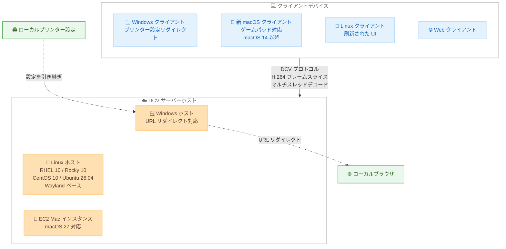

# Amazon DCV - バージョン 2026.0 リリース (RHEL 10 サポートと新クライアント)

**リリース日**: 2026 年 10 月 13 日
**サービス**: Amazon DCV
**機能**: Amazon DCV 2026.0 (新 OS サポート、新 macOS クライアント、URL リダイレクトなど)

📊 [このアップデートのインフォグラフィックを見る](https://takech9203.github.io/aws-news-summary/20261013-amazon-dcv-2026-0.html)

## 概要

Amazon DCV は、リモートデスクトップやアプリケーションストリーミングをあらゆるデバイスにネットワーク環境の変化に強い形で配信する、高性能なリモートディスプレイプロトコルです。今回リリースされたバージョン 2026.0 (ビルド 2026.0-24952) では、新しい OS のサポート、刷新されたクライアント、新機能、パフォーマンス改善が多数追加されました。

サーバー側では、RHEL 10、Rocky Linux 10、CentOS 10、Ubuntu 26.04 の仮想セッションが新たにサポートされ、これらの Linux ホストは Wayland ディスプレイサーバーをベースに動作します。また、Amazon EC2 Mac インスタンス上の DCV サーバーで macOS 27 がサポートされ、AWS European Sovereign Cloud での DCV EC2 ライセンスにも対応しました。クライアント側では、完全に新しくなったネイティブ macOS クライアント (ゲームパッド対応) に加え、Windows および Linux クライアントも更新されています。

さらに、Windows ホストでの URL リダイレクト、Windows クライアントから Windows ホストへのプリンター設定リダイレクト、H.264 フレームスライスサポートによる低遅延化など、リモートワークステーション利用者の体験を向上させる機能が追加されました。HPC、CAD/CAE、メディア制作、VDI 用途でリモートデスクトップ環境を運用するユーザーに幅広く関係するアップデートです。

**アップデート前の課題**

- RHEL 10 や Ubuntu 26.04 など最新の Linux ディストリビューションで DCV の仮想セッションを利用できなかった
- リモートセッション内でリンクをクリックすると、リモート側のブラウザで開くしかなく、ローカルブラウザで開きたいユースケース (SSO 認証、社内ポータルなど) に対応できなかった
- Windows ホストへ印刷する際に、クライアント側のプリンター設定 (用紙サイズ、両面印刷など) を引き継げなかった
- macOS クライアントは旧世代の実装で、ゲームパッドなどの入力デバイスサポートが限定的だった
- H.264 デコードがフレーム単位であり、Linux と macOS クライアントでの描画遅延に改善余地があった

**アップデート後の改善**

- RHEL 10、Rocky Linux 10、CentOS 10、Ubuntu 26.04 の Wayland ベース仮想セッションが利用可能になった
- macOS 14 (Sonoma) 以降に対応した新しいネイティブ macOS クライアントが提供され、ゲームパッドもサポートされた
- Windows ホストで URL リダイレクトが可能になり、設定したリンクをクライアントデバイスのローカルブラウザで開けるようになった
- Windows クライアントのプリンター設定を Windows ホストのリモートセッションに引き継げるようになった
- H.264 フレームスライスとマルチスレッドによるスライス単位のソフトウェアデコードにより、Linux と macOS クライアントの遅延が低減した
- Amazon EC2 Mac インスタンスで macOS 27 がサポートされ、AWS European Sovereign Cloud での DCV EC2 ライセンスにも対応した

## アーキテクチャ図



DCV 2026.0 におけるクライアントとサーバーホストの構成を示しています。新しい Linux ディストリビューションの Wayland ベース仮想セッション、刷新された macOS クライアント、URL リダイレクトとプリンター設定リダイレクトのデータフローがポイントです。

## サービスアップデートの詳細

### 主要機能

1. **新しい OS サポート (Wayland ベース)**
   - RHEL 10、Rocky Linux 10、CentOS 10、Ubuntu 26.04 の仮想セッションをサポート
   - これらの Linux ホスト / セッションは Wayland ディスプレイサーバー上で動作
   - Amazon EC2 Mac インスタンス上の DCV サーバーで macOS 27 をサポート

2. **新しいネイティブ macOS クライアント**
   - 従来の macOS クライアントを置き換える完全新規のネイティブクライアント
   - macOS 14 (Sonoma) 以降が必要
   - ゲームパッドサポートを追加
   - フルスクリーンツールバーに最小化ボタンを追加 (Windows クライアントにも同様に追加)

3. **Linux / Windows クライアントの更新**
   - Linux クライアントのユーザー体験を刷新
   - Windows クライアントは Microsoft Visual C++ 再頒布可能パッケージ バージョン 14.50 以降 (Visual Studio 2026) が必要

4. **URL リダイレクト (Windows ホスト)**
   - リモートセッション内で設定済みのリンクをクリックすると、クライアントデバイスのローカルブラウザで開く
   - ローカル側での認証やローカルリソースへのアクセスが必要なワークフローに有効

5. **プリンター設定リダイレクト (Windows クライアント → Windows ホスト)**
   - クライアント側のプリンター設定をリモートセッションで利用可能
   - 用紙設定などローカルの印刷環境を維持したまま、リモートセッションから印刷できる

6. **パフォーマンス改善 (H.264 フレームスライス)**
   - H.264 フレームスライスをサポート
   - Linux および macOS クライアントでスライス単位のマルチスレッドソフトウェアデコードを実装し、遅延を低減

7. **AWS European Sovereign Cloud 対応**
   - AWS European Sovereign Cloud での DCV EC2 ライセンスをサポート

## 技術仕様

### DCV 2026.0-24952 の構成コンポーネント

| コンポーネント | ビルド番号 |
|------|------|
| nice-dcv-server | 24952 |
| nice-dcv-client (Windows) | 13455 |
| nice-dcv-viewer (macOS) | 14405 |
| nice-dcv-viewer (Linux) | 14405 |
| nice-dcv-web-viewer | 24952 |
| nice-xdcv | 714 |
| nice-dcv-gl | 1122 |
| nice-dcv-gltest | 371 |
| nice-dcv-simple-external-authenticator | 300 |

### サポート変更点

| 項目 | 変更内容 |
|------|------|
| 新規サポート OS (サーバー) | RHEL 10、Rocky Linux 10、CentOS 10、Ubuntu 26.04 (Wayland ベースの仮想セッション)、macOS 27 (EC2 Mac) |
| サポート終了 | Amazon Linux 2 のサポートを終了 |
| macOS クライアント要件 | macOS 14 (Sonoma) 以降 |
| Windows クライアント要件 | Microsoft Visual C++ 再頒布可能パッケージ 14.50 以降 (Visual Studio 2026) |
| その他 | セキュリティおよびパフォーマンスの改善 |

## 設定方法

### 前提条件

1. DCV サーバーをインストールするホスト OS がサポート対象であること (RHEL 10 / Rocky Linux 10 / CentOS 10 / Ubuntu 26.04 / Windows / macOS など)
2. クライアント側は新バージョンのクライアント要件を満たすこと (macOS 14 以降、Windows は VC++ 再頒布可能パッケージ 14.50 以降)
3. Amazon EC2 上で利用する場合は、インスタンスから DCV ライセンスを取得するための S3 エンドポイントへのアクセス許可

### 手順

#### ステップ 1: DCV サーバー 2026.0 のダウンロードとインストール

```bash
# 例: RHEL 10 (x86_64) へのインストール
wget https://d1uj6qtbmh3dt5.cloudfront.net/nice-dcv-el10-x86_64.tgz
tar -xvzf nice-dcv-el10-x86_64.tgz
cd nice-dcv-*-el10-x86_64
sudo dnf install ./nice-dcv-server-*.el10.x86_64.rpm
```

DCV の公式ダウンロードサイトから RHEL 10 向けのパッケージを取得し、DCV サーバーをインストールします。実際のパッケージ名やバージョンはダウンロードページで確認してください。

#### ステップ 2: DCV サーバーの起動とセッション作成

```bash
# DCV サーバーの起動
sudo systemctl enable --now dcvserver

# 仮想セッションの作成
dcv create-session --type virtual my-session --owner myuser
```

DCV サーバーを起動し、仮想セッションを作成します。2026.0 の新規サポート OS では、セッションは Wayland ベースで動作します。

#### ステップ 3: 新クライアントのインストールと接続

```bash
# クライアントから接続 (例)
# macOS: 新しいネイティブクライアント (macOS 14 以降) をインストールして接続
# Windows / Linux: 最新クライアントをインストールして接続
dcvviewer https://<サーバーアドレス>:8443/#my-session
```

クライアントデバイスに 2026.0 対応の最新クライアントをインストールし、DCV サーバーへ接続します。URL リダイレクトやプリンター設定リダイレクトは、サーバー / クライアント側の設定で有効化します。

## メリット

### ビジネス面

- **最新 OS への移行パスの確保**: RHEL 10 や Ubuntu 26.04 など最新のエンタープライズ Linux へリモートワークステーション基盤を更新でき、OS のサポートライフサイクルに沿った運用が可能
- **ユーザー体験の向上による生産性向上**: URL リダイレクトやプリンター設定リダイレクトにより、ローカルとリモートを意識しないシームレスな業務フローを実現
- **欧州の規制要件への対応**: AWS European Sovereign Cloud での DCV EC2 ライセンスサポートにより、データ主権要件が厳しい環境でも利用可能

### 技術面

- **Wayland ベースの最新デスクトップスタック**: 新規サポートの Linux ディストリビューションでは Wayland 上で動作し、最新のディスプレイサーバー技術に対応
- **低遅延なストリーミング**: H.264 フレームスライスとマルチスレッドデコードにより、Linux / macOS クライアントでの描画遅延を低減
- **ネイティブ macOS クライアントの刷新**: ゲームパッド対応を含む新実装により、macOS ユーザーの操作性と拡張性が向上

## デメリット・制約事項

### 制限事項

- Amazon Linux 2 のサポートが終了したため、Amazon Linux 2 上で DCV サーバーを運用している場合は OS の移行が必要
- 新しい macOS クライアントは macOS 14 (Sonoma) 以降が必要で、それ以前の macOS では利用できない
- Windows クライアントは Microsoft Visual C++ 再頒布可能パッケージ 14.50 以降 (Visual Studio 2026) が必要
- URL リダイレクトは Windows ホスト、プリンター設定リダイレクトは Windows クライアントから Windows ホストへの接続に限定される

### 考慮すべき点

- Wayland ベースへの移行に伴い、X11 前提のアプリケーションやツールとの互換性を事前に検証する必要がある
- クライアント / サーバーのバージョン組み合わせによっては新機能が利用できないため、両方のアップデート計画が必要

## ユースケース

### ユースケース 1: 最新 RHEL 10 ベースのリモート開発環境への更新

**シナリオ**: RHEL 系 OS でエンジニアリング用リモートワークステーションを運用しており、RHEL 10 への OS 更新に合わせて DCV 環境も刷新したい。

**実装例**:
```
1. RHEL 10 の EC2 インスタンスまたはオンプレミスサーバーを用意
2. DCV サーバー 2026.0 をインストールし、Wayland ベースの仮想セッションを構成
3. 各ユーザーのクライアントを 2026.0 対応バージョンへ更新
```

**効果**: 最新 OS のサポートライフサイクルに沿った長期運用が可能になり、H.264 スライスデコードによる低遅延な操作体験も得られる。

### ユースケース 2: リモートセッションからローカルブラウザへの SSO 連携

**シナリオ**: リモートセッション内のアプリケーションから社内ポータルや SSO 認証ページへのリンクを、セキュリティ上の理由からクライアント側のローカルブラウザで開かせたい。

**実装例**:
```
1. Windows ホストで URL リダイレクトを有効化
2. リダイレクト対象の URL パターンを設定
3. ユーザーがリモートセッション内でリンクをクリックすると、ローカルブラウザで開く
```

**効果**: 認証情報をリモート環境に残さずにローカルで認証フローを完結でき、セキュリティとユーザー体験を両立できる。

### ユースケース 3: macOS ユーザーのクリエイティブ / ゲーム開発ワークフロー

**シナリオ**: ゲーム開発者やテスト担当者が macOS クライアントからリモートワークステーションに接続し、ゲームパッドを使った動作検証を行いたい。

**実装例**:
```
1. macOS 14 以降のデバイスに新しいネイティブ macOS クライアントをインストール
2. ゲームパッドをクライアントデバイスに接続
3. DCV セッションに接続し、リモート環境上のアプリケーションをゲームパッドで操作
```

**効果**: ローカルにゲームパッドを接続したままリモート環境で動作検証ができ、開発 / テスト環境の集約とデバイス運用の柔軟性を実現できる。

## 料金

Amazon DCV は、Amazon EC2 上で利用する場合は追加料金なしで使用できます (EC2 インスタンスなどの通常の AWS リソース利用料金のみ発生)。今回のアップデートで AWS European Sovereign Cloud での DCV EC2 ライセンスもサポートされました。オンプレミスや他のクラウドで利用する場合は、別途ライセンスの購入が必要です。詳細は Amazon DCV の料金ページを確認してください。

## 利用可能リージョン

Amazon DCV はクライアント / サーバー型のソフトウェアとして提供され、Amazon EC2 (AWS European Sovereign Cloud を含む) およびオンプレミス環境で利用できます。リージョン固有の制限は発表されていません。

## 関連サービス・機能

- **Amazon EC2**: EC2 インスタンス上で DCV サーバーを追加ライセンス費用なしで利用可能。EC2 Mac インスタンスでは macOS 27 もサポート
- **Amazon DCV Session Manager**: 複数の DCV サーバーにまたがるセッションのライフサイクル管理を行うコンポーネント
- **AWS European Sovereign Cloud**: 今回のアップデートで DCV EC2 ライセンスがサポートされた、欧州のデータ主権要件に対応するクラウド環境
- **Research and Engineering Studio on AWS**: DCV を利用して仮想デスクトップ環境を提供するソリューション

## 参考リンク

- 📊 [インフォグラフィック](https://takech9203.github.io/aws-news-summary/20261013-amazon-dcv-2026-0.html)
- [公式発表 (What's New)](https://aws.amazon.com/about-aws/whats-new/2026/10/amazon-dcv-2026-0/)
- [Amazon DCV リリースノート](https://docs.aws.amazon.com/dcv/latest/adminguide/doc-history-release-notes.html)
- [Amazon DCV 製品ページ](https://aws.amazon.com/hpc/dcv/)

## まとめ

Amazon DCV 2026.0 は、RHEL 10 をはじめとする最新 Linux ディストリビューションの Wayland ベースサポート、刷新された macOS クライアント、URL / プリンター設定リダイレクト、H.264 フレームスライスによる低遅延化など、サーバーとクライアントの両面で大きく進化したメジャーリリースです。Amazon Linux 2 のサポート終了やクライアント要件の変更が含まれるため、既存環境の利用者は OS とクライアントの移行計画を立てた上で、リリースノートを確認してアップグレードを進めることを推奨します。
