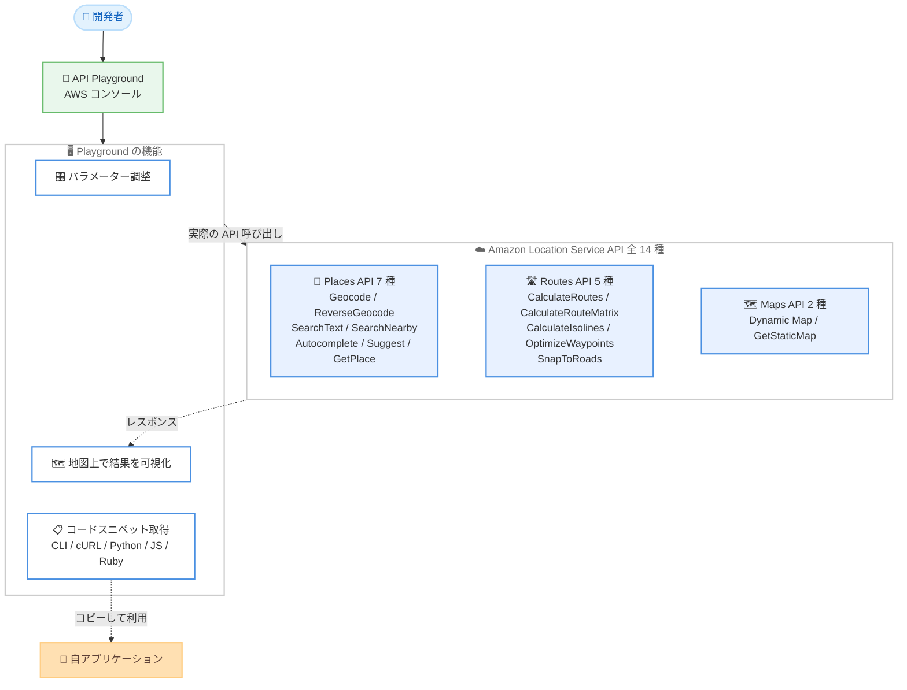

# Amazon Location Service - インタラクティブな API Playground の提供開始

**リリース日**: 2026 年 10 月 13 日
**サービス**: Amazon Location Service
**機能**: Places、Routes、Maps API を対象としたインタラクティブな API Playground

📊 [このアップデートのインフォグラフィックを見る](https://takech9203.github.io/aws-news-summary/20261013-amazon-location-service-api-playground.html)

## 概要

Amazon Location Service は、Places、Routes、Maps の全 14 種類の API をコードを書かずにビジュアルに試せる、インタラクティブな **API Playground** を発表しました。AWS マネジメントコンソール上で実際の API 呼び出しを実行し、結果をインタラクティブな地図上で確認しながら、パラメーターを調整し、すぐに使えるリクエストスニペットをアプリケーションにコピーできます。

API Playground では、住所検証のシミュレーション、トラックが安全に通行できる複数拠点ルートの計画、到達圏 (ドライブタイムのサービスエリア) の可視化、地図の埋め込みなどを、SDK のセットアップやテストスクリプトなしで試すことができます。位置情報アプリケーションの開発を始める開発者や、導入前に API の挙動を評価したいアーキテクトにとって、学習と検証のハードルを大きく下げるアップデートです。

**アップデート前の課題**

このアップデート以前には、以下の課題がありました。

- Amazon Location Service の API の挙動を確認するには、SDK のセットアップやテストスクリプトの作成が必要だった
- Geocode や CalculateRoutes などのレスポンスを地図上で視覚的に確認するには、自前で地図描画コードを実装する必要があった
- パラメーターの組み合わせによる結果の違いを試行錯誤するたびに、コードの修正と再実行が必要だった

**アップデート後の改善**

今回のアップデートにより、以下が可能になりました。

- コンソール上から 14 種類の Places、Routes、Maps API をコードなしで実行し、挙動を即座に確認できるようになった
- API の実行結果がインタラクティブな地図上にレンダリングされ、ジオコーディング結果やルート、到達圏を視覚的に理解できるようになった
- パラメーターを UI 上で調整しながら、CLI、cURL、Python、JavaScript、Ruby のすぐに使えるコードスニペットをダウンロードできるようになった

## アーキテクチャ図



開発者は API Playground 上でパラメーターを調整しながら実際の API を呼び出し、結果を地図上で確認できます。動作を確認したリクエストは、コードスニペットとしてそのまま自身のアプリケーションに取り込めます。

## サービスアップデートの詳細

### 主要機能

1. **コード不要のインタラクティブな API 実行**
   - AWS コンソール上から実際の API 呼び出しを実行し、サンプルリクエストとレスポンスを確認できる
   - パラメーターを UI 上で変更しながら、結果の違いを即座に比較できる
   - SDK のセットアップやテストスクリプトの作成は不要

2. **地図上での結果の可視化**
   - ジオコーディング結果、ルート、到達圏などの API レスポンスがインタラクティブな地図上にレンダリングされる
   - 座標やルート形状をコンソール上で直感的に確認できる

3. **すぐに使えるコードスニペットの提供**
   - 動作確認済みのリクエストを CLI、cURL、Python、JavaScript、Ruby のコードスニペットとしてダウンロードできる
   - アプリケーションへの組み込みまでの時間を短縮できる

4. **全 14 種類の Places、Routes、Maps API に対応**
   - 検索・ジオコーディング: Geocode、ReverseGeocode、Autocomplete、Suggest、SearchText、SearchNearby、GetPlace
   - ルーティング: CalculateRoutes、CalculateRouteMatrix、CalculateIsolines、OptimizeWaypoints、SnapToRoads
   - 地図: Dynamic Map、GetStaticMap

## 技術仕様

### 対応 API 一覧

| カテゴリ | API | 主な用途 |
|------|------|------|
| Places | Geocode | 住所やプレイス名を座標と住所コンポーネントに変換 |
| Places | ReverseGeocode | 座標を住所やプレイス情報に変換 |
| Places | SearchText | フリーテキストによる場所検索 (店舗、施設など) |
| Places | SearchNearby | 中心座標から指定半径内の POI を検索 |
| Places | GetPlace | PlaceId から営業時間や連絡先などの詳細情報を取得 |
| Places | Autocomplete | 入力中の部分文字列から住所を補完 |
| Places | Suggest | 不完全な入力やタイプミスから候補を提示 |
| Routes | CalculateRoutes | 車、トラック、徒歩、公共交通などのルート計算 |
| Routes | CalculateRouteMatrix | 複数の出発地と目的地間の所要時間・距離マトリクスを計算 |
| Routes | CalculateIsolines | 指定した時間や距離で到達可能なエリアを算出 |
| Routes | OptimizeWaypoints | 複数拠点の最適な訪問順序を計算 |
| Routes | SnapToRoads | GPS 座標を最寄りの道路にスナップして補正 |
| Maps | Dynamic Map | ズームやパンなどの操作が可能なインタラクティブ地図 |
| Maps | GetStaticMap | マーカーやルートを重ねた静的地図画像を生成 |

### コードスニペットの対応形式

| 形式 | 用途 |
|------|------|
| AWS CLI | コマンドラインでの検証、スクリプト化 |
| cURL | HTTP リクエストの直接確認 |
| Python | バックエンドやデータパイプラインへの組み込み |
| JavaScript | Web アプリケーションへの組み込み |
| Ruby | Ruby 製アプリケーションへの組み込み |

## 設定方法

### 前提条件

1. AWS アカウントを保有していること
2. Amazon Location Service の API を呼び出せる IAM 権限があること
3. API Playground が提供されているリージョン (東京リージョンを含む 15 リージョン) を利用すること

### 手順

#### ステップ 1: API Playground を開く

AWS マネジメントコンソールで Amazon Location Service の [API Playground](https://console.aws.amazon.com/location/api-playground) を開きます。追加のセットアップは不要です。

#### ステップ 2: 試したい API を選択してパラメーターを調整する

Places、Routes、Maps のカテゴリから試したい API (例: CalculateRoutes) を選択し、出発地や目的地、移動モード (トラックなど) のパラメーターを UI 上で設定します。実行すると実際の API が呼び出され、結果が地図上に表示されます。

#### ステップ 3: コードスニペットをアプリケーションに組み込む

期待どおりの結果が得られたら、CLI、cURL、Python、JavaScript、Ruby のいずれかの形式でリクエストスニペットをコピーまたはダウンロードし、自身のアプリケーションに組み込みます。

## メリット

### ビジネス面

- **評価サイクルの短縮**: 導入前の技術評価や PoC で、コードを書かずに API の品質とデータ内容を確認できるため、意思決定が速くなる
- **開発コストの削減**: 検証用のテストスクリプトや地図描画コードの実装が不要になり、プロトタイピングの工数を削減できる
- **オンボーディングの容易化**: 位置情報サービスに不慣れな開発者でも、API の挙動を視覚的に学習できる

### 技術面

- **視覚的なデバッグ**: ジオコーディング結果やルート、到達圏を地図上で確認でき、パラメーターの影響を直感的に把握できる
- **正確なリクエストの再利用**: Playground で動作確認したリクエストをそのままコードスニペットとして取得でき、実装時のパラメーター誤りを防げる
- **全 14 API の網羅**: 検索、ルーティング、地図描画までを 1 つの画面で横断的に試せる

## デメリット・制約事項

### 制限事項

- API Playground は AWS コンソール上の機能であり、コンソールへのサインインが必要
- 利用可能リージョンは 15 リージョンに限定される (下記参照)
- Playground から実行されるのは実際の API 呼び出しであるため、呼び出し内容によっては Amazon Location Service の標準料金が適用される可能性がある

### 考慮すべき点

- 本番アプリケーションへの組み込み時には、別途 API キーや IAM 認証などの認証方式の設計が必要
- Playground での動作確認結果は実行時点の地図データに基づくため、本番環境では継続的なテストも併用することが望ましい

## ユースケース

### ユースケース 1: EC サイトの住所検証フローの事前検証

**シナリオ**: EC サイトのチェックアウトで住所の自動補完と検証を導入したい。実装前に Autocomplete と Geocode の挙動や返却される住所コンポーネントを確認したい。

**実装例**:
```
1. API Playground で Autocomplete を開き、部分的な住所を入力して補完候補を確認
2. Geocode に切り替え、確定した住所から座標と郵便番号が取得できることを確認
3. 動作確認済みのリクエストを JavaScript スニペットとして取得し、チェックアウト画面に組み込む
```

**効果**: 実装前にデータ品質とレスポンス構造を確認でき、配送エラー削減につながる住所検証フローを短期間で構築できる。

### ユースケース 2: 物流アプリのトラック向け複数拠点ルートの設計

**シナリオ**: 配送管理システムで、トラックの車両制限を考慮した複数拠点の配送ルートを計算したい。移動モードや回避条件の違いによる結果を事前に比較したい。

**実装例**:
```
1. API Playground で OptimizeWaypoints を使い、複数の配送先の最適な訪問順序を確認
2. CalculateRoutes でトラックモードを指定し、通行制限を考慮したルートを地図上で確認
3. 有料道路回避などのパラメーターを変えて結果を比較し、最適な設定を決定
4. 確定したリクエストを Python スニペットとして取得し、バックエンドに組み込む
```

**効果**: トラックが安全に通行できる複数拠点ルートの計算ロジックを、コーディング前に視覚的に検証できる。

### ユースケース 3: 店舗出店計画のための到達圏分析

**シナリオ**: 小売企業が新店舗の商圏分析のために、候補地から車で一定時間以内に到達できるエリアを可視化したい。

**実装例**:
```
1. API Playground で CalculateIsolines を開き、候補地の座標と時間しきい値 (例: 15 分) を設定
2. 交通状況や移動モードのパラメーターを変えながら、到達圏の変化を地図上で比較
3. 分析パイプラインへの組み込み用に CLI スニペットを取得し、バッチ処理に組み込む
```

**効果**: 到達圏 (ドライブタイムのサービスエリア) をコードなしで即座に可視化でき、商圏分析や出店判断の初期検討を迅速化できる。

## 料金

今回の発表では API Playground 自体の料金に関する記載はありません。Playground からは実際の API 呼び出しが行われるため、呼び出した API に応じて Amazon Location Service の標準料金が適用される可能性があります。詳細は [Amazon Location Service 料金ページ](https://aws.amazon.com/location/pricing/) を参照してください。

## 利用可能リージョン

API Playground は以下の 15 リージョンで利用できます。

- 米国東部 (オハイオ、バージニア北部)
- 米国西部 (オレゴン)
- アジアパシフィック (ムンバイ、シンガポール、シドニー、マレーシア、東京)
- カナダ (中部)
- 欧州 (フランクフルト、アイルランド、ロンドン、スペイン、ストックホルム)
- 南米 (サンパウロ)

## 関連サービス・機能

- **Amazon Location Service Places**: ジオコーディング、リバースジオコーディング、場所検索を提供する機能。Playground の Places カテゴリで試せる
- **Amazon Location Service Routes**: ルート計算、ルートマトリクス、到達圏、経由地最適化を提供する機能。Playground の Routes カテゴリで試せる
- **Amazon Location Service Maps**: ダイナミック地図と静的地図を提供する機能。Playground の Maps カテゴリで試せる
- **MapLibre**: ダイナミック地図のレンダリングに利用できるオープンソースの地図描画エンジン

## 参考リンク

- 📊 [インフォグラフィック](https://takech9203.github.io/aws-news-summary/20261013-amazon-location-service-api-playground.html)
- [公式発表 (What's New)](https://aws.amazon.com/about-aws/whats-new/2026/10/amazon-location-service-api-playground)
- [API Playground (AWS コンソール)](https://console.aws.amazon.com/location/api-playground)
- [ドキュメント: API Playground - Amazon Location Service Developer Guide](https://docs.aws.amazon.com/location/latest/developerguide/api-playground.html)
- [料金ページ: Amazon Location Service](https://aws.amazon.com/location/pricing/)

## まとめ

Amazon Location Service の API Playground により、Places、Routes、Maps の全 14 API をコードなしで実行し、結果を地図上で確認しながら、すぐに使えるコードスニペットを取得できるようになりました。位置情報機能の導入を検討している場合は、まず Playground で API の挙動とデータ品質を確認し、動作確認済みのリクエストをそのままアプリケーションに組み込むアプローチを推奨します。
