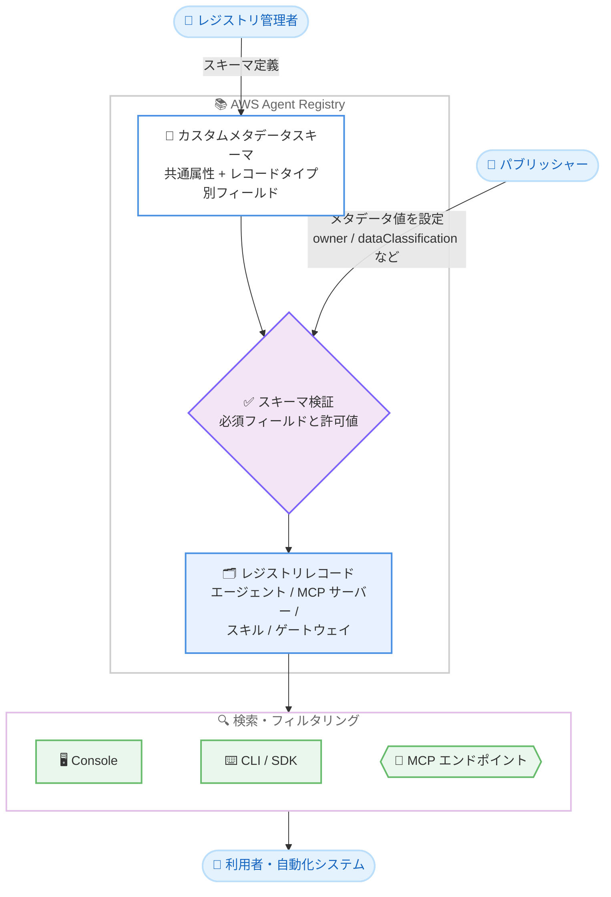

# AWS Agent Registry - レジストリレコードのカスタムメタデータ対応

**リリース日**: 2026 年 10 月 13 日
**サービス**: AWS Agent Registry
**機能**: レジストリレコードへのカスタムメタデータ (カスタムメタデータスキーマ) のサポート

📊 [このアップデートのインフォグラフィックを見る](https://takech9203.github.io/aws-news-summary/20261013-aws-agent-registry-custom-metadata-registry-records.html)

## 概要

AWS Agent Registry が、レジストリレコードへのカスタムメタデータの付与をサポートしました。AWS Agent Registry は、組織内のエージェント、MCP サーバー、エージェントスキル、ゲートウェイ、カスタムリソースを一元管理するガバナンス付きカタログです。今回のアップデートにより、組織独自の構造化フィールド (例: 所有チーム、データ分類、レビューステータス) をすべてのレジストリレコードに追加できるようになりました。

スキーマはレジストリごとに 1 回定義します。全レコードタイプ共通の属性 (共通属性) を定義し、さらにレコードタイプ固有のフィールド (例: エージェントレコードにおけるモデルファミリー) で拡張できます。フィールドタイプはフリーテキスト、URL、ブール値、許可値リストからの選択 (Enum) をサポートし、レコードの作成・更新時に必須フィールドと値がレジストリによって検証されます。

検索結果は、AWS Management Console、AWS CLI、AWS SDK、またはレジストリの MCP エンドポイント経由で、任意のカスタムメタデータフィールドによるフィルタリングが可能です。これにより、人間と自動化システムの双方が、組織全体で一貫した方法でリソースを発見・ガバナンスできます。

**アップデート前の課題**

エージェントや MCP サーバーなどのリソースが数百規模に拡大すると、名前と説明だけでは効果的なガバナンスと発見が困難でした。

- 以前はレコードに名前と説明しか付与できず、所有チームやデータ分類などの組織固有の属性を記録できなかった
- 以前はリソースの分類やレビューステータスを外部の台帳 (スプレッドシートなど) で別途管理する必要があった
- 以前は組織固有の属性に基づくレコードの検索・フィルタリングができなかった

**アップデート後の改善**

今回のアップデートにより、組織独自の構造化メタデータをレジストリ上で直接管理できるようになりました。

- レジストリごとにスキーマを 1 回定義するだけで、全レコードに共通属性とレコードタイプ固有フィールドを適用できるようになった
- レコードの作成・更新時に必須フィールドと許可値がレジストリによって自動検証され、メタデータの一貫性が保証されるようになった
- Console、CLI、SDK、MCP エンドポイントのいずれからでも、カスタムメタデータフィールドで検索結果をフィルタリングできるようになった

## アーキテクチャ図



管理者がレジストリにカスタムメタデータスキーマを定義すると、パブリッシャーがレコードを作成・更新する際にレジストリが必須フィールドと許可値を検証します。利用者と自動化システムは Console、CLI/SDK、MCP エンドポイントからカスタムメタデータでレコードをフィルタリングして発見できます。

## サービスアップデートの詳細

### 主要機能

1. **カスタムメタデータスキーマの定義**
   - レジストリごとにスキーマを 1 回定義し、全レコードタイプに適用する共通属性 (API では `defaultSchema`) を設定できる
   - レコードタイプ固有のフィールド (API では `recordTypeSchemaOverrides`) を追加でき、例えばエージェントレコードにのみモデルファミリーのフィールドを要求できる
   - 共通属性をレコードタイプ側で再定義することで、特定のレコードタイプだけ必須化したり、許可値を追加したりできる

2. **4 種類のフィールドタイプと自動検証**
   - フィールドタイプはテキスト、Enum (許可値リスト)、URL、ブール値の 4 種類をサポート
   - レコードの作成・更新のたびに、レジストリが必須フィールドの有無と許可値を自動検証する
   - スキーマ変更後に適合しなくなったレコードは `customMetadataSchemaComplianceStatus` で `NON_COMPLIANT` として報告される (承認ステータスは維持)

3. **カスタムメタデータによる検索フィルタリング**
   - 検索結果を任意のカスタムメタデータフィールドでフィルタリング可能
   - AWS Management Console、AWS CLI、AWS SDK、レジストリの MCP エンドポイントのすべてのインターフェイスから利用できる
   - 自動化システムやエージェント自身が MCP エンドポイント経由でメタデータに基づくリソース発見を行える

## 技術仕様

### フィールドタイプ

| フィールドタイプ | JSON Schema 表現 | 用途 |
|------|------|------|
| テキスト | `{"type": "string"}` | 所有チーム名などの自由入力 |
| Enum | `{"type": "string", "enum": [...]}` | データ分類などの許可値リスト |
| URL | `{"type": "string", "format": "uri"}` | ドキュメントやリポジトリへのリンク |
| ブール値 | `{"type": "boolean"}` | レビュー済みフラグなどの真偽値 |

### スキーマの制限

| 制限項目 | 値 |
|------|------|
| 1 レコードタイプが持てるフィールド数 (共通属性含む、重複は 1 回カウント) | 30 |
| 共通属性のフィールド数 | 30 |
| Enum フィールドの許可値数 | 1〜25 |
| 許可値の長さ | 64 文字 |
| フィールド名の長さ | 64 文字 |
| スキーマの `title` | 64 文字 |
| スキーマの `description` | 256 文字 |
| 1 スキーマ (共通属性または 1 レコードタイプ分) のサイズ | 16,384 文字 |
| スキーマ設定全体のサイズ | 128 KB |
| レコードタイプあたりのスキーマ数 | 1 |

### スキーマ定義の例

共通属性 (全レコードに `owner` を必須、`dataClassification` を任意で付与):

```json
{
  "type": "object",
  "properties": {
    "owner": {"type": "string"},
    "dataClassification": {"type": "string", "enum": ["public", "internal", "confidential"]}
  },
  "required": ["owner"]
}
```

エージェントレコード固有のフィールド (`modelFamily` と `dataClassification` を必須化し、許可値 `restricted` を追加):

```json
{
  "type": "object",
  "properties": {
    "modelFamily": {"type": "string"},
    "dataClassification": {"type": "string", "enum": ["public", "internal", "confidential", "restricted"]}
  },
  "required": ["modelFamily", "dataClassification"]
}
```

## 設定方法

### 前提条件

1. AWS Agent Registry を利用可能なリージョン (バージニア北部、オレゴン、シドニー、東京、アイルランド) であること
2. `agent-registry-control` の API を呼び出す IAM 権限があること
3. AWS CLI または AWS SDK が最新バージョンに更新されていること

### 手順

#### ステップ 1: スキーマ設定ファイルの作成

```bash
jq -n --rawfile common common.json --rawfile agent agent.json \
  '{defaultSchema: $common, recordTypeSchemaOverrides: [{recordType: "AGENT", schema: $agent}]}' \
  > schema-config.json
```

共通属性 (`common.json`) とエージェント固有フィールド (`agent.json`) の 2 つの JSON Schema ドキュメントを、`defaultSchema` と `recordTypeSchemaOverrides` を持つスキーマ設定ファイルに組み立てています。各スキーマは JSON 文字列として埋め込まれます。

#### ステップ 2: スキーマ付きレジストリの作成

```bash
aws agent-registry-control create-registry \
  --name "my-registry" \
  --custom-metadata-schema-configuration file://schema-config.json \
  --region us-east-1
```

カスタムメタデータスキーマ設定を指定してレジストリを作成しています。以降、このレジストリのレコードを作成・更新する際に、スキーマに基づく検証が行われます。

#### ステップ 3: スキーマの更新

```bash
jq '.properties.team = {"type": "string"}' common.json > common.tmp && mv common.tmp common.json

jq -n --rawfile common common.json --rawfile agent agent.json \
  '{optionalValue: {defaultSchema: $common, recordTypeSchemaOverrides: [{recordType: "AGENT", schema: $agent}]}}' \
  > schema-update.json

aws agent-registry-control update-registry \
  --registry-id "<registryId>" \
  --custom-metadata-schema-configuration file://schema-update.json \
  --region us-east-1
```

共通属性に `team` フィールドを追加し、`optionalValue` でラップした完全な新スキーマ設定で `update-registry` を実行しています。スキーマ更新は全体置換となるため、維持したいフィールドとレコードタイプをすべて含める必要があります。

なお、AWS Management Console からは、レジストリ詳細ページの [Custom metadata schema] セクションの [Manage schema] からフォームまたは JSON 形式でスキーマを定義できます。

## メリット

### ビジネス面

- **ガバナンスの強化**: 所有チーム、データ分類、レビューステータスなどの組織固有の属性をレコード自体に記録でき、数百規模のリソースに対する統制を一元化できる
- **監査・コンプライアンス対応**: データ分類やレビューステータスをスキーマで強制することで、監査時にリソースの状態を体系的に確認できる
- **外部台帳の廃止**: スプレッドシートなどでの別管理が不要になり、情報の二重管理による不整合を防止できる

### 技術面

- **スキーマによる一貫性の保証**: レコード作成・更新時に必須フィールドと許可値が自動検証され、メタデータの品質が維持される
- **柔軟なスキーマ設計**: 共通属性とレコードタイプ固有フィールドの 2 層構造により、全体共通のポリシーとタイプ別の要件を両立できる
- **自動化との統合**: MCP エンドポイント経由でカスタムメタデータによるフィルタリングが可能なため、エージェントや自動化システムが適切なリソースをプログラムで発見できる

## デメリット・制約事項

### 制限事項

- フィールドのネストや `default`、`pattern` などの JSON Schema キーワードは使用できない (フィールドタイプは 4 種類のみ)
- 一度スキーマを定義すると、フィールド名の変更、フィールドの削除、フィールドタイプの変更、許可値の削除、必須フィールドの任意化、スキーマ自体の削除はできない
- 1 レコードタイプが持てるフィールド数は共通属性を含めて 30 まで、Enum の許可値は 1〜25 個まで
- フィールド名は大文字小文字のみが異なる名前 (例: `owner` と `Owner`) を併用できない

### 考慮すべき点

- スキーマ更新は全体置換のため、更新時に維持したいフィールドとレコードタイプをすべて含める必要がある
- スキーマ変更後、適合しなくなった既存レコードは `NON_COMPLIANT` として報告されるが自動では修正されないため、次回の承認申請前にメタデータの更新が必要
- AWS Agent Registry は新しい `agent-registry` 名前空間で提供されており、パブリックプレビューの `bedrock-agentcore` 名前空間のサポートは 2026 年 10 月 30 日に終了するため、移行が必要
- 削除や型変更ができないため、スキーマ設計 (特に Enum の許可値と必須設定) は事前に十分に検討する必要がある

## ユースケース

### ユースケース 1: 全社共通のリソースオーナーシップ管理

**シナリオ**: 複数の事業部がエージェントや MCP サーバーをレジストリに公開しており、各リソースの所有チームと連絡先を一元管理したい。

**実装例**:
```json
{
  "type": "object",
  "properties": {
    "owner": {"type": "string"},
    "runbookUrl": {"type": "string", "format": "uri"}
  },
  "required": ["owner"]
}
```

**効果**: すべてのレコードに所有チームが必ず記録され、インシデント発生時に `owner` でフィルタリングして担当チームと運用手順書を即座に特定できる。

### ユースケース 2: データ分類に基づくエージェントのガバナンス

**シナリオ**: 機密データを扱うエージェントを識別し、レビュー済みのエージェントのみ利用を許可する統制を実現したい。

**実装例**:
```json
{
  "type": "object",
  "properties": {
    "dataClassification": {"type": "string", "enum": ["public", "internal", "confidential", "restricted"]},
    "securityReviewed": {"type": "boolean"}
  },
  "required": ["dataClassification", "securityReviewed"]
}
```

**効果**: エージェントレコードに必ずデータ分類とセキュリティレビュー状況が記録され、`restricted` のエージェントを検索で抽出して追加の統制を適用できる。

### ユースケース 3: MCP エンドポイント経由の自動リソース発見

**シナリオ**: オーケストレーターエージェントが、タスクに応じて承認済みかつ特定のモデルファミリーのエージェントを動的に発見して呼び出したい。

**実装例**:
```
レジストリの MCP エンドポイントに対して、
modelFamily と securityReviewed のカスタムメタデータフィールドで
検索結果をフィルタリングするクエリを実行
```

**効果**: 人手を介さずに、組織のガバナンス基準を満たすリソースだけをプログラムで発見・利用でき、エージェント間連携の安全性と拡張性が向上する。

## 料金

今回の公式発表には、カスタムメタデータ機能に関する追加料金の記載はありません。AWS Agent Registry の利用料金の詳細は、公式ドキュメントおよび料金ページを確認してください。

## 利用可能リージョン

以下のリージョンで利用可能です。

- 米国東部 (バージニア北部)
- 米国西部 (オレゴン)
- アジアパシフィック (シドニー)
- アジアパシフィック (東京)
- 欧州 (アイルランド)

## 関連サービス・機能

- **Amazon Bedrock AgentCore**: AWS Agent Registry は AgentCore ファミリーの一部として提供されており、エージェントの実行基盤 (Runtime、Gateway、Memory など) と組み合わせて利用できる。なお、レジストリはプレビュー時の `bedrock-agentcore` 名前空間から新しい `agent-registry` 名前空間に移行している
- **Model Context Protocol (MCP)**: レジストリは MCP サーバーをレコードタイプとしてカタログ化でき、レジストリ自体も MCP エンドポイントを提供するため、エージェントからのリソース発見に活用できる
- **AWS IAM**: レジストリとスキーマの管理操作 (`agent-registry-control`) に対するアクセス制御に使用する

## 参考リンク

- 📊 [インフォグラフィック](https://takech9203.github.io/aws-news-summary/20261013-aws-agent-registry-custom-metadata-registry-records.html)
- [公式発表 (What's New)](https://aws.amazon.com/about-aws/whats-new/2026/10/aws-agent-registry-custom-metadata-registry-records)
- [ドキュメント: AWS Agent Registry](https://docs.aws.amazon.com/bedrock-agentcore/latest/devguide/registry.html)
- [ドキュメント: カスタムメタデータスキーマの定義](https://docs.aws.amazon.com/bedrock-agentcore/latest/devguide/registry-custom-metadata-schema.html)
- [ドキュメント: レコードへのカスタムメタデータ値の設定](https://docs.aws.amazon.com/bedrock-agentcore/latest/devguide/registry-custom-metadata-values.html)

## まとめ

AWS Agent Registry のカスタムメタデータ対応により、数百規模に拡大するエージェント、MCP サーバー、スキルなどのリソースを、組織固有の属性で体系的にガバナンス・発見できるようになりました。フィールドの削除や型変更ができないという制約があるため、所有チームやデータ分類などの必須属性を事前に設計したうえでスキーマを定義することを推奨します。また、プレビュー時の `bedrock-agentcore` 名前空間を利用している場合は、2026 年 10 月 30 日のサポート終了前に新しい `agent-registry` 名前空間への移行を計画してください。
