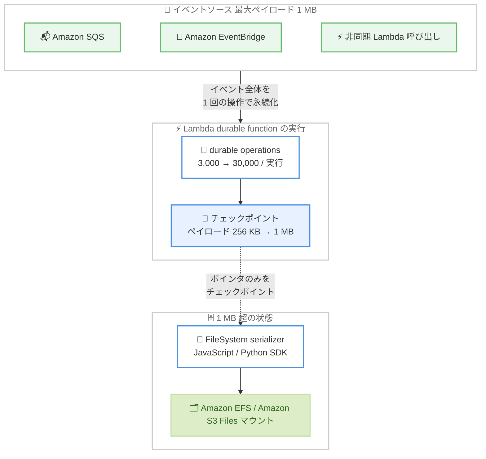

# AWS Lambda - durable functions の操作数とチェックポイントペイロードの上限引き上げ

**リリース日**: 2026 年 10 月 13 日
**サービス**: AWS Lambda
**機能**: durable functions の durable operation 数およびチェックポイントペイロードサイズの上限引き上げ

📊 [このアップデートのインフォグラフィックを見る](https://takech9203.github.io/aws-news-summary/20261013-aws-lambda-durable-gen-limit-increase.html)

## 概要

AWS Lambda durable functions において、1 回の実行 (execution) あたりの durable operation 数の上限が 3,000 から 30,000 に、チェックポイントペイロードの最大サイズが 256 KB から 1 MB に引き上げられました。追加の設定や料金は不要で、durable functions が利用可能なすべての AWS リージョンで新しい上限が自動的に適用されます。

AWS Lambda durable functions は、最長 1 年間実行できる耐障害性のあるマルチステップアプリケーションや AI ワークフローを構築するための機能で、チェックポイント、自動リトライ、コンピュート課金なしで実行を一時停止する wait を組み込みで提供します。durable operation の上限には、各ステップの試行、wait-for-condition の各ポーリング、parallel や map 操作の各ブランチなど、すべての操作がカウントされます。30,000 操作により、1 回の実行の中で、より複雑なマルチステップワークフローの調整、数千アイテムにわたる反復処理、数週間に及ぶ外部システムのポーリングが可能になります。

また、1 MB のチェックポイントペイロードは、非同期 Lambda 呼び出しや Amazon SQS、Amazon EventBridge といった統合サービスの最大ペイロードサイズと一致します。これにより、これらのソースから受け取ったイベント全体を 1 回の操作でそのままチェックポイントに永続化できます。数千回のモデル呼び出し・ツール呼び出しを行うエージェントアプリケーションでは、会話履歴、モデル応答、ツール出力を外部ストレージに書き出すことなくチェックポイントに直接保存できます。

**アップデート前の課題**

- 1 回の実行あたり 3,000 操作の上限があり、大規模な反復ループ、長期間のポーリング、複雑なロールバックパスを含むワークフローでは上限に達するおそれがあった
- チェックポイントペイロードは 256 KB までで、非同期 Lambda 呼び出しや Amazon SQS、Amazon EventBridge の最大ペイロード (1 MB) より小さく、イベント全体をそのまま永続化できないケースがあった
- エージェントアプリケーションで会話履歴やモデル応答が大きくなると、Amazon S3 などの外部ストレージへの書き出しが必要になるケースがあった

**アップデート後の改善**

- 操作数の上限が 10 倍の 30,000 になり、反復ループの拡大、より長期間のポーリング、ステップ失敗時に実行される複雑なロールバックパスの構築を単一の実行内で安全に行えるようになった
- チェックポイントペイロードが 1 MB となり、非同期 Lambda 呼び出し、Amazon SQS、Amazon EventBridge からのイベント全体を 1 回の操作で永続化できるようになった
- エージェントアプリケーションが、より大きな会話履歴、モデル応答、ツール出力を外部ストレージなしでチェックポイントに直接保存できるようになった

## アーキテクチャ図



イベントソースの最大ペイロードとチェックポイントサイズが 1 MB で一致し、イベント全体を 1 回の操作で永続化できる構成を示しています。1 MB を超える状態は FileSystem serializer がファイルマウントに書き込み、チェックポイントにはポインタのみを保存します。

## サービスアップデートの詳細

### 主要機能

1. **durable operation 数の上限を 3,000 から 30,000 に引き上げ**
   - 各ステップの試行、wait-for-condition の各ポーリング、parallel・map 操作の各ブランチがすべて上限にカウントされる
   - 反復ループの拡大、長期間のポーリング、ステップ失敗時に実行される複雑なロールバックパスの構築を単一の実行内で行える
   - 数千アイテムにわたる反復処理や、外部システムを数週間ポーリングし続けるワークフローも、チェックポイント上限を超えずに実行できる

2. **チェックポイントペイロードの最大サイズを 256 KB から 1 MB に引き上げ**
   - 非同期 Lambda 呼び出し、Amazon SQS、Amazon EventBridge の最大ペイロードサイズ (1 MB) と一致
   - これらのソースから受け取ったイベント全体を、分割せずに 1 回の操作で永続化できる
   - エージェントアプリケーションは、より大きな会話履歴、モデル応答、ツール出力をチェックポイントに直接保存できる

3. **1 MB 超の状態向けの FileSystem serializer**
   - JavaScript および Python の Durable Execution SDK に含まれる
   - ペイロードを Amazon EFS または Amazon S3 Files のマウントに書き込み、チェックポイントにはポインタのみを保存する
   - 1 MB の上限を超える大きな状態を扱うワークフローでも、SDK の仕組みの範囲内で対応できる

## 技術仕様

### durable functions の主なクォータ (今回の変更を含む)

| 項目 | 変更前 | 変更後 | 引き上げ可否 |
|------|--------|--------|--------------|
| 1 実行あたりの durable operation 数 | 3,000 | 30,000 | 不可 (ハードリミット) |
| durable operation あたりの最大ペイロードサイズ (チェックポイントおよびコールバック) | 256 KB | 1 MB | 不可 (ハードリミット) |
| 1 実行あたりの累積ストレージ書き込み量 | 100 MB | 100 MB (変更なし) | 不可 (ハードリミット) |
| リージョンあたりの同時実行中 durable execution 数 | - | 5,000,000 (バージニア北部、オレゴン、アイルランドは 10,000,000) | 可 (ソフトリミット) |

1 実行あたりの累積書き込み量 100 MB は変更されていない点に注意が必要です。1 MB のチェックポイントを多用する場合、操作数の上限より先に累積書き込み量の上限に達する可能性があります。

### 設定変更の要否

今回のアップデートは既定の上限値の引き上げであり、API の変更や関数側の設定変更は不要です。新しい上限は durable functions が利用可能なすべてのリージョンで自動的に適用されます。

## 設定方法

### 前提条件

1. AWS Lambda durable functions が利用可能なリージョンで durable 設定付きの Lambda 関数を利用していること
2. JavaScript、Python などの Durable Execution SDK を使用してワークフローを実装していること

### 手順

#### ステップ 1: 新しい上限の確認

```bash
# Lambda 開発者ガイドのクォータページで durable functions の上限を確認
# https://docs.aws.amazon.com/lambda/latest/dg/gettingstarted-limits.html
```

新しい上限は自動的に適用されるため、追加の申請や設定は不要です。公式ドキュメントで最新のクォータ値を確認します。

#### ステップ 2: ワークフロー設計の見直し

これまで 3,000 操作の上限を考慮して分割していたワークフローや、256 KB に収まるように状態を圧縮・分割していた処理があれば、単一の実行への統合やイベント全体の永続化への簡素化を検討します。

#### ステップ 3: 1 MB 超の状態への対応

会話履歴やツール出力が 1 MB を超える可能性がある場合は、SDK の [FileSystem serializer](https://docs.aws.amazon.com/durable-execution/sdk-reference/state/serialization/#filesystem-serdes) を利用し、Amazon EFS または Amazon S3 Files のマウントへ書き込む構成を検討します。

## メリット

### ビジネス面

- **アーキテクチャの簡素化によるコスト削減**: イベント全体をチェックポイントに保存できるため、状態の外部保存用に Amazon S3 や DynamoDB を別途構成・運用する必要性が減る
- **より長期・大規模な業務プロセスへの適用**: 数週間に及ぶ外部システムのポーリングや数千アイテムの反復処理を単一の実行で扱えるため、適用できる業務プロセスの範囲が広がる
- **追加コストなし**: 上限引き上げによる追加料金はなく、既存の durable functions ワークフローがそのまま恩恵を受けられる

### 技術面

- **ワークフロー分割の削減**: 操作数の上限を理由とした実行の分割や子ワークフローへの切り出しが不要になり、コードがシンプルになる
- **イベント処理の一貫性**: 非同期 Lambda 呼び出し、Amazon SQS、Amazon EventBridge の最大ペイロードとチェックポイントサイズが一致し、イベントの切り詰めや分割ロジックが不要になる
- **エージェントワークロードとの親和性**: 大きな会話履歴やモデル応答を外部ストレージを介さずチェックポイントに保持でき、リプレイ時の整合性管理が容易になる

## デメリット・制約事項

### 制限事項

- 1 実行あたり 30,000 操作、ペイロード 1 MB はいずれもハードリミットであり、引き上げ申請はできない
- 1 実行あたりの累積ストレージ書き込み量は引き続き 100 MB で変更されていない
- 1 MB を超える状態は FileSystem serializer と Amazon EFS または Amazon S3 Files のマウント構成が別途必要になる

### 考慮すべき点

- 各ステップの試行、wait-for-condition の各ポーリング、parallel・map の各ブランチがすべて操作数にカウントされるため、ポーリング間隔やリトライ回数の設計によっては依然として上限に達する可能性がある
- 大きなチェックポイントを高頻度で書き込むと、累積書き込み量 100 MB の上限に先に到達する可能性があるため、ペイロードサイズと操作数のバランスを考慮した設計が必要
- 従来の上限を前提に実装した分割ロジックを統合する場合は、リプレイへの影響を考慮し、発行バージョンを使ったデプロイ戦略で移行することが望ましい

## ユースケース

### ユースケース 1: 長期間の外部システムポーリング

**シナリオ**: 外部の基幹システムやサードパーティ API のジョブ完了を、数日から数週間にわたって定期的にポーリングして待つワークフロー。wait-for-condition の各ポーリングが操作数にカウントされる。

**実装例**:
```
wait-for-condition で 15 分間隔のポーリングを構成した場合
1 日あたり 96 操作 × 30 日 = 約 2,880 操作
変更前の 3,000 操作ではポーリングだけで上限に達していたが、
30,000 操作では前後の処理ステップを含めても十分な余裕がある
```

**効果**: ポーリング期間を理由にワークフローを分割する必要がなくなり、数週間規模の待機を含む業務プロセスを単一の durable execution で完結できる。

### ユースケース 2: SQS や EventBridge イベントをそのまま永続化するワークフロー

**シナリオ**: Amazon SQS や Amazon EventBridge から最大 1 MB のイベントを受け取り、複数ステップで処理するワークフロー。従来はチェックポイントが 256 KB までのため、大きなイベントは外部ストレージへの退避や分割が必要だった。

**実装例**:
```
変更前: イベント本体を S3 に保存し、チェックポイントにはキーのみを記録
変更後: イベント全体 (最大 1 MB) を 1 回の操作でチェックポイントに永続化
```

**効果**: イベントの退避・分割ロジックと外部ストレージへのアクセスが不要になり、コードの簡素化とレイテンシーの削減が期待できる。

### ユースケース 3: 大規模なエージェントアプリケーション

**シナリオ**: 数千回のモデル呼び出しとツール呼び出しを行いながら推論を重ねるエージェントアプリケーション。会話履歴やツール出力が実行の進行とともに増大する。

**実装例**:
```
各モデル呼び出し・ツール呼び出しを durable step としてチェックポイント化
会話履歴やモデル応答 (1 MB 以内) はチェックポイントに直接保存
1 MB を超える状態は FileSystem serializer で
Amazon EFS / Amazon S3 Files マウントに書き込み、ポインタのみを保存
```

**効果**: 数千ステップ規模の推論でも操作数の上限に余裕を持って対応でき、中断後も大きな会話コンテキストを失わずに最後に完了したステップから再開できる。

## 料金

今回の上限引き上げに伴う追加料金はありません。AWS Lambda durable functions の既存の料金体系がそのまま適用され、wait による実行の一時停止中はコンピューティング料金が発生しません。

詳細は [AWS Lambda 料金ページ](https://aws.amazon.com/lambda/pricing/) を参照してください。

## 利用可能リージョン

新しい上限は、AWS Lambda durable functions が利用可能なすべての AWS リージョンで適用されます。

## 関連サービス・機能

- **AWS Lambda durable functions**: 本アップデートの対象機能。チェックポイント、自動リトライ、wait により最長 1 年間の耐障害性のある実行を実現する
- **Amazon SQS / Amazon EventBridge**: 最大ペイロード 1 MB がチェックポイントサイズと一致し、イベント全体をそのまま永続化できる統合サービス
- **Amazon EFS / Amazon S3 Files**: 1 MB を超える状態を FileSystem serializer 経由で保存するファイルマウント先
- **AWS Step Functions**: ワークフローオーケストレーションの選択肢。コードと密結合したワークフローには durable functions、サービス横断のビジュアルオーケストレーションには Step Functions が適する

## 参考リンク

- 📊 [インフォグラフィック](https://takech9203.github.io/aws-news-summary/20261013-aws-lambda-durable-gen-limit-increase.html)
- [公式発表 (What's New)](https://aws.amazon.com/about-aws/whats-new/2026/10/aws-lambda-durable-gen-limit-increase/)
- [AWS Lambda durable functions 開発者ガイド](https://docs.aws.amazon.com/lambda/latest/dg/durable-functions.html)
- [Lambda クォータ (開発者ガイド)](https://docs.aws.amazon.com/lambda/latest/dg/gettingstarted-limits.html)
- [FileSystem serializer (Durable Execution SDK リファレンス)](https://docs.aws.amazon.com/durable-execution/sdk-reference/state/serialization/#filesystem-serdes)
- [AWS Lambda 料金ページ](https://aws.amazon.com/lambda/pricing/)

## まとめ

このアップデートにより、AWS Lambda durable functions の 1 実行あたりの操作数が 10 倍の 30,000 になり、チェックポイントペイロードが主要なイベントソースの最大サイズと同じ 1 MB に揃いました。操作数の上限を理由にワークフローを分割していた場合や、256 KB に収めるために状態を外部ストレージへ退避していた場合は、設計の簡素化を検討する価値があります。累積書き込み量 100 MB の上限は変更されていないため、ペイロードサイズと操作数のバランスを意識した設計を推奨します。
