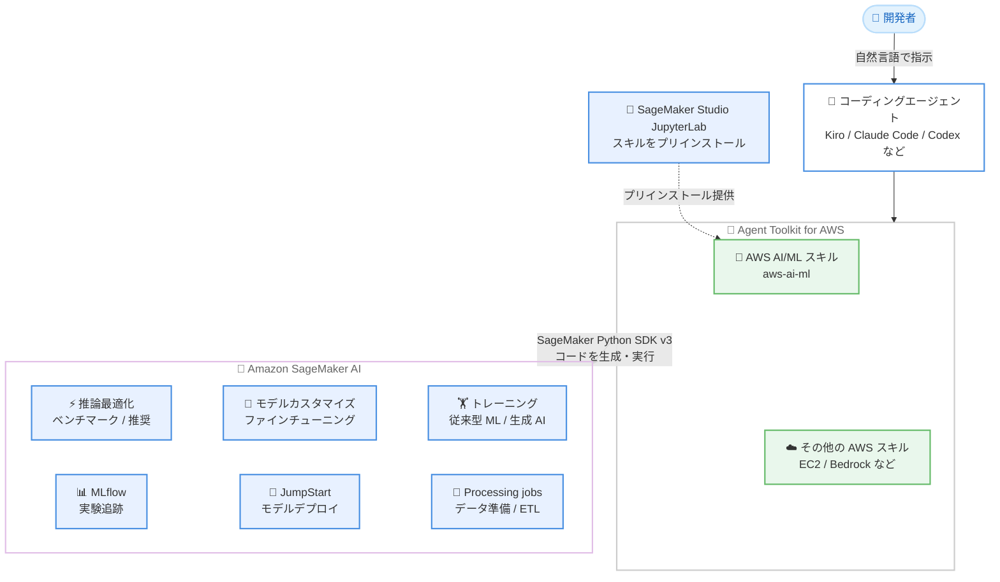

# Agent Toolkit for AWS - AWS AI/ML スキルによる SageMaker AI 専門知識のコーディングエージェントへの提供

**リリース日**: 2026 年 10 月 13 日
**サービス**: Amazon SageMaker AI / Agent Toolkit for AWS
**機能**: AWS AI/ML スキル (aws-ai-ml) によるコーディングエージェント向け SageMaker AI 専門知識の提供

📊 [このアップデートのインフォグラフィックを見る](https://takech9203.github.io/aws-news-summary/20261013-bring-sagemaker-ai-expertise-to-your-coding-agent.html)

## 概要

Agent Toolkit for AWS の AWS AI/ML スキル (aws-ai-ml) により、Kiro や Claude Code などのコーディングエージェントに Amazon SageMaker AI の深い専門知識を付与できるようになりました。開発者は自然言語の単一ワークフローで、SageMaker AI 上でのモデルの選択・トレーニング・最適化・デプロイを、他の AWS 環境との連携も含めて実行できます。

AWS AI/ML スキルは Agent Toolkit for AWS のコアスキルとして提供され、EC2 や Bedrock など他の AWS スキルと組み合わせて利用できます。今回の発表により、Agent Toolkit for AWS が唯一のサポート対象の統合ポイントとなり、従来の AWS Labs のスキル / プラグインを置き換えます。また、本スキルは SageMaker Studio の JupyterLab にプリインストールされており、Studio 内のターミナルからすぐに利用を開始できます。

対象ユーザーは、コーディングエージェントを活用して ML ワークロードを構築する ML エンジニア、データサイエンティスト、アプリケーション開発者です。推論最適化からモデルカスタマイズ、トレーニング、実験管理まで、SageMaker AI の幅広い機能領域をエージェント経由で操作できます。

**アップデート前の課題**

- 以前はコーディングエージェントが SageMaker AI の推論最適化やファインチューニングなどの専門的なワークフローを理解しておらず、開発者が API 仕様やベストプラクティスを自分で調査してコードを書く必要があった
- 以前は AWS Labs のスキル / プラグインが複数の場所に分散しており、統合ポイントが一本化されていなかった
- 以前は SageMaker Studio の JupyterLab でエージェントに SageMaker AI の知識を使わせるには、個別のセットアップが必要だった

**アップデート後の改善**

- 今回のアップデートにより、自然言語の指示だけでモデルの選択・トレーニング・最適化・デプロイまでの一連のワークフローをエージェントに実行させることが可能になった
- 今回のアップデートにより、Agent Toolkit for AWS が唯一のサポート対象の統合ポイントとなり、EC2 や Bedrock など他の AWS スキルと組み合わせた一貫したエージェント体験が実現した
- 今回のアップデートにより、SageMaker Studio の JupyterLab にスキルがプリインストールされ、追加セットアップなしで利用を開始できるようになった

## アーキテクチャ図



開発者が自然言語で指示すると、コーディングエージェントが AWS AI/ML スキルの専門知識を参照して SageMaker Python SDK v3 のコードを生成・実行し、推論最適化からトレーニング、デプロイまでの SageMaker AI の各機能を操作します。

## サービスアップデートの詳細

### 主要機能

1. **推論最適化 (Inference optimization)**
   - レイテンシ、スループット、コストの観点から推論構成を最適化
   - 既存エンドポイントのベンチマークを実行し、スループット (req/s、トークン/s)、レイテンシ (p50、p99、TTFT、トークン間レイテンシ) をレポート
   - S3 上のカスタムモデル、SageMaker JumpStart の基盤モデル、Hugging Face Hub のモデルに対して、コスト・スループット・レイテンシを含むランク付けされたインスタンスタイプ推奨を提供
   - 2 つのベンチマーク実行結果を比較し、主要メトリクスの差分を算出

2. **モデルカスタマイズ (Model customization)**
   - ユースケースの定義からトレーニング、評価、デプロイまでをガイド付きで支援するファインチューニングワークフロー
   - AI 主導のワークフローにより、ファインチューニングの複雑な設定を簡素化

3. **サーバーフルトレーニング (Serverful training)**
   - 従来型 ML と生成 AI の両方のトレーニングジョブに対応
   - SageMaker AI のマネージドインフラストラクチャ上でのトレーニング実行を支援

4. **MLflow による実験管理**
   - 実験追跡とモデルライフサイクル管理をエージェント経由で操作
   - SageMaker AI のマネージド MLflow と連携

5. **JumpStart モデルのデプロイと推奨**
   - 事前構築済みモデルのデプロイと、ユースケースに応じたモデル推奨を提供

6. **Processing jobs によるデータ準備**
   - マネージドコンピュート上でのデータ準備と ETL 処理を支援

## 技術仕様

### スキルの提供形態

| 項目 | 詳細 |
|------|------|
| スキル名 | aws-ai-ml |
| 提供元 | Agent Toolkit for AWS (GitHub: aws/agent-toolkit-for-aws) |
| 対応エージェント | Kiro、Claude Code、Codex、Cursor、fx など MCP 対応エージェント全般 |
| プリインストール環境 | SageMaker Studio JupyterLab |
| 生成コード | SageMaker Python SDK v3 (検査・修正・実行が可能) |
| 位置づけ | 従来の AWS Labs スキル / プラグインを置き換える唯一のサポート対象統合ポイント |

### エージェントの動作原則

- エンドポイント名や S3 URI などの不足情報は推測せず、開発者に質問する
- 実トラフィックを伴う操作 (ベンチマークなど) の前に明示的な確認を求める
- 生成されるコードはすべて検査・修正可能な SageMaker Python SDK v3 のコードで、不透明な UI の裏で処理が実行されることはない

## 設定方法

### 前提条件

1. AWS CLI 2.35 以降と uv がインストールされていること (ローカル利用の場合)
2. AWS 認証情報に SageMaker AI の API (エンドポイント作成、ベンチマーク / 推奨ジョブ実行など) を呼び出す IAM 権限があること
3. SageMaker Studio で利用する場合は、JupyterLab スペースの共有設定が Private であること (スキル同期の条件)

### 手順

#### ステップ 1: Agent Toolkit for AWS のインストール (ローカル利用の場合)

```bash
aws configure agent-toolkit
```

AWS CLI の組み込みコマンドで Agent Toolkit for AWS をセットアップしています。Claude Code の場合は、公式マーケットプレイス経由のプラグインインストール (`/plugin install aws-core@claude-plugins-official` など) も利用できます。

#### ステップ 2: AWS AI/ML スキルの追加

```bash
npx skills add aws/agent-toolkit-for-aws/skills/aws-ai-ml
```

GitHub リポジトリから aws-ai-ml スキルをコーディングエージェントに追加しています。Kiro の場合は、`.kiro/settings/mcp.json` に AWS MCP Server の設定を追加したうえでスキルをインストールします。

#### ステップ 3: 自然言語での利用

```text
Benchmark my Llama endpoint on SageMaker AI.
Find the best instance for model huggingface-reasoning-qwen3-8b on SageMaker AI.
```

エージェントのチャットで「What skills are available?」とスキルの認識を確認したあと、自然言語で意図を伝えます。エージェントがスキルの知識に基づいて SageMaker Python SDK v3 のコードを生成し、確認を経て実行します。

SageMaker Studio で利用する場合は、スキルがプリ構成されたイメージで JupyterLab スペースを作成し、ターミナルからエージェントにログイン (例: `kiro-cli login`) するだけで利用を開始できます。

## メリット

### ビジネス面

- **ML ワークフローの開発速度向上**: API 仕様やベストプラクティスの調査が不要になり、自然言語の指示だけで推論最適化やファインチューニングを進められる
- **コスト最適化の促進**: モデルごとに最適なインスタンスタイプの推奨とベンチマーク比較が容易になり、推論コストの削減判断をデータに基づいて行える
- **追加コストなし**: スキル自体は無料で、エージェントが使用する AWS リソースの料金のみが発生する

### 技術面

- **透明性の高いコード生成**: 出力はすべて検査・修正・実行可能な SageMaker Python SDK v3 のコードであり、ブラックボックス化を回避できる
- **他の AWS スキルとの統合**: EC2 や Bedrock などのスキルと組み合わせて、ML ワークロードと周辺の AWS 環境を単一のエージェントワークフローで扱える
- **安全な実行制御**: 実トラフィックを伴う操作の前に明示的な確認を求めるなど、エージェントの動作原則が組み込まれている

## デメリット・制約事項

### 制限事項

- 従来の AWS Labs のスキル / プラグインは置き換えられるため、既存利用者は Agent Toolkit for AWS への移行が必要
- SageMaker Studio でスキルを同期するには、JupyterLab スペースの共有設定を Private にする必要がある
- モデルデプロイの実行など、スキルのスコープ外の操作についてはエージェントが代替案を提示するにとどまる場合がある

### 考慮すべき点

- ベンチマークは既存エンドポイントに実トラフィックを送信するため、本番エンドポイントへの実行は影響を考慮して判断する必要がある
- エージェントが生成・実行するコードは SageMaker AI の API を呼び出すため、IAM 権限の適切なスコープ設定が重要
- ベンチマークで作成したエンドポイントや JupyterLab スペース、S3 上のジョブ成果物は、課金回避のため利用後に削除することが推奨される
- Hugging Face Hub のゲート付きモデル (Llama 系など) を利用する場合は、ライセンス確認と Hugging Face トークンが必要

## ユースケース

### ユースケース 1: 既存エンドポイントの性能ベンチマーク

**シナリオ**: SageMaker AI にデプロイ済みの LLM エンドポイントの性能特性を把握し、SLA を満たせるか確認したい。

**実装例**:
```text
エージェントへの指示:
"Benchmark my Llama endpoint on SageMaker AI."

エージェントが Workload.synthetic() と start_benchmark() を使う
Python ノートブックを生成し、確認後に実行
```

**効果**: スループット、p50/p99 レイテンシ、TTFT、トークン間レイテンシ、同時実行数を含むレポートが得られ、性能特性をデータに基づいて評価できる。

### ユースケース 2: モデルに最適なインスタンスタイプの選定

**シナリオ**: JumpStart の基盤モデルやファインチューニング済みのカスタムモデルをデプロイするにあたり、コストと性能のバランスが最適なインスタンスタイプを選びたい。

**実装例**:
```text
エージェントへの指示:
"Find the best instance for model huggingface-reasoning-qwen3-8b
 on SageMaker AI."

S3 上のカスタムモデルの場合は S3 URI を、
Hugging Face Hub のモデルの場合はモデル ID を提供
```

**効果**: コスト・スループット・レイテンシを含むランク付けされたデプロイオプションが提示され、過剰プロビジョニングや性能不足を回避できる。

### ユースケース 3: モデルサイズ変更の影響比較

**シナリオ**: 小型モデルから大型モデルへの移行を検討しており、性能向上とコスト増のトレードオフを定量的に評価したい。

**実装例**:
```text
エージェントへの指示:
2 つのベンチマークジョブ名を指定して比較を依頼

例: Qwen3-1.7B と Qwen3-8B のベンチマーク結果を比較
```

**効果**: 主要メトリクスの差分がパーセンテージで算出され、スループットやレイテンシの改善幅と必要な計算リソースの増加を踏まえた移行判断ができる。

## 料金

AWS AI/ML スキル自体に追加料金はありません。エージェントが使用する AWS リソース (SageMaker AI のエンドポイント、トレーニングジョブ、ベンチマークジョブなど) に対してのみ料金が発生します。

## 利用可能リージョン

公式発表にリージョンに関する記載はありません。スキルは GitHub の Agent Toolkit for AWS から利用でき、実際に操作する SageMaker AI の各機能は、それぞれの機能がサポートされるリージョンで利用できます。

## 関連サービス・機能

- **Amazon SageMaker AI**: スキルが操作する対象のマネージド ML サービス。推論、トレーニング、JumpStart、MLflow、Processing jobs などの機能をエージェント経由で利用する
- **Agent Toolkit for AWS**: AWS 公式のスキル、MCP サーバー、プラグインのコレクション。aws-core、aws-agents、aws-data-analytics などのプラグインと組み合わせて利用できる
- **Kiro**: AWS が提供する AI 搭載 IDE。AWS MCP Server 経由のランタイムスキル検出に対応しており、SageMaker Studio の JupyterLab からも利用できる
- **Amazon Bedrock**: Agent Toolkit for AWS の他のスキルがカバーする生成 AI サービス。AWS AI/ML スキルと組み合わせて、Bedrock と SageMaker AI をまたぐワークフローを構築できる

## 参考リンク

- 📊 [インフォグラフィック](https://takech9203.github.io/aws-news-summary/20261013-bring-sagemaker-ai-expertise-to-your-coding-agent.html)
- [公式発表 (What's New)](https://aws.amazon.com/about-aws/whats-new/2026/10/bring-sagemaker-ai-expertise-to-your-coding-agent/)
- [AWS Blog: New agent skill - Amazon SageMaker optimized generative AI inference for your coding agent](https://aws.amazon.com/blogs/machine-learning/new-agent-skill-amazon-sagemaker-optimized-generative-ai-inference-for-your-coding-agent/)
- [GitHub: Agent Toolkit for AWS](https://github.com/aws/agent-toolkit-for-aws/tree/main)
- [ドキュメント: SageMaker Studio JupyterLab のコーディングアシスタント](https://docs.aws.amazon.com/sagemaker/latest/dg/studio-updated-jl-coding-assistant.html)
- [AWS Builder Center: Agentic Model Customization](https://builder.aws.com/content/3BRdZnv6dY63soyl4qn7FJMQdqd/agentic-model-customization-simplifying-fine-tuning-with-ai-guided-workflows-in-amazon-sagemaker-ai)

## まとめ

AWS AI/ML スキルにより、コーディングエージェントが SageMaker AI の推論最適化、モデルカスタマイズ、トレーニング、実験管理までを自然言語ワークフローで実行できるようになりました。Agent Toolkit for AWS が唯一のサポート対象統合ポイントとなるため、従来の AWS Labs スキル / プラグインを利用している場合は移行を計画してください。SageMaker Studio の JupyterLab ではプリインストール済みのため、まずは Studio のターミナルからエージェントにログインして試すことを推奨します。
