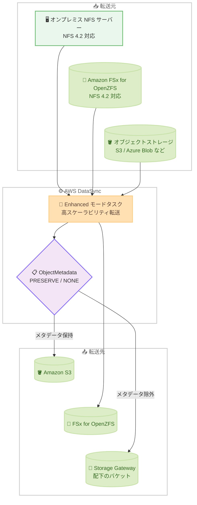

# AWS DataSync - Enhanced モードの FSx for OpenZFS、NFS 4.2、オブジェクトメタデータ制御サポート

**リリース日**: 2026 年 10 月 13 日
**サービス**: AWS DataSync
**機能**: Enhanced モードにおける Amazon FSx for OpenZFS サポート、NFS 4.2 サポート、ObjectMetadata オプション

📊 [このアップデートのインフォグラフィックを見る](https://takech9203.github.io/aws-news-summary/20261013-datasync-enhanced-openzfs-nfs42-metadata.html)

## 概要

AWS DataSync の Enhanced モードが機能拡張され、Amazon FSx for OpenZFS を転送元または転送先として利用できるようになりました。あわせて、オンプレミスの NFS サーバーおよび FSx for OpenZFS ファイルシステムに対する NFS バージョン 4.2 のサポートと、オブジェクトストレージ転送時にユーザーメタデータをコピーするかどうかを制御する新しい ObjectMetadata オプションが追加されました。

Enhanced モードは、Basic モードと比較して高いスケーラビリティとパフォーマンスを提供する DataSync のタスクモードです。今回のアップデートにより、FSx for OpenZFS を利用するデータ移行や、最新の NFS プロトコルバージョンを使用する環境でのデータ転送でも Enhanced モードの性能メリットを享受できるようになり、Storage Gateway 配下のバケットや Azure Blob Storage など、メタデータの取り扱いに注意が必要な転送先への移行も柔軟に制御できるようになりました。

なお、既存のタスクには影響がなく、スケジュールどおりに引き続き実行されます。

**アップデート前の課題**

このアップデート以前には、以下の課題や制限がありました。

- FSx for OpenZFS を転送元または転送先とするデータ移動は Basic モードに限定されており、Enhanced モードのスケーラビリティとパフォーマンスを活用できなかった
- Enhanced モードは NFS 4.2 をサポートしていなかったため、最新バージョンの NFS サーバーからデータを転送するには、古いプロトコルバージョンへの再設定が必要だった
- オブジェクトストレージ間の転送では、オブジェクトのユーザーメタデータのコピー可否を制御できず、転送先のメタデータを維持したい場合や、転送元のメタデータキーが転送先と互換性がない場合に問題が生じていた

**アップデート後の改善**

今回のアップデートにより、以下が可能になりました。

- FSx for OpenZFS を転送元または転送先として Enhanced モードのタスクを作成し、大規模なデータ転送を高速に実行できるようになった
- NFS 4.2 を利用するオンプレミス NFS サーバーや FSx for OpenZFS ファイルシステムから、プロトコルバージョンを変更することなく Enhanced モードでデータを転送できるようになった
- 新しい ObjectMetadata オプション (PRESERVE / NONE) により、オブジェクトのユーザーメタデータをコピーするかどうかをタスク単位で制御できるようになった

## アーキテクチャ図



Enhanced モードタスクが FSx for OpenZFS や NFS 4.2 対応の NFS サーバーを転送元・転送先として扱えるようになり、オブジェクトストレージ転送時には ObjectMetadata オプションでユーザーメタデータのコピー可否を制御できます。

## サービスアップデートの詳細

### 主要機能

1. **Amazon FSx for OpenZFS の Enhanced モードサポート**
   - FSx for OpenZFS を転送元または転送先として Enhanced モードのタスクを作成可能
   - これまで Basic モードに限定されていた FSx for OpenZFS のデータ移動で、Enhanced モードの高いスケーラビリティとパフォーマンスを活用可能
   - 大規模なファイルシステムの移行やデータレイクへのデータ集約を高速化

2. **NFS 4.2 サポート**
   - オンプレミスの NFS サーバーおよび FSx for OpenZFS ファイルシステムに対して NFS バージョン 4.2 で接続可能
   - 最新バージョンの NFS サーバーからのデータ転送時に、古いプロトコルバージョンへの再設定が不要
   - ロケーション作成時の `MountOptions.Version` に `NFS4_2` を指定可能

3. **ObjectMetadata オプションによるメタデータ制御**
   - オブジェクトストレージ転送において、オブジェクトのユーザーメタデータをコピーするかどうかを制御する新しいタスクオプション
   - `PRESERVE` (コピーする) または `NONE` (コピーしない) を指定可能
   - AWS Storage Gateway 配下のバケットのように転送先のメタデータを維持する必要がある場合や、Azure Blob Storage のように転送元のメタデータキーが転送先と互換性がない場合に有効

## 技術仕様

### 新機能の対応範囲

| 項目 | 詳細 |
|------|------|
| タスクモード | Enhanced モード (`TaskMode: ENHANCED`) |
| FSx for OpenZFS | 転送元・転送先の両方で利用可能 |
| NFS バージョン | `AUTOMATIC` / `NFS3` / `NFS4_0` / `NFS4_1` / `NFS4_2` (NFS4_2 を新規追加) |
| ObjectMetadata | `PRESERVE` (デフォルトの動作に相当) / `NONE` |
| 既存タスクへの影響 | なし (スケジュールどおりに実行継続) |

### API 変更履歴

| 日付 | サービス | 変更内容 |
|------|----------|----------|
| 2026/10/13 | [datasync](https://awsapichanges.com/archive/changes/5f4e0c-datasync.html) | 15 updated api methods - `CreateLocationNfs` / `CreateLocationFsxOpenZfs` / `CreateLocationFsxOntap` などに `NFS4_2` を追加、`CreateTask` / `UpdateTask` / `StartTaskExecution` などの `Options` に `ObjectMetadata` を追加 |

### タスクオプションの設定例

```json
{
  "Options": {
    "TransferMode": "CHANGED",
    "ObjectTags": "PRESERVE",
    "ObjectMetadata": "NONE"
  },
  "TaskMode": "ENHANCED"
}
```

## 設定方法

### 前提条件

1. AWS DataSync を利用できる AWS アカウントと IAM 権限があること
2. オンプレミス NFS サーバーを転送元とする場合は、DataSync エージェントがデプロイ済みであること
3. FSx for OpenZFS を利用する場合は、対象のファイルシステムが作成済みで、DataSync からアクセス可能なセキュリティグループが設定されていること

### 手順

#### ステップ 1: FSx for OpenZFS ロケーションの作成 (NFS 4.2 指定)

```bash
aws datasync create-location-fsx-open-zfs \
  --fsx-filesystem-arn arn:aws:fsx:ap-northeast-1:123456789012:file-system/fs-0123456789abcdef0 \
  --protocol '{"NFS": {"MountOptions": {"Version": "NFS4_2"}}}' \
  --security-group-arns arn:aws:ec2:ap-northeast-1:123456789012:security-group/sg-0123456789abcdef0 \
  --subdirectory /fsx/
```

FSx for OpenZFS ファイルシステムを DataSync のロケーションとして登録しています。`MountOptions.Version` に新しくサポートされた `NFS4_2` を指定しています。

#### ステップ 2: Enhanced モードタスクの作成

```bash
aws datasync create-task \
  --source-location-arn arn:aws:datasync:ap-northeast-1:123456789012:location/loc-source \
  --destination-location-arn arn:aws:datasync:ap-northeast-1:123456789012:location/loc-dest \
  --name "openzfs-enhanced-transfer" \
  --task-mode ENHANCED
```

転送元と転送先のロケーションを指定して、`--task-mode ENHANCED` で Enhanced モードのタスクを作成しています。FSx for OpenZFS を含むタスクでも Enhanced モードを選択できるようになりました。

#### ステップ 3: ObjectMetadata オプションを指定したオブジェクトストレージ転送

```bash
aws datasync create-task \
  --source-location-arn arn:aws:datasync:ap-northeast-1:123456789012:location/loc-azure-blob \
  --destination-location-arn arn:aws:datasync:ap-northeast-1:123456789012:location/loc-s3 \
  --name "object-transfer-no-metadata" \
  --task-mode ENHANCED \
  --options '{"ObjectMetadata": "NONE"}'
```

オブジェクトストレージ間の転送タスクで `ObjectMetadata` に `NONE` を指定し、転送元オブジェクトのユーザーメタデータをコピーしないように設定しています。転送先のメタデータを維持したい場合や、メタデータキーの互換性に問題がある場合に使用します。

## メリット

### ビジネス面

- **移行プロジェクトの短縮**: FSx for OpenZFS を含む大規模データ移行で Enhanced モードの高速転送を利用でき、移行期間とコストを削減できる
- **既存環境の変更が不要**: NFS 4.2 を利用する最新の NFS サーバーをそのまま転送元にでき、プロトコルのダウングレード作業や検証コストが不要になる
- **マルチクラウド移行の信頼性向上**: Azure Blob Storage などからの移行時にメタデータ互換性の問題を回避でき、移行失敗のリスクを低減できる

### 技術面

- **スケーラビリティの向上**: Enhanced モードは Basic モードよりも高い並列性とスケーラビリティを提供し、大量のファイルやオブジェクトの転送に適している
- **きめ細かなメタデータ制御**: `ObjectTags` に加えて `ObjectMetadata` もタスクオプションで制御でき、転送先の要件に応じた柔軟な設計が可能
- **タスク実行単位での上書き**: `StartTaskExecution` の `OverrideOptions` でも `ObjectMetadata` を指定でき、実行ごとに動作を変更できる

## デメリット・制約事項

### 制限事項

- ObjectMetadata オプションはオブジェクトストレージ転送に適用されるオプションであり、ファイルシステム間の転送には関係しない
- Enhanced モードが利用可能なリージョンでのみ今回の機能を利用できる
- Basic モードと Enhanced モードでは、サポートされるロケーションの組み合わせや動作に差異があるため、既存タスクをそのまま置き換える場合は事前確認が必要

### 考慮すべき点

- `ObjectMetadata: NONE` を指定すると転送元のユーザーメタデータが転送先にコピーされないため、メタデータに依存するアプリケーションがある場合は影響を確認する必要がある
- NFS 4.2 を指定する場合、転送元・転送先の NFS サーバーまたはファイルシステムが実際に NFS 4.2 をサポートしていることを確認する必要がある
- 既存のタスクは影響を受けないが、新機能を利用するにはタスクまたはロケーションの設定変更 (もしくは新規作成) が必要になる

## ユースケース

### ユースケース 1: FSx for OpenZFS への大規模データ移行

**シナリオ**: オンプレミスの NAS に保存された数千万ファイルを Amazon FSx for OpenZFS に移行したい。従来は Basic モードしか使えず、転送スループットとタスクあたりのファイル数制限が課題だった。

**実装例**:
```bash
aws datasync create-task \
  --source-location-arn arn:aws:datasync:ap-northeast-1:123456789012:location/loc-onprem-nfs \
  --destination-location-arn arn:aws:datasync:ap-northeast-1:123456789012:location/loc-fsx-openzfs \
  --name "nas-to-openzfs-migration" \
  --task-mode ENHANCED
```

**効果**: Enhanced モードの高いスケーラビリティにより、大量のファイルを含む移行を高速かつ安定して実行できる。

### ユースケース 2: NFS 4.2 サーバーからの再設定不要なデータ転送

**シナリオ**: 最新の Linux ディストリビューションで構築した NFS 4.2 サーバーからデータを S3 に転送したい。従来はプロトコルを古いバージョンに再設定する必要があった。

**実装例**:
```bash
aws datasync create-location-nfs \
  --server-hostname nfs42.example.local \
  --on-prem-config '{"AgentArns": ["arn:aws:datasync:ap-northeast-1:123456789012:agent/agent-0123456789abcdef0"]}' \
  --mount-options '{"Version": "NFS4_2"}' \
  --subdirectory /export/data
```

**効果**: NFS サーバー側の設定変更なしで Enhanced モードの転送を開始でき、運用負荷と移行準備期間を削減できる。

### ユースケース 3: Azure Blob Storage から S3 への移行時のメタデータ制御

**シナリオ**: Azure Blob Storage から Amazon S3 へオブジェクトを移行する際、転送元のメタデータキーが転送先の仕様と互換性がなく、転送エラーや不整合が発生する懸念がある。

**実装例**:
```bash
aws datasync start-task-execution \
  --task-arn arn:aws:datasync:ap-northeast-1:123456789012:task/task-0123456789abcdef0 \
  --override-options '{"ObjectMetadata": "NONE"}'
```

**効果**: 互換性のないユーザーメタデータをコピー対象から除外することで、マルチクラウド移行をスムーズに完了できる。AWS Storage Gateway 配下のバケットなど、転送先のメタデータを維持したいケースにも適用できる。

## 料金

今回の発表に料金変更の記載はありません。AWS DataSync の料金は、転送したデータ量 (GB 単位) に基づく従量課金です。Enhanced モードと Basic モードでは GB あたりの料金が異なるため、詳細は [AWS DataSync 料金ページ](https://aws.amazon.com/datasync/pricing/) を参照してください。

## 利用可能リージョン

DataSync Enhanced モードが利用可能なすべての AWS リージョンで、Enhanced モードタスクに対して利用できます。

## 関連サービス・機能

- **Amazon FSx for OpenZFS**: 今回 Enhanced モードの転送元・転送先として新たにサポートされた、OpenZFS ベースのフルマネージドファイルストレージ
- **AWS Storage Gateway**: ObjectMetadata オプションの代表的な適用先。Storage Gateway 配下の S3 バケットでは転送先のメタデータを維持する必要がある
- **Amazon S3**: DataSync のオブジェクトストレージ転送における主要な転送先。ObjectMetadata オプションによりメタデータのコピー可否を制御可能
- **Amazon FSx for NetApp ONTAP**: API 変更により NFS プロトコル設定で `NFS4_2` が指定可能になったロケーションタイプ

## 参考リンク

- 📊 [インフォグラフィック](https://takech9203.github.io/aws-news-summary/20261013-datasync-enhanced-openzfs-nfs42-metadata.html)
- [公式発表 (What's New)](https://aws.amazon.com/about-aws/whats-new/2026/10/datasync-enhanced-openzfs-nfs42-metadata/)
- [AWS DataSync ドキュメント](https://docs.aws.amazon.com/datasync/latest/userguide/what-is-datasync.html)
- [AWS DataSync 料金ページ](https://aws.amazon.com/datasync/pricing/)
- [API 変更履歴 (awsapichanges.com)](https://awsapichanges.com/archive/changes/5f4e0c-datasync.html)

## まとめ

AWS DataSync Enhanced モードが FSx for OpenZFS、NFS 4.2、ObjectMetadata オプションに対応し、より多くのストレージ環境で高スケーラビリティな転送を利用できるようになりました。FSx for OpenZFS への移行を Basic モードで運用しているユーザーや、最新の NFS サーバーからの転送を計画しているユーザーは、Enhanced モードへの移行を検討することを推奨します。オブジェクトストレージ間の移行では、転送先の要件に応じて ObjectMetadata オプションの設定を確認してください。
