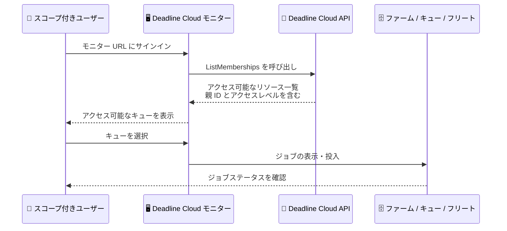

# AWS Deadline Cloud - Deadline Cloud モニターでのアクセス可能リソース検索機能

**リリース日**: 2026 年 10 月 13 日
**サービス**: AWS Deadline Cloud
**機能**: Deadline Cloud モニターにおけるアクセス可能リソースの検索・表示

📊 [このアップデートのインフォグラフィックを見る](https://takech9203.github.io/aws-news-summary/20261013-deadline-cloud-resources.html)

## 概要

AWS Deadline Cloud は、Deadline Cloud モニターにおいて、ユーザーが自身のアクセス可能なリソースを直接検索・表示できる機能を発表しました。ファーム全体ではなく、特定のキュー、フリート、ジョブのみにスコープされたアクセス権を持つユーザーが、管理者に問い合わせることなく、モニターから自分が利用できるリソースを発見できるようになります。

AWS Deadline Cloud は、VFX、アニメーション、プロダクトデザイン、シミュレーション、ゲーム開発などの計算集約型ワークロード向けにレンダーファームを構築・管理できるフルマネージドサービスです。今回のアップデートにより、モニターはユーザーがアクセスできるキュー、そこに到達するために必要な親リソースの ID、およびアクセスレベルを表示します。これは、直接付与された権限と、グループメンバーシップから継承された権限の両方をカバーします。

このアップデートの対象ユーザーは、レンダーファームを運用する管理者と、限定的な権限でジョブを投入・監視するアーティストやデザイナーなどのエンドユーザーです。チーム内で権限レベルが異なっていても、追加の調整なしに単一のモニター URL を共有できるようになり、オンボーディングと日々の運用が簡素化されます。

**アップデート前の課題**

- 以前は、ファーム全体へのアクセス権を持たず、特定のキューのみにアクセスできるユーザーは、モニターに接続するために管理者からファーム ID を取得する必要があった
- ユーザー自身が、どのリソースにどのレベルでアクセスできるかをモニター上で確認する手段がなかった
- 権限レベルが異なるメンバーが混在するチームでは、メンバーごとに接続情報を個別に案内する必要があり、オンボーディングに手間がかかっていた

**アップデート後の改善**

- ユーザーはモニターから直接、自分がアクセスできるキューと、そこに到達するために必要な親リソースの ID、およびアクセスレベルを確認できるようになった
- 直接付与された権限とグループから継承された権限の両方が表示されるため、権限の由来を問わずリソースを発見できる
- チームは権限レベルの違いに関係なく、単一のモニター URL を共有するだけで全メンバーが利用を開始できるようになった

## アーキテクチャ図



スコープされた権限を持つユーザーがモニターにサインインすると、新しい ListMemberships API を通じてアクセス可能なリソースが自動的に検出され、ファーム ID を事前に知らなくても目的のキューに到達できる流れを示しています。

## サービスアップデートの詳細

### 主要機能

1. **アクセス可能リソースの自動検出**
   - モニターがユーザーのアクセスできるキューを一覧表示する
   - キューに到達するために必要な親リソース (ファーム) の ID も合わせて表示されるため、管理者への問い合わせが不要になる
   - 各リソースに対するアクセスレベルも確認できる

2. **直接権限とグループ継承権限の両対応**
   - リソースに直接追加されたユーザーの権限を表示する
   - AWS IAM Identity Center のグループメンバーシップを通じて継承された権限も表示する
   - 権限の付与経路に関係なく、ユーザーは同じ方法でリソースを発見できる

3. **単一モニター URL でのチーム運用**
   - 権限レベルが異なるメンバーが混在するチームでも、同じモニター URL を共有できる
   - 各ユーザーには自身がアクセスできるリソースのみが表示される
   - オンボーディング時の個別の接続情報の案内が不要になる

4. **管理者向けのリソースアクセス管理との連携**
   - 管理者はコンソールの「User management」の「Resource access」タブで、ユーザーまたはグループがアクセスできるすべてのファーム、キュー、フリートを全リージョンにわたって確認できる
   - 同じタブからアクセスレベルの変更やアクセスの取り消しも可能
   - 「Granted through」列により、権限が直接付与されたものか、グループから継承されたものかを判別できる

## 技術仕様

### リソースアクセスの表示仕様 (管理者向けコンソール)

| 項目 | 詳細 |
|------|------|
| 表示対象 | ユーザーまたはグループがアクセスできるすべてのファーム、キュー、フリート (全リージョン) |
| ファームレベルの権限 | ファームへのアクセスには内部のキューとフリートが含まれるため、個別の行としては表示されない |
| Granted through 列 | 「Direct」は直接付与、グループ名はそのグループからの継承を示す |
| 継承権限の変更 | グループ側のアクセスレベル変更、または ID ソースでのグループ所属変更で対応 |
| ジョブへのアクセス | ジョブの投入によって付与されるため、このタブでは編集不可 |
| リージョン確認不可時 | 確認できないリージョン名が明示され、不完全な一覧が完全な一覧と誤認されない設計 |

### API 変更履歴

| 日付 | サービス | 変更内容 |
|------|----------|----------|
| 2026/10/09 | [deadline](https://awsapichanges.com/archive/changes/0723d7-deadline.html) | 1 new api method - 新しい ListMemberships API により、ユーザーが Deadline Cloud リソース全体にわたる自身のメンバーシップを検出可能に。スコープされたアクセス権を持つユーザーが、付与されたリソースを発見して操作できるようになる |

## 設定方法

### 前提条件

1. AWS Deadline Cloud のファーム、キュー、フリートが作成済みであること
2. ユーザーが AWS IAM Identity Center で管理され、ファーム、キュー、フリートのいずれかに直接またはグループ経由でアクセス権が付与されていること
3. Deadline Cloud モニターの URL がチームに共有されていること

### 手順

#### ステップ 1: ユーザーにリソースへのアクセス権を付与する (管理者)

Deadline Cloud コンソールで対象のファーム、キュー、またはフリートを開き、ユーザーまたはグループにアクセスレベル (VIEWER、CONTRIBUTOR、MANAGER、OWNER) を割り当てます。グループに付与した場合、グループ所属ユーザーに権限が継承されます。

#### ステップ 2: ユーザーがモニターにサインインする

ユーザーは共有されたモニター URL にアクセスし、IAM Identity Center の認証情報でサインインします。ファーム ID を事前に知る必要はありません。

#### ステップ 3: アクセス可能なリソースを確認する

サインイン後、モニターにアクセス可能なキューの一覧、到達に必要な親リソースの ID、およびアクセスレベルが表示されます。ユーザーは目的のキューを選択し、ジョブの投入や監視を開始できます。

#### ステップ 4: 管理者がリソースアクセスを確認・変更する (必要に応じて)

管理者は Deadline Cloud コンソールの左ナビゲーションから「User management」を選択し、「Groups」または「Users」タブで対象を選択後、「Resource access」タブを開きます。ここでアクセスレベルの変更やアクセスの取り消しが可能です。ファームへのアクセスを取り消すと、内部のキューとフリートへのアクセスも取り消されます。

## メリット

### ビジネス面

- **オンボーディングの迅速化**: 新しいアーティストやデザイナーへの接続情報の個別案内が不要になり、プロジェクト参加までの時間を短縮できる
- **運用負荷の削減**: 「どのファーム ID に接続すればよいか」という管理者への問い合わせがなくなり、サポートコストを削減できる
- **チーム運用の簡素化**: 権限レベルが異なるメンバーにも単一のモニター URL を共有するだけで済み、ドキュメント管理が容易になる

### 技術面

- **セルフサービスのリソース検出**: 新しい ListMemberships API により、スコープされたユーザーが自身のメンバーシップをプログラムからも検出できる
- **最小権限の原則との両立**: キュー単位の細かい権限設計を維持したまま、ユーザビリティを損なわないアクセス導線を提供できる
- **権限の可視性向上**: 直接付与とグループ継承の両方の権限が表示され、アクセス権の全体像を把握しやすくなる

## デメリット・制約事項

### 制限事項

- ジョブへのアクセス権はジョブの投入によって付与されるため、管理者が「Resource access」タブから編集することはできない
- グループから継承された権限は、ユーザー個別には変更できず、グループ側のアクセスレベル変更または ID ソースでのグループ所属変更が必要
- アカウントポリシーでブロックされているリージョンの情報は確認できない (確認できないリージョンはタブ上に明示される)

### 考慮すべき点

- 権限管理は引き続き管理者側の設計が重要であり、本機能はアクセス権の「発見」を容易にするものであって権限自体を変更するものではない
- グループ経由の権限継承を活用する場合、IAM Identity Center 側のグループ設計とライフサイクル管理を整備しておく必要がある

## ユースケース

### ユースケース 1: 外部協力アーティストのオンボーディング

**シナリオ**: VFX スタジオが外部の協力アーティストをプロジェクトに迎え、特定のキューのみに CONTRIBUTOR 権限を付与する。

**実装例**:
```text
1. 管理者が対象キューで外部アーティストのグループに CONTRIBUTOR を割り当て
2. チーム共通のモニター URL を案内
3. アーティストはサインインするだけでアクセス可能なキューを発見し、ジョブを投入
```

**効果**: ファーム ID の個別案内が不要になり、外部メンバーの参加当日からレンダージョブの投入を開始できる。

### ユースケース 2: 複数プロジェクトを横断するアーティストの作業切り替え

**シナリオ**: 複数のプロジェクト (キュー) にまたがってアサインされているアーティストが、担当するキューを自分で確認して作業を切り替える。

**実装例**:
```text
1. アーティストがモニターにサインイン
2. アクセス可能なキューの一覧と各キューのアクセスレベルを確認
3. 作業対象のキューを選択してジョブのステータスを監視・投入
```

**効果**: プロジェクトごとの接続情報を管理する手間がなくなり、担当キューの確認と切り替えがモニター上で完結する。

### ユースケース 3: 管理者による権限の棚卸し

**シナリオ**: 管理者が四半期ごとにユーザーとグループのリソースアクセスを棚卸しし、不要な権限を取り消す。

**実装例**:
```text
1. Deadline Cloud コンソールの User management を開く
2. 対象ユーザーまたはグループの Resource access タブで全リージョンの権限を確認
3. Granted through 列で直接付与の権限を特定し、不要なものを Revoke access で取り消し
```

**効果**: 全リージョンにわたる権限の全体像を 1 つのタブで確認でき、最小権限の維持とコンプライアンス対応が容易になる。

## 料金

この機能自体に追加料金はありません。AWS Deadline Cloud の利用料金は、使用したコンピューティングリソース (フリートのワーカー) と使用ベースライセンスなどに基づく従量課金です。詳細は料金ページを参照してください。

## 利用可能リージョン

AWS Deadline Cloud が利用可能なすべての AWS リージョンで利用できます。

## 関連サービス・機能

- **AWS IAM Identity Center**: Deadline Cloud のユーザーとグループの管理に使用され、グループメンバーシップを通じた権限継承の基盤となる
- **Deadline Cloud モニター**: ジョブの投入・監視を行うユーザー向けインターフェイスで、今回のリソース検出機能が追加された
- **Deadline Cloud API (ListMemberships)**: ユーザーが自身のメンバーシップをプログラムから検出するための新しい API

## 参考リンク

- 📊 [インフォグラフィック](https://takech9203.github.io/aws-news-summary/20261013-deadline-cloud-resources.html)
- [公式発表 (What's New)](https://aws.amazon.com/about-aws/whats-new/2026/10/deadline-cloud/resources)
- [ドキュメント: View and change resource access for a user or group](https://docs.aws.amazon.com/deadline-cloud/latest/userguide/view-member-resource-access.html)
- [API 変更履歴 (awsapichanges.com)](https://awsapichanges.com/archive/changes/0723d7-deadline.html)
- [料金ページ](https://aws.amazon.com/deadline-cloud/pricing/)

## まとめ

今回のアップデートにより、スコープされた権限を持つユーザーがファーム ID を知らなくても Deadline Cloud モニターから自分のリソースを発見できるようになり、レンダーファーム運用のオンボーディングと日常業務が大幅に簡素化されます。キュー単位の最小権限設計を採用しているチームは、単一のモニター URL への移行と、新しい ListMemberships API を活用したワークフローの見直しを検討することを推奨します。
