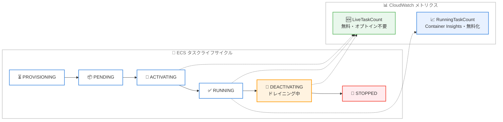

# Amazon ECS - LiveTaskCount メトリクスの追加と RunningTaskCount メトリクスの無料化

**リリース日**: 2026 年 10 月 13 日
**サービス**: Amazon Elastic Container Service (Amazon ECS)
**機能**: LiveTaskCount サービスメトリクスの追加、および CloudWatch Container Insights における RunningTaskCount メトリクスの無料化

📊 [このアップデートのインフォグラフィックを見る](https://takech9203.github.io/aws-news-summary/20261013-ecs-service-metrics.html)

## 概要

Amazon ECS は、サービス内でアクティブに実行中のタスク数を示す新しいサービスメトリクス **LiveTaskCount** を発表しました。このメトリクスはすべてのお客様が無料で利用でき、CloudWatch Container Insights へのオプトインも不要です。あわせて、CloudWatch Container Insights の既存メトリクスである **RunningTaskCount** の課金が廃止され、2026 年 10 月 1 日以降は無料で利用できるようになりました。

LiveTaskCount は、ACTIVATING、RUNNING、DEACTIVATING の各状態にあるタスクをカウントします。スケールイン時にコネクションドレイニング中のタスクなど、停止状態へ遷移中でもまだ実行されているタスクを含むため、オートスケーリングのアラームやキャパシティモニタリングに適しています。一方、RunningTaskCount は現在の状態と希望する状態の両方が RUNNING であるタスクのみをカウントするため、サービスのヘルスと安定性のシグナルとして引き続き有用です。

**アップデート前の課題**

このアップデート以前には、以下の課題がありました。

- タスク数を把握するための RunningTaskCount メトリクスは CloudWatch Container Insights の有効化が必要であり、カスタムメトリクスとして課金されていた
- RunningTaskCount は現在の状態と希望する状態の両方が RUNNING のタスクのみをカウントするため、起動中 (ACTIVATING) やドレイニング中 (DEACTIVATING) のタスクを含めた「実際に稼働しているタスクの全体像」を把握できなかった
- スケールイン時にトラフィックを処理しながらドレイニング中のタスクがカウントから漏れるため、オートスケーリングやキャパシティプランニングの判断材料として不十分な場合があった

**アップデート後の改善**

今回のアップデートにより、以下が可能になりました。

- LiveTaskCount により、ACTIVATING、RUNNING、DEACTIVATING を含むアクティブなタスク数を無料で、Container Insights へのオプトインなしに取得できるようになった
- ドレイニング中のタスクもカウントされるため、オートスケーリングアラームやキャパシティモニタリングでより正確な稼働タスク数を利用できるようになった
- CloudWatch Container Insights の RunningTaskCount メトリクスが、アカウント内の ECS サービス数やクラスター数にかかわらず無料になった

## アーキテクチャ図



タスクライフサイクルの各状態と 2 つのメトリクスのカウント範囲を示しています。LiveTaskCount は ACTIVATING、RUNNING、DEACTIVATING の 3 状態をカウントし、RunningTaskCount は RUNNING 状態のみをカウントします。

## サービスアップデートの詳細

### 主要機能

1. **LiveTaskCount メトリクスの追加**
   - サービス内でアクティブに実行中のタスク数をカウントする新しいサービスメトリクス
   - ACTIVATING、RUNNING、DEACTIVATING の各状態のタスクを含む
   - スケールイン時にコネクションドレイニング中のタスクなど、停止状態へ遷移中でもまだ実行されメトリクスを生成しているタスクをカウントする
   - ECS のサービス使用率メトリクスの一部として提供され、無料で利用可能
   - CloudWatch Container Insights へのオプトインは不要

2. **RunningTaskCount メトリクスの無料化**
   - CloudWatch Container Insights で提供される、クラスター単位およびサービス単位の実行中タスク数メトリクス
   - 現在の状態と希望する状態の両方が RUNNING であるタスクをカウントし、サービスのヘルスと安定性のシグナルとして機能する
   - 2026 年 10 月 1 日以降、ECS サービス数やクラスター数にかかわらず課金されない
   - 変更は自動的に適用され、お客様側での対応は不要

3. **2 つのメトリクスの使い分け**
   - LiveTaskCount: オートスケーリングアラームやキャパシティモニタリング向け。ドレイニング中もトラフィックを処理しているタスクを含めた全体像を把握できる
   - RunningTaskCount: ヘルスと安定性の監視向け。実行中タスク数が指定値を下回った場合のアラームなどに利用できる

## 技術仕様

### メトリクスの比較

| 項目 | LiveTaskCount | RunningTaskCount |
|------|---------------|------------------|
| 提供元 | ECS サービス使用率メトリクス | CloudWatch Container Insights |
| カウント対象の状態 | ACTIVATING、RUNNING、DEACTIVATING | 現在の状態と希望する状態がともに RUNNING |
| ドレイニング中のタスク | カウントする | カウントしない |
| Container Insights のオプトイン | 不要 | 必要 |
| 料金 | 無料 | 無料 (2026 年 10 月 1 日以降) |
| 主な用途 | オートスケーリング、キャパシティモニタリング | ヘルスと安定性の監視 |

### その他のサービス使用率メトリクス

LiveTaskCount は、既存の ECS サービス使用率メトリクスと同じ枠組みで提供されます。

| メトリクス | 説明 |
|-----------|------|
| CPUUtilization | タスク定義で指定した CPU に対する使用率 |
| MemoryUtilization | タスク定義で指定したメモリに対する使用率 |
| EBS ファイルシステム使用率 | タスクにアタッチされた EBS ボリュームの使用率 |
| LiveTaskCount | アクティブに実行中のタスク数 (今回追加) |

## 設定方法

### 前提条件

1. Amazon ECS でサービスが稼働していること
2. CloudWatch メトリクスを参照する IAM 権限があること
3. RunningTaskCount を利用する場合は、CloudWatch Container Insights が有効化されていること (LiveTaskCount では不要)

### 手順

#### ステップ 1: CloudWatch で LiveTaskCount メトリクスを確認する

```bash
aws cloudwatch get-metric-statistics \
  --namespace AWS/ECS \
  --metric-name LiveTaskCount \
  --dimensions Name=ClusterName,Value=my-cluster Name=ServiceName,Value=my-service \
  --start-time 2026-10-13T00:00:00Z \
  --end-time 2026-10-13T01:00:00Z \
  --period 60 \
  --statistics Average
```

指定したクラスターとサービスの LiveTaskCount メトリクスを 60 秒間隔で取得しています。アクティブに実行中のタスク数の推移を確認できます。

#### ステップ 2: LiveTaskCount に基づく CloudWatch アラームを作成する

```bash
aws cloudwatch put-metric-alarm \
  --alarm-name my-service-live-task-count-low \
  --namespace AWS/ECS \
  --metric-name LiveTaskCount \
  --dimensions Name=ClusterName,Value=my-cluster Name=ServiceName,Value=my-service \
  --statistic Average \
  --period 60 \
  --evaluation-periods 3 \
  --threshold 2 \
  --comparison-operator LessThanThreshold \
  --alarm-actions arn:aws:sns:ap-northeast-1:123456789012:my-topic
```

アクティブなタスク数が 3 分間連続で 2 を下回った場合に SNS トピックへ通知するアラームを作成しています。しきい値や評価期間はワークロードに合わせて調整してください。

#### ステップ 3: RunningTaskCount によるヘルス監視を継続する

Container Insights を有効化している場合、既存の RunningTaskCount によるアラームやダッシュボードはそのまま利用できます。2026 年 10 月 1 日以降は課金されないため、設定変更は不要です。

## メリット

### ビジネス面

- **コスト削減**: Container Insights の RunningTaskCount が無料になり、多数のサービスやクラスターを運用している環境ではカスタムメトリクス課金が削減される
- **可観測性の民主化**: LiveTaskCount は Container Insights のオプトインなしで無料提供されるため、追加コストを気にせずすべての環境でタスク数の監視を標準化できる
- **対応不要**: 料金変更は自動的に適用され、お客様側での作業は発生しない

### 技術面

- **正確なキャパシティ把握**: ドレイニング中のタスクを含むアクティブなタスク数を把握でき、スケールイン中もトラフィックを処理しているタスクを見落とさない
- **オートスケーリングの精度向上**: LiveTaskCount をオートスケーリングのアラームに利用することで、実際の稼働タスク数に基づいた判断が可能になる
- **用途別の使い分け**: キャパシティモニタリングには LiveTaskCount、ヘルスと安定性の監視には RunningTaskCount と、目的に応じたメトリクス選択が可能になる

## デメリット・制約事項

### 制限事項

- RunningTaskCount の利用には引き続き CloudWatch Container Insights の有効化が必要
- Container Insights が収集するその他のメトリクスは、引き続きカスタムメトリクスとして課金される
- RunningTaskCount の無料化は 2026 年 10 月 1 日以降の利用分に適用される

### 考慮すべき点

- LiveTaskCount はドレイニング中のタスクも含むため、RUNNING 状態のタスク数のみを前提とした既存のアラームをそのまま置き換えると挙動が変わる可能性がある
- 2 つのメトリクスはカウント対象が異なるため、スケールインやデプロイ中は値に差が出ることを理解した上で使い分ける必要がある

## ユースケース

### ユースケース 1: スケールイン中も正確なキャパシティを把握するオートスケーリング監視

**シナリオ**: Web サービスでスケールイン時にコネクションドレイニングを行っており、ドレイニング中のタスクもトラフィックを処理している。実際に稼働しているタスク数に基づいてキャパシティを監視したい。

**実装例**:
```bash
aws cloudwatch put-metric-alarm \
  --alarm-name web-service-capacity-watch \
  --namespace AWS/ECS \
  --metric-name LiveTaskCount \
  --dimensions Name=ClusterName,Value=web-cluster Name=ServiceName,Value=web-service \
  --statistic Average --period 60 --evaluation-periods 2 \
  --threshold 10 --comparison-operator GreaterThanThreshold \
  --alarm-actions arn:aws:sns:ap-northeast-1:123456789012:capacity-topic
```

**効果**: ドレイニング中のタスクを含めた実際の稼働タスク数で監視でき、スケールイン中のキャパシティの過小評価を防げる。

### ユースケース 2: サービスのヘルス監視によるタスク数低下の検知

**シナリオ**: バッチ処理サービスで、安定稼働しているタスク数が希望数を下回った場合に迅速に検知したい。

**実装例**:
```bash
aws cloudwatch put-metric-alarm \
  --alarm-name batch-service-health \
  --namespace ECS/ContainerInsights \
  --metric-name RunningTaskCount \
  --dimensions Name=ClusterName,Value=batch-cluster Name=ServiceName,Value=batch-service \
  --statistic Minimum --period 60 --evaluation-periods 3 \
  --threshold 4 --comparison-operator LessThanThreshold \
  --alarm-actions arn:aws:sns:ap-northeast-1:123456789012:oncall-topic
```

**効果**: 現在の状態と希望する状態がともに RUNNING のタスク数で監視するため、サービスの安定性低下を正確に検知できる。無料化により監視コストも発生しない。

### ユースケース 3: マルチクラスター環境での監視コスト最適化

**シナリオ**: 数十のクラスターと数百のサービスを運用しており、Container Insights の RunningTaskCount によるカスタムメトリクス課金がコスト要因となっていた。

**実装例**:
```
1. 2026 年 10 月 1 日以降、RunningTaskCount の課金は自動的に廃止 (対応不要)
2. キャパシティモニタリング用途のダッシュボードは LiveTaskCount に移行
3. Container Insights のその他のメトリクスは必要なクラスターのみで有効化を継続
```

**効果**: タスク数監視に関するメトリクスコストを削減しつつ、全サービスで一貫したタスク数の可観測性を維持できる。

## 料金

- **LiveTaskCount**: 無料で利用できます。CloudWatch Container Insights へのオプトインは不要です。
- **RunningTaskCount**: 2026 年 10 月 1 日以降、CloudWatch Container Insights における課金が廃止され、アカウント内の ECS サービス数やクラスター数にかかわらず無料で利用できます。この変更は自動的に適用されます。
- Container Insights が収集するその他のメトリクスは、引き続きカスタムメトリクスとして課金されます。詳細は [CloudWatch 料金ページ](https://aws.amazon.com/cloudwatch/pricing/) を参照してください。

## 利用可能リージョン

Amazon ECS が利用可能なすべての AWS リージョンで利用できます。

## 関連サービス・機能

- **Amazon CloudWatch**: LiveTaskCount および RunningTaskCount メトリクスの保存・可視化・アラーム設定を行うモニタリングサービス
- **CloudWatch Container Insights**: ECS クラスターとサービスの詳細なメトリクスを収集する機能。RunningTaskCount はこの機能の一部として提供される
- **Application Auto Scaling**: ECS サービスのオートスケーリング機能。LiveTaskCount をアラームと組み合わせることで、より正確なキャパシティ判断が可能になる

## 参考リンク

- 📊 [インフォグラフィック](https://takech9203.github.io/aws-news-summary/20261013-ecs-service-metrics.html)
- [公式発表 (What's New)](https://aws.amazon.com/about-aws/whats-new/2026/10/ecs-service-metrics/)
- [ドキュメント: Amazon ECS サービス使用率メトリクス (LiveTaskCount)](https://docs.aws.amazon.com/AmazonECS/latest/developerguide/service_utilization.html#cw_live_task_count)
- [ドキュメント: Amazon ECS CloudWatch Container Insights](https://docs.aws.amazon.com/AmazonECS/latest/developerguide/cloudwatch-container-insights.html)
- [料金ページ: Amazon CloudWatch](https://aws.amazon.com/cloudwatch/pricing/)

## まとめ

Amazon ECS に無料の LiveTaskCount メトリクスが追加され、ドレイニング中を含むアクティブなタスク数を Container Insights なしで把握できるようになりました。あわせて RunningTaskCount も無料化されたため、タスク数の監視コストを気にする必要がなくなります。オートスケーリングやキャパシティモニタリングには LiveTaskCount、ヘルス監視には RunningTaskCount という使い分けを検討することを推奨します。
