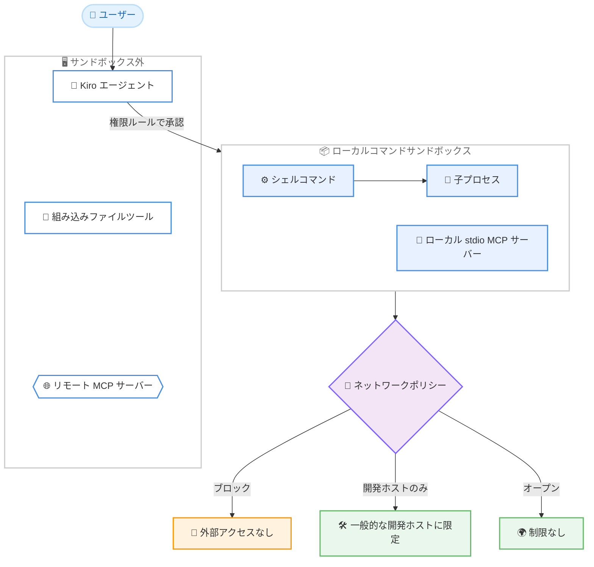
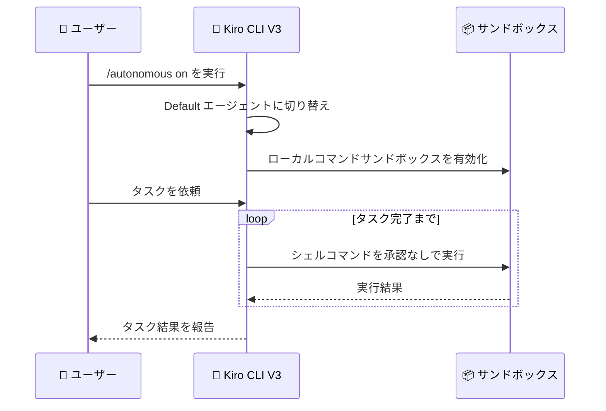

# Kiro - ローカルコマンドサンドボックスとローカル自律モード (IDE 1.3.0 / CLI 2.31.0)

**リリース日**: 2026 年 10 月 13 日
**サービス**: Kiro (AWS が提供する AI 搭載 IDE / CLI)
**機能**: Local Command Sandbox, Start Saved Workflows from Chat, Live Tab Status / Local Command Sandbox and Local Autonomous Mode

📊 [このアップデートのインフォグラフィックを見る](https://takech9203.github.io/aws-news-summary/20261013-kiro-changelog-2026-10-13.html)

## 概要

Kiro IDE 1.3.0 と Kiro CLI 2.31.0 が同日リリースされ、両製品で「ローカルコマンドサンドボックス」が利用可能になりました。サンドボックスを有効にすると、エージェントが実行するシェルコマンドとその子プロセスが OS レベルのサンドボックス内に隔離され、アクセスできる範囲が制限されます。アウトバウンドのネットワークアクセスは「ブロック」「一般的な開発ホストのみ許可」「オープン」の 3 段階から選択でき、ローカルの stdio MCP サーバーも同じサンドボックス内で実行できます。

CLI 2.31.0 では、ローカルコマンドサンドボックスとあわせて「ローカル自律モード」がすべての V3 ユーザーに提供されました。`/autonomous on` を実行すると、Kiro はシェルコマンドごとの承認を求めずにタスクを進めます。その際、Kiro は Default エージェントに切り替わり、先にローカルコマンドサンドボックスを有効化するため、自律実行とリスク低減が両立されます。

IDE 1.3.0 ではこのほか、チャットから `/workflow-run` で保存済み Workflow を起動する機能、エディタタブ上でのライブセッションステータス表示、モデルフォールバック通知などが追加されました。また、IDE と CLI の両方で MCP ツール定義のオンデマンドロードが導入され、モデルコンテキストをより多く本来の作業に使えるようになりました。CLI では `KIRO_HOME` 環境変数による V3 設定の一元管理も拡張されています。

**アップデート前の課題**

このアップデート以前には、以下のような課題がありました。

- エージェントが実行するシェルコマンドは、権限ルールによる承認制御はあるものの、実行時にアクセスできるファイルやネットワークの範囲を OS レベルで制限する仕組みがなかった
- CLI でエージェントに自律的にタスクを進めさせたい場合でも、シェルコマンドごとの承認が必要で、長時間のタスクでは手間がかかった
- 保存済み Workflow を開始するには Workflows ビューを開いて操作する必要があり、チャットから直接起動できなかった
- チャットや Workflow ステップのタブを開かないと、Kiro が作業中なのか入力待ちなのかがわからなかった
- モデルが拒否や利用不可で別モデルにフォールバックしても、どのモデルが応答を継続したのか、その適用範囲が 1 ターンか会話の残り全体かがわからなかった
- MCP ツール定義がすべて事前にロードされ、モデルコンテキストを圧迫していた
- CLI の V3 設定やサインイン情報、セッション、エージェント状態の保存先を切り替えられず、仕事用と個人用などのプロファイルを分離しにくかった

**アップデート後の改善**

今回のアップデートにより、以下が可能になりました。

- IDE / CLI の両方で、エージェント実行のシェルコマンドと子プロセスを OS サンドボックス内に閉じ込め、ネットワークアクセスを 3 段階 (ブロック / 開発ホストのみ / オープン) で制御できるようになった
- ローカルの stdio MCP サーバーも同じサンドボックス内で実行できるようになった
- CLI V3 で `/autonomous on` によるローカル自律モードが全ユーザーに提供され、コマンドごとの承認なしでタスクを進められるようになった (サンドボックスが先に有効化される)
- IDE のチャットで `/workflow-run` と入力し、レシピを選択して入力を完了するだけで保存済み Workflow を起動できるようになった
- チャットと Workflow ステップのタブに「作業中」「入力待ち」のライブステータスが表示されるようになった
- モデルフォールバック時に、応答を継続するモデル名と適用範囲 (1 ターンのみか会話の残り全体か) がトランスクリプトに明示されるようになった
- MCP ツール定義が必要なときにのみロードされ、モデルコンテキストに余裕が生まれた
- CLI で `KIRO_HOME` に絶対パスを設定すると、V3 のグローバル設定、サインイン、セッション、エージェント状態がその配下に保存され、プロファイルを分離できるようになった

## アーキテクチャ図



ローカルコマンドサンドボックスの構成を示しています。エージェント本体、組み込みファイルツール、リモート MCP サーバーはサンドボックスの外側に留まり、シェルコマンドとその子プロセス、およびローカル stdio MCP サーバーがサンドボックス内で実行されます。ネットワークアクセスは 3 段階のポリシーで制御されます。



CLI V3 のローカル自律モードの流れです。`/autonomous on` を実行すると、Kiro は Default エージェントへの切り替えとサンドボックスの有効化を先に行い、その後はシェルコマンドごとの承認なしでタスクを進めます。

## サービスアップデートの詳細

### 主要機能

1. **ローカルコマンドサンドボックス (IDE 1.3.0 / CLI 2.31.0)**
   - エージェントが実行するシェルコマンドとその子プロセスを OS サンドボックス内に配置し、アクセス可能な範囲を制限する
   - アウトバウンドのネットワークアクセスは「ブロック」「一般的な開発ホストのみ」「オープン」の 3 段階から選択できる
   - ローカルの stdio MCP サーバーも同じサンドボックス内で実行できる
   - エージェント本体、組み込みファイルツール、リモート MCP サーバーはサンドボックスの外側に留まり、権限ルールによるエージェントアクションの制御は引き続き有効
   - IDE ではステータスバーの「Command sandbox」から設定を開き、サンドボックスが有効かを確認できる。CLI では `/sandbox` コマンドで有効化する
   - サンドボックスはリスクを低減するが完全な隔離を保証するものではないため、提案されたコマンドのレビューは引き続き必要

2. **ローカル自律モード (CLI 2.31.0、V3 全ユーザーに提供)**
   - ローカルの V3 セッションで `/autonomous on` を実行すると、シェルコマンドごとの承認なしで Kiro がタスクを進める
   - 実行時には Kiro が Default エージェントに切り替わり、ローカルコマンドサンドボックスを先に有効化する

3. **チャットからの保存済み Workflow 起動 (IDE 1.3.0)**
   - チャットで `/workflow-run` と入力し、レシピを選択して入力を完了すると、Workflow の実行を開始できる
   - 実行開始と同時に Kiro が Workflows ビューを新しい実行の画面で開く

4. **エディタタブのライブセッションステータス (IDE 1.3.0)**
   - チャットと Workflow ステップのタブに、Kiro が作業中か入力待ちかのステータスが表示される
   - セッションがアイドルになると通常のアイコン表示に戻る

5. **モデルフォールバック通知 (IDE 1.3.0)**
   - モデルが拒否した場合や利用できない場合に、応答を継続するモデル名と、その適用範囲が 1 ターンのみか会話の残り全体かをトランスクリプトに表示する

6. **MCP ツールのオンデマンドロード (IDE 1.3.0 / CLI 2.31.0 V3)**
   - MCP ツール定義を必要なときにのみロードし、モデルコンテキストをより多く本来の作業に使えるようにする

7. **KIRO_HOME による V3 設定の一元管理 (CLI 2.31.0)**
   - `KIRO_HOME` に絶対パスを設定すると、V3 のグローバル設定、サインイン、セッション、エージェント状態がその配下に保存される
   - 仕事用と個人用など、複数の Kiro プロファイルを分離して管理できる
   - 既存の MCP サインインは初回に 1 度だけコピーされる
   - `KIRO_HOME` が相対パス、ファイルシステムルート、ホームディレクトリまたはその親の場合は `~/.kiro` にフォールバックする (修正)

8. **ヘッドレス実行でのサンドボックス設定の適用 (CLI 2.31.0)**
   - `enabled: true` を含むグローバルまたはプロジェクトの `sandbox.json` が V3 ヘッドレス実行にも適用される
   - 保護なしで続行する代わりに実行を停止させたい場合は `--sandbox` フラグを追加する

### その他の改善と修正

**IDE 1.3.0:**

- 空の Workflows / Artifacts ビューに、何を配置する場所か、最初の項目をどう追加するかの説明を表示
- アクティブな Workflow 実行が完了済みの実行より上に表示され、実行の一時停止や入力待ちで行が移動しない問題を修正
- Workflow の経過時間ラベルがリスト表示中に更新され、展開可能な行にシェブロンを表示
- プロファイル、使用量、プラン詳細の取得がリクエスト停滞時に無期限に待機しない問題を修正
- アニメーション WebP 画像の最初のフレーム読み取り時にテキストが鮮明に保たれるよう修正
- streamable HTTP サーバー上の MCP ツールが、サーバーのセッション切断後も動作を継続するよう修正
- チャット入力、エージェント応答、ツールカードで 2〜3 桁のリスト番号が完全に表示されるよう修正

**CLI 2.31.0:**

- V1 の `--no-interactive` 実行が、無関係なツール承認エラーではなくターンを終了させたエラーで終了するよう修正
- V3 のクラウド設定と Kiro サービスへのリクエストが停滞時にハングせず、15 秒で停止するよう修正
- V3 クラウドセッションで、コードインテリジェンスインジケーターと `/code` パネルがクラウドワークスペースを反映するよう修正
- 認証サービスがトークンリフレッシュ時に一時的なエラーを返しても、GitHub / Google サインインが終了しないよう修正

## 技術仕様

### ローカルコマンドサンドボックスの範囲

| 対象 | サンドボックス内 / 外 |
|------|----------------------|
| エージェントが実行するシェルコマンド | 内 |
| シェルコマンドの子プロセス | 内 |
| ローカル stdio MCP サーバー | 内 (オプション) |
| エージェント本体 | 外 |
| 組み込みファイルツール | 外 |
| リモート MCP サーバー | 外 |

### ネットワークポリシーの選択肢

| ポリシー | 内容 |
|----------|------|
| ブロック | アウトバウンドのネットワークアクセスをすべて遮断 |
| 開発ホストのみ | 一般的な開発ホストへのアクセスのみ許可 |
| オープン | ネットワークアクセスを制限しない |

### 有効化方法の比較

| 製品 | 有効化方法 | 補足 |
|------|-----------|------|
| Kiro IDE 1.3.0 | ステータスバーの「Command sandbox」から設定 | 設定画面でサンドボックスの有効状態を確認可能 |
| Kiro CLI 2.31.0 (V3) | `/sandbox` コマンド | ヘッドレス実行は `sandbox.json` の `enabled: true` で適用、`--sandbox` フラグで必須化 |
| Kiro CLI 2.31.0 (V3) 自律モード | `/autonomous on` | Default エージェントへの切り替えとサンドボックス有効化が先に実行される |

### sandbox.json の設定例 (ヘッドレス実行)

```json
{
  "enabled": true
}
```

グローバルまたはプロジェクトの `sandbox.json` に `enabled: true` を設定すると、V3 ヘッドレス実行にもサンドボックスが適用されます。

## 設定方法

### 前提条件

1. Kiro IDE 1.3.0 以降、または Kiro CLI 2.31.0 以降にアップデートされていること
2. CLI の場合、ローカルの V3 セッションを使用していること (サンドボックスと自律モードは V3 機能)

### 手順

#### ステップ 1: IDE でローカルコマンドサンドボックスを有効化

```text
ステータスバーの「Command sandbox」を選択 → 設定画面でサンドボックスを有効化
```

IDE のステータスバーから設定を開き、ネットワークアクセスのポリシー (ブロック / 開発ホストのみ / オープン) を選択してサンドボックスを有効化します。設定画面でサンドボックスがアクティブかどうかも確認できます。

#### ステップ 2: CLI でローカルコマンドサンドボックスを有効化

```bash
/sandbox
```

ローカルの V3 セッションで `/sandbox` を実行すると、エージェントのシェルコマンドと子プロセスが OS サンドボックス内に配置されます。ネットワークアクセスの範囲も選択できます。

#### ステップ 3: CLI でローカル自律モードを開始

```bash
/autonomous on
```

ローカルの V3 セッションで `/autonomous on` を実行すると、Kiro が Default エージェントに切り替わり、ローカルコマンドサンドボックスを有効化したうえで、シェルコマンドごとの承認なしにタスクを進めます。

#### ステップ 4: IDE のチャットから保存済み Workflow を起動

```text
チャットで /workflow-run と入力 → レシピを選択 → 入力を完了して実行を開始
```

チャットから保存済み Workflow のレシピを選択して実行を開始すると、Kiro が Workflows ビューを新しい実行の画面で開きます。

#### ステップ 5: CLI のプロファイルを分離する場合

```bash
export KIRO_HOME=/path/to/kiro-work-profile
```

`KIRO_HOME` に絶対パスを設定すると、V3 のグローバル設定、サインイン、セッション、エージェント状態がその配下に保存され、仕事用と個人用などのプロファイルを分離できます。既存の MCP サインインは初回に 1 度だけコピーされます。

## メリット

### ビジネス面

- **セキュリティリスクの低減**: エージェントが実行するコマンドの影響範囲を OS レベルで制限できるため、AI エージェントを開発ワークフローに導入する際の組織的なリスク評価がしやすくなる
- **生産性の向上**: 自律モードによりコマンドごとの承認が不要になり、長時間のタスクでも開発者が張り付く必要がなくなる。サンドボックスが先に有効化されるため、安全性と効率を両立できる
- **ガバナンスの強化**: ヘッドレス実行 (CI/CD など) にも `sandbox.json` でサンドボックスを適用でき、`--sandbox` フラグで保護なしの実行を停止させる運用も可能

### 技術面

- **多層防御**: 権限ルールによる承認制御に加えて、OS サンドボックスとネットワークポリシーという実行時の制限レイヤーが追加された
- **コンテキスト効率の向上**: MCP ツール定義のオンデマンドロードにより、多数の MCP サーバーを登録していてもモデルコンテキストを本来の作業に使える
- **環境分離**: `KIRO_HOME` による設定・状態の一元管理で、複数プロファイルの切り替えや CI 環境での独立した設定管理が容易になった
- **可視性の向上**: エディタタブのライブステータスとモデルフォールバック通知により、セッションの状態と応答モデルを正確に把握できる

## デメリット・制約事項

### 制限事項

- サンドボックスはリスクを低減するが、完全な隔離を保証するものではない。提案されたコマンドのレビューは引き続き必要
- エージェント本体、組み込みファイルツール、リモート MCP サーバーはサンドボックスの対象外
- ローカル自律モードとサンドボックスの `/sandbox` コマンドは CLI の V3 セッションが対象
- `KIRO_HOME` は絶対パスで指定する必要がある。相対パス、ファイルシステムルート、ホームディレクトリまたはその親を指定した場合は `~/.kiro` にフォールバックする

### 考慮すべき点

- ネットワークポリシーを「ブロック」にすると、パッケージのインストールなど外部アクセスを必要とするコマンドが失敗する可能性があるため、ワークフローに応じたポリシー選択が必要
- 自律モードではコマンドごとの承認がなくなるため、作業対象のリポジトリやタスクの性質を考慮して利用を判断することを推奨
- ヘッドレス実行でサンドボックスを必須にしたい場合は、`sandbox.json` の設定に加えて `--sandbox` フラグの付与が必要

## ユースケース

### ユースケース 1: 信頼度の低いコードベースでの安全なエージェント利用

**シナリオ**: 外部から取得した OSS リポジトリの調査やビルドをエージェントに任せたいが、未知のスクリプトが実行される可能性があり、ホスト環境への影響を最小化したい。

**実装例**:
```bash
# CLI V3 セッションでサンドボックスを有効化し、ネットワークを開発ホストのみに制限
/sandbox
```

**効果**: シェルコマンドと子プロセスがサンドボックス内に閉じ込められ、ネットワークアクセスも制限されるため、意図しない外部送信やホスト環境の改変リスクを低減しながらエージェントを活用できる。

### ユースケース 2: 長時間タスクの自律実行

**シナリオ**: テストスイート全体の修復やリファクタリングなど、多数のコマンド実行を伴うタスクをエージェントに任せたいが、コマンドごとの承認で作業が中断されるのを避けたい。

**実装例**:
```bash
# ローカル V3 セッションで自律モードを有効化
/autonomous on
# タスクを依頼
"テストスイートを実行し、失敗しているテストをすべて修正してください"
```

**効果**: サンドボックスが先に有効化されたうえで、承認なしにタスクが進むため、安全性を確保しながら開発者は別の作業に集中できる。

### ユースケース 3: チャットからの定型 Workflow の即時実行

**シナリオ**: コードレビューやリリース準備などの定型手順を Workflow レシピとして保存しており、チャットでの作業中に素早く起動したい。

**実装例**:
```text
チャットで /workflow-run と入力 → レシピを選択 → 必要な入力を完了して実行開始
```

**効果**: Workflows ビューに移動することなくチャットから直接 Workflow を起動でき、実行状況はエディタタブのライブステータスで把握できるため、定型作業の着手から完了確認までがスムーズになる。

### ユースケース 4: 仕事用と個人用の CLI プロファイル分離

**シナリオ**: 同じマシンで業務プロジェクトと個人プロジェクトの両方に Kiro CLI を使っており、サインイン情報やエージェント状態を分離したい。

**実装例**:
```bash
# 業務用プロファイル
export KIRO_HOME=/home/user/kiro-profiles/work
kiro-cli

# 個人用プロファイル
export KIRO_HOME=/home/user/kiro-profiles/personal
kiro-cli
```

**効果**: V3 のグローバル設定、サインイン、セッション、エージェント状態がプロファイルごとに分離され、環境の切り替えによる設定の混在を防げる。

## 利用可能リージョン

Kiro はグローバルに利用可能です。

## 関連サービス・機能

- **Kiro CLI V3**: ローカルコマンドサンドボックスとローカル自律モードの基盤となるハーネス。10 月末の CLI 3.0 でデフォルト化予定
- **Kiro Workflows**: 保存済みレシピをチャットの `/workflow-run` から起動できるようになった宣言的ワークフロー機能
- **MCP (Model Context Protocol)**: ツール定義のオンデマンドロードに対応し、ローカル stdio サーバーはサンドボックス内で実行可能
- **Kiro 権限ルール**: サンドボックスと併用されるエージェントアクションの承認制御

## 参考リンク

- 📊 [インフォグラフィック](https://takech9203.github.io/aws-news-summary/20261013-kiro-changelog-2026-10-13.html)
- [Kiro Changelog](https://kiro.dev/changelog/)
- [Changelog: IDE 1.3.0](https://kiro.dev/changelog/ide/1-3)
- [Changelog: CLI 2.31.0](https://kiro.dev/changelog/cli/2-31)
- [ドキュメント: ローカルコマンドサンドボックス](https://kiro.dev/docs/sandbox/)
- [ドキュメント: チャットのスラッシュコマンド](https://kiro.dev/docs/ide/chat/slash-commands/#declarative-workflows)
- [ドキュメント: MCP ツールのオンデマンドロード](https://kiro.dev/docs/mcp/tool-search/)
- [ドキュメント: CLI の設定ファイルパス](https://kiro.dev/docs/cli/chat/configuration/#file-paths)

## まとめ

Kiro IDE 1.3.0 と CLI 2.31.0 は、エージェント実行コマンドの OS レベルの隔離という安全性の強化と、自律モードによる承認レスのタスク遂行という効率化を同時に実現するリリースです。権限ルールに加えてサンドボックスとネットワークポリシーの多層防御が利用できるため、AI エージェントを日常の開発ワークフローへ組み込む際のリスク管理が大きく前進します。まずは最新バージョンへ更新し、IDE のステータスバーまたは CLI の `/sandbox` からサンドボックスを有効化したうえで、長時間タスクでの `/autonomous on` の活用を検討することを推奨します。
