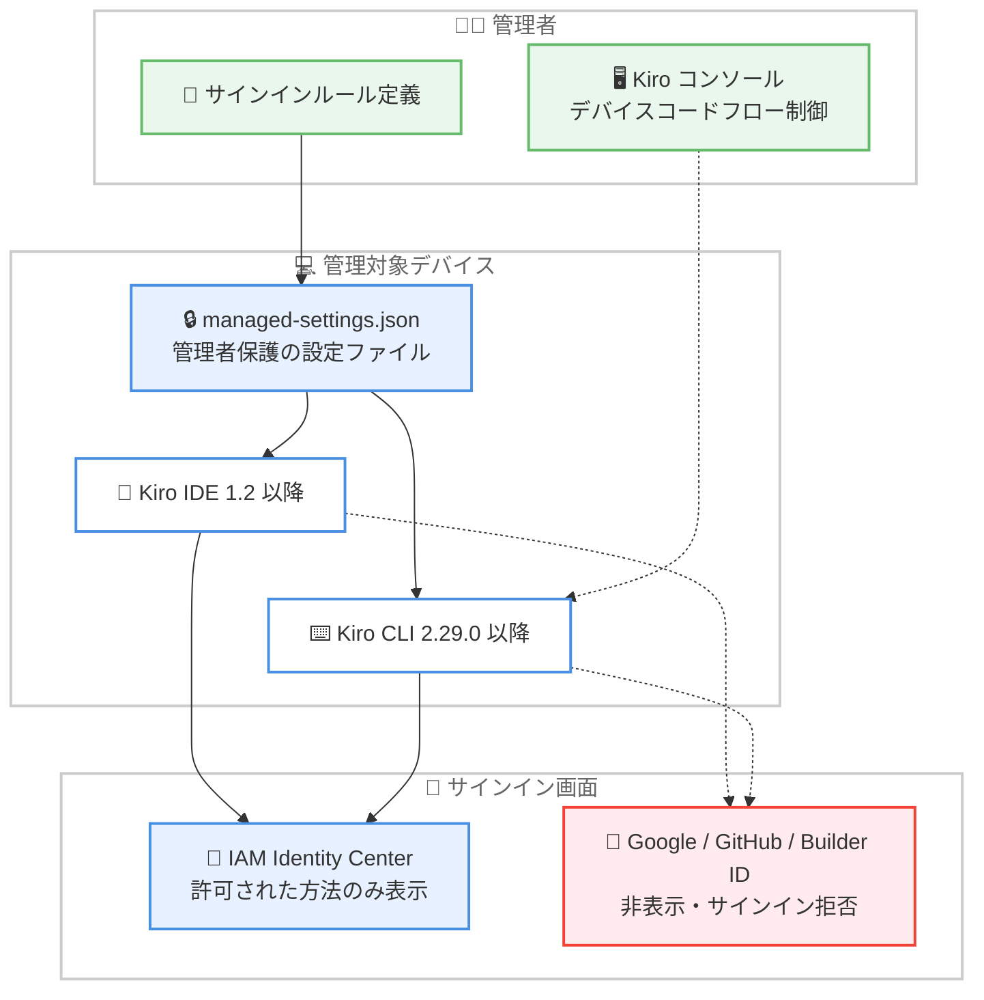

# Kiro - エンタープライズ向けサインインコントロールの強化

**リリース日**: 2026 年 10 月 13 日
**サービス**: Kiro
**機能**: エンタープライズサインインコントロール (Enterprise Sign-in Controls)

📊 [このアップデートのインフォグラフィックを見る](https://takech9203.github.io/aws-news-summary/20261013-kiro-sign-in-controls.html)

## 概要

Kiro は、エンタープライズ環境における管理対象デバイスでのサインイン方法を管理者が制御できる、サインインコントロール機能を発表しました。管理者は組織が許可するサインイン方法のみをユーザーに表示できるようになり、ユーザーが制限を回避しようとした場合、Kiro はサインインを拒否します。

この機能は、管理者保護された設定ファイルである `managed-settings.json` にサインインルールを定義することで動作します。Kiro IDE と Kiro CLI の両方から開始されるサインイン (デバイスコードフローを含む) に適用されるため、組織全体で一貫したアイデンティティガバナンスを実現できます。IAM Identity Center のスタート URL やリージョンの事前入力、IT ヘルプページへのリンク表示といった、ユーザー体験を向上させる設定も提供されます。

**アップデート前の課題**

このアップデート以前は、管理対象デバイス上でエンタープライズユーザーがどのように Kiro にサインインするかを制御する方法がありませんでした。

- 組織が IAM Identity Center の利用を必須としていても、ユーザーは個人アカウント (Google、GitHub、AWS Builder ID) で Kiro にサインインできてしまった
- ユーザーが IAM Identity Center のスタート URL やリージョンを自分で調べて入力する必要があった
- サインインで問題が発生したユーザーを組織の IT サポートへ誘導する手段がサインイン画面上に存在しなかった
- ブラウザのないリモートマシンなどで使用されるデバイスコードフローを組織として管理する手段がなかった

**アップデート後の改善**

今回のアップデートにより、管理者は以下の制御が可能になりました。

- サインイン方法の制限: 組織がサポートするサインインオプションのみを表示し、それ以外を非表示にできる
- IAM Identity Center 情報の事前入力: スタート URL とリージョンを事前入力し、ユーザーが手動で調べる手間を排除できる
- ヘルプリンクの追加: サインイン画面から組織の IT サポートページへ直接誘導できる
- デバイスコードフローの有効化 / 無効化: ブラウザのない環境からのサインインを Kiro コンソールから直接管理できる

## アーキテクチャ図



管理者が `managed-settings.json` に定義したサインインルールを Kiro IDE / CLI が各マシンで読み込み、許可されたサインイン方法のみをユーザーに表示します。制限されたサインイン方法での認証は拒否されます。

## サービスアップデートの詳細

### 主要機能

1. **サインイン方法の制限**
   - 組織がサポートするサインインオプションのみを表示し、それ以外を非表示にする
   - ユーザーが制限を回避しようとした場合、Kiro はサインインを拒否する
   - `deny` エフェクトと `exclude` (許可リスト方式) または `match` (拒否リスト方式) を組み合わせてルールを定義する

2. **IAM Identity Center 情報の事前入力**
   - `idc_start_url` でスタート URL を、`idc_region` でリージョンを事前入力できる
   - ユーザーがスタート URL やリージョンを自分で調べる必要がなくなる
   - サインイン画面には「Your organization」オプションとして表示される

3. **ヘルプリンクの表示**
   - `signin_help_url` で組織の IT ヘルプページへのリンクをサインイン画面に表示できる
   - サインインでつまずいたユーザーを適切なサポート窓口へ誘導できる

4. **デバイスコードフローの管理**
   - ブラウザのないリモートマシンなどの環境からのサインインに使用されるデバイスコードフローを、Kiro コンソールから直接有効化 / 無効化できる
   - サインインコントロールは Kiro IDE と Kiro CLI の両方から開始されるサインイン (デバイスコードフローを含む) に適用される

## 技術仕様

### サインイン方法の識別子

ルール定義で使用できるサインイン方法の名前は以下のとおりです。

| 名前 | サインインオプション |
|------|---------------------|
| `idc` | Your organization (AWS IAM Identity Center) |
| `builder_id` | AWS Builder ID |
| `google` | Google |
| `github` | GitHub |
| `social` | Google と GitHub の短縮形 |

### 設定リファレンス

トップレベルの `settings` キー配下に追加します。各設定はすべてオプションです。

| 設定 | 内容 |
|------|------|
| `idc_start_url` | IAM Identity Center のスタート URL を事前入力する。`https://` で始まる必要がある |
| `idc_region` | IAM Identity Center のリージョンを事前入力する。`idc_start_url` と併用した場合のみ使用される |
| `signin_help_url` | IT ヘルプページへのリンクをサインイン画面に表示する。`https://` で始まる必要がある |

### 設定例: IAM Identity Center のみに制限

```json
{
  "rules": [
    { "capability": "signin_method", "effect": "deny", "exclude": ["idc"] }
  ],
  "settings": {
    "idc_start_url": "https://my-org.awsapps.com/start",
    "idc_region": "us-east-1",
    "signin_help_url": "https://it.example.com/kiro-help"
  }
}
```

このルールは `idc` (IAM Identity Center) を除くすべてのサインイン方法を拒否します。ユーザーのサインイン画面には「Your organization」オプションのみが表示されます。`idc_start_url` と `idc_region` により Identity Center のフォームが事前入力され、`signin_help_url` により IT ヘルプページへのリンクが表示されます。

### 設定例: 特定の方法のみを拒否

特定のサインイン方法のみを拒否し、残りを利用可能なままにする場合は `match` を使用します。

```json
{ "capability": "signin_method", "effect": "deny", "match": ["social"] }
```

この例では Google と GitHub によるサインインのみを拒否し、AWS Builder ID と IAM Identity Center は引き続き利用できます。

## 設定方法

### 前提条件

1. Kiro IDE 1.2 以降、または Kiro CLI 2.29.0 以降がインストールされていること
2. 管理対象デバイス上の `managed-settings.json` を管理者権限で配布・管理できること (MDM などのデバイス管理ツールの利用を想定)
3. IAM Identity Center を利用する場合、組織のスタート URL とリージョンを把握していること

### 手順

#### ステップ 1: サインインルールの定義

```json
{
  "rules": [
    { "capability": "signin_method", "effect": "deny", "exclude": ["idc"] }
  ]
}
```

組織のポリシーに応じて、許可リスト方式 (`exclude`) または拒否リスト方式 (`match`) でルールを定義します。この例では IAM Identity Center 以外のすべてのサインイン方法を拒否します。

#### ステップ 2: ユーザー体験向上のための設定追加

```json
{
  "settings": {
    "idc_start_url": "https://my-org.awsapps.com/start",
    "idc_region": "us-east-1",
    "signin_help_url": "https://it.example.com/kiro-help"
  }
}
```

スタート URL とリージョンの事前入力、および IT ヘルプページへのリンクを設定します。これによりユーザーは接続情報を手動で入力する必要がなくなります。

#### ステップ 3: managed-settings.json の配布

作成した設定を管理者保護された `managed-settings.json` として各管理対象デバイスに配布します。Kiro は各マシンでこのファイルを読み込み、サインインコントロールを適用します。

#### ステップ 4: デバイスコードフローの制御

ブラウザのない環境からのサインインを管理する場合は、Kiro コンソールからデバイスコードフローの有効化 / 無効化を設定します。

## メリット

### ビジネス面

- **ガバナンスの強化**: 組織が承認したアイデンティティプロバイダーのみを使用するよう強制でき、シャドー IT のリスクを低減できる
- **コンプライアンス対応**: 企業のセキュリティポリシーで個人アカウントの利用が禁止されている場合でも、技術的に制限を適用できる
- **サポートコストの削減**: スタート URL の事前入力とヘルプリンクの表示により、サインインに関する問い合わせを削減できる

### 技術面

- **IDE と CLI の一貫した制御**: Kiro IDE と Kiro CLI の両方のサインイン (デバイスコードフローを含む) に同じルールが適用される
- **宣言的な設定管理**: `managed-settings.json` という単一の設定ファイルで制御でき、MDM などの既存のデバイス管理の仕組みと組み合わせやすい
- **柔軟なルール定義**: 許可リスト方式 (`exclude`) と拒否リスト方式 (`match`) の両方に対応し、組織のポリシーに合わせて選択できる

## デメリット・制約事項

### 制限事項

- Kiro IDE 1.2 以降、Kiro CLI 2.29.0 以降が必要であり、ユーザーはこれらのバージョンにアップグレードする必要がある
- 本機能は米国東部 (バージニア北部) と欧州 (フランクフルト) リージョンで利用可能
- `idc_start_url` と `signin_help_url` は `https://` で始まる URL である必要がある
- `idc_region` は `idc_start_url` と併用した場合のみ有効

### 考慮すべき点

- `managed-settings.json` は管理者保護されたファイルとして配布する必要があり、配布と更新の運用設計 (MDM などの利用) が必要
- 既に個人アカウントでサインインしているユーザーへの移行手順を事前に周知することが望ましい
- デバイスコードフローの制御は `managed-settings.json` ではなく Kiro コンソールから行う点に注意が必要

## ユースケース

### ユースケース 1: IAM Identity Center への一本化

**シナリオ**: 大企業の IT 部門が、開発者全員に会社の IAM Identity Center 経由でのみ Kiro を利用させたい。

**実装例**:
```json
{
  "rules": [
    { "capability": "signin_method", "effect": "deny", "exclude": ["idc"] }
  ],
  "settings": {
    "idc_start_url": "https://my-org.awsapps.com/start",
    "idc_region": "us-east-1"
  }
}
```

**効果**: 個人アカウントによるサインインが不可能になり、組織のアイデンティティ基盤による一元的なアクセス管理と監査が実現する。ユーザーはスタート URL を入力する必要がなく、スムーズにサインインできる。

### ユースケース 2: ソーシャルアカウントのみを禁止

**シナリオ**: 中規模組織で、AWS Builder ID と IAM Identity Center は許可しつつ、Google / GitHub アカウントによるサインインのみを禁止したい。

**実装例**:
```json
{
  "rules": [
    { "capability": "signin_method", "effect": "deny", "match": ["social"] }
  ]
}
```

**効果**: `social` 短縮形により Google と GitHub の両方を 1 つのルールで拒否でき、AWS 系のアカウントのみを許可する運用が簡潔に実現する。

### ユースケース 3: リモート開発環境でのサインイン管理

**シナリオ**: ブラウザのないリモート開発サーバー上で Kiro CLI を利用しており、デバイスコードフローによるサインインを組織として統制したい。

**実装例**: Kiro コンソールからデバイスコードフローの有効化 / 無効化を設定し、`managed-settings.json` のサインインルールと組み合わせる。

**効果**: ブラウザのない環境を含むすべてのサインイン経路に組織のポリシーが適用され、統制の抜け道がなくなる。

## 利用可能リージョン

Kiro はグローバルに利用できるサービスですが、サインインコントロール機能は米国東部 (バージニア北部) と欧州 (フランクフルト) リージョンで、Kiro IDE 1.2 および Kiro CLI 2.29.0 から利用可能です。利用にはこれらのバージョン以降へのアップグレードが必要です。

## 関連サービス・機能

- **AWS IAM Identity Center**: 組織のワークフォースアイデンティティを一元管理するサービス。本機能により Kiro のサインインを IAM Identity Center に限定できる
- **Kiro CLI**: ターミナルから Kiro のエージェント機能を利用する CLI。本機能のサインインコントロールは CLI にも適用される
- **Kiro コンソール**: デバイスコードフローの有効化 / 無効化を管理するための管理コンソール

## 参考リンク

- 📊 [インフォグラフィック](https://takech9203.github.io/aws-news-summary/20261013-kiro-sign-in-controls.html)
- [公式ブログ (Introducing improved enterprise sign-in controls)](https://kiro.dev/blog/sign-in-controls/)
- [Kiro Changelog](https://kiro.dev/changelog/)
- [ドキュメント (Enterprise Governance - Sign-in)](https://kiro.dev/docs/enterprise/governance/sign-in/)
- [Kiro ドキュメント](https://kiro.dev/docs/)

## まとめ

Kiro のサインインコントロールにより、エンタープライズ管理者は管理対象デバイス上でのサインイン方法を初めて技術的に強制できるようになりました。IAM Identity Center を標準とする組織では、`managed-settings.json` による許可リスト方式の設定とスタート URL の事前入力を組み合わせることで、ガバナンスとユーザー体験を両立できます。Kiro を組織導入している場合は、Kiro IDE 1.2 / Kiro CLI 2.29.0 以降へのアップグレードとあわせて本機能の適用を検討することを推奨します。
