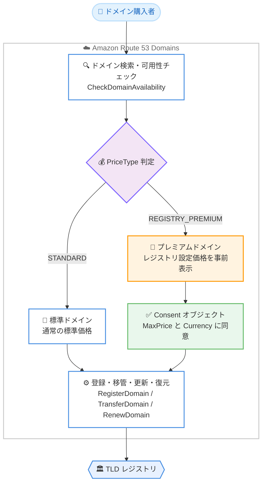

# Amazon Route 53 - プレミアムドメインの登録・移管・更新サポート

**リリース日**: 2026 年 10 月 13 日
**サービス**: Amazon Route 53 (Route 53 Domains)
**機能**: レジストリプレミアムドメインの検索、登録、移管、更新、復元のサポート

📊 [このアップデートのインフォグラフィックを見る](https://takech9203.github.io/aws-news-summary/20261013-route-53-premium-domains.html)

## 概要

Amazon Route 53 は、プレミアムドメイン名のサポートを発表しました。お客様は Route 53 内で直接、レジストリプレミアムネームの検索、登録、移管、更新、復元を実行できるようになりました。

多くの TLD レジストリは、短い、覚えやすい、または需要の高い一部の高価値ドメイン名を「プレミアムドメイン」として予約し、標準価格とは異なる価格で提供しています。これまで Route 53 はこれらのプレミアムドメインを扱えなかったため、プレミアムドメインを取得したい場合は他のレジストラを利用する必要があり、ドメインポートフォリオが複数のプロバイダーに分散していました。今回のアップデートにより、プレミアムドメインの新規取得、他レジストラで保有しているプレミアムドメインの Route 53 への集約、そしてプレミアムドメインと標準ドメインの一元管理が可能になります。

プレミアムドメインのワークフローは標準ドメインと同じで、ドメイン検索と可用性チェックの結果にプレミアムネームが自動的に表示され、価格が事前に提示されるため、購入を確定する前にコストを確認できます。

**アップデート前の課題**

このアップデート以前には、以下の課題がありました。

- Route 53 ではレジストリが予約するプレミアムドメインを検索・登録できず、検索結果にも表示されなかった
- プレミアムドメインを取得するには他のレジストラを利用する必要があり、ドメインポートフォリオが複数プロバイダーに分散していた
- 他レジストラで取得したプレミアムドメインを Route 53 に移管できず、DNS 管理と登録管理を AWS に統一できなかった

**アップデート後の改善**

今回のアップデートにより、以下が可能になりました。

- Route 53 のドメイン検索・可用性チェックの結果にプレミアムドメインが自動的に表示され、価格を事前に確認した上で登録できるようになった
- 他レジストラで保有しているプレミアムドメインを Route 53 へ移管し、標準ドメインと合わせて一元管理できるようになった
- プレミアムドメインの更新や復元も Route 53 内で完結し、API では Consent オブジェクトによる上限価格の明示的な同意と新しい GetDomainPrices API によるドメイン単位の価格確認が可能になった

## アーキテクチャ図



ドメイン検索から登録までのフローを示しています。検索結果の PriceType によりプレミアムドメインが識別され、価格が事前に表示された上で、Consent オブジェクトによる同意を経てレジストリへの登録・移管・更新が実行されます。

## サービスアップデートの詳細

### 主要機能

1. **プレミアムドメインの検索と価格の事前表示**
   - レジストリが予約するプレミアムネームが、ドメイン検索と可用性チェックの結果に自動的に表示されるようになった
   - CheckDomainAvailability のレスポンスに `Price` フィールドが追加され、`PriceType` が `STANDARD` または `REGISTRY_PREMIUM` で返される
   - 購入を確定する前に価格を確認できるため、意図しない高額請求を防止できる

2. **プレミアムドメインの登録・移管・更新・復元**
   - 標準ドメインと同じワークフローで、プレミアムドメインの登録 (RegisterDomain)、移管 (TransferDomain)、更新 (RenewDomain)、復元を実行できる
   - RegisterDomain、TransferDomain、RenewDomain に `Consent` オブジェクト (`MaxPrice` と `Currency`) が追加され、プレミアム価格への明示的な同意を API で表明する
   - CheckDomainTransferability の `Transferable` に `PREMIUM_DOMAIN` と `PENDING` のステータスが追加された

3. **GetDomainPrices API の新規追加**
   - 指定したドメイン名の登録、移管、更新、所有者変更、復元の各価格を取得できる新しい API
   - レスポンスの各価格に `PriceType` が含まれ、標準価格かレジストリプレミアム価格かを判別できる
   - GetDomainSuggestions には `OnlyStandardPrices` パラメータが追加され、標準価格のドメインのみに候補を絞り込むことも可能

## 技術仕様

### プレミアムドメイン対応の API 変更点

| 項目 | 詳細 |
|------|------|
| 新規 API | `GetDomainPrices`: ドメイン名単位で登録・移管・更新・所有者変更・復元の価格と PriceType を返す |
| Consent オブジェクト | `RegisterDomain`、`TransferDomain`、`RenewDomain` に追加。`MaxPrice` (上限価格) と `Currency` (通貨) を指定 |
| PriceType | `STANDARD` / `REGISTRY_PREMIUM` の 2 種類。`CheckDomainAvailability`、`CheckDomainTransferability`、`GetDomainSuggestions`、`ListPrices`、`GetDomainPrices` のレスポンスに含まれる |
| 可用性ステータス | `CheckDomainAvailability` に `AVAILABLE_PREORDER`、`UNAVAILABLE_PREMIUM`、`PENDING` などのステータスが定義されている |
| 移管可能性ステータス | `CheckDomainTransferability` の `Transferable` に `PREMIUM_DOMAIN`、`PENDING` が追加 |
| その他の変更 | `DnssecKey` レスポンスの `Flags` と `PublicKey` フィールドが非推奨化 |

### API 変更履歴

| 日付 | サービス | 変更内容 |
|------|----------|----------|
| 2026/10/13 | [route53domains](https://awsapichanges.com/archive/changes/5f4e0c-route53domains.html) | 1 new 7 updated api methods - プレミアムドメインサポート。GetDomainPrices API の追加、プレミアムドメイン操作への Consent オブジェクトの追加、DnssecKey レスポンスの Flags / PublicKey フィールドの非推奨化 |

### Consent オブジェクトの指定例

```json
{
  "DomainName": "example.com",
  "DurationInYears": 1,
  "AutoRenew": true,
  "Consent": {
    "MaxPrice": 1500.0,
    "Currency": "USD"
  }
}
```

RegisterDomain でプレミアムドメインを登録する際のリクエスト抜粋です。`Consent.MaxPrice` に同意する上限価格を指定することで、プレミアム価格での購入に明示的に同意します。

## 設定方法

### 前提条件

1. AWS アカウントと Route 53 ドメイン登録の操作権限 (route53domains の IAM 権限)
2. 登録するドメインの TLD が Route 53 のサポート対象であること
3. 移管の場合は、現在のレジストラでドメインのロック解除と認証コード (AuthCode) の取得が完了していること

### 手順

#### ステップ 1: ドメインの検索と価格の確認

```bash
aws route53domains check-domain-availability \
  --region us-east-1 \
  --domain-name example.com
```

ドメインの可用性を確認します。プレミアムドメインの場合、レスポンスの `Price` フィールドに `PriceType: REGISTRY_PREMIUM` と価格が返されます。コンソールの場合は [Domains] > [Registered domains] > [Register domains] から検索すると、プレミアムドメインが価格付きで検索結果に表示されます。

#### ステップ 2: ドメイン単位の価格詳細の取得

```bash
aws route53domains get-domain-prices \
  --region us-east-1 \
  --domain-name example.com
```

新しい GetDomainPrices API で、対象ドメインの登録、移管、更新、所有者変更、復元それぞれの価格と PriceType を取得します。更新価格もプレミアム価格となる場合があるため、長期的なコストを事前に確認します。

#### ステップ 3: Consent を指定した登録・移管・更新

```bash
aws route53domains register-domain \
  --region us-east-1 \
  --domain-name example.com \
  --duration-in-years 1 \
  --auto-renew \
  --admin-contact file://contact.json \
  --registrant-contact file://contact.json \
  --tech-contact file://contact.json \
  --consent MaxPrice=1500.0,Currency=USD
```

ステップ 2 で確認した価格をもとに、`--consent` で上限価格と通貨を指定してプレミアムドメインを登録します。移管 (transfer-domain) や更新 (renew-domain) でも同様に Consent を指定します。コンソールの場合は、チェックアウト時に表示されるプレミアム価格を確認して進めます。

## メリット

### ビジネス面

- **ブランド価値の高いドメインの取得**: 短く覚えやすい高価値ドメインを AWS 内で直接取得でき、ブランディングやマーケティング戦略の選択肢が広がる
- **ドメインポートフォリオの統合**: 他レジストラに分散していたプレミアムドメインを Route 53 に集約し、契約・請求・管理を一元化できる
- **価格の透明性**: 検索時点でプレミアム価格が事前に表示されるため、予算判断を購入前に行える

### 技術面

- **標準ドメインと同一のワークフロー**: 登録、移管、更新、復元の操作がすべて既存の Route 53 Domains の操作体系に統合されており、追加の学習コストが小さい
- **API による自動化**: GetDomainPrices と Consent オブジェクトにより、価格確認と上限価格を組み込んだドメイン取得の自動化が可能
- **AWS サービスとの統合**: 取得したプレミアムドメインをそのまま Route 53 ホストゾーン、CloudFront、ELB などと組み合わせて利用できる

## デメリット・制約事項

### 制限事項

- プレミアムドメインの価格は TLD レジストリが設定するため、標準ドメインよりも大幅に高額になる場合があり、更新価格もプレミアム価格が適用される場合がある
- Route 53 の開発者ガイドによると、プレミアムドメインでは複数年登録 (multi-year registration) はサポートされない
- API でプレミアムドメインを操作する場合、Consent オブジェクトで上限価格への同意が必要であり、既存の自動化スクリプトの改修が必要になる場合がある

### 考慮すべき点

- ドメインの登録・更新は返金不可であるため、プレミアム価格の確認は特に慎重に行う必要がある
- `DnssecKey` レスポンスの `Flags` と `PublicKey` フィールドが非推奨化されたため、これらのフィールドに依存する既存コードは見直しが推奨される
- Route 53 のドメイン登録料金は AWS クレジットでは支払えない点は、プレミアムドメインでも同様に考慮が必要

## ユースケース

### ユースケース 1: ブランドドメインの新規取得

**シナリオ**: 新規サービスの立ち上げにあたり、短く覚えやすいプレミアムドメインを取得し、AWS 上のインフラと一体で管理したい。

**実装例**:
```bash
# 価格を確認してから登録
aws route53domains get-domain-prices --region us-east-1 --domain-name brand.io
aws route53domains register-domain --region us-east-1 \
  --domain-name brand.io --duration-in-years 1 \
  --admin-contact file://contact.json --registrant-contact file://contact.json \
  --tech-contact file://contact.json \
  --consent MaxPrice=2000.0,Currency=USD
```

**効果**: 他レジストラを経由せずにプレミアムドメインを取得でき、ホストゾーンの自動作成により DNS 設定まで一気通貫で完了する。

### ユースケース 2: 他レジストラからのプレミアムドメイン集約

**シナリオ**: 過去に他レジストラで取得したプレミアムドメインを Route 53 に移管し、標準ドメインと合わせて管理を統一したい。

**実装例**:
```bash
# 移管可能性と価格を確認
aws route53domains check-domain-transferability \
  --region us-east-1 --domain-name premium-example.com --auth-code "AUTH_CODE"

# Consent を指定して移管
aws route53domains transfer-domain --region us-east-1 \
  --domain-name premium-example.com --duration-in-years 1 \
  --auth-code "AUTH_CODE" \
  --admin-contact file://contact.json --registrant-contact file://contact.json \
  --tech-contact file://contact.json \
  --consent MaxPrice=1800.0,Currency=USD
```

**効果**: ドメインポートフォリオ全体を Route 53 に統合し、請求の一本化、IAM による権限管理、タグによるコスト配分が可能になる。

### ユースケース 3: 上限価格を組み込んだドメイン更新の自動化

**シナリオ**: プレミアムドメインの更新を自動化しつつ、想定外の価格改定による高額請求を防ぎたい。

**実装例**:
```bash
# 更新前に現在の更新価格を取得し、上限価格以内であれば更新する
PRICE=$(aws route53domains get-domain-prices --region us-east-1 \
  --domain-name premium-example.com \
  --query 'DomainPrice.RenewalPrice.Price' --output text)

aws route53domains renew-domain --region us-east-1 \
  --domain-name premium-example.com \
  --duration-in-years 1 --current-expiry-year 2027 \
  --consent MaxPrice=${PRICE},Currency=USD
```

**効果**: GetDomainPrices で取得した価格を Consent に反映することで、価格確認と同意を組み込んだ安全な更新自動化を実現できる。

## 料金

プレミアムドメインの価格は TLD レジストリが設定し、ドメインごとに異なります。What's New では具体的な価格は示されていませんが、検索結果と可用性チェックの結果に価格が事前に表示され、購入前にコストを確認できます。登録、移管、更新、所有者変更、復元それぞれの価格は GetDomainPrices API で取得でき、`PriceType` が `REGISTRY_PREMIUM` の場合はプレミアム価格が適用されます。

標準ドメインの料金については、Route 53 のドメイン登録料金ページを参照してください。なお、ドメイン登録に伴い自動作成されるホストゾーンには月額料金が発生します。

## 利用可能リージョン

Amazon Route 53 はグローバルサービスであり、What's New では特定のリージョンは記載されていません。Route 53 Domains の API エンドポイントは米国東部 (バージニア北部) リージョン (us-east-1) を使用します。

## 関連サービス・機能

- **Amazon Route 53 (DNS)**: ドメイン登録時にホストゾーンが自動作成され、取得したプレミアムドメインの DNS 管理をそのまま行える
- **Amazon CloudFront / Elastic Load Balancing**: 取得したドメインのエイリアスレコードを作成し、CDN やロードバランサーへのトラフィックルーティングに利用できる
- **AWS Certificate Manager**: 取得したプレミアムドメインに対して SSL/TLS 証明書を発行し、HTTPS 化を実現できる

## 参考リンク

- 📊 [インフォグラフィック](https://takech9203.github.io/aws-news-summary/20261013-route-53-premium-domains.html)
- [公式発表 (What's New)](https://aws.amazon.com/about-aws/whats-new/2026/10/route-53-premium-domains/)
- [Amazon Route 53 Domains](https://aws.amazon.com/route53/domains/)
- [ドキュメント: Route 53 で登録できるドメイン (サポート TLD 一覧)](https://docs.aws.amazon.com/Route53/latest/DeveloperGuide/registrar-tld-list.html)
- [ドキュメント: 新しいドメインの登録](https://docs.aws.amazon.com/Route53/latest/DeveloperGuide/domain-register.html)
- [料金ページ](https://aws.amazon.com/route53/pricing/)

## まとめ

Route 53 がプレミアムドメインの検索、登録、移管、更新、復元に対応したことで、高価値ドメインを含むドメインポートフォリオ全体を AWS に集約できるようになりました。価格が事前に表示され、API では Consent オブジェクトによる上限価格の同意が必須となるため、コストの透明性を保ちながら安全に運用できます。他レジストラでプレミアムドメインを保有している場合は、Route 53 への移管によるドメイン管理の一元化を検討することを推奨します。
