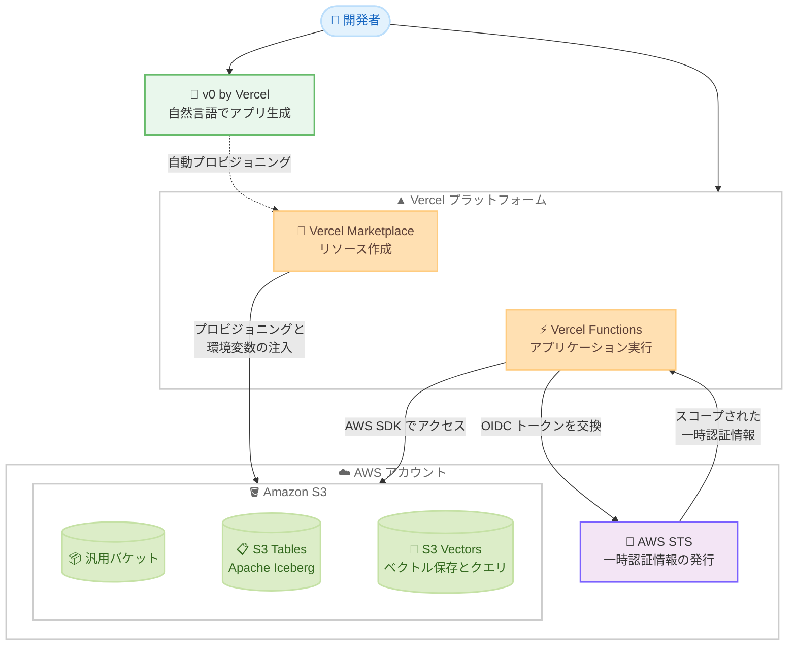

# Amazon S3 - Vercel Marketplace および v0 by Vercel での提供開始

**リリース日**: 2026 年 10 月 14 日
**サービス**: Amazon S3 (S3 Tables、S3 Vectors を含む)
**機能**: Vercel Marketplace および v0 by Vercel とのネイティブ統合

📊 [このアップデートのインフォグラフィックを見る](https://takech9203.github.io/aws-news-summary/20261014-amazon-s3-vercel-marketplace-v0.html)

## 概要

Amazon S3 (S3 Tables および S3 Vectors を含む) が、Vercel Marketplace および v0 by Vercel で利用可能になりました。開発者は開発環境を離れることなく、数秒で S3 リソースを作成し、Vercel プロジェクトに接続できます。S3 の持つ高い耐久性、スケーラビリティ、パフォーマンスを、Vercel の合理化されたプロビジョニングワークフローを通じて利用できます。

今回の統合では、汎用バケット、分析ワークロード向けのフルマネージド Apache Iceberg テーブルである S3 Tables、ベクトルをネイティブに保存・クエリできる S3 Vectors の 3 種類から選択できます。リソースのプロビジョニングと接続設定は自動的に処理され、認証には OIDC トークンと AWS STS による一時認証情報が使用されるため、静的なアクセスキーを保存する必要がありません。既存の Amazon Aurora、Amazon DynamoDB、Amazon OpenSearch Serverless の統合と合わせて、1 つの AWS アカウント・1 つの請求で管理できます。

Web フロントエンドの開発に Vercel を利用しつつ、ストレージやデータ基盤に AWS を利用したい開発者、および v0 による AI 駆動開発で迅速にアプリケーションを構築したい開発者が主な対象です。

**アップデート前の課題**

- 以前は Vercel プロジェクトから S3 を利用する場合、AWS マネジメントコンソールに移動してバケットの作成、IAM ポリシーや認証情報の設定を行う必要があった
- 以前はアクセスキーなどの静的な認証情報を環境変数として手動で管理する必要があり、セキュリティ上の負担があった
- 以前は Vercel と AWS のリソース管理・請求が分断されており、開発ワークフローが中断されていた

**アップデート後の改善**

- 今回のアップデートにより、Vercel ダッシュボードや v0 から離れることなく、数秒で S3 リソースの作成と接続が可能になった
- 今回のアップデートにより、リソースのプロビジョニングと接続設定 (環境変数の注入) が自動化され、手動設定が不要になった
- 今回のアップデートにより、OIDC トークンと AWS STS を利用した短命の一時認証情報による認証が標準となり、静的なアクセスキーの保存が不要になった
- 今回のアップデートにより、v0 で自然言語からアプリケーションを生成する際に、適切な S3 リソースが自動的にプロビジョニングされるようになった

## アーキテクチャ図



Vercel Marketplace または v0 から S3 リソースを自動プロビジョニングし、Vercel Functions は実行時に OIDC トークンを AWS STS で一時認証情報と交換して S3 にアクセスします。静的なアクセスキーは保存されません。

## サービスアップデートの詳細

### 主要機能

1. **Vercel Marketplace からの S3 プロビジョニング**
   - Vercel ダッシュボードの Storage タブから AWS を選択し、バケットタイプとリージョンを指定するだけで数秒でバケットを作成可能
   - リソースのプロビジョニングと接続設定が自動化され、環境変数がプロジェクトに自動注入される
   - 既存の Amazon Aurora、Amazon DynamoDB、Amazon OpenSearch Serverless の統合に加わる形で提供

2. **3 種類の S3 ストレージタイプに対応**
   - **S3 汎用バケット**: ファイル、画像、動画、ドキュメントなどほぼあらゆるユースケースに対応。99.999999999% (イレブンナイン) のデータ耐久性と 99.99% の可用性を標準で提供
   - **S3 Tables**: 分析ワークロード向けに最適化されたフルマネージドの Apache Iceberg テーブル。自動テーブルメンテナンスとコンパクション機能を備え、DuckDB など Iceberg REST catalog API 互換エンジンから直接クエリ可能
   - **S3 Vectors**: RAG やセマンティック検索向けに、ベクトルをネイティブに大規模保存・クエリ可能。ベクトルのアップロード、保存、クエリのコストを最大 90% 削減

3. **OIDC ベースのセキュアな認証**
   - `@vercel/functions/oidc` の `awsCredentialsProvider` が、実行時に短命の OIDC トークンを AWS STS と交換
   - 対象リソースにスコープされた一時認証情報を取得するため、静的なアクセスキーの保存が不要

4. **v0 by Vercel での自動プロビジョニング**
   - 自然言語で作りたいものを記述すると、v0 が適切な S3 リソースを自動的に選択してプロビジョニング
   - 接続設定と動作するコードも合わせて生成される

5. **新規 AWS アカウント向けクレジット**
   - Vercel 経由で作成された新規 AWS アカウントには、最大 6 か月間有効な 100 ドルのクレジットを付与
   - クレジットは Amazon S3、Amazon OpenSearch Serverless、AWS データベースサービスで利用可能
   - 既存の AWS 顧客はアカウントをリンクして、現行の請求を維持したまま Vercel プロジェクトで S3 を利用可能

## 技術仕様

### 自動注入される環境変数

| 環境変数 | 説明 |
|------|------|
| `AWS_REGION` | リソースが作成された AWS リージョン |
| `AWS_ROLE_ARN` | OIDC トークン交換で引き受ける IAM ロールの ARN |
| `AWS_RESOURCE_ARN` | 作成されたリソースの ARN |
| `S3_BUCKET_NAME` | 汎用バケットの名前 (汎用バケット選択時) |
| `S3_TABLE_BUCKET_NAME` | テーブルバケットの名前 (S3 Tables 選択時) |
| `S3_VECTOR_BUCKET_NAME` | ベクトルバケットの名前 (S3 Vectors 選択時) |

### 利用する SDK パッケージ

| ストレージタイプ | 主なパッケージ |
|------|------|
| S3 汎用バケット | `@aws-sdk/client-s3` (`PutObjectCommand`、`GetObjectCommand`、`ListObjectsV2Command`) |
| S3 Tables | `@duckdb/node-api` (aws / httpfs / iceberg 拡張をロードして SQL 実行) |
| S3 Vectors | `@aws-sdk/client-s3vectors` (`QueryVectorsCommand` による topK 検索) |
| 認証 | `@vercel/functions/oidc` (`awsCredentialsProvider`) |

## 設定方法

### 前提条件

1. Vercel アカウントと Vercel プロジェクト
2. AWS アカウント (Vercel 経由での新規作成、または既存アカウントのリンクが可能)
3. Vercel CLI (環境変数の取得に使用)

### 手順

#### ステップ 1: Vercel ダッシュボードから S3 リソースを作成

Vercel ダッシュボードの **Storage** タブから **Create** を選択し、AWS を選びます。S3 のバケットタイプ (汎用バケット、S3 Tables、S3 Vectors) とリージョンを指定すると、数秒でバケットが作成されます。

#### ステップ 2: プロジェクトに接続して環境変数を取得

```bash
vercel link
vercel env pull .env.local
```

`vercel link` でローカルのコードベースを Vercel プロジェクトに関連付け、`vercel env pull` で統合により注入された環境変数 (`AWS_REGION`、`AWS_ROLE_ARN`、バケット名など) をローカルの `.env.local` ファイルに取得します。

#### ステップ 3: アプリケーションコードから S3 にアクセス

```typescript
import { awsCredentialsProvider } from "@vercel/functions/oidc";
import { S3Client, PutObjectCommand } from "@aws-sdk/client-s3";

const s3 = new S3Client({
  region: process.env.AWS_REGION,
  credentials: awsCredentialsProvider({
    roleArn: process.env.AWS_ROLE_ARN!,
  }),
});

await s3.send(
  new PutObjectCommand({
    Bucket: process.env.S3_BUCKET_NAME,
    Key: "uploads/sample.png",
    Body: fileBuffer,
  })
);
```

`awsCredentialsProvider` が実行時に OIDC トークンを AWS STS と交換し、対象リソースにスコープされた一時認証情報を取得します。アプリケーションコードに静的なアクセスキーを記述する必要はありません。なお、Next.js のルートで DuckDB を使用して S3 Tables にクエリする場合は、`next.config.mjs` の `serverExternalPackages` に該当パッケージの追加が必要です。

## メリット

### ビジネス面

- **開発速度の向上**: 開発環境を離れずに数秒でストレージをプロビジョニングでき、プロトタイプから本番までの時間を短縮できる
- **コスト最適化の機会**: 新規 AWS アカウントには 6 か月有効な 100 ドルのクレジットが付与され、S3 Vectors はベクトル関連コストを最大 90% 削減できる
- **請求の一元化**: リソースは自分の AWS アカウント内に作成されるため、AWS の請求・管理体系に統合される

### 技術面

- **セキュリティの向上**: OIDC トークンと AWS STS による短命の一時認証情報を使用し、静的なアクセスキーを保存しない設計
- **自動化された接続設定**: 環境変数の注入が自動化され、設定ミスのリスクを低減
- **AWS ネイティブツールとの併用**: リソースは自分の AWS アカウント内に存在するため、AWS CLI やマネジメントコンソールなど AWS ネイティブツールでの管理も可能
- **AI 駆動開発との統合**: v0 で自然言語からアプリケーションを生成する際に、ユースケースに応じた適切な S3 リソースが自動選択される

## デメリット・制約事項

### 制限事項

- 既存の AWS アカウントをリンクした場合、Vercel が扱えるのはプラットフォーム経由で作成した新規バケットのみで、既存のバケットは対象外
- S3 Vectors には埋め込みを生成する機能はなく、埋め込みモデル (Amazon Bedrock など) で別途作成する必要がある
- 提供リージョンは Vercel がサポートする商用 AWS リージョンに限定される

### 考慮すべき点

- 100 ドルのクレジットは Vercel 経由で作成した新規 AWS アカウントが対象で、有効期間は最大 6 か月である
- Next.js で DuckDB を使用して S3 Tables にアクセスする場合、`serverExternalPackages` の設定が必要になる
- 本番運用では、Vercel 側と AWS 側の両方でアクセス権限や監視体制を整理しておくことが望ましい

## ユースケース

### ユースケース 1: 画像アップロード機能付き Web アプリケーション

**シナリオ**: Vercel 上の Next.js アプリケーションで、ユーザーがアップロードした画像や動画を保存したい。

**実装例**:
```
1. Vercel Marketplace から S3 汎用バケットを作成
2. vercel env pull で環境変数を取得
3. @aws-sdk/client-s3 の PutObjectCommand でアップロード、
   ListObjectsV2Command / GetObjectCommand で一覧表示と配信を実装
```

**効果**: AWS コンソールでの設定作業なしに、イレブンナインの耐久性を持つオブジェクトストレージを数秒で利用開始できる。

### ユースケース 2: PDF ドキュメントに回答する RAG サポートボット

**シナリオ**: 社内ドキュメントやマニュアルの PDF をもとに質問へ回答するサポートボットを構築したい。

**実装例**:
```
1. v0 に「PDF から回答するサポートボット」と自然言語で指示
2. v0 が S3 Vectors バケットを自動プロビジョニングし、接続コードを生成
3. 埋め込みモデルでドキュメントをベクトル化して保存し、
   @aws-sdk/client-s3vectors の QueryVectorsCommand で topK 検索
```

**効果**: 専用のベクトルデータベースを運用せずにセマンティック検索を実現し、ベクトル関連コストを最大 90% 削減できる。

### ユースケース 3: クリックストリーム分析ダッシュボード

**シナリオ**: Web アプリケーションのクリックストリームデータを蓄積し、分析ダッシュボードを提供したい。

**実装例**:
```
1. Vercel Marketplace から S3 Tables バケットを作成
2. Vercel Function 内で DuckDB の aws / httpfs / iceberg 拡張をロードし、
   一時認証情報でシークレットを作成
3. テーブルバケットの ARN をアタッチして SQL で集計クエリを実行
```

**効果**: フルマネージドの Apache Iceberg テーブルにより、自動メンテナンスとコンパクションを備えた分析基盤をサーバーレスで構築できる。

## 料金

統合自体の利用は無料で、使用した S3 リソースに対して標準の Amazon S3 料金が適用されます。

- Vercel 経由で作成された新規 AWS アカウントには、最大 6 か月間有効な 100 ドルのクレジットが付与されます
- クレジットは Amazon S3、Amazon OpenSearch Serverless、AWS データベースサービスで利用できます
- 既存の AWS 顧客はアカウントをリンクすることで、現行の請求体系を維持したまま利用できます

## 利用可能リージョン

Vercel が利用可能なすべての商用 AWS リージョンで提供されています。

## 関連サービス・機能

- **Amazon S3 Tables**: Apache Iceberg 形式に最適化されたフルマネージドのテーブルストレージ。今回の統合で Vercel から直接プロビジョニング可能
- **Amazon S3 Vectors**: ベクトルをネイティブに保存・クエリできる S3 のストレージタイプ。RAG やセマンティック検索の基盤として利用可能
- **Amazon Aurora / Amazon DynamoDB / Amazon OpenSearch Serverless**: 先行して Vercel Marketplace で提供されている AWS サービス。S3 と組み合わせてフルスタックな AWS バックエンドを構成可能
- **AWS STS**: OIDC トークンを一時認証情報と交換する認証基盤として本統合で利用

## 参考リンク

- 📊 [インフォグラフィック](https://takech9203.github.io/aws-news-summary/20261014-amazon-s3-vercel-marketplace-v0.html)
- [公式発表 (What's New)](https://aws.amazon.com/about-aws/whats-new/2026/10/amazon-s3-vercel-marketplace-v0)
- [AWS Blog: Amazon S3 is now available on the Vercel Marketplace and v0 by Vercel](https://aws.amazon.com/blogs/aws/amazon-s3-vercel-marketplace-v0/)
- [AWS on Vercel Marketplace](https://vercel.com/marketplace/aws)
- [v0 by Vercel](https://v0.app/)
- [Amazon S3 ドキュメント](https://docs.aws.amazon.com/s3/)
- [Amazon S3 料金ページ](https://aws.amazon.com/s3/pricing/)

## まとめ

Amazon S3 (S3 Tables、S3 Vectors を含む) が Vercel Marketplace と v0 by Vercel に統合され、開発環境を離れることなく数秒で S3 リソースの作成と接続が可能になりました。OIDC ベースの一時認証情報により静的なアクセスキーが不要となり、セキュリティと開発体験の両面で優れた統合です。Vercel で Web アプリケーションや AI アプリケーションを構築しているチームは、Vercel ダッシュボードの Storage タブまたは v0 から試してみることを推奨します。
