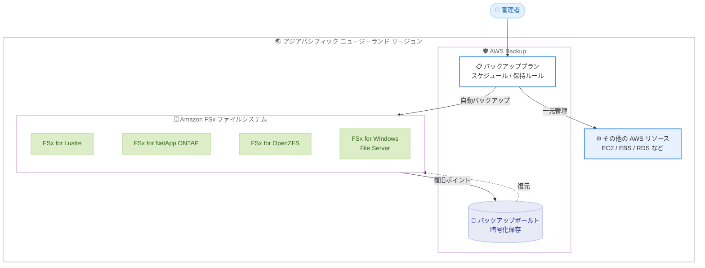

# AWS Backup - アジアパシフィック (ニュージーランド) リージョンでの Amazon FSx ファイルシステムのサポート

**リリース日**: 2026 年 10 月 14 日
**サービス**: AWS Backup
**機能**: アジアパシフィック (ニュージーランド) リージョンにおける Amazon FSx ファイルシステムのバックアップサポート

📊 [このアップデートのインフォグラフィックを見る](https://takech9203.github.io/aws-news-summary/20261014-aws-backup-fsx-asia-pacific-new-zealand.html)

## 概要

AWS Backup が、アジアパシフィック (ニュージーランド) リージョンにおいて Amazon FSx ファイルシステムのサポートを開始しました。対象となるのは Amazon FSx for Lustre、Amazon FSx for NetApp ONTAP、Amazon FSx for OpenZFS、Amazon FSx for Windows File Server の 4 種類すべての FSx ファイルシステムです。

今回のリリースにより、アジアパシフィック (ニュージーランド) リージョンの FSx ファイルシステムに対して、他のサポート対象 AWS リソースと同様に、AWS Backup による一元的なデータ保護の自動化と管理が可能になりました。ポリシーベースのバックアッププランによるスケジュール設定と保持ルールの適用、暗号化されたバックアップボールトへの保存、必要なときのファイルシステムの復元を、単一の集中管理されたサービスから実行できます。

ニュージーランドでワークロードを運用する企業や、データレジデンシー要件によりニュージーランド国内でのデータ保管が求められる組織にとって、事業継続性、災害対策、規制コンプライアンスの要件を満たすための重要なアップデートです。

**アップデート前の課題**

このアップデート以前は、アジアパシフィック (ニュージーランド) リージョンで FSx ファイルシステムを保護する際に以下の課題がありました。

- 以前はアジアパシフィック (ニュージーランド) リージョンの FSx ファイルシステムを AWS Backup で管理できず、FSx ネイティブのバックアップ機能を個別に設定する必要があった
- 以前は EC2 や EBS など他の AWS リソースと FSx ファイルシステムのバックアップポリシーを統一的に管理できなかった
- 以前は同リージョン内でコンプライアンス要件に対応したバックアップの一元管理と監査が難しかった

**アップデート後の改善**

今回のアップデートにより以下が可能になりました。

- アジアパシフィック (ニュージーランド) リージョンの FSx ファイルシステム 4 種類すべてを AWS Backup で一元管理できるようになった
- ポリシーベースのバックアッププランにより、スケジュール設定と保持ルールの適用を自動化できるようになった
- 暗号化されたバックアップボールトへの保存と、必要に応じたファイルシステムの復元が単一サービスから実行できるようになった

## アーキテクチャ図



AWS Backup のバックアッププランがアジアパシフィック (ニュージーランド) リージョン内の 4 種類の FSx ファイルシステムを自動的にバックアップし、暗号化されたバックアップボールトに復旧ポイントを保存します。他の AWS リソースと合わせて単一のポリシーで一元管理できます。

## サービスアップデートの詳細

### 主要機能

1. **4 種類の FSx ファイルシステムのサポート**
   - Amazon FSx for Lustre: HPC や機械学習向けの高性能ファイルシステム
   - Amazon FSx for NetApp ONTAP: NetApp ONTAP ベースのマルチプロトコル対応ファイルシステム
   - Amazon FSx for OpenZFS: OpenZFS ベースの NFS 対応ファイルシステム
   - Amazon FSx for Windows File Server: SMB プロトコル対応の Windows ネイティブファイルシステム

2. **ポリシーベースのバックアップ管理**
   - バックアッププランによるバックアップスケジュールの自動化
   - 保持ルールの適用によるライフサイクル管理
   - タグベースのリソース割り当てによる柔軟な保護対象の指定

3. **暗号化ボールトへの保存と復元**
   - バックアップは暗号化されたバックアップボールトに保存
   - 必要なときにファイルシステムを復元可能
   - 事業継続性、災害対策、規制コンプライアンスの要件に単一サービスで対応

## 技術仕様

### サポート対象と利用方法

| 項目 | 詳細 |
|------|------|
| 対象リージョン | アジアパシフィック (ニュージーランド) |
| 対象サービス | FSx for Lustre、FSx for NetApp ONTAP、FSx for OpenZFS、FSx for Windows File Server |
| バックアップ方式 | ポリシーベースのバックアッププラン (スケジュール、保持ルール) |
| 保存先 | 暗号化されたバックアップボールト |
| 操作方法 | AWS Backup コンソール、AWS CLI、AWS SDK |

## 設定方法

### 前提条件

1. アジアパシフィック (ニュージーランド) リージョンで Amazon FSx ファイルシステムを運用していること
2. AWS Backup の操作に必要な IAM 権限 (AWSBackupFullAccess など) を持っていること
3. AWS Backup がリソースを操作するためのサービスロールが設定されていること

### 手順

#### ステップ 1: バックアップボールトの作成

```bash
aws backup create-backup-vault \
  --backup-vault-name fsx-backup-vault \
  --region ap-southeast-6
```

アジアパシフィック (ニュージーランド) リージョンにバックアップボールトを作成します。復旧ポイントはこのボールトに暗号化されて保存されます。

#### ステップ 2: バックアッププランの作成

```bash
aws backup create-backup-plan \
  --region ap-southeast-6 \
  --backup-plan '{
    "BackupPlanName": "fsx-daily-backup",
    "Rules": [
      {
        "RuleName": "DailyBackup",
        "TargetBackupVaultName": "fsx-backup-vault",
        "ScheduleExpression": "cron(0 17 * * ? *)",
        "StartWindowMinutes": 60,
        "Lifecycle": {
          "DeleteAfterDays": 35
        }
      }
    ]
  }'
```

毎日定時に実行されるバックアッププランを作成します。この例では保持期間を 35 日に設定し、期間を過ぎた復旧ポイントは自動的に削除されます。

#### ステップ 3: FSx ファイルシステムをバックアッププランに割り当て

```bash
aws backup create-backup-selection \
  --region ap-southeast-6 \
  --backup-plan-id <backup-plan-id> \
  --backup-selection '{
    "SelectionName": "fsx-selection",
    "IamRoleArn": "arn:aws:iam::123456789012:role/service-role/AWSBackupDefaultServiceRole",
    "Resources": [
      "arn:aws:fsx:ap-southeast-6:123456789012:file-system/*"
    ]
  }'
```

バックアッププランに FSx ファイルシステムを割り当てます。リソース ARN の指定のほか、タグベースでの割り当ても可能です。これにより、対象のファイルシステムがスケジュールに従って自動的にバックアップされます。

## メリット

### ビジネス面

- **事業継続性と災害対策の強化**: ニュージーランド国内のワークロードに対して、ポリシーに基づく確実なバックアップ運用が可能になり、障害発生時の復旧体制を強化できる
- **規制コンプライアンスへの対応**: データレジデンシー要件のあるワークロードでも、リージョン内で一元的なデータ保護と監査対応が可能になる
- **運用コストの削減**: FSx 固有のバックアップ運用を個別に構築する必要がなくなり、既存の AWS Backup 運用に統合できる

### 技術面

- **一元管理**: EC2、EBS、RDS など他の AWS リソースと FSx ファイルシステムのバックアップを単一のサービスとポリシーで管理できる
- **自動化**: スケジュール設定と保持ルールにより、バックアップの取得から削除までのライフサイクルを自動化できる
- **セキュリティ**: バックアップは暗号化されたボールトに保存され、アクセスポリシーによる保護が可能

## デメリット・制約事項

### 制限事項

- 今回のサポート対象はアジアパシフィック (ニュージーランド) リージョンの FSx ファイルシステムであり、リージョンごとの機能サポート状況は [AWS Backup ドキュメント](https://docs.aws.amazon.com/aws-backup/latest/devguide/backup-feature-availability.html#features-by-region)で確認が必要
- クロスリージョンコピーやクロスアカウントコピーなどの個別機能の対応状況は、リージョンおよびリソースタイプごとに異なるため事前確認が必要

### 考慮すべき点

- バックアップストレージには AWS Backup の料金が発生するため、保持期間とバックアップ頻度の設計がコストに影響する
- FSx for NetApp ONTAP など一部のファイルシステムタイプでは、バックアップの仕様 (対象ボリュームの扱いなど) がタイプごとに異なるため、ドキュメントでの確認を推奨

## ユースケース

### ユースケース 1: Windows ファイルサーバーの定期バックアップと世代管理

**シナリオ**: ニュージーランド国内の企業が FSx for Windows File Server を社内ファイルサーバーとして利用しており、日次バックアップと 35 日間の世代管理が社内規定で求められている。

**実装例**:
```
1. バックアップボールト「corp-file-vault」を作成
2. 日次バックアップのバックアッププランを作成 (保持期間 35 日)
3. タグ「Backup=Daily」が付与された FSx ファイルシステムをプランに割り当て
```

**効果**: 社内規定に準拠したバックアップ運用を自動化でき、誤削除やランサムウェア被害からの復旧体制を確立できる。

### ユースケース 2: HPC ワークロードのデータ保護

**シナリオ**: 研究機関が FSx for Lustre を HPC クラスターのストレージとして利用しており、解析結果データを定期的に保護したい。

**実装例**:
```
1. 解析ジョブ完了後の時間帯に合わせたバックアップスケジュールを設定
2. 保持ルールにより古い復旧ポイントを自動削除してコストを最適化
3. 必要に応じてオンデマンドバックアップを追加実行
```

**効果**: 高価な再計算を避けるためのデータ保護を自動化し、ストレージコストと保護レベルのバランスを最適化できる。

### ユースケース 3: 複数リソースの統合バックアップガバナンス

**シナリオ**: ニュージーランドで金融系ワークロードを運用する企業が、EC2、RDS、FSx for NetApp ONTAP を含む全リソースのバックアップ状況を一元的に管理し、監査に対応したい。

**実装例**:
```
1. 全リソース共通のバックアッププランをタグベースで適用
2. 暗号化ボールトにバックアップを集約
3. AWS Backup のジョブ履歴と復旧ポイントを監査証跡として活用
```

**効果**: リソースタイプごとに分散していたバックアップ管理を統合し、規制コンプライアンスの証跡提示を効率化できる。

## 料金

AWS Backup の料金は、バックアップストレージの使用量、復元したデータ量などに基づいて課金されます。FSx ファイルシステムのバックアップはウォームストレージの GB 単価で課金され、リージョンおよびリソースタイプによって単価が異なります。最新の料金はアジアパシフィック (ニュージーランド) リージョンの [AWS Backup 料金ページ](https://aws.amazon.com/backup/pricing/)で確認してください。

## 利用可能リージョン

今回のアップデートにより、アジアパシフィック (ニュージーランド) リージョンで Amazon FSx ファイルシステム (FSx for Lustre、FSx for NetApp ONTAP、FSx for OpenZFS、FSx for Windows File Server) の AWS Backup サポートが利用可能になりました。サポート対象リージョンと機能の全一覧は [AWS Backup ドキュメント](https://docs.aws.amazon.com/aws-backup/latest/devguide/backup-feature-availability.html#features-by-region)を参照してください。

## 関連サービス・機能

- **Amazon FSx**: 今回バックアップ対象となったフルマネージドファイルストレージサービス。Lustre、NetApp ONTAP、OpenZFS、Windows File Server の 4 種類を提供
- **AWS Backup Audit Manager**: バックアップポリシーの準拠状況を監査し、コンプライアンスレポートを生成する機能
- **AWS Organizations**: 組織全体でバックアップポリシーを一元適用し、マルチアカウント環境のデータ保護ガバナンスを実現

## 参考リンク

- 📊 [インフォグラフィック](https://takech9203.github.io/aws-news-summary/20261014-aws-backup-fsx-asia-pacific-new-zealand.html)
- [公式発表 (What's New)](https://aws.amazon.com/about-aws/whats-new/2026/10/aws-backup-fsx-asia-pacific-new-zealand/)
- [ドキュメント (リージョン別機能一覧)](https://docs.aws.amazon.com/aws-backup/latest/devguide/backup-feature-availability.html#features-by-region)
- [AWS Backup 製品ページ](https://aws.amazon.com/backup/)
- [料金ページ](https://aws.amazon.com/backup/pricing/)

## まとめ

AWS Backup がアジアパシフィック (ニュージーランド) リージョンで 4 種類すべての Amazon FSx ファイルシステムをサポートし、同リージョンでのデータ保護を単一サービスで一元管理できるようになりました。ニュージーランドで FSx を利用中、または利用を検討している場合は、既存の FSx ネイティブバックアップ運用を AWS Backup のポリシーベース管理へ統合し、事業継続性とコンプライアンス対応の強化を検討することを推奨します。
