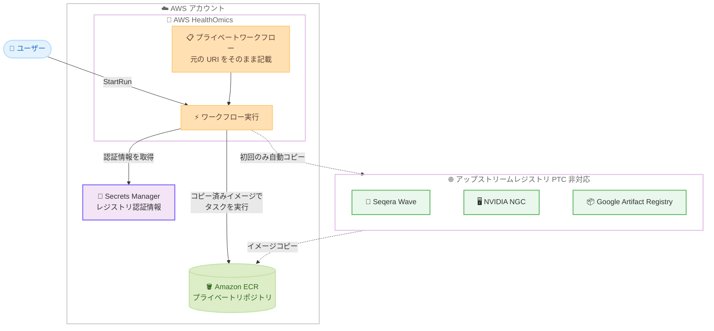

# AWS HealthOmics - プライベートワークフローのコンテナレジストリサポート拡大

**リリース日**: 2026 年 10 月 14 日
**サービス**: AWS HealthOmics
**機能**: Expanded container registry support (サードパーティコンテナレジストリサポートの拡大)

📊 [このアップデートのインフォグラフィックを見る](https://takech9203.github.io/aws-news-summary/20261014-aws-healthomics-expanded-container-registry-support.html)

## 概要

AWS HealthOmics のプライベートワークフローで、Seqera (Wave)、NVIDIA NGC、Google Artifact Registry、Google Container Registry といったサードパーティコンテナレジストリのイメージを直接利用できるようになりました。ワークフローが依存するコンテナイメージを手動で Amazon ECR へ移行したり、ワークフロー定義内のイメージ URI を書き換えたりする必要がなくなります。

AWS HealthOmics は、ヘルスケア・ライフサイエンス分野のお客様がフルマネージドなバイオインフォマティクスワークフローを大規模に実行できるようにする HIPAA 対応サービスです。今回の拡大により、プライベートワークフローの実行時に、HealthOmics がユーザーに代わって新たにサポートされたレジストリからコンテナイメージをユーザーの Amazon ECR へコピーします。コピーは初回のみ実行され、以降のタスクや実行ではコピー済みイメージが再利用されます。

これまで HealthOmics は、Amazon ECR プルスルーキャッシュ (PTC) がサポートするレジストリ (Docker Hub、Quay、GitHub Container Registry、Amazon ECR Public など) からのみイメージを取得できました。今回のアップデートにより、PTC 対応レジストリと PTC 非対応のサードパーティレジストリの両方をプライベートワークフローから利用できます。

**アップデート前の課題**

- PTC 非対応レジストリ (Seqera、NVIDIA NGC、Google Artifact Registry など) のイメージは、手動で pull して Amazon ECR へ re-push する必要があった
- ワークフロー定義内のイメージ URI を Amazon ECR の URI に書き換える必要があり、nf-core などの既存パイプラインの移植に手間がかかった
- イメージの移行作業とワークフロー定義の管理が運用負荷になっていた

**アップデート後の改善**

- HealthOmics が実行時にアップストリームレジストリからユーザーの Amazon ECR へイメージを自動コピーするため、手動での pull / re-push が不要になった
- ワークフロー定義には元のアップストリームイメージ URI をそのまま記載でき、URI の書き換えが不要になった
- コピーは初回のみ実行され、以降の実行ではコピー済みイメージを再利用するため、ダウンロードが 1 回で済む

## アーキテクチャ図



ワークフロー実行時、HealthOmics が Secrets Manager の認証情報を使用してアップストリームレジストリからイメージをユーザーの Amazon ECR へ自動コピーし、タスクはコピー済みイメージから起動されます。コピーは初回のみ実行されます。

## サービスアップデートの詳細

### 主要機能

1. **PTC 非対応レジストリからの自動イメージコピー**
   - 実行中のタスクが初めてイメージを必要とした時点で、HealthOmics がアップストリームレジストリからユーザーアカウント内の Amazon ECR プライベートリポジトリへイメージをコピーし、そのコピーからタスクを起動する
   - 以降のタスクと実行はコピー済みイメージを再利用するため、ダウンロードは 1 回のみ
   - バッチ実行などで複数の実行が同じイメージを同時に必要とした場合も、コピーは 1 回だけ実行され、他の実行はそのコピーを待機する

2. **新たにサポートされたレジストリ**
   - Seqera Containers (`community.wave.seqera.io` および `wave.seqera.io`)
   - NVIDIA NGC (`nvcr.io`)
   - Google Container Registry (`gcr.io`)
   - Google Artifact Registry (`{region}-docker.pkg.dev`、例: `us-central1-docker.pkg.dev` のように完全なリージョンホストを指定)

3. **ワークフロー定義の変更不要**
   - ワークフロー定義には元のアップストリームイメージ URI をそのまま記載できる
   - ワークフロー作成時に registry mapping を指定し、Secrets Manager シークレットの ARN を `credentialArn` として設定する
   - 既存の PTC 対応レジストリ (Docker Hub、Quay、GitHub Container Registry、Amazon ECR Public など) との併用も可能

### コピー先リポジトリの命名

コピーされたイメージは、registry mapping から計算できる次の URI に配置されます。

```
{account-id}.dkr.ecr.{region}.amazonaws.com/{ecrRepositoryPrefix}/{image-path}:{tag}
```

- `image-path` は、アップストリームイメージ URI からレジストリホスト (および設定した場合は `upstreamRepositoryPrefix`) を除いたパス
- 例: `community.wave.seqera.io/library/samtools:1.22.1--eccb42ff8fb55509` をプレフィックス `wave-seqera` でコピーすると `111122223333.dkr.ecr.us-east-1.amazonaws.com/wave-seqera/library/samtools:1.22.1--eccb42ff8fb55509` に配置される
- `ecrAccountId` を設定すると、別アカウントの ECR にリポジトリを作成してコピーを push できる
- リポジトリが存在しない場合は HealthOmics が作成し、リポジトリポリシーがない場合は HealthOmics が pull を許可するポリシーをアタッチする

## 技術仕様

### レジストリサポートの比較

| 項目 | PTC 対応レジストリ | PTC 非対応レジストリ (今回拡大) |
|------|------|------|
| 対象レジストリ | Docker Hub、Quay、GitHub Container Registry、Amazon ECR Public など | Seqera Containers / Wave、NVIDIA NGC、Google Container Registry、Google Artifact Registry |
| 同期方式 | Amazon ECR プルスルーキャッシュによる自動同期 | HealthOmics による実行時の自動コピー (初回のみ) |
| 認証情報 | PTC ルールの設定に従う | Secrets Manager シークレット (`credentialArn`) が必須 |
| アップストリーム更新の反映 | PTC が同期 | 自動更新されない。コピー済みイメージを削除すると次回実行時に再コピー |

### 認証情報のフォーマット

| レジストリ | シークレットの形式 |
|------|------|
| Seqera Containers / Wave | `{"accessToken":"<Seqera Platform アクセストークン>"}` |
| NVIDIA NGC | `{"username":"$oauthtoken","accessToken":"<NGC API キー>"}` |
| Google Container Registry / Artifact Registry | `{"username":"_json_key","accessToken":"<サービスアカウント JSON キーの内容>"}` |

匿名 pull が可能なレジストリ (`community.wave.seqera.io` など) を含め、サポートされるすべてのレジストリで認証情報が必要です。

### API 変更履歴

| 日付 | サービス | 変更内容 |
|------|----------|----------|
| 2026/10/13 | [omics](https://awsapichanges.com/archive/changes/5f4e0c-omics.html) | 4 updated api methods - `CreateWorkflow`、`CreateWorkflowVersion` のリクエストおよび `GetWorkflow`、`GetWorkflowVersion` のレスポンスに `containerRegistryMap.registryMappings.credentialArn` フィールドが追加 |

## 設定方法

### 前提条件

1. AWS HealthOmics が利用可能なリージョンでプライベートワークフローを使用していること
2. アップストリームレジストリの認証情報 (Seqera Platform アクセストークン、NGC API キー、Google Cloud サービスアカウントキーなど) を取得していること
3. `StartRun` に渡すサービスロールが実行と同じ AWS アカウントに存在すること

### 手順

#### ステップ 1: レジストリ認証情報を Secrets Manager に保存する

```bash
aws secretsmanager create-secret \
    --name omics-registry/seqera \
    --secret-string '{"accessToken":"<seqera-platform-access-token>"}' \
    --region us-east-1
```

Seqera Containers 用の認証情報を Secrets Manager シークレットとして作成しています。シークレットは HealthOmics の実行と同じリージョンに保存します。NVIDIA NGC の場合は `{"username":"$oauthtoken","accessToken":"<ngc-api-key>"}` の形式で作成します (`$oauthtoken` がシェルで展開されないようシングルクォートで囲みます)。レスポンスに含まれるシークレットの ARN を registry mapping の `credentialArn` に使用します。

#### ステップ 2: サービスロールに権限を付与する

HealthOmics は `StartRun` に渡されたサービスロールを使用して、シークレットの読み取り (`secretsmanager:GetSecretValue`)、コピー先リポジトリの作成、コピーしたイメージの push を行います。[Service role policy for non-PTC container support](https://docs.aws.amazon.com/omics/latest/dev/permissions-ecr.html#permissions-ecr-non-ptc) に記載されたポリシーをサービスロールに追加します。

#### ステップ 3: ワークフロー作成時に registry mapping を指定する

ワークフロー作成時に、アップストリームレジストリとコピー先の ECR リポジトリプレフィックス、シークレットの ARN を registry mapping として指定します。ワークフロー定義内のイメージ URI は元のアップストリーム URI のまま変更不要です。

#### ステップ 4: イメージコピーの成功を確認する

```bash
aws ecr describe-images \
    --repository-name wave-seqera/library/samtools \
    --image-ids imageTag=1.22.1--eccb42ff8fb55509 \
    --region us-east-1
```

実行後、コピー先 URI にイメージが存在することを確認しています。コピーが成功していれば、イメージの詳細情報が返されます。

## メリット

### ビジネス面

- **パイプライン移植の高速化**: nf-core など、Seqera Wave や NGC のイメージに依存する既存のバイオインフォマティクスパイプラインを、イメージ移行作業なしで HealthOmics 上で実行開始できる
- **運用負荷の削減**: イメージの手動 pull / re-push やワークフロー定義のメンテナンスが不要になり、科学的な作業に集中できる
- **GPU ワークロードの導入促進**: NVIDIA NGC の最適化済みコンテナ (Parabricks など) をそのまま利用でき、ゲノミクスの GPU 高速化を導入しやすくなる

### 技術面

- **ワークフロー定義の可搬性**: 元のアップストリーム URI を保持するため、ワークフロー定義をコミュニティ標準のまま維持できる
- **効率的なイメージ管理**: コピーは初回のみ実行され、同時実行時も 1 回のコピーを共有するため、ネットワーク転送とストレージが効率化される
- **セキュアな認証情報管理**: レジストリ認証情報は Secrets Manager で一元管理され、クロスアカウントでのシークレット共有にも対応する

## デメリット・制約事項

### 制限事項

- x86_64 イメージのみコピー対象であり、ARM ベースおよびマルチアーキテクチャイメージはサポートされない
- 共有ワークフローでは非 PTC コンテナサポートは利用できない (他アカウントが共有ワークフローを実行する際、`credentialArn` を含む registry mapping は無視される)
- 匿名 pull 可能なレジストリを含め、すべての対象レジストリで認証情報 (Secrets Manager シークレット) が必要

### 考慮すべき点

- `latest` などのタグでコピーしたイメージは、アップストリームの内容が更新されても自動では更新されない。新しい内容を反映するには、ECR 上のコピー済みイメージを削除して再コピーさせる必要がある。タグではなくダイジェストまたはバージョンでの参照が推奨される
- 認証情報が無効、またはサービスロールの権限が不足している場合、イメージコピーが失敗しタスクと実行も失敗する。ただし、ECR にコピーが既に存在する場合はそのコピーが使用され、認証情報の検証は行われない
- 同じアカウントで `ecrRepositoryPrefix` を共有するワークフローはコピー済みイメージを共有するため、イメージを削除すると同じプレフィックスを使用するすべてのワークフローに影響する
- コピーされたイメージには標準の Amazon ECR ストレージ料金が適用され、認証情報には Secrets Manager の料金が適用される

## ユースケース

### ユースケース 1: Seqera Wave イメージを使用する nf-core パイプラインの実行

**シナリオ**: nf-core の Nextflow パイプラインは Seqera Containers (Wave) のイメージを参照しているが、これまでは全イメージを手動で ECR へ移行する必要があった。

**実装例**:
```bash
# Seqera 用シークレットを作成
aws secretsmanager create-secret \
    --name omics-registry/seqera \
    --secret-string '{"accessToken":"<token>"}' \
    --region us-east-1

# ワークフロー作成時に community.wave.seqera.io の registry mapping を指定
# (ecrRepositoryPrefix: wave-seqera, credentialArn: 上記シークレットの ARN)
```

**効果**: パイプライン定義を変更せずに HealthOmics 上で実行でき、移植にかかる時間を大幅に短縮できる。

### ユースケース 2: NVIDIA NGC の GPU 最適化コンテナによるゲノム解析

**シナリオ**: NVIDIA Parabricks などの GPU 最適化ツールを使用してゲノム解析を高速化したいが、NGC のイメージは PTC に対応していなかった。

**実装例**:
```bash
aws secretsmanager create-secret \
    --name omics-registry/nvidia-ngc \
    --secret-string '{"username":"$oauthtoken","accessToken":"<ngc-api-key>"}' \
    --region us-east-1
```

**効果**: `nvcr.io` のイメージ URI をそのままワークフロー定義に記載でき、GPU ワークロードの導入が容易になる。

### ユースケース 3: Google Artifact Registry にある社内ツールの利用

**シナリオ**: マルチクラウド環境の組織で、バイオインフォマティクスツールのコンテナイメージを Google Artifact Registry で管理しているが、AWS 上の HealthOmics でも同じイメージを使用したい。

**実装例**:
```bash
aws secretsmanager create-secret \
    --name omics-registry/google \
    --secret-string "$(jq -n --rawfile key key.json '{username: "_json_key", accessToken: $key}')" \
    --region us-east-1
```

**効果**: イメージの二重管理が不要になり、単一のレジストリを情報源として両クラウドでワークフローを実行できる。

## 料金

拡大されたコンテナレジストリサポート自体に追加料金はありません。関連して以下の料金が適用されます。

- コピーされたイメージの保存には標準の Amazon ECR ストレージ料金が適用される
- アップストリームレジストリの認証情報には AWS Secrets Manager の料金が適用される
- ワークフロー実行には通常の AWS HealthOmics の料金が適用される

## 利用可能リージョン

HealthOmics が利用可能なすべての AWS リージョンで利用できます。

- 米国東部 (バージニア北部、オハイオ)
- 米国西部 (オレゴン)
- 欧州 (フランクフルト、アイルランド、ロンドン)
- イスラエル (テルアビブ)
- アジアパシフィック (シンガポール、ソウル、東京)

## 関連サービス・機能

- **Amazon ECR**: コピーされたイメージの保存先。プルスルーキャッシュ (PTC) 対応レジストリとの併用も可能
- **AWS Secrets Manager**: アップストリームレジストリの認証情報を保存。クロスアカウントでのシークレット共有に対応
- **AWS IAM**: `StartRun` に渡すサービスロールに、シークレット読み取りと ECR リポジトリ作成 / push の権限が必要

## 参考リンク

- 📊 [インフォグラフィック](https://takech9203.github.io/aws-news-summary/20261014-aws-healthomics-expanded-container-registry-support.html)
- [公式発表 (What's New)](https://aws.amazon.com/about-aws/whats-new/2026/10/aws-healthomics-expanded-container-registry-support/)
- [ドキュメント: Container images for private workflows](https://docs.aws.amazon.com/omics/latest/dev/workflows-ecr.html)
- [ドキュメント: Using third-party registries not supported by pull through cache](https://docs.aws.amazon.com/omics/latest/dev/containers-non-ptc-registries.html)
- [AWS HealthOmics 製品ページ](https://aws.amazon.com/healthomics/)
- [関連する過去の発表: PTC によるサードパーティレジストリサポート (2025 年 8 月)](https://aws.amazon.com/about-aws/whats-new/2025/08/aws-healthomics-third-party-container-registries-private-workflows/)

## まとめ

AWS HealthOmics のプライベートワークフローが Seqera (Wave)、NVIDIA NGC、Google Artifact Registry などの PTC 非対応レジストリに対応し、イメージの手動移行やワークフロー定義の書き換えが不要になりました。nf-core などのコミュニティパイプラインや GPU 最適化コンテナを利用するお客様は、Secrets Manager に認証情報を保存し、サービスロールの権限と registry mapping を設定することで、既存のワークフロー定義をそのまま HealthOmics で実行できます。タグ参照のイメージは自動更新されないため、ダイジェストまたはバージョンでの参照を推奨します。
