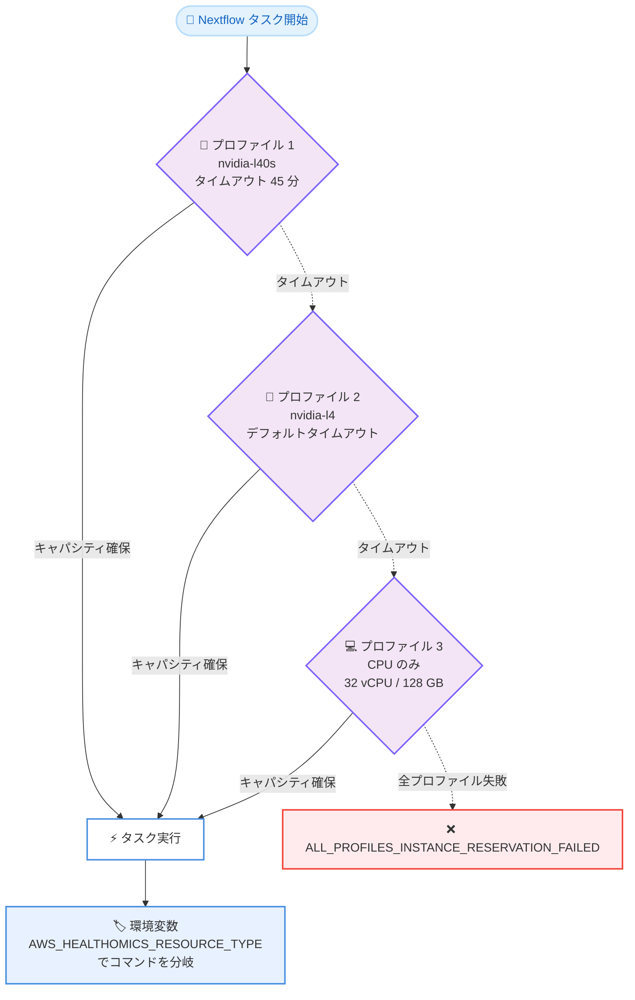

# AWS HealthOmics - Nextflow ワークフロー向けリソースフォールバック順序

**リリース日**: 2026 年 10 月 14 日
**サービス**: AWS HealthOmics
**機能**: Nextflow ワークフローにおける omicsResourceFallbackOrder ディレクティブのサポート

📊 [このアップデートのインフォグラフィックを見る](https://takech9203.github.io/aws-news-summary/20261014-aws-healthomics-resource-fallback-for-Nextflow.html)

## 概要

AWS HealthOmics が、Nextflow ワークフローのタスクに対する「リソースフォールバック」ディレクティブ (`omicsResourceFallbackOrder`) のサポートを発表しました。このディレクティブを使用すると、優先するアクセラレーター (GPU) タイプを順序付きリストとして定義でき、最終的なフォールバック先として CPU インスタンスを指定することも可能です。

優先するアクセラレーターのキャパシティが確保できない場合、HealthOmics はラン (実行) を再送信することなく、指定されたフォールバック順序に従って次のリソースプロファイルへ自動的に移行します。各アクセラレータープロファイルにはタイムアウトを個別に設定でき、そのアクセラレーターを検索する時間を制御できます。これにより、研究者やバイオインフォマティシャンは、アクセラレーターのキャパシティ制約が原因で失敗したランの診断と再送信に費やす時間を削減し、本番ワークフローを継続的に稼働させることができます。

本機能は 2026 年 9 月に WDL ワークフロー向けに提供開始された `omicsResourceFallbackOrder` ディレクティブを Nextflow ワークフローにも拡張するものです。AWS HealthOmics は HIPAA 対応のサービスであり、ヘルスケア・ライフサイエンスのお客様がフルマネージドなバイオインフォマティクスワークフローによって科学的なブレークスルーを大規模に加速することを支援します。

**アップデート前の課題**

- Nextflow ワークフローのタスクでは単一のアクセラレータータイプしか指定できず、キャパシティが確保できない場合はタスクが `INSTANCE_RESERVATION_FAILED` エラーで失敗していた
- GPU キャパシティ不足によるラン失敗のたびに、原因の診断、ワークフロー定義の修正、ランの再送信という手動対応が必要だった
- 人気の高い GPU (例: NVIDIA L40S) のキャパシティ変動により、本番パイプラインの安定稼働が困難だった

**アップデート後の改善**

- アクセラレータータイプの優先順位リストを定義でき、キャパシティ不足時には再送信なしで次の候補へ自動的に移行するようになった
- プロファイルごとに待機タイムアウト (`omicsResourceWaitTimeoutInMin`) を設定でき、優先アクセラレーターをどれだけ待つかを制御できるようになった
- 最終フォールバックとして CPU プロファイルを含めることで、タスクがインスタンスを確保できる可能性を最大化できるようになった
- タスクコンテナに設定される環境変数 `AWS_HEALTHOMICS_RESOURCE_TYPE` により、GPU 用と CPU 用でコマンドを分岐できるようになった

## アーキテクチャ図



HealthOmics はフォールバック順序の先頭プロファイルからキャパシティの確保を試行し、タイムアウトに達すると次のプロファイルへ自動的に移行します。すべてのプロファイルが失敗した場合のみタスクが失敗します。

## サービスアップデートの詳細

### 主要機能

1. **順序付きリソースプロファイルの定義**
   - `omicsResourceFallbackOrder` ディレクティブで、アクセラレーターおよび CPU のリソースプロファイルを優先順に最大 10 件まで定義可能
   - 各プロファイルには `acceleratorType`、`acceleratorCount`、`cpus`、`memory`、`omicsResourceWaitTimeoutInMin` の 5 つのフィールドを個別に設定可能
   - `container`、`errorStrategy`、`maxRetries` などの他のディレクティブは全プロファイルで共有される

2. **プロファイルごとの待機タイムアウト制御**
   - `omicsResourceWaitTimeoutInMin` でプロファイルごとの待機時間を設定可能 (デフォルト: 単一 GPU バンドルは 20 分、マルチ GPU バンドルは 30 分)
   - 短いタイムアウトはフォールバック順序を素早く進め、長いタイムアウトは優先アクセラレーターを確保できる確率を高める
   - タイムアウト時はタスクが失敗するのではなく、次のプロファイルへ移行する

3. **CPU プロファイルへの最終フォールバック**
   - `acceleratorType` を省略したプロファイルは CPU プロファイルとして扱われ、リストの最後に 1 つだけ配置可能
   - CPU プロファイルにはキャパシティ制約がないため、タスクがインスタンスを確保できる可能性が大幅に向上する

4. **実行時のリソースタイプ判別**
   - HealthOmics がタスクコンテナに環境変数 `AWS_HEALTHOMICS_RESOURCE_TYPE` を設定 (値の例: `nvidia-l40s`、`cpu`)
   - GPU 用と CPU 用でコードパスが異なる場合に、スクリプト内でコマンドを分岐できる

5. **柔軟な設定場所**
   - process 定義内のディレクティブ、または `nextflow.config` の `process` スコープ (トップレベル、`withName`、`withLabel` セレクター) で設定可能
   - 複数の場所で設定された場合は、config ファイルのセレクター > process 定義内のディレクティブ > config ファイルのトップレベルの順で適用される

## 技術仕様

### プロファイルのフィールド仕様 (Nextflow)

| フィールド | 型 | 省略時のデフォルト | 備考 |
|------|------|------|------|
| `acceleratorType` | String | 省略すると CPU プロファイル | サポートされる 7 種類のアクセラレータータイプのいずれか。空文字列は不可 |
| `acceleratorCount` | Integer | - | `acceleratorType` とセットで指定必須。最大 4 |
| `cpus` | Integer / Float / String | process の `cpus`、未設定なら GPU インスタンスタイプのデフォルト | 最大 192 vCPU |
| `memory` | String / Nextflow メモリ値 | process の `memory`、未設定なら GPU インスタンスタイプのデフォルト | 単位は B、KB、MB、GB、TB (GiB、MiB は不可)。最大 1,536 GiB |
| `omicsResourceWaitTimeoutInMin` | Integer | 単一 GPU: 20 分、マルチ GPU バンドル: 30 分 | 上限なし。CPU プロファイルには不要 |

### 検証ルール (主要なもの)

| 項目 | 内容 |
|------|------|
| 排他制約 | `omicsResourceFallbackOrder` 使用時は、トップレベルの `acceleratorType` などの個別リソースディレクティブとの併用は警告対象 |
| プロファイル数 | 1 タスクあたり最大 10 プロファイル。空リスト・空プロファイルは不可 |
| CPU プロファイル | 最大 1 つ、かつリストの最後に配置する必要がある |
| リージョン非対応 | ワークフローのリージョンで未サポートのアクセラレータータイプはスケジューリング時にスキップされ、ランタイムログに警告が出力される |
| 全プロファイル失敗時 | タスクは `ALL_PROFILES_INSTANCE_RESERVATION_FAILED` で失敗。Nextflow では `errorStrategy` と `maxRetries` に従ってリトライされ、リトライは先頭プロファイルから再開される |
| リトライとの関係 | OOM やサービスエラーによるリトライは、確保済みの現在のプロファイル内で実行され、次のプロファイルには進まない |

### Nextflow での設定例

```groovy
process ALIGN {
    container 'my-registry/align-multi-arch:latest'
    errorStrategy 'retry'
    maxRetries 2

    omicsResourceFallbackOrder([
        [acceleratorType: 'nvidia-l40s', acceleratorCount: 1, cpus: 8, memory: '32 GB',
         omicsResourceWaitTimeoutInMin: 45],
        [acceleratorType: 'nvidia-l4', acceleratorCount: 1, cpus: 8, memory: '32 GB'],
        [cpus: 32, memory: '128 GB']
    ])

    script:
    """
    # 割り当てられたリソースタイプに応じてコマンドを分岐
    if [ "\$AWS_HEALTHOMICS_RESOURCE_TYPE" = "cpu" ]; then
      sentieon bwa mem -t \$(nproc) ${reference} ${fastq}
    else
      pbrun fq2bam --ref ${reference} --in-fq ${fastq}
    fi
    """
}
```

この例では、最初に `nvidia-l40s` を最大 45 分間待機して確保を試行し、次に `nvidia-l4` (デフォルトタイムアウト)、最後に CPU のみのプロファイル (32 vCPU、128 GB) へフォールバックします。

## 設定方法

### 前提条件

1. AWS HealthOmics のワークフロー実行環境が構築済みであること
2. Nextflow DSL2 のワークフロー定義があること
3. GPU から CPU へのフォールバックを含める場合、コンテナイメージが GPU と CPU の両方のコードパスに対応していること

### 手順

#### ステップ 1: ワークフロー定義にディレクティブを追加

process 定義内に `omicsResourceFallbackOrder` をメソッド呼び出し形式 (括弧付き) で記述します。前述の設定例を参照してください。

または `nextflow.config` で代入形式により設定します。

```groovy
process {
    withLabel: 'gpu_align' {
        omicsResourceFallbackOrder = [
            [acceleratorType: 'nvidia-l40s', acceleratorCount: 1, cpus: 8, memory: '32 GB'],
            [cpus: 32, memory: '128 GB']
        ]
    }
}
```

config ファイルでは `=` を使用してリストを代入します。トップレベルの `process` スコープで全 process に適用するか、`withName` / `withLabel` セレクターで特定のタスクに適用できます。

#### ステップ 2: ワークフローを作成または更新

```bash
aws omics create-workflow \
  --name "my-nextflow-workflow" \
  --engine NEXTFLOW \
  --definition-zip fileb://workflow.zip
```

ワークフロー定義 (zip 形式) を指定して HealthOmics ワークフローを作成します。Nextflow の場合、検証ルール違反はワークフロー作成を拒否せず、ステータスメッセージに報告され、不正な値はタスク実行時に失敗します。

#### ステップ 3: ランを開始して動作を確認

```bash
aws omics start-run \
  --workflow-id <workflow-id> \
  --role-arn <role-arn> \
  --output-uri s3://<bucket>/<prefix>/ \
  --parameters file://params.json
```

ランを開始します。アクセラレーターがスキップされた場合やフォールバックが発生した場合は、ランタイムログで確認できます。

## メリット

### ビジネス面

- **本番パイプラインの安定稼働**: GPU キャパシティの変動に起因するラン失敗が減り、臨床・研究パイプラインの SLA 遵守が容易になる
- **運用コストの削減**: 失敗したランの診断と再送信という手動オペレーションが不要になり、研究者やバイオインフォマティシャンが本来の業務に集中できる
- **スループットの向上**: キャパシティ待ちで停滞せず代替リソースで処理を継続できるため、解析全体の所要時間を短縮できる

### 技術面

- **宣言的なフォールバック制御**: ワークフロー定義のみで優先順位とタイムアウトを制御でき、外部のリトライ機構やカスタムスクリプトが不要
- **プロファイルごとの細かな制御**: アクセラレーターごとに待機時間、vCPU、メモリを個別に調整できる
- **環境変数によるコード分岐**: `AWS_HEALTHOMICS_RESOURCE_TYPE` により、単一のワークフロー定義で GPU / CPU 両対応のタスクを実装できる

## デメリット・制約事項

### 制限事項

- 1 タスクあたりのプロファイル数は最大 10 件
- CPU プロファイルは最大 1 つで、リストの最後に配置する必要がある
- `memory` の単位は B、KB、MB、GB、TB のみで、GiB や MiB は使用できない (WDL とは異なる)
- インスタンスタイプ名 (例: `omics.g6e.4xlarge`) をリソース値として指定することはできない
- CWL ワークフローは未対応 (サポート予定)
- マルチインスタンスファミリーにまたがるバンドルタイプ (例: `nvidia-t4-a10g-l4`) のフォールバック順序内での使用は非推奨

### 考慮すべき点

- GPU から CPU へフォールバックする場合、コンテナイメージが両方のコードパスのツールを含む必要がある (マルチアーキテクチャイメージの準備が必要)
- `${task.cpus}` と `${task.memory}` はプロセスレベルの値を示し、実際に実行されたプロファイルのリソース値ではない点に注意が必要
- プロファイルで省略したフィールドは前のプロファイルの値を継承せず、ドキュメント記載のデフォルト値が適用される
- タイムアウトを短くしすぎると優先アクセラレーターを確保できる確率が下がる。推奨最小値 (単一 GPU: 20 分、マルチ GPU: 30 分) 未満の値は警告の対象となる
- フォールバック先のリソースによって処理時間と課金額が変動するため、CPU フォールバック時の実行時間を事前に検証しておくことが望ましい

## ユースケース

### ユースケース 1: 高性能 GPU 優先のアライメント処理

**シナリオ**: NVIDIA Parabricks を使用したゲノムアライメントで、最新の L40S GPU を優先しつつ、キャパシティ不足時には L4 GPU で処理を継続したい。

**実装例**:
```groovy
omicsResourceFallbackOrder([
    [acceleratorType: 'nvidia-l40s', acceleratorCount: 1, cpus: 8, memory: '32 GB',
     omicsResourceWaitTimeoutInMin: 60],
    [acceleratorType: 'nvidia-l4', acceleratorCount: 1, cpus: 8, memory: '32 GB',
     omicsResourceWaitTimeoutInMin: 20]
])
```

**効果**: 優先 GPU には長めの待機時間を設定して確保確率を高めつつ、確保できない場合も代替 GPU で自動的に処理を継続でき、ランの失敗と再送信を回避できる。

### ユースケース 2: GPU / CPU 両対応ツールによる確実な実行

**シナリオ**: GPU 版 (Parabricks) と CPU 版 (Sentieon) の両方のツールを持つ変異検出パイプラインで、GPU 不足時にも必ず処理を完了させたい。

**実装例**:
```groovy
process VARIANT_CALL {
    container 'my-registry/variant-multi:latest'

    omicsResourceFallbackOrder([
        [acceleratorType: 'nvidia-l4', acceleratorCount: 1, cpus: 8, memory: '32 GB'],
        [cpus: 48, memory: '192 GB']
    ])

    script:
    """
    if [ "\$AWS_HEALTHOMICS_RESOURCE_TYPE" = "cpu" ]; then
      run-cpu-variant-caller --threads \$(nproc)
    else
      run-gpu-variant-caller
    fi
    """
}
```

**効果**: CPU プロファイルにはキャパシティ制約がないため、タスクが確実にインスタンスを確保でき、締め切りのある解析ジョブを時間内に完了できる。

### ユースケース 3: config ファイルによるラベル単位の一括設定

**シナリオ**: nf-core 由来のワークフローで、ソースコードを変更せずに GPU タスク全体へフォールバック設定を適用したい。

**実装例**:
```groovy
// nextflow.config
process {
    withLabel: 'gpu' {
        omicsResourceFallbackOrder = [
            [acceleratorType: 'nvidia-l40s', acceleratorCount: 1, cpus: 8, memory: '32 GB'],
            [acceleratorType: 'nvidia-l4', acceleratorCount: 1, cpus: 8, memory: '32 GB'],
            [cpus: 32, memory: '128 GB']
        ]
    }
}
```

**効果**: ワークフロー本体を変更せずに config ファイルのみでフォールバック戦略を適用でき、コミュニティパイプラインの保守性を維持したまま HealthOmics 上での実行信頼性を高められる。

## 料金

リソースフォールバック機能自体に追加料金はありません。AWS HealthOmics のワークフロー実行では、タスクが実際に使用したコンピューティングリソース (インスタンスタイプ) とラン保存容量に基づいて課金されます。フォールバックにより実際に確保されたプロファイル (GPU または CPU インスタンス) に応じた料金が適用されるため、フォールバック先によってタスク単価と実行時間が変動する点に留意してください。

詳細は [AWS HealthOmics の料金ページ](https://aws.amazon.com/healthomics/pricing/)を参照してください。

## 利用可能リージョン

AWS HealthOmics が利用可能なすべてのリージョンで利用できます。

- 米国東部 (バージニア北部、オハイオ)
- 米国西部 (オレゴン)
- 欧州 (フランクフルト、アイルランド、ロンドン)
- イスラエル (テルアビブ)
- アジアパシフィック (ソウル、シンガポール、東京)

## 関連サービス・機能

- **AWS HealthOmics ワークフロー (WDL)**: 本ディレクティブは 2026 年 9 月に WDL 向けに先行提供されており、今回 Nextflow に拡張された。WDL では `cpu` / `GiB` 表記を使用するなど構文に差異がある
- **Nextflow の errorStrategy / maxRetries ディレクティブ**: 全プロファイル失敗時のリトライ挙動を制御する。リトライはフォールバック順序の先頭から再開される
- **HealthOmics タスクアクセラレーター**: フォールバック順序で指定できるアクセラレータータイプ (NVIDIA T4、A10G、L4、L40S など) を定義する機能
- **Amazon CloudWatch Logs**: アクセラレーターのスキップやフォールバックの発生をランタイムログで確認できる

## 参考リンク

- 📊 [インフォグラフィック](https://takech9203.github.io/aws-news-summary/20261014-aws-healthomics-resource-fallback-for-Nextflow.html)
- [公式発表 (What's New)](https://aws.amazon.com/about-aws/whats-new/2026/10/aws-healthomics-resource-fallback-for-Nextflow/)
- [ドキュメント: Advanced resource configuration](https://docs.aws.amazon.com/omics/latest/dev/advanced-resource-configuration.html)
- [ドキュメント: Nextflow workflow definition specifics - omicsResourceFallbackOrder](https://docs.aws.amazon.com/omics/latest/dev/workflow-definition-nextflow.html#workflow-nextflow-directive-fallback)
- [AWS HealthOmics 製品ページ](https://aws.amazon.com/healthomics/)
- [料金ページ](https://aws.amazon.com/healthomics/pricing/)

## まとめ

Nextflow ワークフローでも `omicsResourceFallbackOrder` ディレクティブが利用可能になり、GPU キャパシティ不足によるラン失敗を自動フォールバックで回避できるようになりました。GPU を使用する本番パイプラインを HealthOmics で運用しているチームは、優先アクセラレーターの順序と待機タイムアウトを定義し、可能であれば CPU プロファイルを最終フォールバックとして追加することを推奨します。GPU / CPU 両対応のマルチアーキテクチャコンテナイメージと環境変数 `AWS_HEALTHOMICS_RESOURCE_TYPE` による分岐を組み合わせることで、実行信頼性を大きく高められます。
