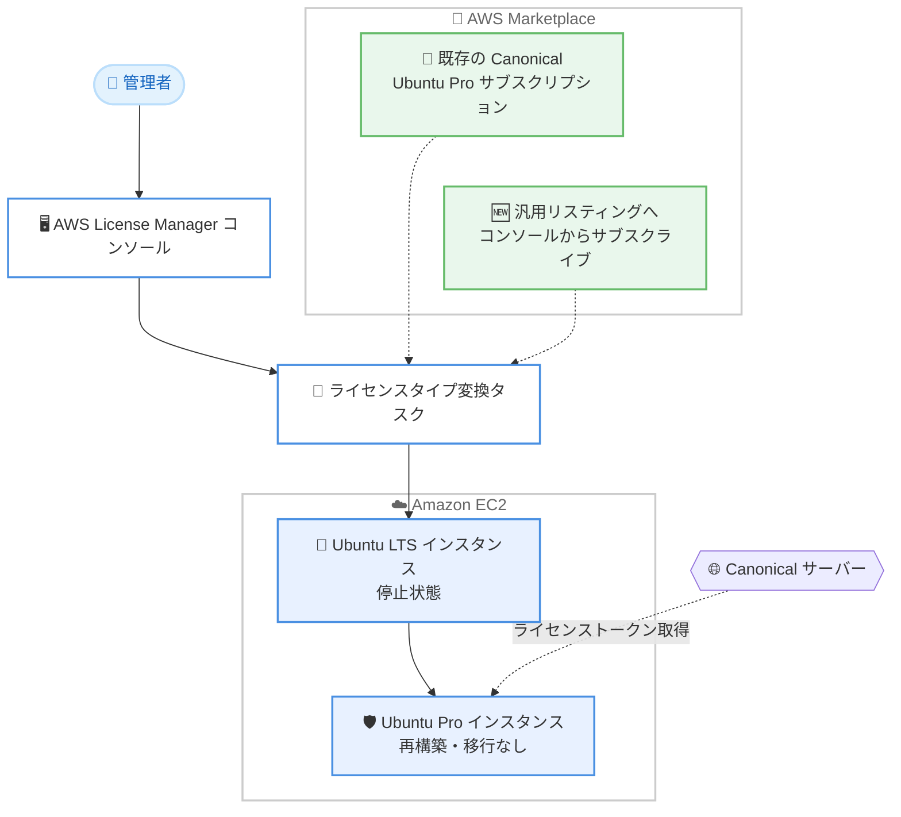

# AWS License Manager - AWS Marketplace 経由で購入した Ubuntu Pro へのライセンスタイプ変換サポート

**リリース日**: 2026 年 10 月 14 日
**サービス**: AWS License Manager
**機能**: AWS Marketplace で購入した Ubuntu Pro へのライセンスタイプ変換 (In-place Upgrade)

📊 [このアップデートのインフォグラフィックを見る](https://takech9203.github.io/aws-news-summary/20261014-aws-license-manager-conversions-ubuntu-pro-marketplace.html)

## 概要

AWS License Manager が、EC2 上の Ubuntu LTS (Long Term Support) インスタンスを、AWS Marketplace で提供される Canonical の Ubuntu Pro へインプレースでアップグレードする機能をサポートしました。インスタンスや AMI を再構築したり、ワークロードを移行したりすることなく、既存のインスタンスのままセキュリティ体制を強化し、コンプライアンス要件を満たすことができます。

Ubuntu Pro サブスクリプションにより、最大 10 年間 (Legacy アドオンを利用すると最大 15 年間) のセキュリティパッチを受け取ることができます。この対象はベース OS にとどまらず、NGINX、PostgreSQL、MongoDB、Redis などの広く利用されているオープンソースアプリケーションを含む数千の追加パッケージに及びます。また、Ubuntu Pro は Kernel Livepatch をサポートしており、再起動なしでカーネルの重要なセキュリティ修正を適用し、ダウンタイムを最小限に抑えられます。

今回のアップデートにより、AWS Marketplace で既に Canonical Ubuntu Pro サブスクリプションを保有しているお客様は、ライセンスタイプ変換ワークフローの中で直接アップグレードできるようになりました。サブスクリプションを保有していないお客様も、AWS License Manager コンソール内から Canonical Ubuntu Pro にサブスクライブできます。

**アップデート前の課題**

- 以前の License Manager のライセンスタイプ変換では、変換先は AWS 提供の Ubuntu Pro (AWS 課金) のみで、AWS Marketplace で Canonical から購入した Ubuntu Pro サブスクリプションを変換先として利用できなかった
- Marketplace 経由の Ubuntu Pro を既存インスタンスに適用するには、Ubuntu Pro の AMI からインスタンスを再構築するか、ワークロードを新しいインスタンスへ移行する必要があった
- Canonical との既存の商流 (Marketplace のプライベートオファーなど) を活かしながら、稼働中のフリートを Ubuntu Pro 化する手段が限られていた

**アップデート後の改善**

- 既存の Ubuntu LTS インスタンスを、AWS Marketplace で購入した Canonical Ubuntu Pro へインプレースで変換できるようになった
- 変換ワークフローの中で、License Manager コンソールから Canonical Ubuntu Pro の汎用リスティングに直接サブスクライブできるようになった
- フリートの再構築や AMI の差し替えなしに、最大 10 年 (Legacy アドオンで最大 15 年) のセキュリティパッチと Kernel Livepatch を利用可能になった

## アーキテクチャ図



License Manager の変換ワークフローが、AWS Marketplace の Canonical Ubuntu Pro サブスクリプションと連携し、停止中の Ubuntu LTS インスタンスをインプレースで Ubuntu Pro に変換する流れを示しています。

## サービスアップデートの詳細

### 主要機能

1. **AWS Marketplace 版 Ubuntu Pro へのインプレース変換**
   - EC2 上の Ubuntu LTS インスタンスを、Canonical が AWS Marketplace で販売する Ubuntu Pro へ変換可能
   - 変換は Canonical Ubuntu Pro の AWS Marketplace 製品コードをインスタンスにアタッチする方式で、使用操作値 (UsageOperation) は `RunInstances` のまま変わらない
   - 課金は AWS Marketplace のサブスクリプションを通じて Canonical から行われる

2. **コンソールからのサブスクリプション購入**
   - Canonical Ubuntu Pro サブスクリプションを保有していない場合、License Manager コンソールの変換ワークフロー内から汎用リスティングにサブスクライブ可能
   - 汎用リスティングはアーキテクチャ別に提供される。x86_64 向けの「Ubuntu Pro License Manager Upgrade」と Arm 向けの「Ubuntu Pro License Manager Upgrade (Arm)」があり、コンソールは選択したインスタンスのアーキテクチャに合ったリスティングを提示する

3. **長期セキュリティカバレッジ**
   - Ubuntu Pro により最大 10 年間のセキュリティパッチを提供。Legacy アドオンで最大 15 年間に延長可能
   - ベース OS に加え、NGINX、PostgreSQL、MongoDB、Redis などを含む数千の追加パッケージが対象
   - Kernel Livepatch により、再起動なしでカーネルの重要なセキュリティ修正を適用可能

4. **既存の AWS 提供 Ubuntu Pro への変換との使い分け**
   - 従来からの「AWS 提供の Ubuntu Pro」への変換 (使用操作値が `RunInstances:0g00` になり AWS から課金) も引き続き利用可能
   - 今回の機能追加により、Canonical との Marketplace 契約 (プライベートオファーなど) を利用するお客様にも選択肢が拡大

## 技術仕様

### 変換オプションの比較

| 項目 | AWS 提供の Ubuntu Pro | Canonical 提供の Ubuntu Pro (今回追加) |
|------|----------------------|--------------------------------------|
| 購入元 | AWS | AWS Marketplace (Canonical) |
| 課金 | AWS から課金 | AWS Marketplace サブスクリプション経由で Canonical から課金 |
| 変換後の使用操作値 | `RunInstances:0g00` | `RunInstances` (Marketplace 製品コードをアタッチ) |
| 事前サブスクリプション | 不要 | 必要 (コンソールから変換時にサブスクライブも可能) |

### 変換の前提条件と動作

| 項目 | 詳細 |
|------|------|
| インスタンス状態 | 変換タスク作成時に停止状態である必要がある。変換中は開始・終了操作を行わない |
| インベントリ | コンソールでは AWS Systems Manager Inventory に関連付けられたインスタンスのみ表示される |
| ネットワーク | Canonical サーバーからライセンストークンを取得し Ubuntu Pro Client をインストールするため、アウトバウンドのインターネットアクセスが必要 |
| 変換結果の確認 | `list-license-conversion-tasks` および `get-license-conversion-task` CLI コマンドでステータスを確認可能 (`IN_PROGRESS` → `SUCCEEDED` / `FAILED`) |
| フレーバー固有パッケージ | 変換は課金とエンタイトルメントのための製品コードのアタッチのみを行う。FIPS、CIS ハードニング、Real-time Kernel などのフレーバー固有コンポーネントは変換後に Ubuntu Pro Client (`pro`) で自身でインストール・設定する必要がある |
| 逆方向の変換 | Ubuntu Pro から Ubuntu LTS への変換はライセンスタイプ変換では不可。AWS Support への申請が必要 |

### 汎用リスティングの製品コード

| 製品名 | AWS Marketplace 製品コード |
|--------|---------------------------|
| Ubuntu Pro License Manager Upgrade (x86_64 向け汎用リスティング) | 561bki7b434ls3uekcvfuzzph |
| Ubuntu Pro License Manager Upgrade Arm (Arm 向け汎用リスティング) | 3cuwhptbszkqo4x83mut8ri41 |

このほか、Ubuntu Pro FIPS、Ubuntu Pro for EKS、Minimal Ubuntu Pro、CIS ハードニング版など、フレーバー固有の Canonical Ubuntu Pro 製品もライセンスタイプ変換でサポートされています。詳細はユーザーガイドの対応製品一覧を参照してください。

## 設定方法

### 前提条件

1. 変換対象の EC2 インスタンスが Ubuntu LTS であり、停止状態であること
2. インスタンスが AWS Systems Manager Inventory に関連付けられていること (コンソール利用時)
3. インスタンスにアウトバウンドのインターネットアクセスが設定されていること (Canonical サーバーからのライセンストークン取得と Ubuntu Pro Client のインストールに必要)
4. CLI を利用する場合、`license-manager:CreateLicenseConversionTaskForResource` を実行できる IAM 権限があること
5. CLI で Marketplace 版へ変換する場合、事前に有効な Canonical Ubuntu Pro サブスクリプションを AWS Marketplace で保有していること (CLI では自動サブスクライブは行われない)

### 手順

#### ステップ 1: 現在のライセンスタイプを確認

```bash
aws ec2 describe-instances \
    --instance-ids <instance-id> \
    --query "Reservations[*].Instances[*].{InstanceId: InstanceId, PlatformDetails: PlatformDetails, UsageOperation: UsageOperation}"
```

対象インスタンスの使用操作値 (UsageOperation) を確認します。`RunInstances` は AWS 提供のライセンスを使用していることを示します。

#### ステップ 2: コンソールから変換を実行

1. [AWS License Manager コンソール](https://console.aws.amazon.com/license-manager/) を開く
2. 左側のナビゲーションペインで [License type conversion] を選択し、[Create license type conversion] を選択
3. ソースのオペレーティングシステムとして [Ubuntu LTS] を選択
4. 変換対象のインスタンスを選択して [Next] を選択
5. 変換先として Canonical Ubuntu Pro を選択 (サブスクリプションがない場合は、インスタンスのアーキテクチャに合った汎用リスティングへこのワークフロー内でサブスクライブ可能)
6. 設定内容を確認して [Start conversion] を選択

変換ステータスは、License type conversion パネルの Conversion status 列で In progress、Completed、Failed として確認できます。

#### ステップ 3: CLI から変換を実行する場合

```bash
aws license-manager create-license-conversion-task-for-resource \
    --resource-arn <instance_arn> \
    --source-license-context "UsageOperation=RunInstances" \
    --destination-license-context "UsageOperation=RunInstances,ProductCodes=[{ProductCodeType=marketplace,ProductCodeId=<product_code_id>}]"
```

インスタンスの ARN と、サブスクライブしている Canonical Ubuntu Pro の AWS Marketplace 製品コードを指定して変換タスクを作成します。使用操作値は `RunInstances` のまま、Marketplace 製品コードがインスタンスにアタッチされます。

#### ステップ 4: 変換結果を確認

```bash
# 変換タスクのステータスを確認
aws license-manager list-license-conversion-tasks

# インスタンス内で Ubuntu Pro のサブスクリプション状態を確認
pro status
```

変換タスクのステータスが `SUCCEEDED` になったことを確認した後、インスタンスを起動し、インスタンス内で `pro status` コマンドを実行して有効な Ubuntu Pro サブスクリプションが適用されていることを確認します。

## メリット

### ビジネス面

- **フリート再構築コストの削減**: インスタンスや AMI の再構築、ワークロード移行なしに Ubuntu Pro へ移行できるため、移行プロジェクトの工数とリスクを大幅に削減できる
- **既存契約の活用**: AWS Marketplace で Canonical と締結済みのサブスクリプション (プライベートオファーなど) を既存インスタンスにそのまま適用でき、調達の柔軟性が向上する
- **コンプライアンス対応の迅速化**: 最大 10 年 (Legacy アドオンで最大 15 年) のセキュリティパッチ提供により、長期サポートが求められる規制業界の要件に対応しやすくなる

### 技術面

- **インプレース変換**: IP アドレス、EBS ボリューム、インスタンス設定を維持したままライセンスタイプのみを変更できる
- **広範なパッケージカバレッジ**: ベース OS に加え、NGINX、PostgreSQL、MongoDB、Redis など数千のオープンソースパッケージがセキュリティパッチの対象になる
- **Kernel Livepatch によるダウンタイム最小化**: 再起動なしでカーネルの重要なセキュリティ修正を適用でき、計画メンテナンスの頻度を削減できる

## デメリット・制約事項

### 制限事項

- 変換タスクの作成時、インスタンスは停止状態である必要があり、変換中は開始・停止操作を行えない (短時間のダウンタイムが発生する)
- Ubuntu Pro から Ubuntu LTS への逆方向の変換はライセンスタイプ変換ではサポートされず、AWS Support への申請が必要
- CLI で変換する場合は、事前に有効な AWS Marketplace サブスクリプションが必要 (コンソールと異なり自動サブスクライブされない)
- Canonical サーバーと通信するためのアウトバウンドインターネットアクセスが必要

### 考慮すべき点

- FIPS や CIS ハードニングなどフレーバー固有のリスティングで変換しても、変換自体は課金用の製品コードのアタッチのみで、フレーバー固有パッケージのインストールは別途 `pro` コマンドで実施する必要がある
- AMI の課金情報は変換後も変わらないため、課金情報を参照する既存ワークフローは EC2 の `DescribeInstances` API を使用するよう更新が必要
- AWS 提供の Ubuntu Pro (AWS 課金) と Marketplace 版 (Canonical 課金) のどちらが自社の調達・コスト要件に適しているか事前に比較することを推奨

## ユースケース

### ユースケース 1: EOL が近い Ubuntu LTS フリートの延命

**シナリオ**: 標準サポート終了が近づく Ubuntu LTS で稼働する多数の本番 EC2 インスタンスがあり、アプリケーションの互換性の都合で OS のメジャーアップグレードがすぐには実施できない。

**実装例**:
```
1. License Manager コンソールで対象の Ubuntu LTS インスタンスを一覧表示
2. メンテナンスウィンドウでインスタンスを停止し、ライセンスタイプ変換を実行
3. 変換完了後に起動し、pro status で ESM (Expanded Security Maintenance) の有効化を確認
```

**効果**: OS 再構築なしで最大 10 年 (Legacy アドオンで最大 15 年) のセキュリティパッチを確保し、アップグレード計画を安全に先送りできる。

### ユースケース 2: Canonical とのプライベートオファーを既存フリートへ適用

**シナリオ**: AWS Marketplace のプライベートオファーで Canonical から Ubuntu Pro サブスクリプションを一括購入済みだが、既存インスタンスへの適用には再構築が必要だと考えていた。

**実装例**:
```
aws license-manager create-license-conversion-task-for-resource \
    --resource-arn arn:aws:ec2:ap-northeast-1:123456789012:instance/i-0123456789abcdef0 \
    --source-license-context "UsageOperation=RunInstances" \
    --destination-license-context "UsageOperation=RunInstances,ProductCodes=[{ProductCodeType=marketplace,ProductCodeId=<契約済み製品コード>}]"
```

**効果**: 購入済みサブスクリプションを既存インスタンスにインプレースで適用し、契約を無駄なく活用できる。

### ユースケース 3: コンプライアンス監査に向けた OSS ミドルウェアのパッチ体制強化

**シナリオ**: PostgreSQL や NGINX などの OSS ミドルウェアを Ubuntu LTS 上で運用しており、監査でベース OS 以外のパッケージの脆弱性管理体制を問われている。

**実装例**:
```
1. License Manager コンソールから対象インスタンスを Ubuntu Pro に変換
   (サブスクリプション未保有の場合はワークフロー内で汎用リスティングにサブスクライブ)
2. 変換後、pro status で esm-apps サービスの有効化を確認
3. Kernel Livepatch を有効化し、再起動なしのカーネルパッチ適用体制を構築
```

**効果**: ベース OS に加えて数千の追加パッケージがセキュリティパッチの対象となり、監査要件への対応と運用負荷の低減を両立できる。

## 料金

AWS License Manager 自体は追加料金なしで利用できます。AWS Marketplace 経由の Canonical Ubuntu Pro へ変換した場合、Ubuntu Pro サブスクリプションの料金は AWS Marketplace のサブスクリプションを通じて Canonical から請求されます。料金はリスティングや契約形態 (パブリックオファー、プライベートオファー) により異なるため、AWS Marketplace の各リスティングで確認してください。

なお、従来からの AWS 提供の Ubuntu Pro へ変換した場合は、AWS から Ubuntu Pro の利用料金が請求されます。

## 利用可能リージョン

AWS License Manager が利用可能なすべての商用リージョンで利用できます。

## 関連サービス・機能

- **AWS Marketplace**: Canonical Ubuntu Pro サブスクリプションの購入チャネル。プライベートオファーによる個別契約にも対応
- **Amazon EC2**: 変換対象の Ubuntu LTS インスタンスが稼働する基盤。`DescribeInstances` API で変換後の課金情報を確認
- **AWS Systems Manager**: コンソールでの変換対象インスタンスの表示に Systems Manager Inventory との関連付けが必要
- **Ubuntu Pro Client (pro コマンド)**: 変換後のサブスクリプション状態確認や、FIPS・Livepatch などの機能の有効化に使用

## 参考リンク

- 📊 [インフォグラフィック](https://takech9203.github.io/aws-news-summary/20261014-aws-license-manager-conversions-ubuntu-pro-marketplace.html)
- [公式発表 (What's New)](https://aws.amazon.com/about-aws/whats-new/2026/10/aws-license-manager-conversions-ubuntu-pro-marketplace/)
- [AWS License Manager 製品ページ](https://aws.amazon.com/license-manager/)
- [ドキュメント: Convert a license type for Linux in License Manager](https://docs.aws.amazon.com/license-manager/latest/userguide/conversion-procedures-linux.html)
- [ドキュメント: AWS License Manager User Guide](https://docs.aws.amazon.com/license-manager/latest/userguide/license-manager.html)
- [リージョン別サービス一覧](https://aws.amazon.com/about-aws/global-infrastructure/regional-product-services/)

## まとめ

AWS License Manager のライセンスタイプ変換が AWS Marketplace 版の Canonical Ubuntu Pro に対応したことで、フリートの再構築やワークロード移行なしに、既存の Ubuntu LTS インスタンスを長期セキュリティサポート付きの Ubuntu Pro へアップグレードできるようになりました。標準サポート終了が近い Ubuntu LTS を運用している場合や、Canonical との Marketplace 契約を保有している場合は、License Manager コンソールから変換ワークフローを試すことを推奨します。
