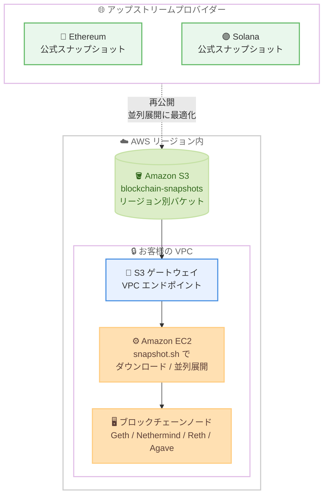

# Blockchain Snapshots on AWS - ノードブートストラップ用スナップショットの提供開始

**リリース日**: 2026 年 10 月 14 日
**サービス**: Blockchain Snapshots on AWS (Amazon S3 / Amazon EC2)
**機能**: Ethereum および Solana 向け事前同期済みチェーンデータスナップショットの公開

📊 [このアップデートのインフォグラフィックを見る](https://takech9203.github.io/aws-news-summary/20261014-blockchain-snapshots-node-bootstrapping.html)

## 概要

AWS は、Ethereum または Solana のブロックチェーンノードを運用するオペレーター向けに、事前同期済みのパブリックブロックチェーンチェーンデータを Amazon S3 で公開する取り組み「Blockchain Snapshots on AWS」を発表しました。ネットワークからのピアツーピア同期の代わりに、スナップショットからノードをブートストラップできるようになります。

スナップショットは AWS インフラストラクチャ内の Amazon S3 でホストされるため、AWS 上でノードを実行するお客様は、低レイテンシーと最適化されたデータ転送の恩恵を受けられます。各ネットワークの公式スナップショットを、複数コアによる並列展開に最適化された形式で再公開しており、Amazon EC2 インスタンスでのセットアップ時間を短縮できます。スナップショットは無料で利用でき、アップストリームプロバイダーと同じ頻度で更新されます。

RPC (Remote Procedure Call) フリートへのキャパシティ追加、障害ノードの復旧、破損したデータベースの再同期といった用途に活用できます。

**アップデート前の課題**

このアップデート以前は、ブロックチェーンノードの立ち上げに以下の課題がありました。

- 新規ノードの立ち上げには、ネットワークピアからのピアツーピア同期が必要で、チェーンデータの肥大化により数日から数週間かかる場合があった
- 各ネットワークコミュニティが公開するスナップショットは AWS 外部でホストされていることが多く、ダウンロードに時間がかかり、インターネット経由のデータ転送が発生していた
- ノード障害やデータベース破損からの復旧に長い再同期時間を要し、RPC フリートのスケールアウトも迅速に行えなかった

**アップデート後の改善**

今回のアップデートにより、以下が可能になりました。

- Amazon S3 上のスナップショットから直接ノードをブートストラップでき、ピアツーピア同期を省略してセットアップ時間を大幅に短縮できる
- スナップショットが AWS インフラストラクチャ内でホストされるため、同一リージョンの EC2 インスタンスから低レイテンシーかつ最適化されたデータ転送でダウンロードできる
- 複数コアでの並列展開に最適化された形式により、ダウンロード後の展開も高速化される
- 無料で利用でき、アップストリームプロバイダーと同じ頻度で最新のスナップショットが提供される

## アーキテクチャ図



各ネットワークの公式スナップショットが並列展開に最適化された形式で Amazon S3 に再公開され、同一リージョンの EC2 インスタンスが S3 ゲートウェイ VPC エンドポイント経由でダウンロードしてノードをブートストラップします。

## サービスアップデートの詳細

### 主要機能

1. **事前同期済みスナップショットの S3 ホスティング**
   - Ethereum および Solana のチェーンデータを Amazon S3 のリージョン別バケットで公開
   - 各ネットワークの公式 (アップストリーム) スナップショットを再公開し、アップストリームと同じ頻度で更新
   - AWS インフラストラクチャ内でのホスティングにより、低レイテンシーかつ最適化されたデータ転送を実現

2. **並列展開に最適化されたフォーマット**
   - 複数コアでの並列展開に最適化された形式でスナップショットを提供し、セットアップ時間を短縮
   - ドキュメントによると、`tar-zstd-seekable-v1` (zstd フレームの並列デコード)、`tar-zstd-stream-v1` (ストリーム展開)、`archive-set-v1` (Solana / Agave 向けにアーカイブのまま配置) の配信プロトコルが定義されている
   - ローカル NVMe では O_DIRECT 書き込み、EBS ではバッファード書き込みなど、ストレージ特性に応じた展開動作

3. **snapshot.sh によるシンプルな取得フロー**
   - awslabs の GitHub リポジトリで公開されるツール (Apache-2.0 ライセンス) を使用してスナップショットを取得
   - `--list` で利用可能なスナップショットカタログを一覧表示し、`--snapshot` で対象を指定してダウンロードと展開を実行
   - `--json` 出力による自動化や、`--workers`、`--region` などのオプションに対応

### 対応ネットワークとクライアント

ドキュメントによると、以下のスナップショットカタログが提供されています。

| ネットワーク | クライアント | カタログ例 |
|------|------|------|
| Ethereum Mainnet | Geth、Nethermind、Reth | `ethereum-mainnet-geth` など |
| Ethereum Hoodi (テストネット) | Geth | `ethereum-hoodi-geth` |
| Solana Mainnet | Agave | `solana-mainnet-agave` |

## 技術仕様

### 利用要件

| 項目 | 詳細 |
|------|------|
| 対応ネットワーク | Ethereum、Solana |
| 提供リージョン | us-east-1、eu-west-1、ap-northeast-1 |
| アクセス元 | スナップショットと同一リージョン内の Amazon EC2 インスタンス |
| ネットワーク要件 | Amazon S3 ゲートウェイ VPC エンドポイント |
| IAM 権限 | リージョン別バケットに対する `s3:GetObject` および `s3:ListBucket` |
| 対応 OS (ドキュメント記載) | Amazon Linux 2023、Ubuntu 24.04 / 22.04 |
| ストレージ | 展開後のスナップショットサイズに対応したローカル NVMe または EBS |
| 料金 | スナップショット自体は無料 (EC2 / EBS などの利用料金は別途発生) |
| 更新頻度 | アップストリームプロバイダーと同じ頻度 |

### IAM ポリシー例

```json
{
  "Version": "2012-10-17",
  "Statement": [
    {
      "Effect": "Allow",
      "Action": [
        "s3:GetObject",
        "s3:ListBucket"
      ],
      "Resource": [
        "arn:aws:s3:::blockchain-snapshots-ap-northeast-1",
        "arn:aws:s3:::blockchain-snapshots-ap-northeast-1/*"
      ]
    }
  ]
}
```

実際のバケット名は各リージョンのカタログで公開されるものを使用してください。

## 設定方法

### 前提条件

1. 提供リージョン (us-east-1、eu-west-1、ap-northeast-1) のいずれかに Amazon EC2 インスタンスを起動していること
2. VPC に Amazon S3 ゲートウェイ VPC エンドポイントが設定されていること (リージョン内ダウンロードが前提で、ローカル PC などリージョン外からはダウンロードできない)
3. インスタンスプロファイルにリージョン別バケットへの `s3:GetObject` と `s3:ListBucket` 権限が付与されていること
4. 展開後のデータサイズを格納できるローカル NVMe または EBS ストレージがあること

### 手順

#### ステップ 1: ツールのセットアップ

```bash
sudo dnf install -y git
cd ~ && git clone https://github.com/awslabs/blockchain-snapshots.git
cd blockchain-snapshots/dist
./snapshot.sh --setup
```

awslabs の GitHub リポジトリをクローンし、セットアップコマンドを実行します。セットアップでは AWS CLI v2、Python / boto3、zstd、mountpoint-s3 などの依存ツールがインストールされます。Ubuntu の場合は `apt-get` を使用します。

#### ステップ 2: 利用可能なスナップショットの確認

```bash
./snapshot.sh --list
```

現在のリージョンのカタログから、利用可能なスナップショットの一覧 (ネットワーク、クライアント、更新日時など) を表示します。

#### ステップ 3: スナップショットのダウンロードと展開

```bash
./snapshot.sh --snapshot ethereum-mainnet-geth --out /data/ethereum-mainnet-geth
```

指定したスナップショットをダウンロードし、複数コアを使用して並列展開します。ツールはリージョンのカタログから最新エントリを解決し、認証情報・空き容量・出力先の安全性を検証したうえで、カタログに定義された配信プロトコルに従ってデータを配置します。完了後、展開されたチェーンデータをデータディレクトリとして指定し、ノードクライアントを起動します。

自動化する場合は JSON 出力を利用できます。

```bash
./snapshot.sh --snapshot ethereum-mainnet-reth --json | jq -r .output_dir
```

`--json` オプションで実行結果を JSON 形式で出力し、`jq` で展開先ディレクトリを取得する例です。CI / CD や起動スクリプトへの組み込みに便利です。

## メリット

### ビジネス面

- **ノード立ち上げ時間の大幅短縮**: ピアツーピア同期で数日かかっていたブートストラップをスナップショットからの復元に置き換え、サービス投入や障害復旧までの時間を短縮できる
- **コスト削減**: スナップショットは無料で提供され、同一リージョン内の S3 ゲートウェイ VPC エンドポイント経由のため、インターネット経由のデータ転送コストを回避できる
- **運用の安定化**: 障害ノードの復旧や破損データベースの再同期を迅速に行え、RPC サービスの可用性を維持しやすくなる

### 技術面

- **最適化されたデータ転送**: AWS インフラストラクチャ内でホストされるため、同一リージョンの EC2 インスタンスから低レイテンシーでダウンロードできる
- **並列展開による高速化**: 複数コアを活用する展開最適化フォーマットにより、ダウンロード後の展開時間も短縮される
- **自動化しやすい設計**: `--list` や `--json` などのオプションを備えた CLI ツールにより、Auto Scaling やフリート管理の仕組みへ容易に組み込める

## デメリット・制約事項

### 制限事項

- 提供リージョンは US East (N. Virginia)、Europe (Ireland)、Asia Pacific (Tokyo) の 3 リージョンのみ
- 対応ネットワークは Ethereum と Solana のみ
- 同一リージョン内の Amazon EC2 インスタンスと Amazon S3 ゲートウェイ VPC エンドポイントが必須で、リージョン外やオンプレミスからのダウンロードは想定されていない

### 考慮すべき点

- ドキュメントによると、スナップショットは「AS IS」で提供され、可用性や鮮度の保証はなく、SLA を持つ AWS サービスではない
- チェーンデータはサードパーティのアップストリームプロバイダー由来であるため、ノード起動後はネットワークピアとの検証 (同期の追い付き) が必要
- 展開後のデータサイズを見込んだ十分なストレージ容量 (ローカル NVMe または EBS) を事前に確保する必要がある
- 更新頻度はアップストリームプロバイダーに依存するため、スナップショット取得後に最新ブロックまでの差分同期が発生する

## ユースケース

### ユースケース 1: RPC フリートへのキャパシティ追加

**シナリオ**: dApp やインデクサー向けに Ethereum RPC ノードのフリートを運用しており、トラフィック増加に応じて迅速にノードを追加したい。

**実装例**:
```bash
# 新規 EC2 インスタンスの起動スクリプト内で実行
./snapshot.sh --snapshot ethereum-mainnet-reth --out /data/reth --json
# 展開完了後に Reth をスナップショットのデータディレクトリで起動
```

**効果**: ピアツーピア同期を待たずに新規ノードを数時間以内でフリートへ投入でき、需要変動への追従が容易になる。

### ユースケース 2: 障害ノードの迅速な復旧

**シナリオ**: Solana バリデータ / RPC ノードがハードウェア障害で停止し、できるだけ早くサービスへ復帰させたい。

**実装例**:
```bash
# 代替インスタンスでスナップショットを取得
./snapshot.sh --snapshot solana-mainnet-agave --out /data/solana
# Agave はアーカイブのまま配置されるため --no-snapshot-fetch で起動
```

**効果**: ネットワークからのスナップショット取得を省略し、障害発生から復旧までの時間を短縮できる。

### ユースケース 3: 破損したデータベースの再同期

**シナリオ**: Geth ノードのデータベースが破損し、ゼロからの再同期では数日を要してしまう。

**実装例**:
```bash
# 破損したデータディレクトリを退避し、スナップショットから再構築
./snapshot.sh --snapshot ethereum-mainnet-geth --out /data/geth --force
```

**効果**: フル再同期の代わりに最新スナップショットから復元し、残りの差分のみをネットワークから同期することでダウンタイムを最小化できる。

## 料金

スナップショット自体は無料で利用できます。ただし、ノードを実行する Amazon EC2 インスタンス、Amazon EBS ボリュームなどの通常の利用料金は別途発生します。Amazon S3 ゲートウェイ VPC エンドポイント経由の同一リージョン内アクセスのため、データ転送は最適化されています。

## 利用可能リージョン

以下の 3 リージョンで利用可能です。

- 米国東部 (バージニア北部): us-east-1
- 欧州 (アイルランド): eu-west-1
- アジアパシフィック (東京): ap-northeast-1

利用には、スナップショットと同一リージョン内の Amazon EC2 インスタンスと Amazon S3 ゲートウェイ VPC エンドポイントが必要です。

## 関連サービス・機能

- **Amazon S3**: スナップショットのホスティング基盤。ゲートウェイ VPC エンドポイント経由でリージョン内から高速にアクセスする
- **Amazon EC2**: スナップショットを取得・展開し、ブロックチェーンノードを実行するコンピューティング基盤
- **Amazon EBS / インスタンスストア (NVMe)**: 展開後のチェーンデータを格納するストレージ。ツールはストレージ特性に応じて書き込み方式を最適化する

## 参考リンク

- 📊 [インフォグラフィック](https://takech9203.github.io/aws-news-summary/20261014-blockchain-snapshots-node-bootstrapping.html)
- [公式発表 (What's New)](https://aws.amazon.com/about-aws/whats-new/2026/10/blockchain-snapshots-node-bootstrapping/)
- [ドキュメント (Blockchain Snapshots on AWS)](https://awslabs.github.io/blockchain-snapshots/)
- [GitHub リポジトリ (awslabs/blockchain-snapshots)](https://github.com/awslabs/blockchain-snapshots)

## まとめ

Blockchain Snapshots on AWS により、Ethereum および Solana のノードオペレーターは、ピアツーピア同期に数日を費やすことなく、Amazon S3 上の事前同期済みスナップショットからノードを迅速にブートストラップできるようになりました。東京リージョンでも提供されるため、国内でノードを運用するお客様にも有用です。RPC フリートの拡張やノード復旧の時間短縮が課題となっている場合は、ドキュメントのセットアップ手順に従って `snapshot.sh` を試すことを推奨します。
