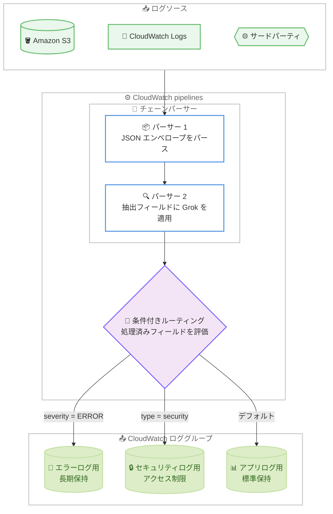

# Amazon CloudWatch - 条件付きログルーティングとチェーンログパーサー

**リリース日**: 2026 年 10 月 14 日
**サービス**: Amazon CloudWatch
**機能**: CloudWatch pipelines における条件付きログルーティング (Conditional Log Routing) とチェーンパーサー (Chained Parsers)

📊 [このアップデートのインフォグラフィックを見る](https://takech9203.github.io/aws-news-summary/20261014-cloudwatch-pipelines-log-routing.html)

## 概要

Amazon CloudWatch が、CloudWatch pipelines における条件付きログルーティングとチェーンパーサーのサポートを発表しました。CloudWatch pipelines は、インフラストラクチャを管理することなくテレメトリデータを取り込み、変換し、CloudWatch にルーティングするフルマネージドサービスです。今回のアップデートにより、ログデータの変換方法と送信先のロググループをより細かく制御できるようになりました。

条件付きログルーティングでは、処理済みフィールドに対して評価される条件に基づき、各イベントを異なる CloudWatch ロググループへ送信するルートを定義できます。これにより、重大度、ソース、タイプごとにイベントを分離し、それぞれに適切な保持期間とアクセス制御を適用できます。チェーンパーサーでは、複数のパーサープロセッサを順番に適用でき、後段のパーサーが前段のパーサーで生成されたフィールドを処理できます。例えば、最初に JSON エンベロープをパースし、そこから抽出したフィールドに Grok パーサーを適用するといった処理が可能です。

多様なログフォーマットが混在するログパイプラインを運用する環境、特に 1 つのログストリームに複数のイベントタイプが含まれるケースや、ログフォーマットがネストしているケースを扱う運用チーム、SRE、セキュリティチームにとって有用なアップデートです。

**アップデート前の課題**

- 以前は、1 つのパイプラインに流れる多様なイベントタイプを単一のロググループにしか送信できず、イベントの種類ごとに保持期間やアクセス制御を分けるには複数のパイプラインや追加の仕組みが必要だった
- 以前は、JSON の中に Grok 形式のメッセージがネストしているような複合フォーマットのログを、1 つのパイプライン内で段階的にパースすることが困難だった
- 以前は、ログの振り分けや多段パースを実現するために、AWS Lambda や自前の ETL 処理など追加のインフラストラクチャの構築・運用が必要になるケースがあった

**アップデート後の改善**

- 今回のアップデートにより、処理済みフィールドに対する条件評価に基づいて、イベントごとに異なる CloudWatch ロググループへルーティングできるようになった
- 今回のアップデートにより、複数のパーサープロセッサを連結し、前段のパーサーが抽出したフィールドを後段のパーサーで処理する多段パースが可能になった
- 今回のアップデートにより、多様なログフォーマットの構造化と適切なロググループへの振り分けを、単一のパイプラインで完結できるようになった

## アーキテクチャ図



単一のパイプライン内でチェーンパーサーによる多段パースを行い、処理済みフィールドの条件評価によって各イベントを適切なロググループへ振り分けるフローを示しています。

## サービスアップデートの詳細

### 主要機能

1. **条件付きログルーティング**
   - 処理済みフィールドに対して評価される条件に基づき、各イベントを異なる CloudWatch ロググループへ送信するルートを定義可能
   - 重大度、ソース、タイプなどでイベントを分離し、ロググループごとに適切な保持期間とアクセス制御を適用可能
   - ドキュメントによると、1 つのログパイプラインで最大 10 個の順序付き `cloudwatch_logs` シンクを条件付きルーティングに使用可能

2. **チェーンパーサー**
   - 複数のパーサープロセッサをシーケンシャルに適用し、後段のパーサーが前段のパーサーで生成されたフィールドを処理可能
   - 例: 最初に JSON エンベロープをパースし、抽出されたフィールドに対して Grok パーサーを適用
   - ネストしたログフォーマットや複合フォーマットのログを、追加のインフラストラクチャなしで構造化可能

3. **CloudWatch pipelines の基盤機能との統合**
   - パイプラインの出力は CloudWatch Logs Insights、Logs Anomaly Detection、Live Tail などの CloudWatch Logs 機能と完全互換
   - Standard と Infrequent Access の両方のログクラスに対応
   - AWS マネジメントコンソール、AWS CLI、AWS SDK から設定可能

## 技術仕様

### CloudWatch pipelines の構成要素

| 項目 | 詳細 |
|------|------|
| ソース | データの取得元 (Amazon S3 バケット、CloudWatch Logs、サードパーティ統合など)。各パイプラインに 1 つ必須 |
| プロセッサ | テレメトリデータの変換、パース、エンリッチメントを実行。定義された順序で順次適用 (チェーンパーサーを含む) |
| シンク | 処理済みデータの送信先。ログパイプラインは条件付きルーティング用に最大 10 個の順序付き `cloudwatch_logs` シンクを使用可能 |
| 拡張機能 | AWS Secrets Manager 統合による認証情報管理などの追加機能 |

### 主なクォータ

| 項目 | 上限 |
|------|------|
| アカウントあたりのログパイプライン数 | 330 (CloudWatch Logs ソース用 300、その他ソース用 30) |
| パイプラインあたりのプロセッサ数 | 最大 20 |

### API変更履歴

本アップデートに直接関連する API 変更は、発表時点の awsapichanges.com では確認されていません。

## 設定方法

### 前提条件

1. CloudWatch pipelines が利用可能な AWS リージョンを使用していること
2. CloudWatch pipelines およびロググループを操作できる IAM 権限を持っていること
3. ルーティング先となる CloudWatch ロググループの設計 (保持期間、アクセス制御) が完了していること

### 手順

#### ステップ1: パイプラインの作成画面を開く

CloudWatch コンソールの [テレメトリ設定] から [パイプライン] を選択し、新しいパイプラインを作成します。ソースとして Amazon S3 バケット、CloudWatch Logs、サードパーティ統合などを指定します。

#### ステップ2: チェーンパーサーを設定する

パイプラインのプロセッサとして、複数のパーサーを順番に追加します。例えば、1 つ目のプロセッサで JSON エンベロープをパースし、2 つ目のプロセッサで抽出されたフィールドに Grok パーサーを適用します。プロセッサは定義した順序で順次実行され、後段のパーサーは前段のパーサーが生成したフィールドを参照できます。

#### ステップ3: 条件付きルーティングを設定する

ルーティング条件を定義し、処理済みフィールドの値 (重大度、ソース、タイプなど) に基づいて、各イベントの送信先となる CloudWatch ロググループを指定します。1 つのログパイプラインで最大 10 個の順序付きシンクを設定でき、条件に一致しないイベントのデフォルト送信先も指定します。

#### ステップ4: 動作を確認する

パイプラインをデプロイ後、各ロググループに期待どおりのイベントが振り分けられているかを CloudWatch Logs Insights や Live Tail で確認します。

詳細な設定方法は [CloudWatch pipelines ドキュメント](https://docs.aws.amazon.com/AmazonCloudWatch/latest/monitoring/cloudwatch-pipelines.html)を参照してください。

## メリット

### ビジネス面

- **コスト最適化**: イベントタイプごとに適切なロググループへ振り分けることで、重要度に応じた保持期間を設定でき、不要な長期保存コストを削減できる
- **コンプライアンス対応**: セキュリティログや監査ログを専用ロググループに分離し、適切なアクセス制御を適用することで、コンプライアンス要件への対応が容易になる
- **運用負荷の軽減**: フルマネージドサービスのため、ログ振り分けのための追加インフラストラクチャの構築・運用が不要になる

### 技術面

- **単一パイプラインでの完結**: 多様なログフォーマットの構造化とルーティングを 1 つのパイプラインで実現でき、アーキテクチャがシンプルになる
- **ネストフォーマットへの対応**: JSON エンベロープ内の Grok 形式メッセージなど、ネストした複合フォーマットを段階的にパースして構造化できる
- **CloudWatch Logs 機能との互換性**: 処理後のログは Logs Insights、Anomaly Detection、Live Tail でそのまま利用できる

## デメリット・制約事項

### 制限事項

- 1 つのログパイプラインで使用できる順序付き `cloudwatch_logs` シンクは最大 10 個
- パイプラインあたりのプロセッサは最大 20 個
- アカウントあたりのログパイプライン数は 330 (CloudWatch Logs ソース用 300、その他ソース用 30)

### 考慮すべき点

- プロセッサを追加するとログイベントが変更され、元の生ログは保持されないため、原本保全が必要な場合は設計上の考慮が必要
- パイプライン定義はカスタマー提供キーで暗号化されないため、パスワード、API キー、個人情報 (PII) などの機密データを定義に含めてはならない
- CloudWatch Logs ソースはパイプライン処理前に、サードパーティおよび S3 バケットソースは処理後に課金計測されるため、ソースタイプごとの課金タイミングの違いを理解しておく必要がある

## ユースケース

### ユースケース1: 重大度ベースのログ分離と保持期間の最適化

**シナリオ**: アプリケーションログに INFO、WARN、ERROR が混在しており、ERROR ログのみ長期保持したいが、現状は単一ロググループのため全ログに同じ保持期間が適用されコストが膨らんでいる。

**実装例**:
```
パイプライン構成:
1. パーサー: JSON パースで severity フィールドを抽出
2. ルート 1: severity = ERROR → ロググループ app/errors (保持 1 年)
3. ルート 2: severity = WARN → ロググループ app/warnings (保持 90 日)
4. デフォルト: ロググループ app/info (保持 7 日)
```

**効果**: 重大度ごとに最適な保持期間を適用し、ストレージコストを削減しながら重要ログの長期保持を実現できる。

### ユースケース2: セキュリティログの分離とアクセス制御

**シナリオ**: アプリケーションログとセキュリティ監査イベントが同じログストリームに出力されており、セキュリティチームのみがアクセスできる専用ロググループへ監査イベントを分離したい。

**実装例**:
```
パイプライン構成:
1. パーサー: ログをパースして event_type フィールドを抽出
2. ルート 1: event_type = security_audit → ロググループ security/audit
   (セキュリティチームのみアクセス可能な IAM ポリシーを適用)
3. デフォルト: ロググループ app/general
```

**効果**: ロググループ単位の IAM アクセス制御により、最小権限の原則に沿ったセキュリティ監査ログの管理ができる。

### ユースケース3: ネストしたログフォーマットの多段パース

**シナリオ**: コンテナ基盤から出力されるログが JSON エンベロープでラップされており、その message フィールド内に Apache 形式のアクセスログが格納されている。これまでは構造化できず、Logs Insights での分析が困難だった。

**実装例**:
```
パイプライン構成:
1. パーサー 1: JSON パーサーでエンベロープをパースし message フィールドを抽出
2. パーサー 2: message フィールドに Grok パーサーを適用し
   クライアント IP、ステータスコード、レスポンスタイムなどを抽出
3. ルーティング: ステータスコード 5xx のイベントをエラー分析用ロググループへ送信
```

**効果**: ネストしたログを完全に構造化し、Logs Insights でのフィールドベースの分析とエラーログの自動分離を同時に実現できる。

## 料金

ドキュメントによると、CloudWatch pipelines は CloudWatch Logs に含まれており追加料金はかかりません。ログクラス (vended または custom) とストレージクラス (Standard または Infrequent Access) に基づく標準のログ取り込み料金が適用されます。課金計測は CloudWatch への最初の取り込み時に行われ、CloudWatch Logs ソースはパイプライン処理前、サードパーティおよび S3 バケットソースは処理後に計測されます。

詳細は [CloudWatch 料金ページ](https://aws.amazon.com/cloudwatch/pricing/)を参照してください。

## 利用可能リージョン

条件付きルーティングとチェーンパーサーは、CloudWatch pipelines が一般提供されているすべての商用 AWS リージョンで利用可能です。ドキュメントによると、CloudWatch pipelines はアジアパシフィック (東京)、アジアパシフィック (大阪) を含む主要リージョン、AWS GovCloud (US)、AWS European Sovereign Cloud (ドイツ) などで利用できます。最新のリージョン一覧は [CloudWatch pipelines ドキュメント](https://docs.aws.amazon.com/AmazonCloudWatch/latest/monitoring/cloudwatch-pipelines.html)を参照してください。

## 関連サービス・機能

- **Amazon CloudWatch Logs**: ルーティング先となるロググループを提供。Logs Insights、Anomaly Detection、Live Tail などの分析機能が処理済みログに対して利用可能
- **CloudWatch Logs 変換 (Log Transformers)**: ロググループレベルでのログ変換機能。CloudWatch pipelines は Log Transformers と後方互換性がある
- **AWS Secrets Manager**: パイプラインの拡張機能として統合でき、サードパーティソースへの接続に必要な認証情報を安全に管理できる

## 参考リンク

- 📊 [インフォグラフィック](https://takech9203.github.io/aws-news-summary/20261014-cloudwatch-pipelines-log-routing.html)
- [公式発表 (What's New)](https://aws.amazon.com/about-aws/whats-new/2026/10/cloudwatch-pipelines-log-routing/)
- [Amazon CloudWatch pipelines ドキュメント](https://docs.aws.amazon.com/AmazonCloudWatch/latest/monitoring/cloudwatch-pipelines.html)
- [Amazon CloudWatch 料金ページ](https://aws.amazon.com/cloudwatch/pricing/)

## まとめ

CloudWatch pipelines の条件付きログルーティングとチェーンパーサーにより、多様なログフォーマットの構造化と適切なロググループへの振り分けを、追加インフラストラクチャなしで単一のパイプラインで実現できるようになりました。重大度やイベントタイプごとの保持期間・アクセス制御の最適化はコスト削減とコンプライアンス強化に直結するため、現在 Lambda や外部ツールでログの振り分けを行っている場合は、CloudWatch pipelines への移行を検討することを推奨します。
