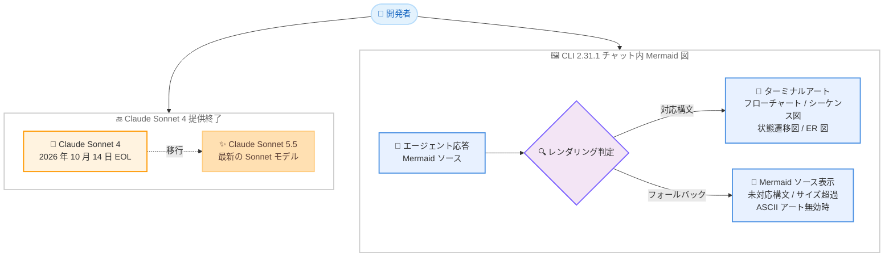

# Kiro - Claude Sonnet 4 の提供終了と CLI 2.31.1 (チャット内 Mermaid 図レンダリング)

**リリース日**: 2026 年 10 月 14 日
**サービス**: Kiro
**機能**: Claude Sonnet 4 の提供終了 (end of life) / Kiro CLI 2.31.1 (チャット内 Mermaid 図レンダリングほか)

📊 [このアップデートのインフォグラフィックを見る](https://takech9203.github.io/aws-news-summary/20261014-kiro-changelog-2026-10-14.html)

## 概要

2026 年 10 月 14 日、Kiro (kiro.dev) の Changelog に 2 件のアップデートが公開されました。1 件目はモデル関連のアナウンスで、**Claude Sonnet 4 が 2026 年 10 月 14 日をもって Kiro での提供を終了 (end of life)** しました。Claude Sonnet 4 に依存するワークフローを利用している場合は、作業を継続する前に他の利用可能なモデルを選択する必要があります。Sonnet 系の最新モデルは Claude Sonnet 5.5 です。各モデルのライフサイクルステージと提供終了日は、公式ドキュメントの Model lifecycle セクションで確認できます。

2 件目は **Kiro CLI 2.31.1** のリリースです。エージェントの応答に含まれる Mermaid 図 (フローチャート、シーケンス図、状態遷移図、ER 図) をターミナルアートとしてチャット内に直接描画できるようになりました。また、ヘッドレス (非対話) の V3 実行で保存済み設定が適用されるようになったほか、コピーしたプロンプトの先頭スペース、ブロック中ペインの表示、モデルフォールバック、コンパクション、Windows でのサンドボックスセットアップ、リリースノート表示、AWS サインイン、ワークフロー出力に関する多数の修正が含まれています。

**アップデート前の課題**

- 提供終了が近づいていた Claude Sonnet 4 を利用し続けると、ある日突然ワークフローが動かなくなるリスクがあった
- エージェントが生成した Mermaid 図はソースコードとして表示されるだけで、ターミナル上で図として確認できなかった
- V3 の非対話実行では、保存済みのコンパクション設定や Tool Search 設定が対話セッションと異なり適用されなかった
- モデルが応答テキストなしで拒否した場合にモデルフォールバックが動作せず、拒否内容が会話サマリーとして保存されることがあった
- Windows ではポリシーにより一時フォルダでのプログラム実行がブロックされる環境で `/sandbox setup` が失敗していた

**アップデート後の改善**

- Claude Sonnet 5.5 など、サポートされているモデルへの移行指針が明示された
- フローチャート、シーケンス図、状態遷移図、ER 図がチャット内でターミナルアートとして直接レンダリングされるようになった
- V3 の非対話実行でも保存済みのコンパクション設定と Tool Search 設定が対話セッションと同様に適用されるようになった
- 応答テキストなしの拒否でもモデルフォールバックが動作し、コンパクションが拒否を会話サマリーとして保存しなくなった
- `/sandbox setup` が一時フォルダの外で実行されるようになり、Windows のポリシー制限環境でも失敗しなくなった

## アーキテクチャ図



今回の 2 つのアップデートの全体像です。Claude Sonnet 4 の利用者は Claude Sonnet 5.5 などへの移行が必要になり、CLI 2.31.1 ではエージェント応答内の Mermaid 図が対応構文であればターミナルアートとして描画され、未対応の場合はソース表示にフォールバックします。

## サービスアップデートの詳細

### 主要機能

1. **Claude Sonnet 4 の提供終了 (Models)**
   - Claude Sonnet 4 は 2026 年 10 月 14 日をもって Kiro での提供を終了 (end of life)
   - Claude Sonnet 4 に依存する作業がある場合は、継続する前に他の利用可能なモデルを選択する必要がある
   - Sonnet 系の最新モデルは Claude Sonnet 5.5
   - 各モデルのライフサイクルステージと提供終了日は、公式ドキュメントの Model lifecycle セクションで確認可能

2. **チャット内 Mermaid 図レンダリング (CLI 2.31.1)**
   - エージェントの応答に含まれるフローチャート、シーケンス図、状態遷移図、ER 図がターミナルアートとしてレンダリングされる
   - 未対応の構文、サイズの大きすぎる図、ASCII アートが無効の場合は Mermaid のソースを表示
   - CLI のターミナル UI ドキュメントに詳細が記載されている

3. **ヘッドレス V3 実行での保存済み設定の適用 (CLI 2.31.1)**
   - V3 の非対話実行で、保存済みのコンパクション設定と Tool Search 設定が適用されるようになり、対話セッションと挙動が一致

4. **モデルフォールバックとコンパクションの修正 (CLI 2.31.1)**
   - モデルが応答テキストなしで拒否した場合にもモデルフォールバックが動作するよう修正
   - コンパクションがモデルの拒否を会話サマリーとして保存しないよう修正

5. **その他の修正 (CLI 2.31.1)**
   - `chat.disableWrap` セッションおよび Lite ペインからコピーしたプロンプトの先頭に余分なスペース 2 つが付かないよう修正
   - ターミナルペインマネージャーの Herdr が、Kiro が許可や回答を待っている間 V3 セッションをブロック状態として表示し、対応が必要なペインを見つけやすくなった
   - Windows の `/sandbox setup` が一時フォルダの外で実行されるようになり、ポリシーが一時フォルダでのプログラム実行をブロックする環境での失敗を回避
   - `/changelog` がリリースノートの各エントリを 1 行ずつ表示するよう修正
   - 分離された AWS パーティションで IAM Identity Center サインインが動作するよう修正
   - V3 の `/workflow` で、ワークフローレシピのテキストがターミナルエスケープシーケンスを出力できないよう修正

## 技術仕様

### Claude Sonnet 4 提供終了の概要

| 項目 | 詳細 |
|------|------|
| 対象モデル | Claude Sonnet 4 |
| 提供終了日 | 2026 年 10 月 14 日 |
| 推奨される対応 | 他の利用可能なモデルへの移行 |
| 最新の Sonnet モデル | Claude Sonnet 5.5 |
| ライフサイクル情報 | 公式ドキュメントの Model lifecycle セクションに記載 |

### CLI 2.31.1 の主な変更点

| 分類 | 内容 |
|------|------|
| 改善 | チャット内 Mermaid 図のターミナルアートレンダリング (フローチャート、シーケンス図、状態遷移図、ER 図) |
| 修正 | ヘッドレス V3 実行での保存済み設定の適用、コピーしたプロンプトの先頭スペース、Herdr でのブロック状態表示、モデルフォールバック、コンパクション、Windows の `/sandbox setup`、`/changelog` の表示、IAM Identity Center サインイン、`/workflow` のエスケープシーケンス抑止 |

### Mermaid 図レンダリングの挙動

| 条件 | 表示 |
|------|------|
| 対応構文かつ適切なサイズ、ASCII アート有効 | ターミナルアートとして描画 |
| 未対応の構文 | Mermaid ソースを表示 |
| サイズの大きすぎる図 | Mermaid ソースを表示 |
| ASCII アートが無効 | Mermaid ソースを表示 |

## 設定方法

### 前提条件

1. Claude Sonnet 4 を利用していた場合: 利用可能な代替モデル (Claude Sonnet 5.5 など) の選定
2. CLI の新機能を利用する場合: Kiro CLI をバージョン 2.31.1 以降へ更新
3. Mermaid 図のレンダリングを利用する場合: ASCII アート表示が有効であること

### 手順

#### ステップ 1: 利用中のモデルを確認し移行する

Kiro CLI または IDE のモデルセレクターで、現在使用しているモデルを確認します。Claude Sonnet 4 を使用していた場合は、Claude Sonnet 5.5 などの利用可能なモデルを選択します。エージェント設定やワークフローでモデルを明示的に指定している場合は、その指定も更新します。

#### ステップ 2: Kiro CLI を更新する

```bash
# 現在のバージョンを確認
kiro --version
```

Kiro CLI のバージョンを確認し、2.31.1 より古い場合は最新バージョンへ更新します。更新後にチャットでエージェントが Mermaid 図を含む応答を返すと、ターミナルアートとして描画されます。

#### ステップ 3: ヘッドレス V3 実行の挙動を確認する

非対話モードで V3 を実行しているスクリプトや CI ジョブがある場合、保存済みのコンパクション設定と Tool Search 設定が適用されるようになった点を確認します。対話セッションと同じ設定で動作するため、これまで挙動差を前提にしていた場合は見直しが必要です。

## メリット

### ビジネス面

- **計画的なモデル移行**: 提供終了日とライフサイクル情報が明示されているため、チームとしてモデル移行を計画的に進められる
- **レビュー効率の向上**: アーキテクチャ図やシーケンス図をチャット内でそのまま確認でき、設計レビューの往復が減る
- **自動化の信頼性向上**: ヘッドレス実行が対話セッションと同じ設定で動作するため、CI/CD などの自動化パイプラインの挙動が予測しやすくなる

### 技術面

- **ターミナル内での図の可視化**: Mermaid ソースを別ツールに貼り付けることなく、CLI 上で図を確認できる
- **フォールバックの堅牢性向上**: 応答テキストなしの拒否でもモデルフォールバックが動作し、セッションが継続しやすくなった
- **会話品質の保護**: コンパクションがモデルの拒否をサマリーとして保存しなくなり、以降の会話コンテキストの劣化を防げる
- **セキュリティの向上**: ワークフローレシピのテキストによるターミナルエスケープシーケンスの出力が抑止された

## デメリット・制約事項

### 制限事項

- Claude Sonnet 4 は利用できなくなったため、同モデルを前提とした設定やワークフローは修正が必須
- Mermaid 図のターミナルレンダリングは、未対応の構文やサイズの大きすぎる図ではソース表示にフォールバックする
- ASCII アート表示が無効の場合、Mermaid 図はレンダリングされずソースが表示される

### 考慮すべき点

- モデル移行時は、プロンプトやエージェント設定の挙動がモデルによって変わる可能性があるため、主要なワークフローでの動作確認を推奨
- ヘッドレス V3 実行で保存済み設定が適用されるようになったため、これまでデフォルト挙動を前提にしていた自動化ジョブは設定内容を確認すること
- 今後のモデル提供終了に備え、Model lifecycle ページを定期的に確認する運用を推奨

## ユースケース

### ユースケース 1: Claude Sonnet 4 からの計画的な移行

**シナリオ**: チームの標準モデルとして Claude Sonnet 4 を指定しており、提供終了に伴い移行が必要になった。

**実装例**:
```
1. エージェント設定やワークフローでのモデル指定箇所を洗い出す
2. Claude Sonnet 5.5 など代替モデルへ指定を変更
3. 主要なワークフローで出力品質と挙動を確認
4. Model lifecycle ページで他モデルの提供終了日も確認し、次回に備える
```

**効果**: 突然の動作停止を回避し、計画的かつ安全にモデルを移行できる。

### ユースケース 2: ターミナル内での設計レビュー

**シナリオ**: CLI でエージェントにアーキテクチャの説明を依頼し、図を交えてその場でレビューしたい。

**実装例**:
```
1. Kiro CLI 2.31.1 以降でチャットを開始
2. 「このシステムの構成を Mermaid のフローチャートで説明して」と依頼
3. 応答内の図がターミナルアートとして描画され、その場で構成を確認
```

**効果**: 別ツールへの貼り付けやブラウザでのプレビューが不要になり、設計の確認サイクルが短縮される。

### ユースケース 3: CI での V3 ヘッドレス実行の設定統一

**シナリオ**: CI パイプラインで V3 の非対話実行を使っており、対話セッションと同じコンパクション設定と Tool Search 設定で動作させたい。

**実装例**:
```
1. 対話セッションで利用しているコンパクション設定と Tool Search 設定を保存
2. CLI 2.31.1 以降で CI の非対話実行を実行
3. 保存済み設定が自動的に適用されることを確認
```

**効果**: ローカルの対話セッションと CI の挙動が一致し、デバッグや品質管理が容易になる。

## 料金

Kiro の各プラン (Free、Pro、Pro+、Pro Max、Power) のクレジットに基づく従量制です。CLI 2.31.1 の新機能自体に追加料金はありません。モデル移行に際しては、移行先モデルのクレジット倍率を確認してください。詳細は [Kiro の料金ページ](https://kiro.dev/pricing/) を参照してください。

## 利用可能リージョン

グローバル (Kiro はグローバルサービスとして提供)

## 関連サービス・機能

- **Kiro IDE / Web / Crew**: モデルの提供終了は CLI 以外のサーフェスにも影響するため、各サーフェスでのモデル指定の見直しが必要
- **Kiro ヘッドレス実行 (V3)**: 保存済み設定の適用により、自動化パイプラインでの挙動が対話セッションと統一された
- **Kiro ローカルコマンドサンドボックス**: `/sandbox setup` の Windows での修正により、ポリシー制限のある環境でもセットアップ可能になった
- **IAM Identity Center**: 分離された AWS パーティションでのサインインに対応し、エンタープライズ環境での利用性が向上

## 参考リンク

- 📊 [インフォグラフィック](https://takech9203.github.io/aws-news-summary/20261014-kiro-changelog-2026-10-14.html)
- [Kiro Changelog](https://kiro.dev/changelog/)
- [Changelog: Claude Sonnet 4 reaches end of life](https://kiro.dev/changelog/models/claude-sonnet-4-end-of-life/)
- [Changelog: CLI 2.31.1 - Mermaid Diagram in Chat](https://kiro.dev/changelog/cli/2-31-1/)
- [ドキュメント: Model lifecycle](https://kiro.dev/docs/models/available-models/#model-lifecycle)
- [ドキュメント: Terminal UI - Mermaid diagrams](https://kiro.dev/docs/cli/terminal-ui/#mermaid-diagrams)
- [ドキュメント: Headless - Saved V3 settings](https://kiro.dev/docs/cli/headless/#saved-v3-settings)
- [ドキュメント: Sandbox - Errors and recovery](https://kiro.dev/docs/sandbox/#errors-and-recovery)
- [料金ページ](https://kiro.dev/pricing/)

## まとめ

Claude Sonnet 4 の提供終了により、同モデルを利用していたユーザーは Claude Sonnet 5.5 などへの移行が必須となります。モデル指定を含む設定やワークフローを早急に確認し、Model lifecycle ページを定期的にチェックする運用を整えることを推奨します。あわせて CLI 2.31.1 では、チャット内での Mermaid 図レンダリングによりターミナルだけで設計の確認が完結しやすくなり、ヘッドレス V3 実行の設定適用やモデルフォールバックの修正により自動化パイプラインの信頼性も向上しています。
