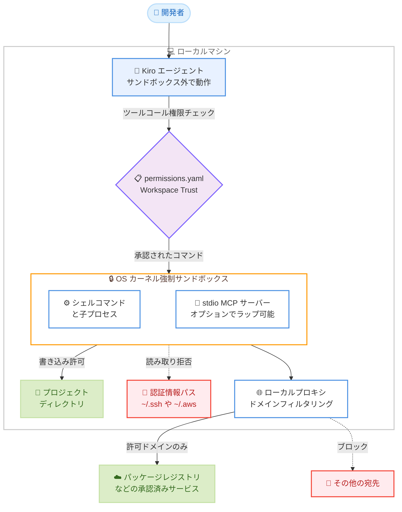

# Kiro - ローカルサンドボックス機能 (Local Command Sandbox)

**リリース日**: 2026 年 10 月 14 日
**サービス**: Kiro
**機能**: Local Command Sandbox (ローカルコマンドサンドボックス)

📊 [このアップデートのインフォグラフィックを見る](https://takech9203.github.io/aws-news-summary/20261014-kiro-local-sandboxing.html)

## 概要

Kiro IDE および Kiro CLI に、エージェントが実行するシェルコマンドを OS カーネルレベルで制限する「ローカルコマンドサンドボックス」機能が追加されました。これまでローカルマシン上でエージェントを実行する場合、エージェントが実行するすべてのコマンドはユーザー自身の権限で動作し、ファイルシステムやネットワークへのフルアクセスを持っていました。その安全性を担保する手段は、ユーザーがセッションを監視し、各コマンドを承認前に確認するという「人間の注意力」に依存していました。

本機能により、エージェント自体はネイティブに動作したまま、エージェントが実行するコマンドのみが OS が強制するサンドボックス内で実行されるようになります。macOS では Seatbelt、Linux では bubblewrap、Windows では AppContainer を使用し、Kiro のツールコール権限チェックに加えて OS レベルの制限が適用されます。書き込みはプロジェクトディレクトリと一時領域に限定され、`~/.ssh` や `~/.aws` などの認証情報パスへの読み取りはカーネルレベルで拒否され、ネットワークアクセスはドメインベースでフィルタリングするローカルプロキシを経由します。

Kiro にはすでにクラウドサンドボックス (IDE、CLI、Web で利用可能) が存在しますが、データレジデンシー要件でコードをクラウドに出せない場合、VPN 内の localhost サービスやリソースへのアクセスが必要な場合、Xcode と Apple ツールチェーンを必要とする iOS ビルドなど、ローカルで実行せざるを得ない作業に対して、本機能が OS レベルの保護を提供します。

**アップデート前の課題**

- エージェントが実行するコマンドはユーザーの権限をそのまま引き継ぎ、ファイルシステムとネットワークへのフルアクセスを持っていた
- 安全性の担保はユーザーの「注意力」に依存しており、長時間タスクや並列セッションの増加により承認疲れ (approval fatigue) が発生し、注意力がシステムのボトルネックになっていた
- Kiro のトラストモデルは `read_file` ツールによる `~/.aws` や `~/.ssh` へのアクセスを拒否していたが、エージェントがシェル経由のスクリプトで同じファイルを読み取るという回避が可能だった
- 悪意がなくても、1 つの誤ったツールコールや意図の取り違えが実際のインシデントにつながるリスクがあった

**アップデート後の改善**

- エージェントが実行するコマンドとその子プロセスが、OS カーネルが強制するサンドボックス内で実行されるようになった
- `~/.ssh/id_rsa` などの認証情報パスへの読み取りは、`read_file` ツール経由でもシェルワンライナー経由でもスクリプト経由でも、カーネルレベルで一律に拒否されるようになった
- ネットワークアクセスはローカルプロキシを経由してドメイン単位でフィルタリングされ、パッケージレジストリなど承認済みサービスのみに到達可能になった
- 既存の Workspace Trust モデルと `permissions.yaml` をそのまま利用でき、新たな権限システムを学習する必要がない

## アーキテクチャ図



エージェント本体はサンドボックスの外で動作し、エージェントが実行するコマンドのみが OS カーネルの制限下で実行されます。1 つのトラストポリシーが、ツールコール時と OS のシステムコール時の 2 段階で強制されます。

## サービスアップデートの詳細

### 主要機能

1. **OS カーネルによるコマンド制限**
   - エージェントが実行するシェルコマンドとそのすべての子プロセスが、OS が強制するサンドボックス内で実行される
   - macOS は Seatbelt (sandbox-exec 経由)、Linux は bubblewrap、Windows は AppContainer を使用
   - 書き込みはプロジェクトディレクトリと一時領域に限定され、主要な認証情報パスの読み取りはカーネルで拒否される
   - サンドボックスは承認後のコマンドが実行できる範囲を制限するものであり、コマンド承認フロー自体は従来どおり動作する

2. **ドメインベースのネットワークフィルタリング**
   - ネットワークアクセスはローカルプロキシを強制経由し、ドメイン単位でフィルタリングされる (クラウドサンドボックスと同じモデル)
   - `networkAccess` 設定で 3 つのモードから選択可能: `DEFAULT_BLOCKED` (デフォルト、許可ルールのあるホスト以外ブロック)、`COMMON_DEPENDENCIES` (一般的なパッケージ・ソース・ビルド・コンテナサービスに到達可能)、`DEFAULT_ALLOWED` (すべて許可)
   - `permissions.yaml` の `sandbox_network` ルールで特定ホストの許可・拒否を細かく制御できる

3. **エージェント本体はサンドボックス外に維持**
   - エージェント自体はサンドボックスの外に残るため、セッションを再起動せずにサンドボックスのオン・オフ切り替えやポリシー変更が可能
   - モデル呼び出しや Kiro バックエンドへの接続に使用する認証情報はサンドボックスに入らないため、サンドボックス内のプロセスが暴走してもその認証情報を悪用できない
   - ローカル MCP サーバーはホストネイティブプロセスとして変更なしで動作し続け、必要に応じて `mcpSandboxing` 設定でサンドボックス経由に切り替えることも可能
   - 従来型のコンテナ・イメージ・VM は不要で、制限付き子プロセスとして実装されているため、最初のコマンド実行前の起動待ちが発生しない

4. **既存の Workspace Trust モデルとの統合**
   - 新しい権限システムを追加するのではなく、既存の `fs_read`、`fs_write`、ネットワークのケーパビリティルールを OS カーネルでも強制する仕組み
   - 同じトラストポリシーが 2 回強制される: 1 回目はエージェントがツールコールで要求した時点、2 回目は OS が実際のシステムコールをチェックする時点
   - ポリシーエンジンがサポートする既存のスコープ (管理者、ユーザー、ワークスペース、エージェント、セッション) がすべて自動的に適用される

## 技術仕様

### プラットフォーム要件

| プラットフォーム | サンドボックス技術 | 要件 |
|------|------|------|
| macOS | Seatbelt (sandbox-exec 経由) | 追加インストール不要 |
| Linux | bubblewrap (bwrap) | bwrap を PATH に配置。`COMMON_DEPENDENCIES` およびホスト許可付き `DEFAULT_BLOCKED` には socat も必要。ディストリビューションのパッケージマネージャーでインストール |
| Windows | AppContainer | 初回のみ管理者セットアップが必要 (IDE はプロンプト表示、CLI では `/sandbox setup` を実行)。`DEFAULT_BLOCKED` はセットアップ前でも動作 |

### sandbox.json の設定キー

| キー | 必須 | 値 | デフォルト |
|------|------|------|------|
| `enabled` | はい | `true`、`false` | - |
| `networkAccess` | いいえ | `DEFAULT_BLOCKED`、`COMMON_DEPENDENCIES`、`DEFAULT_ALLOWED` | `DEFAULT_BLOCKED` |
| `mcpSandboxing` | いいえ | `true`、`false` | `false` |

### ネットワークモード

| モード | 外部ネットワークアクセス |
|------|------|
| `DEFAULT_BLOCKED` | ブロック。`sandbox_network` ルールで許可されたホストのみ到達可能 (デフォルト) |
| `COMMON_DEPENDENCIES` | 一般的なパッケージ・ソース・ビルド・コンテナサービスに到達可能。その他はルールで許可しない限りブロック |
| `DEFAULT_ALLOWED` | オープン。任意のホストに到達可能。ネットワークフィルタリングが不要な場合のみ使用 |

### サンドボックスの適用範囲

| 対象 | サンドボックス内か |
|------|------|
| エージェントが実行するターミナルコマンドとその子プロセス | 内 |
| stdio MCP サーバープロセス (`mcpSandboxing: true` の場合) | 内 |
| エージェントハーネスとモデルとの会話 | 外 |
| 組み込みファイルツール (権限ルールは引き続き適用) | 外 |
| リモート HTTP / SSE MCP サーバー | 外 |

## 設定方法

### 前提条件

1. Kiro IDE 1.3 以降、または Kiro CLI 2.31 以降 (ローカル V3 セッション)
2. Linux の場合は bubblewrap (必要に応じて socat) のインストール
3. Windows の場合は初回の管理者セットアップ

### 手順

#### ステップ 1: サンドボックスを有効化する

グローバルデフォルトとして `~/.kiro/settings/sandbox.json`、またはプロジェクト単位のオーバーライドとして `<project-root>/.kiro/settings/sandbox.json` を作成します。

```json
{
  "enabled": true,
  "networkAccess": "COMMON_DEPENDENCIES"
}
```

`enabled` を `true` に設定するとサンドボックスが有効になり、`networkAccess` でネットワークモードを指定します。ファイルを編集せずに有効化することも可能で、Kiro CLI ではローカルセッション (`kiro-cli chat --v3`) で `/sandbox on` を実行、Kiro IDE ではコマンドパレットから `Kiro: Open User Sandbox Config (JSON)` を実行します。有効化されるとステータスバーに「Command sandbox: Active」と表示されます。

#### ステップ 2: permissions.yaml でポリシーを調整する

```yaml
# ~/.kiro/settings/permissions.yaml
rules:
  - capability: sandbox_network
    match: ['packages.internal.example.com']
    effect: allow
  # ワイルドカードルールより前に配置する
  - capability: sandbox_network
    match: ['uploads.example-corp.net']
    effect: deny
  - capability: sandbox_network
    match: ['*.example-corp.net']
    effect: allow
```

既存のツール認可を管理している `permissions.yaml` にルールを追加して、エージェントがアクセスできる範囲を細かく制御します。`sandbox_network` ルールは記述順に評価され、最初にマッチしたルールが適用されます (他のケーパビリティと異なり deny が常に優先されるわけではないため、具体的なホストを広いワイルドカードより前に記述します)。`fs_read` と `fs_write` のルールは、サンドボックス化されたコマンドが参照・書き込みできるパスにも適用されます。

#### ステップ 3: 必要に応じて stdio MCP サーバーをラップする

```json
{
  "enabled": true,
  "networkAccess": "DEFAULT_BLOCKED",
  "mcpSandboxing": true
}
```

`mcpSandboxing` を `true` に設定すると、stdio MCP サーバープロセスがシェルコマンドと同じサンドボックス内で起動されます。リモート HTTP / SSE MCP サーバーは影響を受けません。この設定の変更時にはローカル MCP サーバーが再起動されます (約 1 分かかる場合があります)。

## メリット

### ビジネス面

- **セキュリティインシデントリスクの低減**: 悪意の有無にかかわらず、誤ったツールコールや意図の取り違えが実際のインシデントになるリスクを OS レベルの境界で抑制できる
- **データレジデンシー要件への対応**: コードをクラウドに出せない環境でも、ローカル実行のままサンドボックスによる保護を適用できる
- **開発者の生産性向上**: 承認疲れを軽減し、複数セッションの並列実行や長時間タスクの実行時に、人間の注意力への依存度を下げられる

### 技術面

- **多層防御の実現**: ツールコール時の権限チェックに加えて、OS のシステムコールレベルでも同じポリシーが強制され、シェルやスクリプト経由の回避を防げる
- **軽量な実装**: コンテナ・イメージ・VM が不要な制限付き子プロセスとして実装され、起動オーバーヘッドがなく、セッション中にオン・オフやポリシー変更が可能
- **既存ポリシーの再利用**: 既存の `permissions.yaml` と Workspace Trust モデルをそのまま使用でき、管理者・ユーザー・ワークスペース・エージェント・セッションの各スコープが自動的に引き継がれる
- **プロジェクトファイルによる改ざん防止**: グローバルポリシーが有効な場合、プロジェクトファイルは制限を強化する方向にのみ変更可能で、クローンしたリポジトリがネットワークを開放したりサンドボックスを無効化したりすることはできない

## デメリット・制約事項

### 制限事項

- デフォルトでは無効であり、明示的に有効化する必要がある
- Kiro IDE 1.3 以降、Kiro CLI 2.31 以降のローカル V3 セッションでのみ利用可能
- Linux では bubblewrap (および socat) の手動インストール、Windows では初回の管理者セットアップが必要
- プラットフォームのバックエンドが見つからない場合、サンドボックスは「Unavailable」となり、コマンドは OS レベルの分離なしで実行される
- リモート HTTP / SSE MCP サーバーのネットワークトラフィックはサンドボックスのルールに従わない
- クラウドセッションには適用されない (クラウドセッションはマネージドクラウドサンドボックスを使用)

### 考慮すべき点

- サンドボックスはコマンドができることを減らすものであり、完全な分離を保証するものではない。提案されたコマンドのレビューと、決して実行してはならない操作の deny ルールの維持は引き続き必要
- サンドボックスはコマンド承認を置き換えるものではなく、承認されたコマンドの実行範囲を制限する位置付けである
- `sandbox_network` ルールは先勝ち評価のため、ルールの記述順序に注意が必要
- `sandbox_network` は `all` メタケーパビリティに含まれないため、`capability: all, effect: allow` を設定してもサンドボックスのネットワークアクセスは開放されない

## ユースケース

### ユースケース 1: データレジデンシー要件下での長時間リファクタリング

**シナリオ**: 規制によりソースコードを社外やクラウドに出せない組織で、エージェントに大規模なリファクタリングやビルド・テストのループを任せたい。

**実装例**:
```json
{
  "enabled": true,
  "networkAccess": "COMMON_DEPENDENCIES"
}
```

**効果**: コードはローカルに保ったまま、書き込みはプロジェクトディレクトリに限定され、認証情報パスへのアクセスはカーネルで拒否される。パッケージレジストリなどビルドに必要なサービスには到達できるため、エージェントに長時間タスクを任せても実行範囲が OS レベルで制限される。

### ユースケース 2: 社内ネットワーク内のサービスを使う開発

**シナリオ**: VPN 内の社内パッケージレジストリを利用しつつ、社外への不要なデータ送信は防ぎたい。

**実装例**:
```yaml
# ~/.kiro/settings/permissions.yaml
rules:
  - capability: sandbox_network
    match: ['packages.internal.example.com']
    effect: allow
```

**効果**: `DEFAULT_BLOCKED` モードと組み合わせることで、サンドボックス化されたコマンドは明示的に許可した社内レジストリのみに到達でき、その他の宛先への通信はブロックされる。クラウドサンドボックスでは到達できない VPN 内リソースを使った開発を、ネットワーク制御付きで実行できる。

### ユースケース 3: 依存関係アップグレード時のサプライチェーンリスク低減

**シナリオ**: 依存パッケージのアップグレードでは、インストールスクリプトなど信頼できないコードが実行される可能性があり、認証情報の窃取や外部への不正送信を防ぎたい。

**実装例**:
```json
{
  "enabled": true,
  "networkAccess": "DEFAULT_BLOCKED",
  "mcpSandboxing": true
}
```

**効果**: パッケージのインストールスクリプトを含むすべての子プロセスがサンドボックス内で実行され、`~/.ssh` や `~/.aws` の読み取りは拒否され、許可されていないドメインへの通信もブロックされる。stdio MCP サーバーも同じ境界内で動作させることで、保護範囲をさらに広げられる。

## 利用可能リージョン

グローバル (Kiro IDE 1.3 以降および Kiro CLI 2.31 以降のローカル V3 セッションで利用可能)

## 関連サービス・機能

- **Kiro クラウドサンドボックス**: IDE、CLI、Web で利用できる分離されたクラウド実行環境。ローカルサンドボックスは、クラウドに出せない作業に対して同様の保護をローカルで提供する補完関係にある
- **Kiro Workspace Trust / permissions.yaml**: 既存のツール認可ポリシー。ローカルサンドボックスは同じ `fs_read`、`fs_write`、`sandbox_network` ルールを OS カーネルレベルでも強制する
- **MCP (Model Context Protocol)**: ローカル stdio MCP サーバーは `mcpSandboxing` 設定でサンドボックス内にラップ可能。リモート HTTP / SSE サーバーは対象外

## 参考リンク

- 📊 [インフォグラフィック](https://takech9203.github.io/aws-news-summary/20261014-kiro-local-sandboxing.html)
- [Kiro Blog: Local sandboxing in Kiro: keep agent commands within boundaries](https://kiro.dev/blog/local-sandboxing/)
- [Kiro Changelog](https://kiro.dev/changelog/)
- [ドキュメント: Local command sandbox](https://kiro.dev/docs/sandbox/)
- [ドキュメント: Permissions (sandbox_network ルール)](https://kiro.dev/docs/permissions/#sandbox-network-rules)

## まとめ

Kiro のローカルサンドボックスは、エージェントが実行するコマンドを OS カーネルレベルで制限することで、ツールコール権限チェックだけでは防げなかったシェルやスクリプト経由の回避を塞ぎ、人間の注意力に依存しない多層防御を実現する重要なアップデートです。既存の `permissions.yaml` ポリシーをそのまま再利用でき、コンテナや VM の起動オーバーヘッドもないため、導入コストは低く抑えられています。Kiro IDE 1.3 以降または Kiro CLI 2.31 以降にアップデートし、まずは `sandbox.json` で `enabled: true` を設定してデフォルトポリシーから試すことを推奨します。
