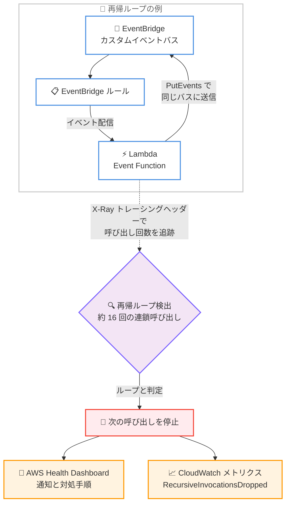

# AWS Lambda - 再帰ループ検出が Amazon EventBridge カスタムイベントバスをサポート

**リリース日**: 2026 年 10 月 14 日
**サービス**: AWS Lambda / Amazon EventBridge
**機能**: Lambda recursive loop detection for Amazon EventBridge Custom event buses

📊 [このアップデートのインフォグラフィックを見る](https://takech9203.github.io/aws-news-summary/20261014-lambda-recursive-loops-eventbridge-custom.html)

## 概要

AWS Lambda の再帰ループ検出 (recursive loop detection) が、Amazon EventBridge カスタムイベントバスとの間で発生する再帰ループを自動的に検出し、停止できるようになりました。設定ミスやコードの不具合によって EventBridge ルールが Lambda Event Function を再帰的に呼び出し続けると、意図しない使用量の急増と予期しない課金が発生する可能性があります。本アップデートにより、このようなランナウェイワークロードから自動的に保護されます。

再帰ループ検出は AWS アカウントでデフォルトで有効になっており、追加の設定や料金は不要です。ループが検出されて停止されると、トラブルシューティング手順を含む通知が AWS Health Dashboard に送信されます。意図的に再帰ループを使用する設計の場合は、PutFunctionRecursionConfig API を使用して関数単位で検出を無効化できます。

EventBridge カスタムイベントバスは、インフラストラクチャを管理することなく自動化ワークフローの構築や定期タスクのスケジューリングに Lambda Event Function を呼び出せるため、イベント駆動アーキテクチャで広く利用されています。本アップデートは、サーバーレスアプリケーションを運用するすべてのユーザーにとって、コスト保護という観点で重要な改善です。

**アップデート前の課題**

- 再帰ループ検出の対象は Amazon SQS、Amazon S3、Amazon SNS、および Lambda Event Function 同士のループに限られていた
- EventBridge カスタムイベントバスを含むループは検出されず、設定ミスやコード不具合による無限ループが発生すると、手動で気付いて停止するまで実行が継続した
- ランナウェイワークロードにより、アカウントの同時実行数の枯渇や予期しない課金が発生するリスクがあった

**アップデート後の改善**

- Lambda Event Function と EventBridge カスタムイベントバスの間の再帰ループが自動的に検出・停止されるようになった
- ループ停止時に AWS Health Dashboard へトラブルシューティング手順を含む通知が送信されるため、迅速な原因究明が可能になった
- デフォルトで有効であり、設定変更や追加コストなしで保護が適用される

## アーキテクチャ図



Lambda Event Function が処理結果を同じ EventBridge カスタムイベントバスに送信すると再帰ループが発生します。Lambda はイベントに付与されたメタデータで呼び出し回数を追跡し、同一リクエストチェーンで約 16 回の呼び出しを検出すると次の呼び出しを自動停止して通知します。

## サービスアップデートの詳細

### 主要機能

1. **EventBridge カスタムイベントバスを含む再帰ループの自動検出**
   - Lambda Event Function と EventBridge カスタムイベントバスの間で発生する再帰ループを自動的に識別
   - 同一のトリガーイベントに起因するリクエストチェーンで、関数が約 16 回呼び出されると次の呼び出しを自動停止
   - 複数のトリガーが設定されている場合、他のトリガーからの呼び出しには影響しない

2. **X-Ray トレーシングヘッダーによるイベント追跡**
   - サポート対象の AWS サービスから Lambda に送信されるイベントにメタデータが自動付与され、関数の呼び出し回数がカウントされる
   - X-Ray のアクティブトレースを有効化する必要はなく、追加料金も発生しない
   - 検出には、関数がサポート対象バージョンの AWS SDK を使用してイベントを書き込むことが必要

3. **通知とモニタリング**
   - ループ停止時に AWS Health Dashboard の「Your account health」ページに通知を表示 (表示まで最大 3.5 時間)
   - 関数ごとに 24 時間に最大 1 通のメールアラートをアカウントの連絡先に送信
   - CloudWatch メトリクス `RecursiveInvocationsDropped` で停止された再帰呼び出し数を監視可能

4. **関数単位でのオプトアウト**
   - 意図的に再帰パターンを使用する設計の場合、PutFunctionRecursionConfig API、コンソール、AWS CLI、CloudFormation、AWS SAM で検出を無効化可能
   - 無効化した関数では `RecursiveInvocationsDropped` メトリクスは発行されない

## 技術仕様

### 再帰ループ検出の仕様

| 項目 | 詳細 |
|------|------|
| 検出対象サービス | Amazon SQS、Amazon S3、Amazon SNS、Amazon EventBridge カスタムイベントバス、Lambda Event Function 同士の呼び出し |
| 検出のしきい値 | 同一リクエストチェーンで約 16 回の呼び出し |
| 追跡の仕組み | AWS X-Ray トレーシングヘッダーによるイベントメタデータ (アクティブトレースの有効化は不要) |
| デフォルト設定 | 全 AWS アカウントで有効 (設定不要・無料) |
| 通知方法 | AWS Health Dashboard、メールアラート (関数ごとに 24 時間に最大 1 通) |
| 関連メトリクス | `RecursiveInvocationsDropped` (CloudWatch) |
| オプトアウト | PutFunctionRecursionConfig API で関数単位に設定 (`Allow` / `Terminate`) |

### サポートされる AWS SDK の最小バージョン

検出には、Lambda Event Function がイベントを書き込む際に以下のバージョン以上の AWS SDK を使用している必要があります。

| ランタイム | 最小 SDK バージョン |
|------|------|
| Node.js | 2.1147.0 (SDK v2) / 3.105.0 (SDK v3) |
| Python | 1.24.46 (boto3) / 1.27.46 (botocore) |
| Java 8 / 11 | 2.17.135 |
| Java 17 | 2.20.81 |
| Java 21 | 2.21.24 |
| .NET | 3.7.293.0 |
| Ruby | 3.134.0 |
| PHP | 3.232.0 |
| Go | V2 SDK 1.57.0 |

### API変更履歴

本アップデートに伴う新規 API の追加や変更はありません。オプトアウトには既存の [PutFunctionRecursionConfig API](https://docs.aws.amazon.com/lambda/latest/api/API_PutFunctionRecursionConfig.html) を使用します。

## 設定方法

### 前提条件

1. 再帰ループ検出はデフォルトで有効のため、保護を受けるための設定は不要
2. 検出には、関数がサポート対象バージョンの AWS SDK を使用してイベントを書き込んでいること
3. オプトアウトする場合は、対象関数に対する `lambda:PutFunctionRecursionConfig` 権限

### 手順

#### ステップ1: 停止された再帰呼び出しの監視

```bash
aws cloudwatch get-metric-statistics \
  --namespace AWS/Lambda \
  --metric-name RecursiveInvocationsDropped \
  --dimensions Name=FunctionName,Value=my-function \
  --start-time 2026-10-14T00:00:00Z \
  --end-time 2026-10-15T00:00:00Z \
  --period 3600 \
  --statistics Sum
```

CloudWatch メトリクス `RecursiveInvocationsDropped` を取得し、Lambda が停止した再帰呼び出しの数を確認します。このメトリクスにアラームを設定しておくと、ループ発生時に迅速に対応できます。

#### ステップ2: ループ検出後の対処

```bash
# 関数の予約済み同時実行数をゼロにしてすべての呼び出しをスロットリング
aws lambda put-function-concurrency \
  --function-name my-function \
  --reserved-concurrent-executions 0
```

ループが検出された場合の応急処置として、関数の同時実行数をゼロに設定して以降の呼び出しを抑止します。その後、同じイベントバスへ書き戻しているコード不具合や、イベントソースとターゲットに同じ変数値を使用している設定ミスを特定して修正します。

#### ステップ3: 意図的な再帰ループを使用する場合のオプトアウト

```bash
aws lambda put-function-recursion-config \
  --function-name my-function \
  --recursive-loop Allow
```

意図的に再帰パターンを使用する関数に対して、再帰ループ検出を無効化します。デフォルトに戻す場合は `--recursive-loop Terminate` を指定します。再帰ループの使用は実装ミスによるリスクが大きいため、AWS はガードレールの実装を推奨しています。

## メリット

### ビジネス面

- **予期しない課金の防止**: 設定ミスによるランナウェイワークロードが自動停止されるため、意図しない大量実行による課金リスクを低減できる
- **運用負荷の軽減**: デフォルトで有効かつ無料のため、追加の仕組みを構築することなく保護が適用される
- **迅速な障害対応**: AWS Health Dashboard の通知にトラブルシューティング手順が含まれるため、原因究明と復旧までの時間を短縮できる

### 技術面

- **検出対象の拡大**: SQS、S3、SNS に加えて EventBridge カスタムイベントバスを含むループが検出可能になり、イベント駆動アーキテクチャの保護範囲が広がった
- **同時実行数の保護**: 無限ループによるアカウントの同時実行数の枯渇を防ぎ、他のワークロードへの影響を抑止できる
- **柔軟なオプトアウト**: 意図的な再帰パターンを使用する関数のみ、API 一つで検出を無効化できる

## デメリット・制約事項

### 制限事項

- 検出対象は Amazon SQS、Amazon S3、Amazon SNS、EventBridge カスタムイベントバス、Lambda Event Function 同士のループに限られ、DynamoDB など他のサービスを含むループは検出されない
- 検出には、関数がサポート対象バージョン以上の AWS SDK を使用してイベントを書き込む必要がある
- 約 16 回の呼び出しが発生するまではループが継続するため、しきい値到達までの実行分は課金対象となる

### 考慮すべき点

- Health Dashboard への通知表示とメールアラートの送信には最大 3.5 時間かかる場合がある
- SQS がイベントソースの場合、ループ検出後も `maxReceiveCount` を超過するまでメッセージの再試行が継続する (呼び出し自体はブロックされる)
- 検出対象外のサービスを含むループに備えて、CloudWatch アラームや AWS Cost Anomaly Detection による監視を併用することが推奨される
- オンフェイラー送信先やデッドレターキューに、関数を呼び出すリソースと同じリソースを指定しないよう注意が必要

## ユースケース

### ユースケース1: イベント駆動の自動化ワークフローの保護

**シナリオ**: EventBridge カスタムイベントバスのルールで Lambda Event Function を起動し、処理結果を再びイベントとして発行する自動化基盤を運用している。ルールのイベントパターンの設定ミスにより、関数が発行したイベントが自分自身を再トリガーしてしまった。

**実装例**:
```text
EventBridge ルール → Lambda Event Function → PutEvents で同じバスに発行
→ 同じルールに一致して再トリガー (ループ発生)
→ 約 16 回で Lambda が自動停止し Health Dashboard に通知
```

**効果**: 手動で気付く前にループが自動停止され、課金と同時実行数の消費を最小限に抑えられる。

### ユースケース2: マルチアカウント環境での一括保護

**シナリオ**: 組織内の多数のアカウントでイベント駆動アーキテクチャを運用しており、各チームの設定ミスによるランナウェイワークロードを統制したい。

**実装例**:
```text
追加設定は不要 (デフォルトで有効)
各アカウントで RecursiveInvocationsDropped に CloudWatch アラームを設定し、
検出イベントを集約して監視
```

**効果**: ガバナンスの仕組みを個別に構築することなく、全アカウントで統一的な保護と可視化を実現できる。

### ユースケース3: 意図的な再帰パターンの継続利用

**シナリオ**: 大きなバッチ処理を分割して、処理の進捗をイベントとして同じカスタムイベントバスに発行しながら自己継続する再帰的なワークフローを意図的に設計している。

**実装例**:
```bash
aws lambda put-function-recursion-config \
  --function-name batch-splitter \
  --recursive-loop Allow
```

**効果**: 対象関数のみ検出を無効化し、他の関数は保護を維持したまま意図的な再帰設計を継続できる。

## 料金

再帰ループ検出は無料で利用でき、追加料金は発生しません。X-Ray のアクティブトレースを有効化する必要もありません。なお、ループ検出のしきい値 (約 16 回) に到達するまでの Lambda 実行と EventBridge の PutEvents には通常の料金が適用されます。

## 利用可能リージョン

EventBridge カスタムイベントバスが利用可能なすべての商用 AWS リージョンで利用できます。再帰ループ検出自体もすべての商用リージョンでサポートされています。

## 関連サービス・機能

- **Amazon EventBridge**: カスタムイベントバスとルールによるイベントルーティング。本アップデートで再帰ループ検出の対象に追加された
- **AWS X-Ray**: トレーシングヘッダーがイベントの呼び出し回数の追跡に利用される (アクティブトレースの有効化は不要)
- **AWS Health Dashboard**: ループ停止時の通知とトラブルシューティング手順の提供
- **Amazon CloudWatch**: `RecursiveInvocationsDropped` メトリクスによる監視と、ランナウェイワークロードに対するアラーム設定
- **AWS Cost Anomaly Detection**: 検出対象外のサービスを含むループに備えた異常課金の検知

## 参考リンク

- 📊 [インフォグラフィック](https://takech9203.github.io/aws-news-summary/20261014-lambda-recursive-loops-eventbridge-custom.html)
- [公式発表 (What's New)](https://aws.amazon.com/about-aws/whats-new/2026/10/lambda-recursive-loops-eventbridge-custom)
- [ドキュメント: Lambda recursive loop detection](https://docs.aws.amazon.com/lambda/latest/dg/invocation-recursion.html)
- [ドキュメント: EventBridge Custom event buses](https://docs.aws.amazon.com/eventbridge/latest/userguide/eb-custom-bus.html)
- [API リファレンス: PutFunctionRecursionConfig](https://docs.aws.amazon.com/lambda/latest/api/API_PutFunctionRecursionConfig.html)
- [料金ページ: AWS Lambda](https://aws.amazon.com/lambda/pricing/)

## まとめ

Lambda の再帰ループ検出が EventBridge カスタムイベントバスに対応したことで、イベント駆動アーキテクチャにおける主要なループパターンの多くが自動保護の対象となりました。デフォルトで有効かつ無料のため、ユーザー側での対応は不要ですが、`RecursiveInvocationsDropped` メトリクスへのアラーム設定と、意図的な再帰パターンを使用する関数の棚卸しを行うことを推奨します。
