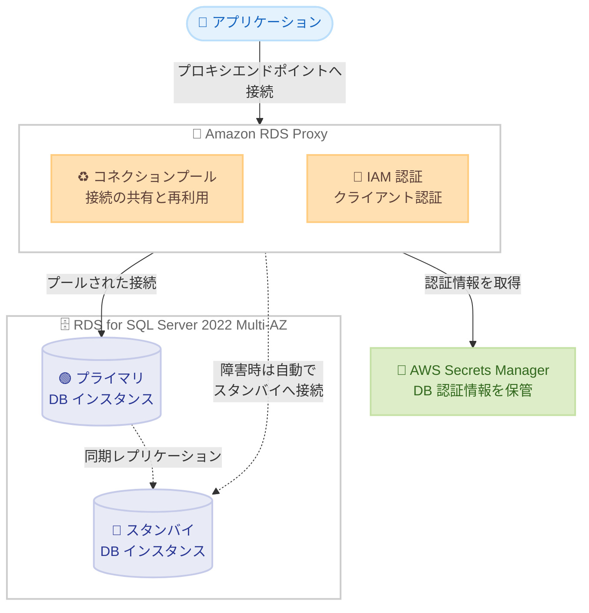

# Amazon RDS Proxy - SQL Server 2022 サポート

**リリース日**: 2026 年 10 月 14 日
**サービス**: Amazon RDS Proxy / Amazon RDS for SQL Server
**機能**: RDS Proxy による SQL Server メジャーバージョン 2022 のサポート

📊 [このアップデートのインフォグラフィックを見る](https://takech9203.github.io/aws-news-summary/20261014-rds-proxy-supports-sqlserver-2022.html)

## 概要

Amazon RDS 向けのフルマネージド型・高可用性データベースプロキシである Amazon RDS Proxy が、メジャーバージョン 2022 を実行する Amazon RDS for SQL Server インスタンスをサポートしました。これにより、最新の SQL Server 2022 を利用するワークロードでも、RDS Proxy による接続プーリングやフェイルオーバー時間の短縮といったメリットを享受できるようになります。

RDS Proxy はアプリケーションとデータベースの間に配置され、確立済みのデータベース接続をプールして共有することで、データベースの効率とアプリケーションのスケーラビリティを向上させます。Amazon RDS for SQL Server の Multi-AZ 構成では、障害発生時に RDS Proxy が自動的にスタンバイインスタンスへ接続し、アプリケーションの接続を維持しながら、フェイルオーバー時間を最大 83% 短縮します。

また、RDS Proxy は SQL Server 向けの標準 IAM 認証をサポートしており、アプリケーションは AWS Identity and Access Management (IAM) を使用してプロキシに認証し、RDS Proxy は AWS Secrets Manager に保存された認証情報を使用してデータベースへの接続を管理します。

**アップデート前の課題**

- 以前は、SQL Server 2022 を実行する RDS for SQL Server インスタンスでは RDS Proxy を利用できなかった
- SQL Server 2022 の新機能を使うために最新バージョンを選択すると、RDS Proxy による接続プーリングやフェイルオーバー高速化の恩恵を受けられなかった
- SQL Server 2022 環境では、接続スパイク対策やフェイルオーバー時の接続維持をアプリケーション側で実装する必要があった

**アップデート後の改善**

- SQL Server 2022 インスタンスでも RDS Proxy を有効化し、接続のプーリングと共有によってデータベース効率とスケーラビリティを向上できるようになった
- Multi-AZ 構成の SQL Server 2022 データベースで、フェイルオーバー時にアプリケーション接続を維持しつつ、フェイルオーバー時間を最大 83% 短縮できるようになった
- IAM 認証と Secrets Manager を組み合わせたセキュアな接続管理を SQL Server 2022 でも利用できるようになった

## アーキテクチャ図



アプリケーションは RDS Proxy のエンドポイントに接続し、プロキシがプールされた接続を介して SQL Server 2022 データベースと通信します。Multi-AZ 構成では、障害発生時にプロキシがアプリケーション接続を維持したままスタンバイインスタンスへ自動的に接続を切り替えます。

## サービスアップデートの詳細

### 主要機能

1. **SQL Server 2022 での接続プーリング**
   - RDS Proxy がアプリケーションとデータベースの間で確立済み接続をプール・共有
   - 新規接続のたびに発生するメモリと CPU のオーバーヘッドを回避
   - 接続要求の急増時にはキューイングやスロットリングを行い、データベースの過負荷を防止

2. **Multi-AZ フェイルオーバーの高速化**
   - 障害発生時に RDS Proxy が自動的にスタンバイデータベースインスタンスへ接続
   - アプリケーション側の接続を維持したまま切り替えが行われるため、再接続ロジックの負担を軽減
   - フェイルオーバー時間を最大 83% 短縮

3. **IAM 認証と Secrets Manager による接続管理**
   - アプリケーションは IAM を使用してプロキシに認証 (標準 IAM 認証)
   - RDS Proxy は AWS Secrets Manager に保存された認証情報を使用してデータベース接続を管理
   - データベース認証情報をアプリケーションコードに埋め込む必要がない

4. **コード変更なしで導入可能**
   - RDS Proxy はサポートするエンジンバージョンと完全な互換性を持つ
   - RDS コンソールで数ステップで有効化し、アプリケーションの接続先をプロキシエンドポイントに変更するだけで利用開始できる

## 技術仕様

### RDS Proxy for SQL Server の主な仕様

| 項目 | 詳細 |
|------|------|
| 対応バージョン | SQL Server 2022 (今回追加)。SQL Server 2025 は現時点で未対応 |
| 配置要件 | プロキシはデータベースと同じ VPC 内に配置 (パブリックアクセス不可) |
| プロキシ数の上限 | AWS アカウントあたり 20 (Service Quotas で引き上げ申請可能) |
| シークレット数 | プロキシあたり最大 200 の Secrets Manager シークレット |
| 追加エンドポイント | プロキシあたり最大 20 の追加エンドポイント |
| クライアント認証 | IAM 認証 (プロキシからデータベースへは Secrets Manager の認証情報を使用) |

### SQL Server 固有の制限事項

公式ドキュメントに記載されている RDS for SQL Server 向けの主な制限は以下のとおりです。

- Active Directory を使用する接続はサポートされない
- エンドツーエンドの IAM 認証 (プロキシからデータベースまで IAM で認証) はサポートされない
- 大文字小文字を区別する照合順序を使用する場合、ユーザー名の表記ごとに個別のシークレットが必要
- `@@IDENTITY`、`@@ROWCOUNT`、`SCOPE_IDENTITY` の結果が常に正確とは限らない (同一セッションステートメント内で値を取得することで回避可能)
- MARS (Multiple Active Result Sets) を使用する接続では初期化クエリが実行されない
- RDS Custom for SQL Server では RDS Proxy を利用できない

## 設定方法

### 前提条件

1. SQL Server 2022 を実行する Amazon RDS for SQL Server DB インスタンスがあること
2. データベースの認証情報を保存する AWS Secrets Manager シークレットを作成できること
3. プロキシがデータベースと同じ VPC 内に配置できるネットワーク構成であること

### 手順

#### ステップ 1: データベース認証情報のシークレットを作成

```bash
aws secretsmanager create-secret \
  --name rds-proxy-sqlserver-secret \
  --secret-string '{"username":"admin","password":"<パスワード>"}'
```

RDS Proxy がデータベースへの接続に使用する認証情報を AWS Secrets Manager に保存します。

#### ステップ 2: RDS Proxy を作成

```bash
aws rds create-db-proxy \
  --db-proxy-name sqlserver2022-proxy \
  --engine-family SQLSERVER \
  --auth '[{"AuthScheme":"SECRETS","SecretArn":"<シークレットの ARN>","IAMAuth":"REQUIRED"}]' \
  --role-arn <Secrets Manager へのアクセスを許可する IAM ロールの ARN> \
  --vpc-subnet-ids subnet-xxxx subnet-yyyy
```

エンジンファミリーに SQLSERVER を指定して RDS Proxy を作成します。`IAMAuth` を REQUIRED にすることで、クライアントからプロキシへの接続に IAM 認証を強制します。

#### ステップ 3: ターゲットの登録

```bash
aws rds register-db-proxy-targets \
  --db-proxy-name sqlserver2022-proxy \
  --db-instance-identifiers <SQL Server 2022 の DB インスタンス識別子>
```

作成したプロキシに SQL Server 2022 の DB インスタンスをターゲットとして登録します。

#### ステップ 4: アプリケーションの接続先を変更

アプリケーションの接続文字列のホスト名を、RDS Proxy のエンドポイントに変更します。アプリケーションコードの変更は原則不要で、接続先の切り替えのみで RDS Proxy の利用を開始できます。

## メリット

### ビジネス面

- **ダウンタイムの短縮**: Multi-AZ 構成でのフェイルオーバー時間が最大 83% 短縮され、障害時のビジネス影響を低減できる
- **最新バージョンへの移行促進**: SQL Server 2022 へのアップグレードと RDS Proxy の利用を両立でき、バージョン選定の制約がなくなる
- **運用負担の軽減**: フルマネージドのプロキシにより、接続管理の仕組みを自前で構築・運用する必要がない

### 技術面

- **スケーラビリティの向上**: 接続のプーリングと共有により、接続数の多いアプリケーションや急激なトラフィック増加に対応しやすくなる
- **接続の耐障害性**: フェイルオーバー時もアプリケーション接続が維持されるため、クライアント側の再接続処理への依存を減らせる
- **セキュリティの強化**: IAM 認証と Secrets Manager の組み合わせにより、認証情報の埋め込みを排除し、アクセス制御を一元化できる

## デメリット・制約事項

### 制限事項

- SQL Server 2025 は現時点で RDS Proxy の対象外 (プロキシ接続中のインスタンスを 2025 にアップグレードした場合、vector 型や JSON 型の結果列は `nvarchar(max)` として返される)
- Active Directory 認証を使用する接続はサポートされない
- エンドツーエンドの IAM 認証は SQL Server ではサポートされない
- RDS Custom for SQL Server では利用できない
- プロキシはデータベースと同じ VPC 内に配置する必要があり、パブリックアクセスはできない

### 考慮すべき点

- プロキシ経由の接続はレイテンシーがわずかに増加する可能性があるため、性能要件の厳しいワークロードでは事前検証が必要
- 16 KB を超えるテキストサイズのステートメントはセッションを接続にピン留めし、プーリング効率が低下する
- 大文字小文字を区別する照合順序では、ユーザー名の表記ごとにシークレットを用意する必要があり、シークレット設計に注意が必要
- RDS Proxy は vCPU 単位の時間課金が発生するため、接続数の少ないワークロードでは費用対効果を確認する必要がある

## ユースケース

### ユースケース 1: Lambda ベースのサーバーレスアプリケーションからの接続管理

**シナリオ**: AWS Lambda から SQL Server 2022 に接続するアプリケーションで、同時実行数の増加に伴い接続数が急増し、データベースの接続上限に達するリスクがある。

**実装例**:
```text
1. SQL Server 2022 インスタンスに RDS Proxy を作成
2. Lambda 関数の接続先を RDS Proxy のエンドポイントに変更
3. プロキシが接続をプール・共有し、接続数の急増を吸収
```

**効果**: Lambda のスケールアウト時でもデータベースへの接続数を抑制でき、接続枯渇によるエラーを防止できる。

### ユースケース 2: Multi-AZ 構成での計画外ダウンタイムの最小化

**シナリオ**: ミッションクリティカルな業務システムで SQL Server 2022 の Multi-AZ 構成を利用しており、フェイルオーバー時のアプリケーション影響を最小化したい。

**実装例**:
```text
1. Multi-AZ 構成の SQL Server 2022 インスタンスに RDS Proxy を導入
2. アプリケーションはプロキシエンドポイント経由で接続
3. 障害時はプロキシが自動的にスタンバイへ接続を切り替え
```

**効果**: フェイルオーバー時間が最大 83% 短縮され、アプリケーション接続が維持されるため、障害時のエラーと復旧時間を大幅に削減できる。

### ユースケース 3: SQL Server 2019 からのアップグレードと接続基盤の維持

**シナリオ**: RDS Proxy を利用中の SQL Server 2019 環境を、サポート期間や新機能を考慮して SQL Server 2022 にアップグレードしたい。

**実装例**:
```text
1. 既存の RDS Proxy 構成を確認
2. DB インスタンスを SQL Server 2022 にメジャーバージョンアップグレード
3. アップグレード後も RDS Proxy 経由の接続構成を継続利用
```

**効果**: 最新バージョンの SQL Server に移行しながら、接続プーリングやフェイルオーバー高速化といった既存の接続基盤のメリットを維持できる。

## 料金

RDS Proxy の料金は、プロキシが関連付けられたデータベースインスタンスのキャパシティに基づきます。RDS for SQL Server を含むプロビジョンドインスタンスでは、vCPU あたりの時間単位で課金されます。部分時間は 1 秒単位で課金され、課金対象のステータス変更後は 10 分の最低課金が適用されます。

デフォルトのプロキシエンドポイントは無料ですが、追加の読み取り専用または読み書き可能エンドポイントを作成すると、AWS PrivateLink のインターフェイスエンドポイントがプロビジョニングされ、PrivateLink の料金が別途発生します。詳細は [Amazon RDS Proxy の料金ページ](https://aws.amazon.com/rds/proxy/pricing/) を参照してください。

## 利用可能リージョン

機能の利用可否はデータベースエンジンのバージョンと AWS リージョンによって異なります。RDS Proxy がサポートされるリージョンとエンジンの最新情報は、[Supported Regions and DB engines for Amazon RDS Proxy](https://docs.aws.amazon.com/AmazonRDS/latest/UserGuide/Concepts.RDS_Fea_Regions_DB-eng.Feature.RDSProxy.html) を参照してください。

## 関連サービス・機能

- **Amazon RDS for SQL Server**: 今回 RDS Proxy の対象に追加された SQL Server 2022 を実行するマネージドデータベースサービス
- **AWS Secrets Manager**: RDS Proxy がデータベース接続に使用する認証情報を安全に保管するサービス
- **AWS Identity and Access Management (IAM)**: クライアントからプロキシへの認証に使用され、アクセス制御を一元化
- **Amazon RDS Multi-AZ**: スタンバイインスタンスへの自動フェイルオーバーを提供し、RDS Proxy と組み合わせることでフェイルオーバー時間をさらに短縮

## 参考リンク

- 📊 [インフォグラフィック](https://takech9203.github.io/aws-news-summary/20261014-rds-proxy-supports-sqlserver-2022.html)
- [公式発表 (What's New)](https://aws.amazon.com/about-aws/whats-new/2026/10/rds-proxy-supports-sqlserver-2022)
- [Amazon RDS Proxy ドキュメント](https://docs.aws.amazon.com/AmazonRDS/latest/UserGuide/rds-proxy.html)
- [Amazon RDS Proxy 製品ページ](https://aws.amazon.com/rds/proxy/)
- [Amazon RDS for SQL Server 製品ページ](https://aws.amazon.com/rds/sqlserver/)
- [Amazon RDS Proxy 料金ページ](https://aws.amazon.com/rds/proxy/pricing/)

## まとめ

本アップデートにより、SQL Server 2022 を実行する Amazon RDS for SQL Server インスタンスでも RDS Proxy を利用できるようになり、接続プーリングによるスケーラビリティ向上と、Multi-AZ フェイルオーバー時間の最大 83% 短縮を実現できます。SQL Server 2022 を利用中または移行予定で、接続数の多いアプリケーションや高可用性が求められるワークロードを運用している場合は、RDS コンソールから RDS Proxy の有効化を検討することを推奨します。
