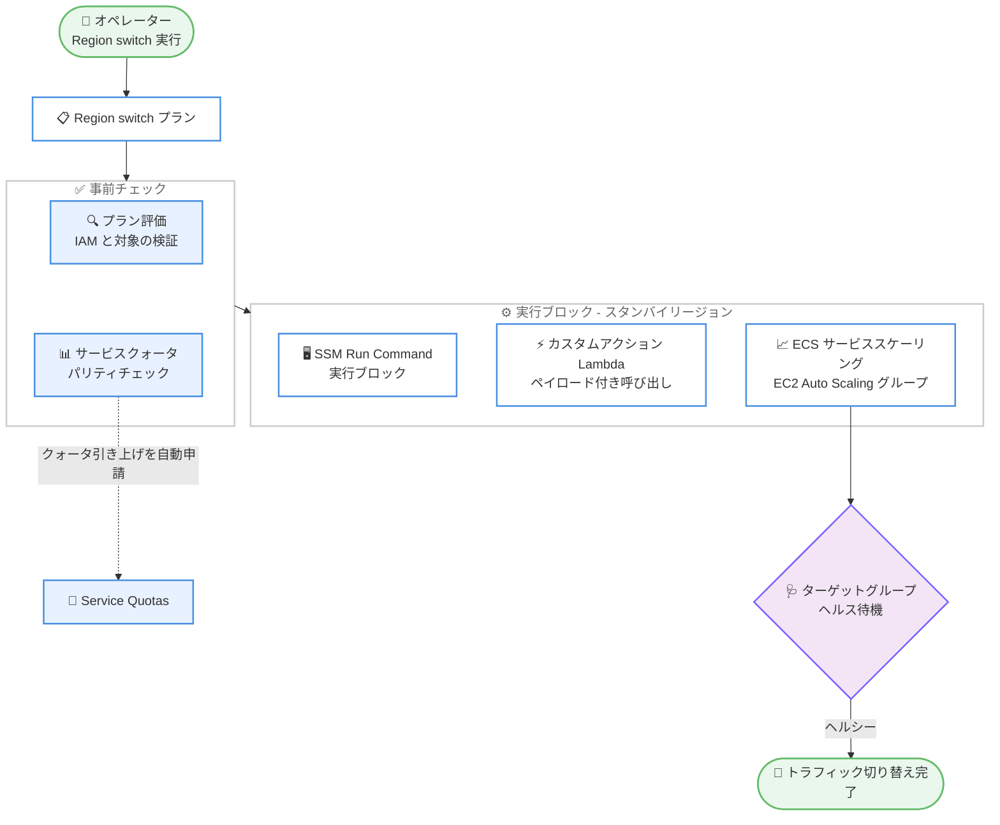

# Amazon Application Recovery Controller - Region switch の 4 つの新機能

**リリース日**: 2026 年 10 月 14 日
**サービス**: Amazon Application Recovery Controller (ARC)
**機能**: Region switch - SSM Run Command 実行ブロック、Lambda ペイロード、サービスクォータチェック、ターゲットグループヘルス待機

📊 [このアップデートのインフォグラフィックを見る](https://takech9203.github.io/aws-news-summary/20261014-region-switch-target-health-ssm-lambda.html)

## 概要

Amazon Application Recovery Controller (ARC) Region switch は、リージョン障害発生時にマルチリージョンアプリケーションのフェイルオーバーをオーケストレーションし、制限された復旧時間 (bounded recovery time) を実現する機能です。今回のアップデートで、Region switch に 4 つの新機能が追加されました。

追加されたのは、(1) AWS Systems Manager Run Command 実行ブロック、(2) カスタムアクション Lambda 実行ブロックへのペイロード渡し、(3) サービスクォータパリティチェック、(4) コンピューティングスケーリングアクションにおけるターゲットグループヘルス待機機能の 4 つです。マルチリージョン構成でディザスタリカバリ (DR) を運用するユーザーにとって、フェイルオーバーの自動化範囲が広がり、復旧の確実性が向上するアップデートです。

**アップデート前の課題**

- フェイルオーバー時にマネージドインスタンスや VM 上でコマンドを実行する必要がある場合、Region switch プランの外で手動またはカスタム実装により対応する必要があった
- カスタムアクション Lambda 実行ブロックにペイロードを渡せなかったため、復旧プランごとに専用の Lambda 関数を用意する必要があった
- サービスクォータの不足は復旧時の一般的な失敗要因であるにもかかわらず、プライマリリージョンとスタンバイリージョンのクォータ差異を事前に検出する仕組みがなかった
- Amazon ECS サービススケーリングや Amazon EC2 Auto Scaling グループの実行ブロックでキャパシティをプロビジョニングしても、そのキャパシティが実際にトラフィックを処理できる状態かを確認できなかった

**アップデート後の改善**

- SSM Run Command 実行ブロックにより、フェイルオーバー中にマネージドインスタンス上で Run Command アクションを実行できるようになった。プラン評価では、コマンドドキュメントが有効なインスタンスを対象としているか、IAM 権限が正しく設定されているかを検証する
- Lambda 実行ブロックにペイロードを渡せるようになり、複数の復旧プランをまたいで Lambda 関数を再利用できるようになった
- プライマリリージョンとスタンバイリージョン間のクォータパリティを検証し、クォータ引き上げリクエストを自動送信することで、復旧時のクォータ不足リスクを低減できるようになった
- オプションのターゲットグループヘルス待機機能により、プロビジョニングされたキャパシティがトラフィックを処理できる状態になったことを確認してから次のステップへ進めるようになった

## アーキテクチャ図



Region switch プランがフェイルオーバーを実行する流れを示しています。事前のプラン評価とクォータパリティチェックで失敗要因を排除し、SSM Run Command や Lambda などの実行ブロックで復旧処理を行い、ターゲットグループヘルス待機でキャパシティの受信可能状態を確認してから切り替えを完了します。

## サービスアップデートの詳細

### 主要機能

1. **AWS Systems Manager Run Command 実行ブロック**
   - フェイルオーバー中に、マネージドインスタンスや VM に対して Run Command アクションを実行できる実行ブロック
   - OS レベルの設定変更、サービスの起動、スクリプト実行などをフェイルオーバーワークフローに組み込める
   - プラン評価機能により、コマンドドキュメントが有効なインスタンスを対象としているか、IAM 権限が正しく設定されているかを事前に検証

2. **カスタムアクション Lambda 実行ブロックのペイロード対応**
   - カスタムアクション Lambda 実行ブロックの呼び出し時に、任意のペイロードを渡せるようになった
   - プランごとに異なるパラメータをペイロードで渡すことで、1 つの Lambda 関数を複数の復旧プランで再利用可能
   - 復旧プランごとに専用関数を作成・保守する運用負荷を削減

3. **サービスクォータチェック**
   - プライマリリージョンとスタンバイリージョン間のサービスクォータのパリティ (同等性) を検証
   - クォータが不足している場合は、クォータ引き上げリクエストを自動的に送信
   - 復旧時の一般的な失敗要因であるクォータ不足のリスクを事前に低減

4. **ターゲットグループヘルス待機**
   - Amazon ECS サービススケーリングおよび Amazon EC2 Auto Scaling グループ実行ブロックのオプション機能
   - プロビジョニングしたキャパシティがロードバランサーのターゲットグループでヘルシーになり、トラフィックを処理できる状態になるまで待機
   - 「キャパシティは起動したが、まだリクエストを処理できない」状態でのトラフィック切り替えを防止

## 技術仕様

### 新機能と対応する実行ブロック

| 新機能 | 関連する実行ブロック / 機能 |
|------|------|
| SSM Run Command 実行ブロック | 新規の実行ブロックとして追加 |
| Lambda ペイロード | カスタムアクション Lambda 実行ブロック |
| サービスクォータチェック | Region switch プランの評価機能 |
| ターゲットグループヘルス待機 | Amazon ECS サービススケーリング / Amazon EC2 Auto Scaling グループ実行ブロック |

### API 変更履歴

| 日付 | サービス | 変更内容 |
|------|----------|----------|
| 2026/10/14 | [ARC - Region switch](https://awsapichanges.com/archive/changes/fca45a-arc-region-switch.html) | 5 updated api methods - カスタムアクション Lambda 実行ブロックへのオプションペイロードのサポートを追加 |
| 2026/10/13 | [ARC - Region switch](https://awsapichanges.com/archive/changes/5f4e0c-arc-region-switch.html) | 6 updated api methods - Region switch プランにおける SSM 実行ブロックのサポートを追加 |

## 設定方法

### 前提条件

1. Amazon Application Recovery Controller の Region switch プランが作成済みであること
2. SSM Run Command 実行ブロックを使用する場合、対象インスタンスが AWS Systems Manager のマネージドインスタンスとして登録されていること
3. 各実行ブロックの実行に必要な IAM 権限 (SSM、Lambda、Service Quotas、ECS、EC2 Auto Scaling、Elastic Load Balancing など) が設定されていること

### 手順

#### ステップ 1: Region switch プランに SSM Run Command 実行ブロックを追加

ARC コンソールの Region switch プラン編集画面で、ワークフローに「AWS Systems Manager Run Command」実行ブロックを追加し、使用するコマンドドキュメントと対象インスタンス (ターゲット) を指定します。詳細は [SSM Run Command 実行ブロックのドキュメント](https://docs.aws.amazon.com/r53recovery/latest/dg/ssm-send-command-block.html)を参照してください。

#### ステップ 2: カスタムアクション Lambda 実行ブロックにペイロードを設定

既存または新規のカスタムアクション Lambda 実行ブロックで、呼び出し時に渡すペイロードを定義します。プランごとに異なるペイロードを設定することで、同一の Lambda 関数を複数プランで再利用できます。詳細は[カスタムアクション Lambda 実行ブロックのドキュメント](https://docs.aws.amazon.com/r53recovery/latest/dg/custom-action-lambda-block.html)を参照してください。

#### ステップ 3: サービスクォータチェックとターゲットグループヘルス待機を有効化

プランの評価設定でサービスクォータチェックを有効にし、プライマリリージョンとスタンバイリージョンのクォータパリティを検証します。また、Amazon ECS サービススケーリングまたは Amazon EC2 Auto Scaling グループ実行ブロックで、オプションの「ターゲットグループヘルス待機」を有効にします。詳細は[サービスクォータチェックのドキュメント](https://docs.aws.amazon.com/r53recovery/latest/dg/working-with-rs-service-quota-checks.html)を参照してください。

#### ステップ 4: プラン評価の結果を確認

プラン評価を実行し、コマンドドキュメントのターゲット、IAM 権限、クォータパリティに関する検出事項を確認して、必要な修正を行います。

## メリット

### ビジネス面

- **復旧の確実性向上**: クォータ不足やキャパシティの準備不足といった、本番フェイルオーバー時の典型的な失敗要因を事前に排除できる
- **RTO の予測可能性**: 手動オペレーションを実行ブロックとして自動化することで、制限された復旧時間の達成がより確実になる
- **運用コスト削減**: Lambda 関数の再利用により、復旧プランごとの実装・保守コストを削減できる

### 技術面

- **自動化範囲の拡大**: OS レベルの操作 (Run Command) までフェイルオーバーワークフローに組み込める
- **事前検証の強化**: プラン評価が SSM コマンドドキュメントのターゲットや IAM 権限を検証し、実行時エラーを未然に防ぐ
- **安全なトラフィック切り替え**: ターゲットグループヘルス待機により、キャパシティが実際にリクエストを処理できる状態になってから切り替えを進められる

## デメリット・制約事項

### 制限事項

- SSM Run Command 実行ブロックの対象は、AWS Systems Manager のマネージドインスタンスとして登録されたインスタンス・VM に限られる
- ターゲットグループヘルス待機はオプション機能であり、Amazon ECS サービススケーリングおよび Amazon EC2 Auto Scaling グループ実行ブロックが対象

### 考慮すべき点

- クォータ引き上げの自動申請は申請の送信を自動化するものであり、クォータの種類によっては承認に時間を要する場合があるため、定期的なプラン評価で事前にパリティを確保しておくことが望ましい
- ターゲットグループヘルス待機を有効にすると、ヘルスチェックが完了するまでワークフローが待機するため、プラン全体の実行時間への影響を考慮する必要がある
- 各実行ブロックに必要な IAM 権限を適切に設計し、プラン評価で検出された権限不足を解消しておく必要がある

## ユースケース

### ユースケース 1: EC2 上のレガシーアプリケーションを含むフェイルオーバーの自動化

**シナリオ**: スタンバイリージョンの EC2 インスタンス上で、フェイルオーバー時にアプリケーションサービスの起動や設定ファイルの切り替えを行う必要がある。

**実装例**:
```text
Region switch プランに SSM Run Command 実行ブロックを追加し、
サービス起動スクリプトを含む SSM ドキュメントを
スタンバイリージョンの対象インスタンスに対して実行するよう構成
```

**効果**: これまで手動またはカスタム実装が必要だった OS レベルの操作をプランに統合し、フェイルオーバー全体を一貫して自動化できる。

### ユースケース 2: 共通 Lambda 関数による複数プランの標準化

**シナリオ**: 複数のアプリケーションの復旧プランで、DNS 更新や外部システムへの通知など共通のカスタムアクションを実行したい。

**実装例**:
```json
{
  "application": "app-a",
  "action": "notify",
  "endpoint": "https://example.com/webhook"
}
```

**効果**: ペイロードでアプリケーション固有のパラメータを渡すことで、1 つの Lambda 関数を全プランで共有でき、保守対象のコードを大幅に削減できる。

### ユースケース 3: 大規模スケールアウトを伴う DR のクォータ・ヘルス担保

**シナリオ**: 平常時は最小構成のスタンバイリージョンを、フェイルオーバー時に大規模にスケールアウトするパイロットライト構成を運用している。

**実装例**:
```text
1. サービスクォータチェックを有効化し、プライマリとスタンバイの
   クォータパリティを定期的に検証
2. EC2 Auto Scaling グループ実行ブロックで
   ターゲットグループヘルス待機を有効化
```

**効果**: クォータ不足による起動失敗を未然に防ぎ、スケールアウトしたキャパシティがヘルシーになってからトラフィックを切り替えることで、復旧直後のエラー発生を回避できる。

## 料金

今回の発表に料金に関する記載はありません。Region switch の料金の詳細は [Amazon Application Recovery Controller の料金ページ](https://aws.amazon.com/application-recovery-controller/pricing/)を参照してください。なお、実行ブロックから呼び出される AWS Systems Manager、AWS Lambda、Amazon ECS、Amazon EC2 などの各サービスには、それぞれの料金が適用されます。

## 利用可能リージョン

すべての商用リージョンおよび AWS GovCloud (US) リージョンで利用可能です。詳細は[リージョン対応状況のドキュメント](https://docs.aws.amazon.com/r53recovery/latest/dg/aws-regions-rs.html)を参照してください。

## 関連サービス・機能

- **AWS Systems Manager Run Command**: マネージドインスタンス上でコマンドを安全かつ大規模に実行する機能。新しい実行ブロックの基盤
- **AWS Lambda**: カスタムアクション実行ブロックで任意の復旧処理を実装するためのサーバーレスコンピューティングサービス
- **Service Quotas**: リージョンごとのサービスクォータを管理するサービス。クォータパリティチェックと自動引き上げ申請に関連
- **Elastic Load Balancing / Amazon ECS / Amazon EC2 Auto Scaling**: ターゲットグループヘルス待機機能が連携するコンピューティング・ロードバランシングサービス

## 参考リンク

- 📊 [インフォグラフィック](https://takech9203.github.io/aws-news-summary/20261014-region-switch-target-health-ssm-lambda.html)
- [公式発表 (What's New)](https://aws.amazon.com/about-aws/whats-new/2026/10/region-switch-target-health-ssm-lambda/)
- [ドキュメント: AWS Systems Manager Run Command 実行ブロック](https://docs.aws.amazon.com/r53recovery/latest/dg/ssm-send-command-block.html)
- [ドキュメント: カスタムアクション Lambda 実行ブロック](https://docs.aws.amazon.com/r53recovery/latest/dg/custom-action-lambda-block.html)
- [ドキュメント: サービスクォータチェック](https://docs.aws.amazon.com/r53recovery/latest/dg/working-with-rs-service-quota-checks.html)
- [ドキュメント: Amazon ECS サービススケーリング実行ブロック](https://docs.aws.amazon.com/r53recovery/latest/dg/ecs-service-scaling-block.html)
- [ドキュメント: Amazon EC2 Auto Scaling グループ実行ブロック](https://docs.aws.amazon.com/r53recovery/latest/dg/ec2-auto-scaling-block.html)

## まとめ

ARC Region switch の今回のアップデートは、マルチリージョン DR における「本番フェイルオーバー時に初めて露見する失敗要因」であるクォータ不足、キャパシティの準備不足、手動オペレーションの残存を体系的に解消するものです。Region switch を利用中、または導入を検討しているユーザーは、サービスクォータチェックとターゲットグループヘルス待機を有効化し、SSM Run Command 実行ブロックと Lambda ペイロードを活用して復旧プランの自動化範囲を見直すことを推奨します。
