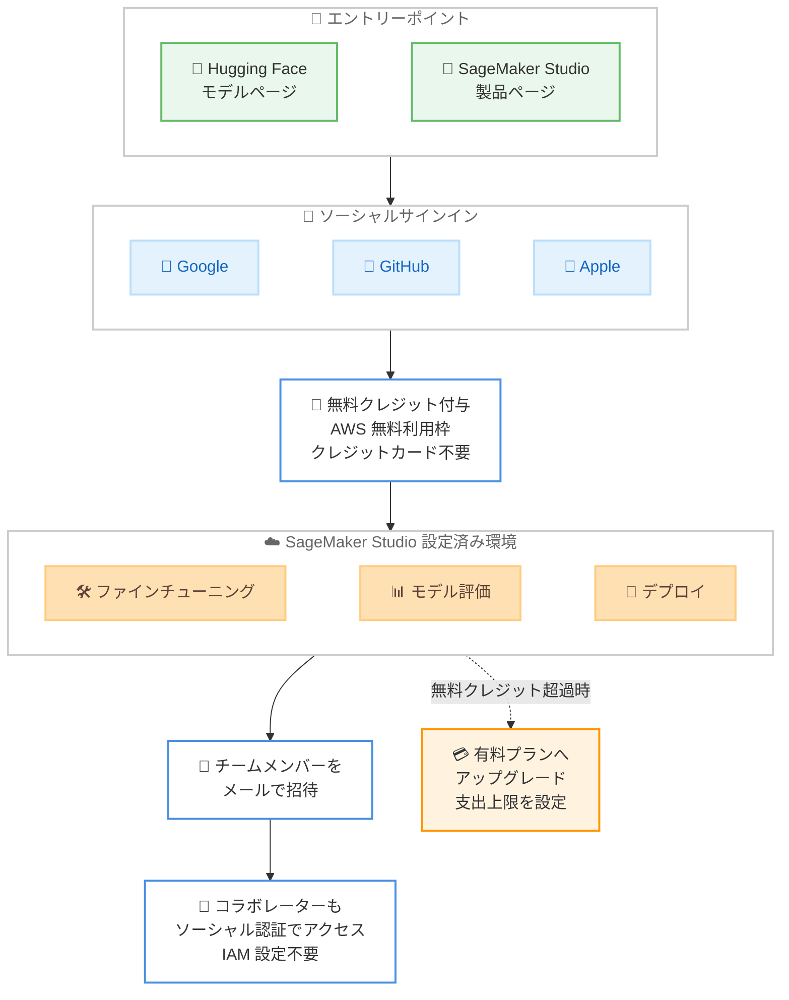

# Amazon SageMaker Studio - ソーシャルサインインによる新規 AI/ML ビルダー向けオンボーディング簡素化

**リリース日**: 2026 年 10 月 14 日
**サービス**: Amazon SageMaker Studio
**機能**: ソーシャルサインイン (Google / GitHub / Apple アカウントによるサインアップ)

📊 [このアップデートのインフォグラフィックを見る](https://takech9203.github.io/aws-news-summary/20261014-sagemaker-studio-social-sign-in.html)

## 概要

Amazon SageMaker Studio が、Google、GitHub、または Apple の既存アカウントを使ったサインアップに対応しました。新規ユーザーは従来の AWS アカウント作成手続きやクレジットカードの登録、AWS コンソールの操作を一切行うことなく、設定済みの SageMaker Studio 環境に直接アクセスできます。

サインアップが完了すると、AWS 無料利用枠の一部として無料クレジットが付与され (クレジットカード不要)、すぐに基盤モデルのファインチューニング、評価、デプロイを開始できます。さらに、メールでチームメンバーを招待でき、招待されたコラボレーターも自身のソーシャル認証情報でサインインするだけで、共有されたモデル、ノートブック、エンドポイントを含む Studio 環境にアクセスできます。IAM ユーザーや権限の設定は不要です。

このアップデートは、Hugging Face や AWS 製品ページでモデルを見つけた新規 AI/ML ビルダーが、最短の手順で実際のモデル開発を始められるようにする一連の改善 (20 秒での環境セットアップ、モデルカスタマイズ権限の事前設定、Hugging Face からのディープリンクなど) の集大成となるものです。

**アップデート前の課題**

- 以前は、新規ユーザーが SageMaker Studio を利用するには、複数ステップの AWS アカウント作成プロセスを完了し、クレジットカード情報を提供する必要があった
- AWS コンソールから SageMaker AI を探し、環境を構築し、IAM 権限を設定してから、ようやく作業を開始できた
- チームメンバーと環境を共有するには、IAM ユーザーの作成や権限設定といった管理作業が必要だった

**アップデート後の改善**

- Google、GitHub、Apple の既存アカウントで簡素化されたサインアップを完了し、すぐに利用可能な SageMaker Studio 環境に到達できるようになった
- クレジットカード登録なしで、AWS 無料利用枠の一部として無料クレジットを受け取れるようになった
- メール招待とソーシャルサインインだけで、IAM の設定なしにチームでの共同作業 (共有モデル、ノートブック、エンドポイントの利用) が可能になった
- プロジェクトが無料クレジットを超えて成長した場合は、有料プランにアップグレードし、支出上限を設定して予算内に収めることができる

## アーキテクチャ図



Hugging Face や製品ページからソーシャルサインインを経て、設定済みの SageMaker Studio 環境に直接到達するまでの流れを示しています。チーム招待や有料プランへのアップグレードもこのフローに統合されています。

## サービスアップデートの詳細

### 主要機能

1. **ソーシャルアカウントによるサインアップ**
   - Google、GitHub、Apple の既存の認証情報でサインアップが可能
   - 従来の AWS アカウント作成プロセス、クレジットカード登録、コンソール操作が不要
   - サインアップ完了後、設定済みの SageMaker Studio 環境に直接到達

2. **クレジットカード不要の無料クレジット**
   - AWS 無料利用枠の一部として無料クレジットを付与
   - 無料クレジットの範囲内で、基盤モデルのファインチューニング、評価、デプロイをすぐに開始可能
   - プロジェクトが無料クレジットを超えた場合は、有料プランにアップグレードし、支出上限 (spend limit) を設定して予算を管理可能

3. **IAM 設定不要のチームコラボレーション**
   - メールアドレスでチームメンバーを招待可能
   - コラボレーターは自身のソーシャル認証情報でサインインし、共有された Studio 環境にアクセス
   - 共有モデル、ノートブック、エンドポイントを、IAM ユーザーや権限の設定なしで利用可能

4. **デフォルトの GPU アクセス**
   - 検証済み (verified) のユーザーは、クォータ引き上げ申請なしで G5、G6、G6e、G4dn インスタンスへのデフォルトアクセスが可能
   - エンドポイントデプロイ、トレーニングジョブ、ノートブックのすべてで GPU を利用可能

## 技術仕様

### サインアップフローの比較

| 項目 | 従来の AWS アカウント作成 | ソーシャルサインイン |
|------|---------------------------|----------------------|
| 認証情報 | 新規 AWS アカウントの作成が必要 | Google / GitHub / Apple の既存アカウント |
| クレジットカード | 登録が必須 | 不要 |
| 環境構築 | コンソールで SageMaker AI を探して環境を設定 | 設定済み環境に直接到達 |
| IAM 設定 | ユーザー・権限の設定が必要 | 不要 |
| チーム共有 | IAM ユーザーの作成・権限管理が必要 | メール招待 + ソーシャルサインイン |
| GPU クォータ | 引き上げ申請が必要な場合あり | 検証済みユーザーは G5 / G6 / G6e / G4dn にデフォルトアクセス |

### 利用可能な GPU インスタンス

| インスタンスファミリー | 主な用途 |
|------------------------|----------|
| G5 | NVIDIA A10G GPU 搭載。モデルのファインチューニング・推論 |
| G6 | NVIDIA L4 GPU 搭載。コスト効率の高い推論 |
| G6e | NVIDIA L40S GPU 搭載。大規模モデルの推論・ファインチューニング |
| G4dn | NVIDIA T4 GPU 搭載。エントリーレベルの GPU ワークロード |

## 設定方法

### 前提条件

1. Google、GitHub、または Apple のいずれかのアカウントを保有していること
2. 新規ユーザーとしてサインアップすること (本機能は新規ユーザー向けのオンボーディングフロー)

### 手順

#### ステップ 1: エントリーポイントからアクセス

以下のいずれかの方法で SageMaker Studio のサインアップを開始します。

- [Hugging Face](https://huggingface.co/models) でサポート対象のモデルを開き、[Customize and Deploy on SageMaker AI] または [Deploy on SageMaker AI] を選択
- [SageMaker Studio 製品ページ](https://aws.amazon.com/sagemaker/ai/studio/) で [Get Started] をクリック

#### ステップ 2: ソーシャルアカウントでサインアップ

Google、GitHub、Apple のいずれかの既存アカウントを選択し、簡素化されたサインアップを完了します。クレジットカードの登録は不要で、AWS 無料利用枠の一部として無料クレジットが付与されます。

#### ステップ 3: SageMaker Studio で開発を開始

サインアップ完了後、すぐに利用可能な SageMaker Studio 環境に到達します。Hugging Face から遷移した場合はモデルがプリロードされた状態で、基盤モデルのファインチューニング、評価、デプロイを開始できます。

#### ステップ 4: チームメンバーの招待 (任意)

メールアドレスでチームメンバーを招待します。招待されたメンバーは自身のソーシャル認証情報でサインインし、共有モデル、ノートブック、エンドポイントを含む Studio 環境にアクセスできます。

## メリット

### ビジネス面

- **参入障壁の大幅な低減**: クレジットカード不要・アカウント作成不要で、AI/ML 開発を試したい個人やスタートアップがすぐに着手できる
- **コスト管理の安心感**: 無料クレジットから開始し、有料プラン移行時も支出上限を設定できるため、予算超過のリスクを抑えられる
- **チーム立ち上げの迅速化**: メール招待だけでコラボレーションを開始でき、管理者による IAM 設計・運用の負担がない

### 技術面

- **環境構築の自動化**: 設定済みの Studio 環境が提供されるため、環境セットアップや権限設定の作業が不要
- **GPU リソースへの即時アクセス**: 検証済みユーザーはクォータ引き上げ申請なしで G5 / G6 / G6e / G4dn インスタンスを利用可能
- **Hugging Face との統合**: モデル発見からファインチューニング・デプロイまでの導線がシームレスにつながる

## デメリット・制約事項

### 制限事項

- 本機能は新規ユーザー向けのオンボーディングフローであり、既存の AWS アカウント運用をソーシャルサインインに置き換えるものではない
- デフォルトの GPU アクセスは検証済み (verified) ユーザーが対象
- 利用可能なのは AWS 商用リージョンのうち SageMaker Studio がサポートされているリージョンに限られる

### 考慮すべき点

- エンタープライズ環境で求められる細かなアクセス制御 (IAM ポリシーによる最小権限設計など) が必要な場合は、従来の AWS アカウントベースの運用を検討する必要がある
- 無料クレジットを使い切った後の継続利用には、有料プランへのアップグレードが必要
- 組織のセキュリティポリシーによっては、ソーシャルアカウントによる業務利用が制限される場合がある

## ユースケース

### ユースケース 1: Hugging Face で見つけたモデルの即時ファインチューニング

**シナリオ**: AI/ML を学び始めた開発者が Hugging Face で興味のあるモデルを発見し、すぐにカスタマイズを試したい。

**実装例**:
```text
1. Hugging Face のモデルページで [Customize and Deploy on SageMaker AI] を選択
2. GitHub アカウントでサインアップ
3. モデルがプリロードされた Studio 環境でファインチューニングを実行
```

**効果**: AWS アカウント作成や環境構築に時間を取られることなく、モデル発見から数分でファインチューニングを開始できる。

### ユースケース 2: スタートアップでのプロトタイプ開発とチーム共有

**シナリオ**: 少人数のスタートアップが、基盤モデルを使ったプロダクトのプロトタイプを短期間で開発し、チームで検証したい。

**実装例**:
```text
1. 代表者が Google アカウントでサインアップし、無料クレジットで開発を開始
2. チームメンバーをメールで招待
3. メンバーは各自のソーシャル認証情報でサインインし、共有ノートブックとエンドポイントで検証
```

**効果**: IAM の設計・運用なしでチーム開発を開始でき、インフラ管理ではなくプロダクト開発に集中できる。

### ユースケース 3: 無料クレジットから本番利用へのスムーズな移行

**シナリオ**: 無料クレジットで検証したモデルの手応えが得られ、本格的なトレーニングとデプロイに進みたい。

**実装例**:
```text
1. 無料クレジットの範囲でモデルの評価・検証を完了
2. 有料プランにアップグレードし、月次の支出上限を設定
3. G5 / G6e などの GPU インスタンスでトレーニングジョブとエンドポイントを拡大
```

**効果**: 支出上限により予算内でのスケールアップが可能になり、クォータ引き上げ申請なしで GPU リソースを拡大できる。

## 料金

サインアップ時に AWS 無料利用枠の一部として無料クレジットが付与され、クレジットカードの登録は不要です。プロジェクトが無料クレジットを超えて成長した場合は、有料プランにアップグレードできます。その際、支出上限 (spend limit) を設定して予算内に収めることができます。

SageMaker AI 自体の利用料金は、使用するインスタンスタイプと稼働時間に基づく従量課金です。詳細は [Amazon SageMaker AI の料金ページ](https://aws.amazon.com/sagemaker/ai/pricing/) を参照してください。

## 利用可能リージョン

Amazon SageMaker Studio がサポートされているすべての AWS 商用リージョンで利用可能です。

## 関連サービス・機能

- **Amazon SageMaker JumpStart**: 基盤モデルのカタログとワンクリックデプロイを提供。プリロードされたモデルのカスタマイズ基盤として連携
- **AWS 無料利用枠**: 本機能で付与される無料クレジットの提供元。クレジットカード不要でのサインアップを実現
- **Hugging Face 連携**: モデルページの [Deploy on SageMaker AI] ボタンから Studio へのディープリンクを提供し、モデル発見から開発までをシームレスに接続

## 参考リンク

- 📊 [インフォグラフィック](https://takech9203.github.io/aws-news-summary/20261014-sagemaker-studio-social-sign-in.html)
- [公式発表 (What's New)](https://aws.amazon.com/about-aws/whats-new/2026/10/sagemaker-studio-social-sign-in/)
- [AWS サインアップドキュメント](https://docs.aws.amazon.com/accounts/latest/reference/sign-in-new.html)
- [SageMaker Studio セットアップガイド](https://docs.aws.amazon.com/sagemaker/latest/dg/onboard-quick-start.html)
- [SageMaker Studio 製品ページ](https://aws.amazon.com/sagemaker/ai/studio/)
- [Amazon SageMaker AI 料金ページ](https://aws.amazon.com/sagemaker/ai/pricing/)

## まとめ

本アップデートにより、新規 AI/ML ビルダーは Google、GitHub、Apple の既存アカウントだけで、クレジットカード登録や IAM 設定なしに SageMaker Studio での基盤モデル開発を開始できるようになりました。AI/ML 開発の参入障壁を大きく下げる重要な改善であり、これから SageMaker を試すユーザーには Hugging Face のモデルページまたは SageMaker Studio 製品ページからのサインアップを推奨します。既存のエンタープライズ利用者にとっても、社内の検証・学習用途のオンボーディング手段として検討する価値があります。
