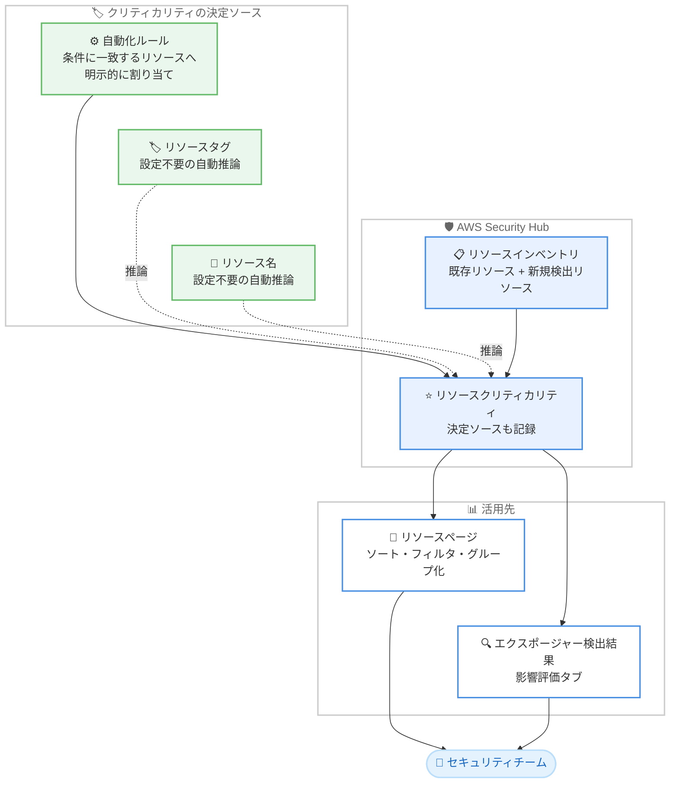

# AWS Security Hub - リソースクリティカリティによるエクスポージャー優先順位付け

**リリース日**: 2026 年 10 月 14 日
**サービス**: AWS Security Hub
**機能**: リソースクリティカリティ (Resource Criticality) によるエクスポージャーの優先順位付け

📊 [このアップデートのインフォグラフィックを見る](https://takech9203.github.io/aws-news-summary/20261014-security-hub-resource-criticality.html)

## 概要

AWS Security Hub が、エクスポージャー (Exposure) の優先順位付けにリソースクリティカリティ (リソースの重要度) を追加しました。これにより、中央のセキュリティチームは、ビジネス上最も重要なリソースを脅かすエクスポージャーに集中して対応できるようになります。

クリティカリティは自動化ルールで設定できます。たとえば「特定のアカウント内のすべてのコンピューティングリソースを Very High としてマークする」といったルールを定義でき、ルールはインベントリ内の既存リソースと、Security Hub が新たに検出するリソースの両方に適用されます。さらに、Security Hub はリソースのタグやリソース名からクリティカリティを自動的に推論するため、設定なしでも利用でき、どのソースによって値が決定されたかも記録されます。

クリティカリティはリソースページの列として表示され、ソート・フィルタリング・グループ化に利用できるほか、エクスポージャー検出結果の影響評価 (Impact assessment) タブにも表示されます。本機能は Security Hub Essentials に追加料金なしで含まれ、すべてのお客様に対して常時有効です。

**アップデート前の課題**

- エクスポージャーの優先順位付けにリソースのビジネス上の重要度を直接反映する仕組みがなく、本番環境の重要リソースと検証環境のリソースのエクスポージャーが同列に扱われやすかった
- 大量のエクスポージャー検出結果の中から、ビジネスインパクトの大きいものを特定するには、タグや命名規則をもとに手動で突き合わせる必要があった
- リソースの重要度を管理するには、Security Hub の外部で独自の仕組みを構築・運用する必要があった

**アップデート後の改善**

- 自動化ルールにより、条件に一致するリソースへクリティカリティを一括かつ継続的に割り当てられるようになった (既存リソースと新規検出リソースの両方に適用)
- 設定なしでも、リソースのタグや名前からクリティカリティが自動的に推論されるようになった
- クリティカリティをリソースページでのソート・フィルタリング・グループ化や、エクスポージャー検出結果の影響評価に活用し、重要リソースを脅かすエクスポージャーから優先的に対応できるようになった

## アーキテクチャ図



自動化ルールによる明示的な割り当てと、タグ・リソース名からの自動推論によってリソースクリティカリティが決定され、リソースページとエクスポージャー検出結果の影響評価タブで優先順位付けに活用されます。

## サービスアップデートの詳細

### 主要機能

1. **自動化ルールによるクリティカリティの割り当て**
   - 条件に一致するリソースにクリティカリティを割り当てるルールを作成可能
   - 例: 特定のアカウント内のすべてのコンピューティングリソースを Very High としてマーク
   - ルールはインベントリ内の既存リソースと、Security Hub が新たに検出するリソースの両方に適用される

2. **タグ・リソース名からの自動推論**
   - Security Hub がリソースのタグとリソース名からクリティカリティを推論
   - 設定は一切不要で、すべてのお客様に対して常時有効
   - どのソース (ルール、タグ、名前) が値を決定したかが記録されるため、割り当ての根拠を追跡可能

3. **コンソールでの可視化と優先順位付け**
   - リソースページにクリティカリティ列が追加され、ソート・フィルタリング・グループ化に利用可能
   - エクスポージャー検出結果の影響評価 (Impact assessment) タブにクリティカリティが表示され、ビジネスインパクトを踏まえたトリアージが可能

## 技術仕様

### 機能の概要

| 項目 | 詳細 |
|------|------|
| 設定方法 | 自動化ルールによる明示的な割り当て、またはタグ・リソース名からの自動推論 |
| 推論の設定 | 不要 (常時有効) |
| 決定ソースの記録 | あり (どのソースが値を決定したかを記録) |
| 適用対象 | インベントリ内の既存リソースおよび新規検出リソース |
| 表示場所 | リソースページの列、エクスポージャー検出結果の影響評価タブ |
| 提供プラン | Security Hub Essentials に追加料金なしで含まれる |
| 有効化作業 | 不要 (すべてのお客様に対して常時有効) |

### API 変更履歴

| 日付 | サービス | 変更内容 |
|------|----------|----------|
| 2026/10/13 | [securityhub](https://awsapichanges.com/archive/changes/5f4e0c-securityhub.html) | 10 updated api methods - クリティカリティをサポートするための API の追加・更新。条件に一致するリソースへクリティカリティを割り当てる自動化ルールを作成でき、リソースとエクスポージャー検出結果にクリティカリティが含まれるようになった |

## 設定方法

### 前提条件

1. AWS Security Hub (Security Hub Essentials 以上) が有効化されていること
2. 自動化ルールを作成する場合、Security Hub の自動化ルールを管理できる IAM 権限があること
3. 組織全体で利用する場合、委任管理者アカウントからの設定を推奨

### 手順

#### ステップ 1: 自動推論されたクリティカリティを確認する

Security Hub コンソールのリソースページを開き、クリティカリティ列を確認します。タグやリソース名から推論された値が、設定なしで表示されます。列を使ってソート・フィルタリング・グループ化を行い、重要リソースの分布を把握します。

#### ステップ 2: 自動化ルールでクリティカリティを割り当てる

推論結果が組織の実態と合わない場合や、明示的に重要度を定義したい場合は、自動化ルールを作成します。たとえば「本番アカウント内のすべてのコンピューティングリソースを Very High にする」といった条件を定義します。ルールは既存リソースと今後検出されるリソースの両方に自動的に適用されます。

#### ステップ 3: エクスポージャー検出結果の影響評価で優先順位を判断する

エクスポージャー検出結果を開き、影響評価 (Impact assessment) タブで対象リソースのクリティカリティを確認します。クリティカリティの高いリソースに関わるエクスポージャーから優先的に修復対応を行います。

## メリット

### ビジネス面

- **ビジネスリスクに基づく優先順位付け**: 技術的な深刻度だけでなく、リソースのビジネス上の重要度を加味してエクスポージャーに対応できる
- **追加コストなし**: Security Hub Essentials に追加料金なしで含まれ、有効化作業も不要なため、すぐに価値を得られる
- **対応リソースの効率化**: 限られたセキュリティ人員を、最も重要なリソースを脅かすエクスポージャーに集中させられる

### 技術面

- **設定不要の自動推論**: タグやリソース名からクリティカリティが自動的に推論されるため、導入の初期コストが低い
- **継続的な適用**: 自動化ルールが新規検出リソースにも適用されるため、リソースの増減に追従した運用が可能
- **トレーサビリティ**: どのソースがクリティカリティを決定したかが記録され、割り当ての根拠を確認できる

## デメリット・制約事項

### 制限事項

- 本機能はエクスポージャー検出を含む Security Hub (Security Hub Essentials) の機能であり、Security Hub が利用可能なリージョンでの提供となる
- 自動推論はタグやリソース名に依存するため、タグ付けや命名規則が整備されていないリソースでは意図した重要度が推論されない可能性がある

### 考慮すべき点

- 推論された値が組織の実態と異なる場合があるため、自動化ルールによる明示的な割り当てで補正する運用を検討する
- 推論の精度を高めるために、環境や重要度を示すタグ付け・命名規則を組織全体で標準化しておくことが望ましい
- マルチアカウント環境では、委任管理者アカウントでルールを一元管理し、組織全体で一貫したクリティカリティ基準を適用することを推奨

## ユースケース

### ユースケース 1: 本番アカウントの重要リソースを最優先で保護

**シナリオ**: 多数の AWS アカウントを運用する企業で、本番アカウントのコンピューティングリソースに関わるエクスポージャーを最優先で修復したい。

**実装例**:
```text
1. 本番アカウントの ID を条件とする自動化ルールを作成
2. 対象のコンピューティングリソースのクリティカリティを Very High に設定
3. エクスポージャー検出結果を影響評価タブで確認し、Very High のリソースから対応
```

**効果**: 本番環境の重要リソースを脅かすエクスポージャーが明確に区別され、修復の優先順位付けが迅速になる。

### ユースケース 2: タグベースの自動推論による設定レスな優先順位付け

**シナリオ**: タグ付け規則が整備されている組織で、追加の設定作業なしにエクスポージャーの優先順位付けを始めたい。

**実装例**:
```text
1. 既存のタグ・命名規則のまま Security Hub のリソースページを確認
2. 自動推論されたクリティカリティ列でソート・フィルタリング
3. 推論結果と実態のずれがあるリソースのみ自動化ルールで補正
```

**効果**: 設定なしで即座にクリティカリティに基づく優先順位付けを開始でき、運用負担を最小限に抑えられる。

### ユースケース 3: 中央セキュリティチームによるトリアージの効率化

**シナリオ**: 中央のセキュリティチームが組織全体のエクスポージャーをトリアージしており、大量の検出結果からビジネスインパクトの大きいものを素早く特定したい。

**実装例**:
```text
1. リソースページでクリティカリティによるグループ化を実施
2. クリティカリティの高いリソース群に紐づくエクスポージャーを抽出
3. 影響評価タブでクリティカリティと決定ソースを確認し、対応順を決定
```

**効果**: トリアージの判断材料としてビジネス上の重要度を一貫して利用でき、対応までの時間を短縮できる。

## 料金

リソースクリティカリティは Security Hub Essentials に追加料金なしで含まれます。新たな有効化作業は不要で、すべてのお客様に対して常時有効です。Security Hub 自体の料金については、[AWS Security Hub の料金ページ](https://aws.amazon.com/security-hub/pricing/) を参照してください。

## 利用可能リージョン

Security Hub が利用可能なすべての AWS リージョンで利用できます。最新のリージョン情報は [AWS リージョン別サービス一覧](https://aws.amazon.com/about-aws/global-infrastructure/regional-product-services/) を参照してください。

## 関連サービス・機能

- **Security Hub エクスポージャー検出結果**: リソースの到達可能性や脆弱性などを組み合わせたエクスポージャーの検出機能で、今回クリティカリティが影響評価に加わった
- **Security Hub 自動化ルール**: クリティカリティの明示的な割り当てに使用するルール機能
- **AWS リソースタグ**: クリティカリティの自動推論のソースとなるメタデータで、タグ付け規則の整備が推論精度の向上につながる
- **AWS Organizations**: マルチアカウント環境で Security Hub を一元管理し、組織全体で一貫したクリティカリティ運用を実現

## 参考リンク

- 📊 [インフォグラフィック](https://takech9203.github.io/aws-news-summary/20261014-security-hub-resource-criticality.html)
- [公式発表 (What's New)](https://aws.amazon.com/about-aws/whats-new/2026/10/security-hub-resource-criticality/)
- [AWS Security Hub ユーザーガイド](https://docs.aws.amazon.com/securityhub/latest/userguide/what-is-securityhub-v2.html)
- [AWS Security Hub 製品ページ](https://aws.amazon.com/security-hub/)
- [AWS リージョン別サービス一覧](https://aws.amazon.com/about-aws/global-infrastructure/regional-product-services/)

## まとめ

本アップデートにより、AWS Security Hub のエクスポージャー優先順位付けにリソースのビジネス上の重要度を反映できるようになりました。追加料金・設定なしで自動推論が常時有効となるため、まずはリソースページでクリティカリティの推論結果を確認し、必要に応じて自動化ルールで組織の基準に合わせた割り当てを整備することを推奨します。
