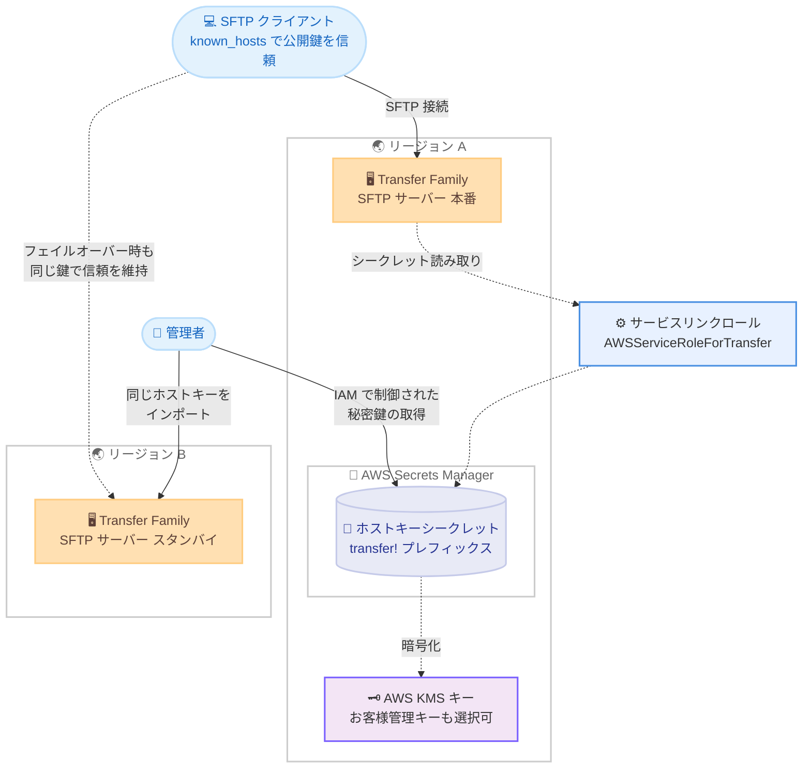

# AWS Transfer Family - SFTP サーバーホストキーの AWS Secrets Manager 保存サポート

**リリース日**: 2026 年 10 月 14 日
**サービス**: AWS Transfer Family
**機能**: SFTP サーバーホストキーの AWS Secrets Manager ストレージサポート

📊 [このアップデートのインフォグラフィックを見る](https://takech9203.github.io/aws-news-summary/20261014-transfer-family-secrets-host-keys.html)

## 概要

AWS Transfer Family が、SFTP サーバーのホストキーを自身の AWS アカウント内の AWS Secrets Manager に保存する機能をサポートしました。ホストキーは SFTP サーバーの一意な識別情報を提供する秘密鍵であり、クライアントの `known_hosts` ファイルに登録された公開鍵と照合することで、接続先が正しいサーバーであることを保証します。

これまで Transfer Family はホストキーをサービス内部に保存しており、ユーザーは関連する秘密鍵マテリアルを取り出すことができませんでした。今回のアップデートにより、サーバー作成時、ホストキーのインポート時、または既存ホストキーの更新時に、ストレージタイプとして Secrets Manager を選択できるようになります。保存された秘密鍵マテリアルは取得可能で、複数のサーバーや AWS リージョン間で同じホストキーを再利用できます。これにより、クライアントに新しいホストキーを信頼させることなく、フェイルオーバー用のスタンバイサーバーや移行時の代替サーバーを運用できます。

誰がホストキーを取得できるかは AWS Identity and Access Management (IAM) ポリシーで制御でき、お客様が管理する AWS KMS キーによるシークレットの暗号化や、Secrets Manager でのアクセスの監査も可能です。サーバー移行、ディザスタリカバリ、マルチリージョン構成を運用する SFTP ワークロードの管理者にとって重要なアップデートです。

**アップデート前の課題**

- ホストキーは Transfer Family サービス内部にのみ保存され、秘密鍵マテリアルを取り出すことができなかった
- サーバーの再作成や別リージョンへの移行時に、外部で生成した鍵を事前に保管していない限り同じホストキーを再利用できず、クライアント側の `known_hosts` の更新が必要になるおそれがあった
- ホストキーマテリアルの暗号化キーをユーザー自身の KMS キーで管理したり、鍵へのアクセスを細かく監査したりすることができなかった

**アップデート後の改善**

- ストレージタイプとして `SECRETS_MANAGER` を選択すると、ホストキーが自アカウントの Secrets Manager シークレットに保存され、秘密鍵マテリアルを取得できるようになった
- 同じホストキーを複数のサーバーやリージョンで再利用できるため、クライアントに新しいホストキーを信頼させることなくフェイルオーバーや移行が可能になった
- IAM ポリシーで鍵の取得権限を制御でき、お客様管理の KMS キーによる暗号化にも対応した

## アーキテクチャ図



Transfer Family はサービスリンクロールを通じて Secrets Manager のシークレットからホストキーを読み取り、SFTP 接続に使用します。管理者は IAM で制御された権限により秘密鍵を取得し、別リージョンのスタンバイサーバーに同じホストキーをインポートできるため、クライアントは `known_hosts` を変更することなく接続先を切り替えられます。

## サービスアップデートの詳細

### 主要機能

1. **Secrets Manager ストレージタイプの選択**
   - サーバー作成時 (`CreateServer` の `HostKeyStorageType`)、ホストキーのインポート時 (`ImportHostKey` の `StorageType`)、既存キーの更新時 (`UpdateHostKey` の `StorageType`) に `SERVICE_MANAGED` または `SECRETS_MANAGER` を指定可能
   - AWS Transfer Family コンソールで新規サーバーを作成する場合のデフォルトは Secrets Manager ストレージ
   - AWS CLI / API で `HostKeyStorageType` を指定しない場合のデフォルトは従来どおり `SERVICE_MANAGED`

2. **秘密鍵マテリアルの取得と再利用**
   - Secrets Manager に保存されたホストキーの秘密鍵マテリアルを取得し、複数のサーバーや AWS リージョンで同じホストキーを再利用可能
   - フェイルオーバー用スタンバイサーバーや移行先サーバーで同一のサーバーアイデンティティを維持でき、クライアントの `known_hosts` 更新が不要
   - 鍵の取得権限は IAM ポリシーで制御可能

3. **お客様管理の KMS キーによる暗号化**
   - `ImportHostKey` / `UpdateHostKey` のオプションパラメータ `KmsKey` に KMS キーの ARN を指定すると、お客様管理キーでシークレットを暗号化
   - 指定しない場合は Secrets Manager の AWS マネージドキーを使用
   - 既存の Secrets Manager 保存キーに対して `UpdateHostKey` で `KmsKey` を変更すると、新しいキーで再暗号化される

4. **マネージドシークレットとしてのライフサイクル管理**
   - Transfer Family が `transfer!` プレフィックス付きのシークレットをユーザーアカウント内に作成し、ライフサイクルを管理
   - シークレットには `aws:transfer:owningServerArn`、`aws:transfer:owningHostKeyArn`、`aws:secretsmanager:owningService=transfer` のタグが付与され、アクセスのスコープ設定やフィルタリングに利用可能
   - 初回利用時にサービスリンクロール `AWSServiceRoleForTransfer` が作成され、Transfer Family はこのロールでシークレットを読み取って接続時にホストキーを提供

## 技術仕様

### ホストキーストレージタイプの比較

| 項目 | SERVICE_MANAGED | SECRETS_MANAGER |
|------|-----------------|-----------------|
| 鍵マテリアルの保存場所 | Transfer Family サービス内部 | 自アカウントの Secrets Manager シークレット |
| 秘密鍵マテリアルの取得 | 不可 | 可能 (IAM ポリシーで制御) |
| 暗号化キー | サービス管理 | AWS マネージドキーまたはお客様管理の KMS キー |
| CLI / API 作成時のデフォルト | ○ | - |
| コンソール作成時のデフォルト | - | ○ |
| 複数サーバー / リージョンでの鍵の再利用 | 不可 | 可能 |

### サポートされるホストキータイプ

| キータイプ | 有効になるアルゴリズム |
|-----------|----------------------|
| RSA | rsa-* 系アルゴリズム |
| ECDSA | ecdsa-* 系アルゴリズム |
| ED25519 | ed25519 アルゴリズム |

### API 変更履歴

| 日付 | サービス | 変更内容 |
|------|----------|----------|
| 2026/10/14 | [AWS Transfer Family](https://awsapichanges.com/archive/changes/fca45a-transfer.html) | 5 updated api methods - `CreateServer` に `HostKeyStorageType`、`ImportHostKey` / `UpdateHostKey` に `StorageType` と `KmsKey`、`DescribeHostKey` / `ListHostKeys` のレスポンスに `StorageType` と `SecretId` が追加 |

### お客様管理の KMS キーポリシー例

お客様管理キーでシークレットを暗号化する場合、サービスリンクロールに `kms:Decrypt` を許可するステートメントをキーポリシーに追加する必要があります。

```json
{
  "Sid": "Enable Transfer SLR to access",
  "Effect": "Allow",
  "Principal": {
    "AWS": "arn:aws:iam::111122223333:role/aws-service-role/transfer.amazonaws.com/AWSServiceRoleForTransfer"
  },
  "Action": "kms:Decrypt",
  "Resource": "*",
  "Condition": {
    "StringEquals": {
      "kms:ViaService": "secretsmanager.us-east-1.amazonaws.com"
    },
    "StringLike": {
      "kms:EncryptionContext:SecretARN": "arn:aws:secretsmanager:us-east-1:111122223333:secret:transfer!*"
    }
  }
}
```

条件句により、この許可は Secrets Manager が Transfer Family に代わって行う呼び出しで、かつ `transfer!` で始まる名前のシークレットに限定されます。

## 設定方法

### 前提条件

1. AWS Transfer Family の SFTP 対応サーバーを作成する権限があること
2. 初回利用時にサービスリンクロールを作成するため、IAM アイデンティティに `iam:CreateServiceLinkedRole` 権限があること
3. `UpdateHostKey` で `StorageType` に `SECRETS_MANAGER` を指定する場合、IAM アイデンティティに `transfer:ExportHostKey` 権限があること (API 操作に対応しない権限専用アクション)
4. お客様管理の KMS キーを使用する場合、キーポリシーの更新権限があること

### 手順

#### ステップ 1: Secrets Manager ストレージを指定してサーバーを作成

```bash
aws transfer create-server \
  --protocols SFTP \
  --identity-provider-type SERVICE_MANAGED \
  --host-key-storage-type SECRETS_MANAGER
```

SFTP 対応サーバーを作成し、ホストキーのストレージタイプとして Secrets Manager を指定しています。ホストキーを提供しない場合は Transfer Family が自動生成し、`transfer!` プレフィックス付きのシークレットとしてアカウント内に保存します。

#### ステップ 2: 既存のホストキーを Secrets Manager にインポート

```bash
aws transfer import-host-key \
  --server-id s-1234567890abcdef0 \
  --host-key-body file://my-host-key \
  --storage-type SECRETS_MANAGER \
  --kms-key arn:aws:kms:us-east-1:111122223333:key/your-key-id \
  --description "Migrated host key"
```

オンプレミスサーバーなどで使用していた既存のホストキーをインポートし、Secrets Manager に保存しています。`--kms-key` でお客様管理の KMS キーを指定すると、シークレットがそのキーで暗号化されます (省略時は AWS マネージドキー)。

#### ステップ 3: ホストキーのストレージ情報を確認

```bash
aws transfer describe-host-key \
  --server-id s-1234567890abcdef0 \
  --host-key-id hostkey-1234567890abcdef0
```

ホストキーの詳細を確認しています。レスポンスの `StorageType` にストレージタイプが、Secrets Manager 保存の場合は `SecretId` に対応するシークレットの ID が含まれます。この `SecretId` を使用して、IAM で許可されたユーザーが Secrets Manager から秘密鍵マテリアルを取得できます。

#### ステップ 4: 既存の Secrets Manager 保存キーのストレージタイプや暗号化キーを更新

```bash
aws transfer update-host-key \
  --server-id s-1234567890abcdef0 \
  --host-key-id hostkey-1234567890abcdef0 \
  --storage-type SECRETS_MANAGER \
  --kms-key arn:aws:kms:us-east-1:111122223333:key/new-key-id \
  --description "Re-encrypted host key"
```

既存ホストキーのストレージタイプを変更、または暗号化に使用する KMS キーを変更しています。新しい `KmsKey` を指定すると、Transfer Family がシークレットを新しいキーで再暗号化します。この操作には `transfer:ExportHostKey` 権限が必要です。

## メリット

### ビジネス面

- **ダウンタイムのない移行とフェイルオーバー**: 同じホストキーを複数サーバー・リージョンで再利用できるため、クライアント側の設定変更や再検証なしにサーバーを切り替えられ、取引先との SFTP 連携を中断させない
- **コンプライアンス対応の強化**: ホストキーへのアクセスを IAM で制御し、Secrets Manager / KMS 経由で監査できるため、鍵管理に関する統制要件を満たしやすくなる
- **運用負荷の軽減**: クライアントの `known_hosts` 更新調整という、多数の外部パートナーが関わる作業が不要になる

### 技術面

- **サーバーアイデンティティの完全な制御**: 秘密鍵マテリアルを自アカウントで保持し、Transfer Family 以外のサーバーも含めて将来の再利用に備えられる
- **お客様管理 KMS キーによる暗号化**: 鍵マテリアルの暗号化キーを自身で管理し、キーポリシーでアクセスを制御可能
- **タグによるアクセススコープ設定**: `aws:transfer:owningServerArn` などのタグを利用して、IAM ポリシーでシークレットへのアクセスを細かく制限可能

## デメリット・制約事項

### 制限事項

- 既存ホストキーのストレージタイプを `SERVICE_MANAGED` から `SECRETS_MANAGER` に変更できるのは、2026 年 10 月 14 日以降にインポートされたホストキーのみ。それより古いキーを移行するには、AWS アカウント ID を添えて AWS サポートに例外申請が必要
- Transfer Family が作成するシークレットはマネージドシークレットであり、Secrets Manager コンソールから値を変更したり、Secrets Manager の自動ローテーション機能を使用したりすることはできない。ローテーションは新しいホストキーのインポートと古いキーの削除で行う
- `transfer:ExportHostKey` は API 操作に対応しない権限専用アクションであり、`UpdateHostKey` で `StorageType` に `SECRETS_MANAGER` を指定するたびに必要 (既に Secrets Manager 保存のキーでも同様)

### 考慮すべき点

- シークレットを手動で削除すると Transfer Family がホストキーを読み取れなくなり、SFTP サーバーへの接続が中断されるため、削除は `DeleteHostKey` API で行う
- サービスリンクロールのシークレットまたは KMS キーへのアクセスを取り消すと、新規接続が失敗する
- お客様管理の KMS キーを使用する場合は、キーポリシーに `AWSServiceRoleForTransfer` への `kms:Decrypt` 許可を追加する必要がある
- ホストキーに対する操作は結果整合性で反映される
- 秘密鍵マテリアルを取得できるようになるため、IAM ポリシーで取得権限を最小限に絞ることが重要

## ユースケース

### ユースケース 1: マルチリージョンのディザスタリカバリ構成

**シナリオ**: 米国東部 (オハイオ) と米国西部 (オレゴン) に同じ DNS 名を共有する Transfer Family サーバーを配置し、障害時に DNS 切り替えでフェイルオーバーする。

**実装例**:
```bash
# プライマリリージョンでホストキーを Secrets Manager に保存
aws transfer import-host-key --region us-east-2 \
  --server-id s-primary --host-key-body file://shared-host-key \
  --storage-type SECRETS_MANAGER

# 同じ鍵をスタンバイリージョンのサーバーにもインポート
aws transfer import-host-key --region us-west-2 \
  --server-id s-standby --host-key-body file://shared-host-key \
  --storage-type SECRETS_MANAGER
```

**効果**: 両リージョンのサーバーが同一のホストキーを提示するため、フェイルオーバー時もクライアントの認証エラーや警告が発生せず、シームレスに切り替えられる。

### ユースケース 2: オンプレミス SFTP サーバーからの移行

**シナリオ**: 多数の取引先が接続するオンプレミス SFTP サーバーを Transfer Family に移行するが、取引先側の `known_hosts` 更新を依頼できない。

**実装例**:
```bash
# オンプレミスサーバーのホストキーを Transfer Family にインポート
aws transfer import-host-key \
  --server-id s-1234567890abcdef0 \
  --host-key-body file://onpremises-host-key \
  --storage-type SECRETS_MANAGER \
  --description "Imported from on-premises server"
```

**効果**: 取引先は従来と同じホストキーで接続を継続でき、中間者攻撃の警告や接続スクリプトの失敗なしに移行が完了する。鍵マテリアルは Secrets Manager に保存されるため、将来の再移行にも備えられる。

### ユースケース 3: 鍵管理の統制強化と監査

**シナリオ**: 金融機関のセキュリティ要件として、SFTP サーバーの秘密鍵をお客様管理の KMS キーで暗号化し、鍵へのアクセスを監査する必要がある。

**実装例**:
```json
{
  "Effect": "Deny",
  "Action": "secretsmanager:GetSecretValue",
  "Resource": "arn:aws:secretsmanager:*:111122223333:secret:transfer!*",
  "Condition": {
    "StringNotEquals": {
      "aws:PrincipalArn": "arn:aws:iam::111122223333:role/KeyAdminRole"
    }
  }
}
```

**効果**: ホストキーの取得を特定のロールに限定し、CloudTrail で Secrets Manager / KMS へのアクセスを監査できるため、鍵管理に関するコンプライアンス要件を満たせる。

## 料金

Transfer Family 自体のこの機能に対する追加料金の発表はありません。ホストキーのシークレットはユーザーアカウント内の AWS Secrets Manager に作成されるため、Secrets Manager の標準料金 (シークレットごとの月額料金および API 呼び出し料金) が適用されると考えられます。また、お客様管理の KMS キーを使用する場合は AWS KMS の料金が適用されます。詳細は各サービスの料金ページを確認してください。

## 利用可能リージョン

AWS Transfer Family が利用可能なすべての AWS リージョンで利用できます。

## 関連サービス・機能

- **AWS Secrets Manager**: ホストキーの秘密鍵マテリアルを `transfer!` プレフィックス付きのマネージドシークレットとして保存し、アクセス制御と監査を提供
- **AWS Key Management Service (KMS)**: シークレットの暗号化に AWS マネージドキーまたはお客様管理キーを使用可能
- **AWS Identity and Access Management (IAM)**: 鍵の取得権限や `transfer:ExportHostKey` 権限の制御、サービスリンクロール `AWSServiceRoleForTransfer` による Transfer Family のシークレットアクセス
- **AWS CloudTrail**: Secrets Manager および KMS への API 呼び出しの監査に利用可能

## 参考リンク

- 📊 [インフォグラフィック](https://takech9203.github.io/aws-news-summary/20261014-transfer-family-secrets-host-keys.html)
- [公式発表 (What's New)](https://aws.amazon.com/about-aws/whats-new/2026/10/transfer-family-secrets-host-keys/)
- [ドキュメント: Manage host keys for your SFTP-enabled server](https://docs.aws.amazon.com/transfer/latest/userguide/configuring-servers-change-host-key.html)
- [ドキュメント: Store SFTP server host keys in AWS Secrets Manager](https://docs.aws.amazon.com/transfer/latest/userguide/server-host-key-storage.html)
- [API 変更詳細 (awsapichanges.com)](https://awsapichanges.com/archive/changes/fca45a-transfer.html)
- [AWS Transfer Family 料金ページ](https://aws.amazon.com/aws-transfer-family/pricing/)
- [AWS Secrets Manager 料金ページ](https://aws.amazon.com/secrets-manager/pricing/)

## まとめ

SFTP サーバーのホストキーを自アカウントの Secrets Manager で管理できるようになり、これまで不可能だった秘密鍵マテリアルの取得と複数サーバー・リージョン間での再利用が実現しました。マルチリージョンのフェイルオーバー構成やオンプレミスからの移行を計画している場合は、新規サーバーやホストキーのインポート時に `SECRETS_MANAGER` ストレージタイプの採用を検討してください。既存キーの移行は 2026 年 10 月 14 日以降にインポートされたキーに限られるため、古いキーの移行が必要な場合は AWS サポートへの申請も視野に入れることを推奨します。
