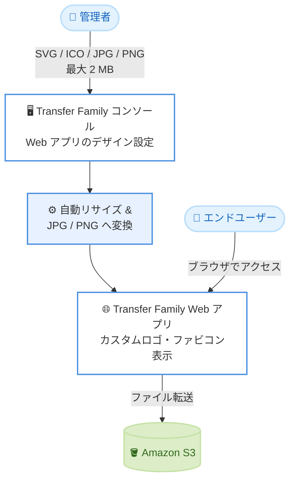

# AWS Transfer Family - Web アプリの SVG ロゴ・ICO ファビコン対応

**リリース日**: 2026 年 10 月 14 日
**サービス**: AWS Transfer Family
**機能**: コンソールでの Web アプリ向け SVG ロゴ / ICO ファビコンのアップロード対応

📊 [このアップデートのインフォグラフィックを見る](https://takech9203.github.io/aws-news-summary/20261014-transfer-family-svg-ico-favicons.html)

## 概要

AWS Transfer Family コンソールが、Web アプリのブランディングカスタマイズにおいて、ロゴ用の SVG ファイルとファビコン用の ICO ファイルのアップロードに対応しました。あわせて、アップロードサイズの上限が 2 MB に引き上げられています。これにより、企業が既に保有しているブランディングアセットをそのまま利用して Web アプリをカスタマイズしやすくなります。

Transfer Family Web アプリは、ブラウザ経由で Amazon S3 とデータを転送できるシンプルなインターフェイスを提供する機能です。ページタイトル、ロゴ、ファビコンをカスタマイズすることで、エンドユーザーに自社ブランドの体験を提供できます。今回のアップデートは、このカスタマイズ作業における画像ファイルの取り扱いを大幅に改善するものです。

コンソールはアップロードされた画像を自動的にリサイズし、JPG または PNG に変換してから保存します。なお、既存の API 経由でのアップロード制限とフォーマット要件は変更されていません。

**アップデート前の課題**

- 以前はコンソールで JPG と PNG ファイルのみ受け付けており、企業ロゴとして一般的な SVG ファイルや、ファビコンの標準形式である ICO ファイルを事前に変換する必要があった
- 以前はロゴのアップロード上限が 50 KB、ファビコンの上限が 20 KB と小さく、既存のブランディングアセットを縮小・圧縮する手間が発生していた
- 画像の変換・圧縮作業のために別途ツールを用意する必要があった

**アップデート後の改善**

- 今回のアップデートにより、ロゴに SVG ファイル、ファビコンに ICO ファイルを直接アップロードできるようになった
- 今回のアップデートにより、アップロード上限が 2 MB に引き上げられ、事前のファイルサイズ調整が不要になった
- コンソールが自動的に画像をリサイズして JPG または PNG に変換するため、手動での画像加工作業が不要になった

## アーキテクチャ図



管理者がコンソールから SVG や ICO 形式のブランディングアセットをアップロードすると、自動的にリサイズ・変換が行われ、エンドユーザー向けの Web アプリに反映されます。

## サービスアップデートの詳細

### 主要機能

1. **SVG ロゴのサポート**
   - Web アプリのロゴとして SVG ファイルを直接アップロード可能
   - ベクター形式の企業ロゴをそのまま利用でき、事前のラスタライズ変換が不要
   - 従来の JPG / PNG 形式も引き続き利用可能

2. **ICO ファビコンのサポート**
   - Web アプリのファビコンとして ICO ファイルを直接アップロード可能
   - 既存の Web サイトで使用しているファビコンをそのまま流用できる
   - 従来の JPG / PNG 形式も引き続き利用可能

3. **アップロード上限の引き上げと自動変換**
   - ロゴ・ファビコンともにアップロード上限が 2 MB に拡大
   - コンソールが画像を自動的にリサイズし、JPG または PNG に変換して保存
   - 手動での画像圧縮・リサイズ作業が不要に

## 技術仕様

### アップロード仕様の変更点

| 項目 | 変更前 | 変更後 |
|------|--------|--------|
| ロゴの対応形式 | JPG、PNG | JPG、PNG、SVG |
| ファビコンの対応形式 | JPG、PNG | JPG、PNG、ICO |
| ロゴのアップロード上限 | 50 KB | 2 MB |
| ファビコンのアップロード上限 | 20 KB | 2 MB |
| 保存形式 | JPG / PNG | JPG / PNG (自動変換) |
| API のアップロード制限・形式要件 | 変更なし | 変更なし |

### 注意事項

- 自動変換はコンソールからのアップロードに適用されます
- API 経由でブランディングアセットを設定する場合、既存のアップロード制限とフォーマット要件が引き続き適用されます

## 設定方法

### 前提条件

1. AWS IAM Identity Center のインスタンス (アカウントインスタンスまたは組織インスタンス) が設定済みであること
2. Web アプリで使用する Amazon S3 バケットが用意されていること
3. Transfer Family Web アプリを作成する権限を持つこと

### 手順

#### ステップ 1: Web アプリの作成またはデザイン設定を開く

Transfer Family コンソール (https://console.aws.amazon.com/transfer/) で [Web apps] を選択し、新規作成時は [Create web app]、既存の Web アプリの場合は対象を選択して編集画面に進みます。

#### ステップ 2: ロゴとファビコンをアップロード

[Design web app] ページで以下を設定します。

- **ページタイトル**: ブラウザのタブに表示されるタイトル (未入力の場合は「Transfer Web App」)
- **ロゴ**: SVG、JPG、PNG のいずれかの画像ファイルをアップロード (最大 2 MB)
- **ファビコン**: ICO、JPG、PNG のいずれかの画像ファイルをアップロード (最大 2 MB)

コンソールが画像を自動的にリサイズし、JPG または PNG に変換して保存します。

#### ステップ 3: 変更の確認

Web アプリのアクセスエンドポイントにブラウザでアクセスし、ロゴとファビコンが正しく表示されることを確認します。

## メリット

### ビジネス面

- **ブランド体験の向上**: 既存のブランディングアセットをそのまま使用でき、一貫性のあるブランド体験をエンドユーザーに提供できる
- **作業時間の短縮**: 画像の変換・圧縮作業が不要になり、Web アプリのセットアップが迅速化する
- **デザイン部門との連携簡素化**: デザイン部門から受領した SVG ロゴや ICO ファビコンを加工せずに利用できる

### 技術面

- **自動変換による簡素化**: コンソールがリサイズと形式変換を自動実行するため、画像処理の知識やツールが不要
- **上限緩和による柔軟性**: 2 MB までの高解像度アセットをアップロードでき、品質劣化を気にせず運用できる
- **後方互換性**: 従来の JPG / PNG もサポートされ、既存のワークフローへの影響がない

## デメリット・制約事項

### 制限事項

- アップロードされた画像は最終的に JPG または PNG に変換されるため、SVG のベクター特性 (拡大縮小時の品質維持) は保存後には引き継がれない
- API 経由のアップロードには従来の制限とフォーマット要件が引き続き適用される
- アップロード上限は 2 MB であり、それを超えるファイルは事前に圧縮が必要

### 考慮すべき点

- 自動リサイズ・変換後の見た目が意図通りか、実際の Web アプリ画面で確認することを推奨
- IaC (API / CloudFormation など) でブランディングを管理している場合は、コンソールとは異なる制限が適用される点に注意

## ユースケース

### ユースケース 1: 取引先向けファイル転送ポータルのブランディング

**シナリオ**: 製造業の企業が、取引先とのファイル授受のために Transfer Family Web アプリを利用している。コーポレートアイデンティティ部門からは SVG 形式のロゴのみが提供されている。

**実装例**:
```
1. コンソールで対象の Web アプリを選択
2. デザイン設定で SVG ロゴ (最大 2 MB) をアップロード
3. 自動変換された表示をアクセスエンドポイントで確認
```

**効果**: SVG から PNG への手動変換作業が不要になり、ブランドガイドラインに準拠したポータルを短時間で構築できる。

### ユースケース 2: 既存 Web サイトのファビコンの流用

**シナリオ**: 既存のコーポレートサイトで使用している ICO 形式のファビコンを、Transfer Family Web アプリにも適用して一貫したユーザー体験を提供したい。

**実装例**:
```
1. 既存サイトの favicon.ico を取得
2. コンソールのデザイン設定でファビコンとしてアップロード
3. ブラウザのタブ表示を確認
```

**効果**: 既存アセットの再利用により、ブラウザタブ上でも自社サービスとして認識されやすくなる。

### ユースケース 3: 高解像度ロゴによる品質改善

**シナリオ**: 従来は 50 KB の制限により低解像度に圧縮したロゴを使用しており、表示品質に課題があった。

**実装例**:
```
1. 高解像度のロゴ画像 (2 MB 以内) を用意
2. コンソールから再アップロード
3. 自動リサイズ後の表示品質を確認
```

**効果**: 事前圧縮による画質劣化を回避し、より鮮明なロゴ表示を実現できる。

## 料金

今回のアップデート自体に追加料金はありません。Transfer Family Web アプリの料金は、プロビジョニングした Web アプリユニット数に基づく従量課金です。詳細は [AWS Transfer Family の料金ページ](https://aws.amazon.com/aws-transfer-family/pricing/) を参照してください。

## 利用可能リージョン

Transfer Family Web アプリが提供されているすべての AWS リージョンで利用可能です。

## 関連サービス・機能

- **Amazon S3**: Web アプリ経由でファイルを転送する対象のストレージ。S3 Access Grants によるアクセス制御と連携
- **AWS IAM Identity Center**: Web アプリのユーザー認証基盤。外部 IdP (Okta など) との連携も可能
- **Amazon CloudFront**: カスタム URL を使用した Web アプリのブランド化で利用されるケースがある

## 参考リンク

- 📊 [インフォグラフィック](https://takech9203.github.io/aws-news-summary/20261014-transfer-family-svg-ico-favicons.html)
- [公式発表 (What's New)](https://aws.amazon.com/about-aws/whats-new/2026/10/transfer-family-svg-ico-favicons/)
- [ドキュメント: Transfer Family Web アプリのチュートリアル](https://docs.aws.amazon.com/transfer/latest/userguide/web-app-tutorial.html)
- [料金ページ](https://aws.amazon.com/aws-transfer-family/pricing/)

## まとめ

AWS Transfer Family コンソールが SVG ロゴと ICO ファビコンに対応し、アップロード上限も 2 MB に拡大されたことで、既存のブランディングアセットをそのまま活用した Web アプリのカスタマイズが容易になりました。Transfer Family Web アプリを運用中で、低解像度ロゴや形式変換の手間に課題を感じていた場合は、コンソールからアセットの再アップロードを検討することを推奨します。
