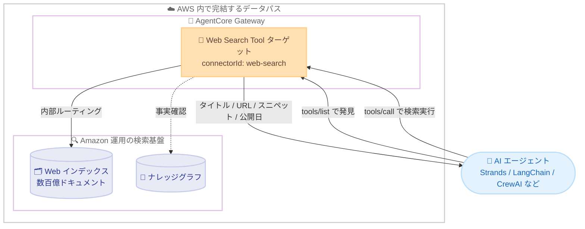

# Amazon Bedrock AgentCore - Web Search の AWS GovCloud および 3 リージョンへの拡大

**リリース日**: 2026 年 10 月 15 日
**サービス**: Amazon Bedrock AgentCore
**機能**: Web Search Tool のリージョン拡大 (米国東部オハイオ、米国西部オレゴン、アジアパシフィックシドニー、AWS GovCloud 米国西部)

📊 [このアップデートのインフォグラフィックを見る](https://takech9203.github.io/aws-news-summary/20261015-amazon-bedrock-agentcore.html)

## 概要

Amazon Bedrock AgentCore の Web Search Tool が、新たに 4 つの AWS リージョンで利用可能になりました。追加されたのは米国東部 (オハイオ)、米国西部 (オレゴン)、アジアパシフィック (シドニー)、AWS GovCloud (米国西部) の 4 リージョンです。

Web Search Tool は、AI エージェントに Web からの最新情報によるグラウンディングを提供するフルマネージドツールです。MCP (Model Context Protocol) 準拠のビルトインコネクタとして AgentCore Gateway に接続することで、エージェントはリサーチ、要約、質問応答などのタスクにおいて、学習データのカットオフ以降の最新情報に基づいた正確な回答を生成できます。検索基盤には Amazon が自社で構築・運用する数百億ドキュメント規模の Web インデックスが使用され、クエリが AWS の外部に送信されることはありません。

今回の拡大により、アプリケーションやエンドユーザーに近いリージョンで Web 情報を取得できるようになり、レイテンシーが低減されます。特に AWS GovCloud (米国西部) での提供開始は、コンプライアンスやデータレジデンシー要件を持つ政府系ワークロードにとって重要なアップデートです。

**アップデート前の課題**

このアップデート以前には、以下の課題がありました。

- Web Search Tool は米国東部 (バージニア北部)、欧州 (アイルランド)、アジアパシフィック (東京) など限られたリージョンでのみ利用可能だった
- オハイオ、オレゴン、シドニーにアプリケーションを展開している場合、他リージョンの Gateway を経由する必要があり、レイテンシーが増加していた
- AWS GovCloud では Web Search Tool を利用できず、政府系ワークロードのエージェントに Web 検索機能を組み込むには独自の検索 API 統合が必要だった

**アップデート後の改善**

今回のアップデートにより、以下が可能になりました。

- 米国東部 (オハイオ)、米国西部 (オレゴン)、アジアパシフィック (シドニー) でエージェントとエンドユーザーに近い場所から低レイテンシーで Web 情報を取得できるようになった
- AWS GovCloud (米国西部) で Web Search Tool が利用可能になり、コンプライアンスやデータレジデンシー要件を満たしながら政府系ワークロードに Web 検索機能を組み込めるようになった
- 商用リージョンと同一のマネージドコネクタ方式で利用でき、サードパーティ検索 API の調達や認証情報管理が不要になった

## アーキテクチャ図



AI エージェントは MCP 標準の `tools/list` と `tools/call` で Web Search Tool を発見・実行します。クエリは Gateway から AWS 内部でルーティングされ、サードパーティの検索エンジンに送信されることはありません。

## サービスアップデートの詳細

### 主要機能

1. **4 リージョンへの提供拡大**
   - 米国東部 (オハイオ) `us-east-2`、米国西部 (オレゴン) `us-west-2`、アジアパシフィック (シドニー) `ap-southeast-2`、AWS GovCloud (米国西部) `us-gov-west-1` が追加
   - 既存の米国東部 (バージニア北部)、欧州 (アイルランド)、アジアパシフィック (東京) と合わせて計 7 リージョンで利用可能
   - アプリケーションに近いリージョンを選択することでレイテンシーを低減

2. **GovCloud での政府系ワークロード対応**
   - AWS GovCloud (米国西部) で Web Search Tool が利用可能になり、コンプライアンスやデータレジデンシー要件を満たすエージェント構築が可能
   - クエリは AWS インフラストラクチャ内で完結し、外部の検索エンジンにデータが送信されない設計

3. **フルマネージドな Web 検索機能 (既存機能)**
   - Amazon が構築・運用する数百億ドキュメント規模の Web インデックスを使用し、新規・更新コンテンツを数分以内に反映
   - ナレッジグラフにより、人物の役職や設立年などの事実に対して高信頼の回答を提供
   - モデルのコンテキストウィンドウに最適化されたセマンティックスニペット抽出により、関連性の高いパッセージのみを返却
   - コネクタバージョン 1.2.0 以降では、リクエスト単位のドメインフィルタ (include / exclude 各最大 100 ドメイン) と公開日フィルタをサポート

## 技術仕様

### Web Search Tool の入力スキーマ

| 項目 | 詳細 |
|------|------|
| `query` (必須) | 自然言語の検索クエリ。最大 200 文字 |
| `maxResults` | 返却する結果の最大数。1~25 件、デフォルト 10 件 |
| `filters.domainFilter` | リクエスト単位の include / exclude ドメインリスト。各最大 100 ドメイン (コネクタバージョン 1.2.0 以降) |
| `filters.publishedDateFilter` | 公開日の範囲指定。ISO-8601 UTC 形式、境界値を含む (コネクタバージョン 1.2.0 以降) |

### レスポンス形式

結果は MCP 準拠の形式で返却され、各結果に以下のフィールドが含まれます。

| 項目 | 詳細 |
|------|------|
| `text` | 検索結果のテキストスニペット (必須) |
| `url` | ソース Web ページの URL |
| `title` | ソース Web ページのタイトル |
| `publishedDate` | 結果の公開日 |

### ドメインフィルタリングの合成ルール

Web Search Tool は 2 層のフィルタリングをサポートし、すべてのリクエストで合成されます。

- **ターゲットレベル**: 管理者が設定する include / exclude リスト。呼び出し元のエージェントからは不可視で、全リクエストに適用される
- **リクエストレベル**: エージェントが `tools/call` ごとに指定可能 (コネクタバージョン 1.2.0 以降)
- いずれかの exclude リストに含まれるドメインは除外され、include リストが複数設定されている場合は両方に含まれるドメインのみが返却される
- リクエストレベルのフィルタでターゲットレベルの制限を上書き・拡張することはできない

## 設定方法

### 前提条件

1. Web Search Tool が利用可能なリージョンで AgentCore Gateway を作成していること
2. Gateway のサービスロールに必要な IAM 権限が設定されていること
3. エージェントが MCP 互換クライアント (Strands Agents、LangChain、LangGraph、CrewAI など) であること

### 手順

#### ステップ 1: Gateway に Web Search Tool ターゲットを追加

```bash
aws bedrock-agentcore-control create-gateway-target \
  --gateway-identifier <gateway-id> \
  --name web-search-target \
  --target-configuration '{"mcp": {"connector": {"connectorId": "web-search"}}}' \
  --region us-east-2
```

Gateway に `connectorId: "web-search"` を指定したターゲットを作成します。Gateway がツールスキーマのスナップショットを取得し、統合をプロビジョニングします。詳細な設定例は公式ドキュメントの「Set up Web Search Tool」を参照してください。

#### ステップ 2: エージェントからツールを発見

```python
# MCP クライアントで Gateway エンドポイントに接続し、ツール一覧を取得
tools = mcp_client.list_tools()
# WebSearch ツールと入力スキーマが返却される
```

エージェントが Gateway エンドポイントに対して `tools/list` を呼び出すと、`WebSearch` ツールとその入力スキーマが発見されます。

#### ステップ 3: 検索を実行

```python
result = mcp_client.call_tool(
    "WebSearch",
    {
        "query": "最新の AWS re:Invent 発表内容",
        "maxResults": 5,
        "filters": {
            "domainFilter": {"include": ["aws.amazon.com"]},
            "publishedDateFilter": {"from": "2026-10-01T00:00:00Z"}
        }
    }
)
```

`tools/call` で自然言語クエリと任意のフィルタを指定して検索を実行します。タイトル、URL、スニペット、公開日を含む構造化された結果が返却され、エージェントは出典を引用した回答を生成できます。

## メリット

### ビジネス面

- **コンプライアンス対応**: AWS GovCloud (米国西部) での提供により、政府系ワークロードのコンプライアンスおよびデータレジデンシー要件を満たしながら Web 検索機能を利用可能
- **運用コスト削減**: サードパーティ検索 API の調達、API キー管理、クォータ・レート制限の管理が不要
- **データガバナンスの簡素化**: クエリが AWS 外部に送信されないため、データ流出に関するセキュリティレビューの負担を軽減

### 技術面

- **低レイテンシー**: アプリケーションとエンドユーザーに近いリージョンで Web 情報を取得可能
- **フレームワーク非依存**: MCP 標準に準拠しており、Strands Agents、LangChain、LangGraph、CrewAI など任意の MCP 互換クライアントから利用可能
- **自動的な品質向上**: Amazon が検索スタック全体を運用しているため、鮮度・カバレッジ・関連性・スニペット品質の改善が同一のマネージドコネクタを通じて自動的に反映される

## デメリット・制約事項

### 制限事項

- 利用可能なリージョンは 7 リージョンに限られる (欧州はアイルランドのみ、日本は東京のみ)
- クエリは最大 200 文字、結果は最大 25 件までの制限がある
- リクエストレベルのフィルタはコネクタバージョン 1.2.0 以降でのみ利用可能

### 考慮すべき点

- 検索結果をエンドユーザーに表示する場合、各結果に付属する出典の引用とリンクを保持・表示する必要がある
- 検索結果の大量抽出・保存・複製や、競合するインデックス・データベースの構築は利用規約で禁止されている
- Web Search の料金は Gateway の API 呼び出し料金とは別に課金される

## ユースケース

### ユースケース 1: 政府系ワークロードでの最新情報グラウンディング

**シナリオ**: GovCloud 上で運用する政府機関向けエージェントに、規制や政策変更などの最新公開情報を参照させたい。

**実装例**:
```
GovCloud (米国西部) に Gateway を作成し、web-search コネクタターゲットを追加。
ターゲットレベルの include リストに政府機関の公式ドメインを設定し、
信頼できる情報源のみを検索対象とする。
```

**効果**: データレジデンシー要件を満たしながら、学習データにない最新の公開情報に基づく正確な回答を提供できる。

### ユースケース 2: 低レイテンシーなリサーチエージェント

**シナリオ**: シドニーリージョンで運用するカスタマー向けリサーチエージェントの応答速度を改善したい。

**実装例**:
```
従来は東京リージョンの Gateway を経由していた構成を、
ap-southeast-2 の Gateway + web-search ターゲットに移行。
エージェントランタイムと同一リージョンで検索を完結させる。
```

**効果**: クロスリージョン通信が不要になり、検索を含むエージェント応答のレイテンシーが低減される。

### ユースケース 3: 公開日フィルタを使った競合インテリジェンス

**シナリオ**: 競合他社の直近 1 週間の発表のみを監視するエージェントを構築したい。

**実装例**:
```
tools/call で publishedDateFilter の from に 7 日前の日付を指定し、
domainFilter の include に競合各社のドメインを設定して検索。
```

**効果**: ノイズの少ない最新の競合情報のみを取得し、要約・通知を自動化できる。

## 料金

Web Search は検索クエリ数に基づく従量課金で、最低料金や前払いのコミットメントはありません。Web Search の料金は Gateway 自体の API 呼び出し料金とは別に課金されます。

### 料金例

| 項目 | 料金 |
|--------|------------------|
| Web Search クエリ | 1,000 クエリあたり 7.00 USD |
| Gateway API 呼び出し (ListTools、InvokeTool など) | 1,000 呼び出しあたり 0.005 USD |
| Gateway Search API | 1,000 呼び出しあたり 0.025 USD |

最新の料金は [Amazon Bedrock AgentCore 料金ページ](https://aws.amazon.com/bedrock/agentcore/pricing/) を参照してください。

## 利用可能リージョン

Web Search Tool は以下の 7 リージョンで利用可能です (太字が今回追加されたリージョン)。

- 米国東部 (バージニア北部) `us-east-1`
- **米国東部 (オハイオ) `us-east-2`**
- **米国西部 (オレゴン) `us-west-2`**
- 欧州 (アイルランド) `eu-west-1`
- **アジアパシフィック (シドニー) `ap-southeast-2`**
- アジアパシフィック (東京) `ap-northeast-1`
- **AWS GovCloud (米国西部) `us-gov-west-1`**

## 関連サービス・機能

- **AgentCore Gateway**: Web Search Tool をビルトインコネクタとして公開する MCP 対応ゲートウェイ。スキーマ管理、パラメータガバナンス、サービス認証を担当
- **AgentCore Runtime**: エージェント実行環境。Gateway 経由で Web Search Tool を利用するエージェントのホスティングに使用
- **Amazon Bedrock**: 基盤モデルの提供。Web Search Tool の検索結果をグラウンディングに使用する生成 AI アプリケーションの中核

## 参考リンク

- 📊 [インフォグラフィック](https://takech9203.github.io/aws-news-summary/20261015-amazon-bedrock-agentcore.html)
- [公式発表 (What's New)](https://aws.amazon.com/about-aws/whats-new/2026/10/amazon-bedrock-agentcore/)
- [Web Search Tool ドキュメント](https://docs.aws.amazon.com/bedrock-agentcore/latest/devguide/gateway-target-connector-web-search-tool.html)
- [サポートされる AWS リージョン](https://docs.aws.amazon.com/bedrock-agentcore/latest/devguide/agentcore-regions.html)
- [Amazon Bedrock AgentCore 料金ページ](https://aws.amazon.com/bedrock/agentcore/pricing/)

## まとめ

Amazon Bedrock AgentCore の Web Search Tool が 4 リージョンに拡大し、特に AWS GovCloud (米国西部) での提供開始により、政府系ワークロードでもフルマネージドな Web 検索によるグラウンディングが可能になりました。オハイオ、オレゴン、シドニーのユーザーは、エージェントと同一リージョンで検索を完結させることでレイテンシーを低減できます。該当リージョンでエージェントを運用している場合は、Gateway に web-search コネクタターゲットを追加して最新情報グラウンディングの導入を検討することを推奨します。
