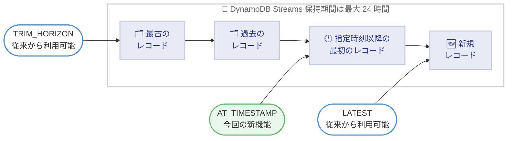

# Amazon DynamoDB Streams - タイムスタンプベースのストリーム処理

**リリース日**: 2026 年 10 月 15 日
**サービス**: Amazon DynamoDB (DynamoDB Streams)
**機能**: タイムスタンプベースのストリーム処理 (AT_TIMESTAMP シャードイテレータ)

📊 [このアップデートのインフォグラフィックを見る](https://takech9203.github.io/aws-news-summary/20261015-amazon-dynamodb-streams-timestamp-processing.html)

## 概要

Amazon DynamoDB Streams がタイムスタンプベースのストリーム処理をサポートしました。`AT_TIMESTAMP` シャードイテレータタイプを使用することで、指定した時刻以降に書き込まれた最初のレコードからストリームの読み取りを開始できます。タイムスタンプを指定すると、`ApproximateCreationDateTime` が指定時刻以降である最初のレコードから処理が始まります。

この機能は、DynamoDB Streams Kinesis アダプターを通じて Kinesis Client Library (KCL) からも利用できます。障害からの復旧、デバッグや監査のためのデータ再生、バックログのスキップ、ポイントインタイムリカバリ (PITR) エクスポート後の同期など、ストリーム消費を特定の時点から再開したいユースケースに対応します。

**アップデート前の課題**

このアップデート以前は、ストリームの読み取り開始位置の選択肢が限られていました。

- 読み取り開始位置は、保持されている最古のレコード (最大 24 時間前、`TRIM_HORIZON`) か、消費開始後に書き込まれた新しいレコード (`LATEST`) のいずれかしか選択できなかった
- 中断後に処理を再開する際、保持されているストリーム全体を再処理するか、中断中のレコードを失うかのトレードオフが発生していた
- PITR エクスポートからの復元後、エクスポート時点以降の変更だけを正確に適用する手段がなかった

**アップデート後の改善**

今回のアップデートにより、時刻を指定した柔軟な読み取り開始が可能になりました。

- タイムスタンプを指定して、その時刻以降の最初のレコードから読み取りを開始できるようになった
- 中断からの復旧時に、ストリーム全体の再処理やレコードの取りこぼしを回避できるようになった
- 過去の特定時点からのデータ再生 (デバッグ・監査)、直近のタイムスタンプ指定によるバックログのスキップ、PITR エクスポート時刻からの同期が可能になった

## アーキテクチャ図



シャードイテレータタイプごとの読み取り開始位置を示しています。新しい `AT_TIMESTAMP` では、指定したタイムスタンプ以降の最初のレコードから読み取りを開始できます。

## サービスアップデートの詳細

### 主要機能

1. **AT_TIMESTAMP シャードイテレータタイプ**
   - `GetShardIterator` API に新しいイテレータタイプ `AT_TIMESTAMP` が追加された
   - タイムスタンプを指定すると、`ApproximateCreationDateTime` が指定時刻以降である最初のレコードからイテレータが開始する
   - 取得したイテレータを `GetRecords` に渡すことで、指定時点以降のレコードを順に読み取れる

2. **Kinesis Client Library (KCL) との統合**
   - DynamoDB Streams Kinesis アダプター (バージョン 2.5.0 以降) を通じて KCL アプリケーションから利用可能
   - `InitialPositionInStreamExtended.newInitialPositionAtTimestamp` でタイムスタンプを指定し、`StreamsSchedulerFactory.createSingleStreamTracker` で作成した `StreamTracker` を `ConfigsBuilder` に登録する
   - アダプターは新しいリースごとに `AT_TIMESTAMP` を初期位置として初期化し、指定タイムスタンプで `GetShardIterator` を呼び出す

3. **安全なタイムスタンプ処理**
   - 指定タイムスタンプが保持期間 (24 時間) より古い場合、エラーにはならず各シャードで利用可能な最古のレコードから開始する
   - 指定タイムスタンプが未来の場合、アダプターは初期化時に検証して API 呼び出しを行わずに拒否する
   - 追加の IAM 権限は不要で、既存のアダプターアプリケーションと同じ権限で動作する

## 技術仕様

### 読み取り開始位置の比較

| イテレータタイプ | 読み取り開始位置 | 主な用途 |
|------|------|------|
| TRIM_HORIZON | 保持されている最古のレコード (最大 24 時間前) | 全レコードの処理 |
| LATEST | 消費開始後に書き込まれた新しいレコード | リアルタイム処理 |
| AT_SEQUENCE_NUMBER / AFTER_SEQUENCE_NUMBER | 指定したシーケンス番号の位置 | チェックポイントからの再開 |
| AT_TIMESTAMP (新機能) | 指定時刻以降の最初のレコード | 時刻指定による再開・再生 |

### タイムスタンプのシナリオ別動作

| シナリオ | 動作 |
|------|------|
| タイムスタンプが保持期間内 | 指定時刻以降の最初のレコードから読み取り開始 |
| タイムスタンプが保持期間より古い | エラーにならず、各シャードの最古のレコードから開始 |
| タイムスタンプが未来 | アダプターが初期化時に拒否し、処理を開始しない |

### API変更履歴

| 日付 | サービス | 変更内容 |
|------|----------|----------|
| 2026/10/14 | [Amazon DynamoDB Streams](https://awsapichanges.com/archive/changes/fca45a-streams.dynamodb.html) | 1 updated api methods - GetShardIterator API に新しいイテレータタイプ AT_TIMESTAMP を追加 |

## 設定方法

### 前提条件

1. DynamoDB テーブルで DynamoDB Streams が有効化されていること
2. KCL で利用する場合は DynamoDB Streams Kinesis アダプターのバージョン 2.5.0 以降を使用すること
3. 既存のアダプターアプリケーションと同じ IAM 権限 (追加の API 権限は不要)

### 手順

#### ステップ1: AWS CLI でタイムスタンプ指定のシャードイテレータを取得

```bash
aws dynamodbstreams get-shard-iterator \
  --stream-arn arn:aws:dynamodb:ap-northeast-1:123456789012:table/MyTable/stream/2026-10-15T00:00:00.000 \
  --shard-id shardId-00000001 \
  --shard-iterator-type AT_TIMESTAMP \
  --timestamp 2026-10-15T09:00:00+09:00
```

`GetShardIterator` API を `AT_TIMESTAMP` イテレータタイプで呼び出し、指定したタイムスタンプ以降の最初のレコードを指すシャードイテレータを取得しています。

#### ステップ2: 取得したイテレータでレコードを読み取る

```bash
aws dynamodbstreams get-records \
  --shard-iterator <ステップ1で取得したシャードイテレータ>
```

`GetRecords` API を呼び出し、指定時点以降のストリームレコードを取得しています。レスポンスには `ApproximateCreationDateTime` が指定時刻以降である最初のレコードから順に含まれます。

#### ステップ3: KCL アプリケーションでタイムスタンプを設定 (Java)

```java
// 開始タイムスタンプを指定して初期位置を作成
InitialPositionInStreamExtended initialPosition =
    InitialPositionInStreamExtended.newInitialPositionAtTimestamp(
        Date.from(Instant.ofEpochMilli(1790467200000L)));

// ストリームトラッカーを作成
StreamTracker streamTracker = StreamsSchedulerFactory.createSingleStreamTracker(
    streamArn,
    initialPosition);

// スケジューラが指定タイムスタンプからシャードを読み取るよう登録
configsBuilder.streamTracker(streamTracker);
```

`InitialPositionInStreamExtended` にタイムスタンプを設定し、`StreamTracker` を `ConfigsBuilder` に登録しています。アダプターは新しいリースごとに指定タイムスタンプで `GetShardIterator` を呼び出し、レコードの読み取りを開始します。

## メリット

### ビジネス面

- **復旧時間の短縮**: 障害や中断からの復旧時に、必要な時点からのみ処理を再開できるため、ダウンタイム後のキャッチアップが速くなる
- **監査対応の効率化**: 過去の特定時点からデータを再生できるため、監査やデバッグの調査作業を効率化できる
- **追加コストなし**: 標準の GetRecords API リクエスト料金以外に追加料金は発生しない

### 技術面

- **再処理の削減**: 保持されているストリーム全体を再処理する必要がなくなり、重複処理や下流システムへの負荷を削減できる
- **PITR との連携**: PITR エクスポートのタイムスタンプを開始位置に指定することで、復元後のテーブルとストリーム消費を正確に同期できる
- **バックログのスキップ**: 最新レコードに近いタイムスタンプを指定することで、処理しきれないバックログをスキップして追いつける

## デメリット・制約事項

### 制限事項

- DynamoDB Streams の保持期間は最大 24 時間のままであり、保持期間を過ぎたレコードはタイムスタンプを指定しても復元できない
- KCL で利用する場合は DynamoDB Streams Kinesis アダプターのバージョン 2.5.0 以降が必要
- 未来のタイムスタンプは指定できない (アダプターが初期化時に拒否する)

### 考慮すべき点

- 稼働中のアプリケーションでは、リーステーブルに状態が保存されているため、タイムスタンプや初期位置 (`AT_TIMESTAMP`、`TRIM_HORIZON`、`LATEST`) を変更してはならない。チェックポイント済みのシャードは既存のチェックポイントから継続し、シャードごとに異なる開始位置で処理される可能性がある
- 設定を安全に変更するには、アプリケーションを停止したうえで、リーステーブルを削除して再起動する (推奨)、または新しいアプリケーション名を使用して新しいリーステーブルを作成する
- 現在時刻に近いタイムスタンプを指定する場合は、アプリケーションホストとサービス間のクロック差を考慮する

## ユースケース

### ユースケース1: 障害・中断からの復旧

**シナリオ**: ストリームコンシューマーが数時間停止した後、停止時点から処理を再開したい。チェックポイント情報が失われている場合でも、停止時刻は把握している。

**実装例**:
```java
// 停止時刻 (例: 3 時間前) から再開
InitialPositionInStreamExtended initialPosition =
    InitialPositionInStreamExtended.newInitialPositionAtTimestamp(
        Date.from(Instant.now().minus(Duration.ofHours(3))));
```

**効果**: ストリーム全体の再処理による重複や、レコードの取りこぼしを避けつつ、停止時点から正確に処理を再開できる。

### ユースケース2: デバッグ・監査のためのデータ再生

**シナリオ**: 本番環境で特定の時刻に発生した問題を調査するため、その時刻以降の変更レコードを別のコンシューマーで再生して分析したい。

**実装例**:
```bash
aws dynamodbstreams get-shard-iterator \
  --stream-arn <ストリーム ARN> \
  --shard-id <シャード ID> \
  --shard-iterator-type AT_TIMESTAMP \
  --timestamp 2026-10-15T03:00:00Z
```

**効果**: 問題発生時刻以降の変更履歴だけをピンポイントで取得でき、調査時間を短縮できる。

### ユースケース3: PITR エクスポート後の同期

**シナリオ**: PITR エクスポートを使用してテーブルデータを別システムに複製した後、エクスポート時点以降の変更をストリームから適用して同期を維持したい。

**実装例**:
```java
// PITR エクスポートのタイムスタンプから読み取りを開始
InitialPositionInStreamExtended initialPosition =
    InitialPositionInStreamExtended.newInitialPositionAtTimestamp(
        exportTimestamp);
```

**効果**: エクスポート時点とストリーム読み取り開始位置が正確に一致し、変更の欠落や重複なく同期を継続できる。

## 料金

この機能自体に追加料金はありません。標準の `GetRecords` API リクエスト料金のみが適用されます。詳細は [DynamoDB 料金ページ](https://aws.amazon.com/dynamodb/pricing/)を参照してください。

## 利用可能リージョン

すべての商用 AWS リージョン、AWS GovCloud (US) リージョン、中国リージョンで利用可能です。

## 関連サービス・機能

- **Amazon DynamoDB Streams**: テーブルの項目レベルの変更をキャプチャするストリーム機能。本アップデートの対象
- **Kinesis Client Library (KCL)**: DynamoDB Streams Kinesis アダプターを介してストリームを消費するためのライブラリ。バージョン 2.5.0 以降のアダプターで本機能に対応
- **DynamoDB ポイントインタイムリカバリ (PITR)**: 特定時点へのテーブル復元・エクスポート機能。エクスポートタイムスタンプを本機能の開始位置として利用できる
- **Amazon Kinesis Data Streams**: Kinesis では以前から `AT_TIMESTAMP` イテレータが利用可能であり、DynamoDB Streams でも同等の操作性が実現された

## 参考リンク

- 📊 [インフォグラフィック](https://takech9203.github.io/aws-news-summary/20261015-amazon-dynamodb-streams-timestamp-processing.html)
- [公式発表 (What's New)](https://aws.amazon.com/about-aws/whats-new/2026/10/amazon-dynamodb-streams-timestamp-processing)
- [ドキュメント: Using the DynamoDB Streams Kinesis Adapter to read records from a timestamp](https://docs.aws.amazon.com/amazondynamodb/latest/developerguide/Streams.Timestamp.html)
- [ドキュメント: Using the DynamoDB Streams Kinesis adapter to process stream records](https://docs.aws.amazon.com/amazondynamodb/latest/developerguide/Streams.KCLAdapter.html)
- [DynamoDB Streams Kinesis Adapter (GitHub)](https://github.com/awslabs/dynamodb-streams-kinesis-adapter)
- [料金ページ](https://aws.amazon.com/dynamodb/pricing/)

## まとめ

DynamoDB Streams の `AT_TIMESTAMP` シャードイテレータにより、時刻を指定したストリーム読み取りが可能になり、障害復旧・データ再生・PITR 後の同期といった運用上の課題が大きく改善されます。追加料金なしで利用できるため、DynamoDB Streams を利用するコンシューマーアプリケーションでは、復旧手順やリプレイ手順への組み込みを検討することを推奨します。KCL 利用時はアダプターをバージョン 2.5.0 以降に更新し、稼働中アプリケーションの初期位置変更時はリーステーブルの扱いに注意してください。
