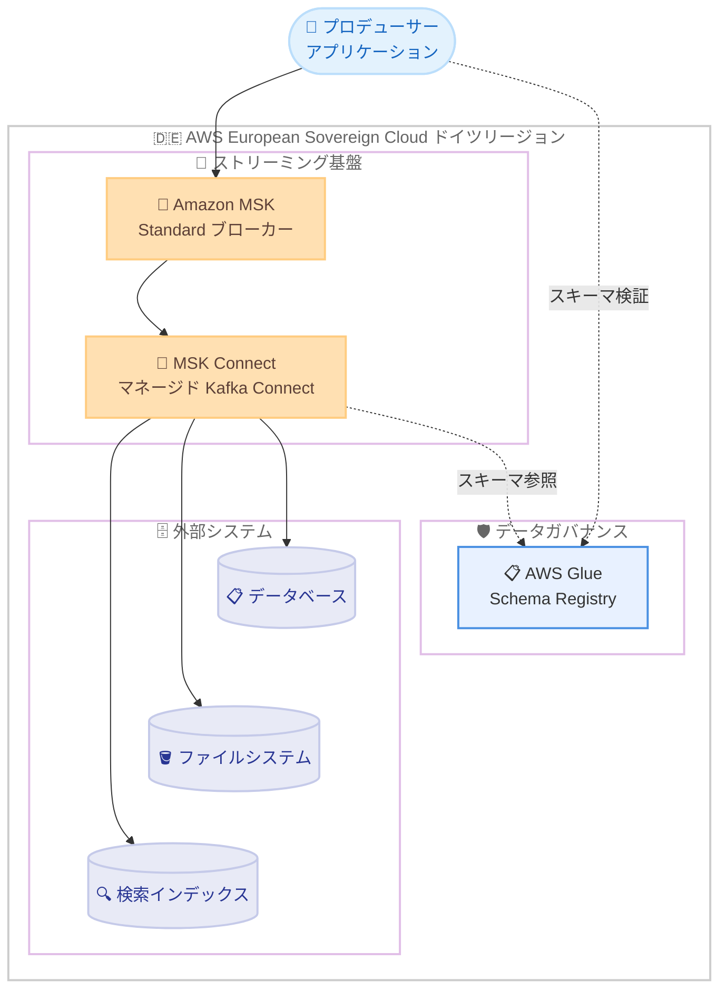

# Amazon MSK Connect / AWS Glue Schema Registry - AWS European Sovereign Cloud (ドイツ) リージョンで利用可能に

**リリース日**: 2026 年 10 月 15 日
**サービス**: Amazon MSK Connect、AWS Glue Schema Registry
**機能**: AWS European Sovereign Cloud (ドイツ) リージョンでの提供開始

📊 [このアップデートのインフォグラフィックを見る](https://takech9203.github.io/aws-news-summary/20261015-amazon-msk-connect-aws-gsr-additional-aws-regions.html)

## 概要

Amazon MSK Connect と AWS Glue Schema Registry が、AWS European Sovereign Cloud (ドイツ) リージョンで利用可能になりました。同リージョンではすでに Amazon MSK Standard ブローカーが利用可能であり、今回の 2 つのサービス追加により、欧州ソブリンクラウド上でストリーミングワークロードを実行するお客様は、Apache Kafka アプリケーションの構築、接続、ガバナンスに必要なツール一式をより完全な形で利用できるようになります。

MSK Connect は、Amazon MSK と連携するフルマネージドの Kafka Connect クラスターを実行できるサービスです。Apache Kafka とデータベース、ファイルシステム、検索インデックスなどの外部システム間でデータを移動するコネクタを、インフラのプロビジョニングなしでデプロイ、監視、スケーリングできます。AWS Glue Schema Registry は AWS Glue のサーバーレスかつ無料の機能で、Apache Avro、JSON、Protobuf スキーマを使用してストリーミングデータの検証とスキーマ進化の制御を実現します。

このアップデートは、データ主権やコンプライアンス要件により AWS European Sovereign Cloud の利用を求められる EU のお客様 (公共部門、金融、医療など規制の厳しい業界) にとって重要な拡張です。

**アップデート前の課題**

AWS European Sovereign Cloud (ドイツ) リージョンでは、ストリーミング基盤の構築に以下の制約がありました。

- Amazon MSK Standard ブローカーは利用できたものの、MSK Connect が未提供のため、外部システムとのデータ連携には Kafka Connect クラスターを EC2 などで自前構築・運用する必要があった
- AWS Glue Schema Registry が未提供のため、スキーマの集中管理やスキーマ進化の制御を別の仕組みで実現する必要があった
- データ主権要件を満たしながら、他リージョンと同等のマネージドなストリーミングエコシステムを構築することが困難だった

**アップデート後の改善**

今回のアップデートにより、以下が可能になりました。

- AWS European Sovereign Cloud 内でフルマネージドな Kafka Connect クラスターを実行でき、コネクタのデプロイ、監視、自動スケーリングをインフラ管理なしで利用できるようになった
- AWS Glue Schema Registry により、Avro、JSON、Protobuf スキーマの検証とスキーマ進化の集中管理が追加費用なしで利用できるようになった
- データ主権要件を満たしたまま、Kafka アプリケーションの構築から接続、データガバナンスまでを一貫してマネージドサービスで実現できるようになった

## アーキテクチャ図



AWS European Sovereign Cloud (ドイツ) リージョン内で、Amazon MSK、MSK Connect、AWS Glue Schema Registry を組み合わせたストリーミングアーキテクチャが完結する構成を示しています。MSK Connect が Kafka と外部システム間のデータ移動を担い、Schema Registry がデータ形式の検証とスキーマ進化を集中管理します。

## サービスアップデートの詳細

### 主要機能

1. **Amazon MSK Connect の提供開始**
   - Amazon MSK と連携するフルマネージドの Kafka Connect クラスターを実行可能
   - Apache Kafka とデータベース、ファイルシステム、検索インデックスなどの外部システム間でデータを移動するコネクタをデプロイ、監視、スケーリング
   - インフラのプロビジョニング不要、自動スケーリング、従量課金制

2. **AWS Glue Schema Registry の提供開始**
   - AWS Glue のサーバーレスかつ無料の機能
   - Apache Avro、JSON、Protobuf スキーマを使用したストリーミングデータの検証とスキーマ進化の制御
   - 疎結合なアプリケーション間でデータ形式と構造を集中管理するリポジトリとして機能
   - データ検証ロジック、チーム間調整、下流での障害を削減

3. **既存の Amazon MSK Standard ブローカーとの統合**
   - 同リージョンですでに利用可能な Amazon MSK Standard ブローカーと組み合わせて利用可能
   - Kafka アプリケーションの構築、接続、ガバナンスを一貫してマネージドサービスで実現

## 技術仕様

### 対応スキーマ形式と統合サービス

| 項目 | 詳細 |
|------|------|
| 対応スキーマ形式 | Apache Avro、JSON Schema、Protobuf |
| 対応言語 | Java、C# のアプリケーションと統合可能 |
| Schema Registry 統合サービス | Amazon MSK、Amazon Kinesis Data Streams、Amazon Managed Service for Apache Flink、AWS Lambda |
| MSK Connect の対象 | Kafka Connect 互換のソース / シンクコネクタ |
| 課金モデル | MSK Connect は従量課金、Schema Registry は無料 |

## 設定方法

### 前提条件

1. AWS European Sovereign Cloud (ドイツ) リージョンのアカウントとアクセス権限があること
2. 同リージョンに Amazon MSK クラスター (Standard ブローカー) が構築済みであること
3. MSK Connect 用のコネクタプラグイン (JAR / ZIP) と、Schema Registry を利用する場合は対応するシリアライザー / デシリアライザーの準備

### 手順

#### ステップ 1: スキーマレジストリとスキーマの作成

```bash
# スキーマレジストリを作成
aws glue create-registry \
  --registry-name my-streaming-registry \
  --description "Streaming schemas for Kafka applications"

# Avro スキーマを登録
aws glue create-schema \
  --registry-id RegistryName=my-streaming-registry \
  --schema-name orders-schema \
  --data-format AVRO \
  --compatibility BACKWARD \
  --schema-definition file://orders-schema.avsc
```

AWS Glue Schema Registry にレジストリを作成し、Avro 形式のスキーマを BACKWARD 互換モードで登録しています。互換モードにより、スキーマ進化時の破壊的変更を防止できます。

#### ステップ 2: MSK Connect カスタムプラグインの登録

```bash
# S3 にアップロードしたコネクタプラグインをカスタムプラグインとして登録
aws kafkaconnect create-custom-plugin \
  --name my-jdbc-sink-plugin \
  --content-type ZIP \
  --location '{"s3Location": {"bucketArn": "arn:aws:s3:::my-plugin-bucket", "fileKey": "jdbc-sink-connector.zip"}}'
```

S3 バケットに配置したコネクタプラグインを MSK Connect のカスタムプラグインとして登録しています。MSK Connect はこのプラグインを使用してコネクタを起動します。

#### ステップ 3: コネクタの作成

```bash
# MSK Connect コネクタを作成
aws kafkaconnect create-connector \
  --connector-name orders-jdbc-sink \
  --kafka-cluster '{"apacheKafkaCluster": {"bootstrapServers": "<ブートストラップサーバー>", "vpc": {"subnets": ["subnet-xxxx"], "securityGroups": ["sg-xxxx"]}}}' \
  --capacity '{"autoScaling": {"maxWorkerCount": 4, "minWorkerCount": 1, "mcuCount": 1, "scaleInPolicy": {"cpuUtilizationPercentage": 20}, "scaleOutPolicy": {"cpuUtilizationPercentage": 80}}}' \
  --connector-configuration '{"connector.class": "io.confluent.connect.jdbc.JdbcSinkConnector", "topics": "orders", "tasks.max": "2"}' \
  --kafka-connect-version "2.7.1" \
  --plugins '[{"customPlugin": {"customPluginArn": "<プラグイン ARN>", "revision": 1}}]' \
  --service-execution-role-arn "<IAM ロール ARN>" \
  --kafka-cluster-authentication-type IAM \
  --kafka-cluster-client-authentication '{"authenticationType": "IAM"}' \
  --kafka-cluster-encryption-in-transit '{"encryptionType": "TLS"}'
```

MSK クラスターに接続するコネクタを自動スケーリング構成 (ワーカー数 1〜4) で作成しています。CPU 使用率に応じてワーカー数が自動的に調整されるため、負荷変動に対する手動運用が不要になります。

## メリット

### ビジネス面

- **データ主権要件への対応**: EU のデータ主権やコンプライアンス要件を満たしながら、マネージドなストリーミングエコシステムを利用可能
- **運用コスト削減**: Kafka Connect クラスターの自前構築・運用が不要になり、運用負荷と TCO を削減
- **無料のスキーマ管理**: Schema Registry は追加費用なしで利用でき、データガバナンス強化のコストを抑制

### 技術面

- **フルマネージドと自動スケーリング**: コネクタのワーカーが負荷に応じて自動的にスケールし、インフラ管理が不要
- **スキーマ進化の制御**: 互換性モード (BACKWARD、FORWARD など) によりスキーマ変更時の下流障害を防止
- **幅広いサービス統合**: Schema Registry は MSK だけでなく Kinesis Data Streams、Managed Service for Apache Flink、Lambda とも統合可能

## デメリット・制約事項

### 制限事項

- AWS European Sovereign Cloud は一般の AWS リージョンとは分離された環境であり、利用には専用のアカウントが必要
- Schema Registry のネイティブ統合は Java および C# アプリケーションが対象であり、他言語ではサードパーティ実装などの検討が必要
- 同リージョンで利用可能なのは Amazon MSK Standard ブローカーであり、他リージョンの全機能が揃っているとは限らない

### 考慮すべき点

- MSK Connect のコネクタプラグインは自身で用意する必要があるため、使用するコネクタのライセンスとバージョン互換性を事前に確認する
- 既存の自前 Kafka Connect クラスターから移行する場合は、オフセット管理やコネクタ設定の移行計画が必要
- European Sovereign Cloud のサービス提供状況は段階的に拡大しているため、依存する他サービスの提供状況も確認する

## ユースケース

### ユースケース 1: 規制業界におけるデータベースへのストリーミング連携

**シナリオ**: ドイツの金融機関が、データ主権要件を満たしつつ Kafka 上の取引イベントをリレーショナルデータベースへリアルタイム連携したい。

**実装例**:
```
MSK (取引イベントトピック) → MSK Connect (JDBC Sink コネクタ) → データベース
Schema Registry で取引イベントのスキーマを BACKWARD 互換で管理
```

**効果**: 自前の Kafka Connect 運用なしで、EU 域内に閉じたリアルタイムデータパイプラインを構築できる。

### ユースケース 2: スキーマ進化を伴うマイクロサービス間のイベント連携

**シナリオ**: 複数チームが開発するマイクロサービス間で Kafka トピックを共有しており、スキーマ変更時の下流障害を防ぎたい。

**実装例**:
```
各プロデューサー / コンシューマーに Glue Schema Registry のシリアライザーを組み込み、
互換性モードを BACKWARD に設定してスキーマ変更を検証
```

**効果**: 互換性のないスキーマ変更が登録時に拒否されるため、チーム間調整のコストと下流アプリケーションの障害を削減できる。

### ユースケース 3: 検索インデックスへのログ・イベント転送

**シナリオ**: 公共部門のお客様が、アプリケーションイベントを検索インデックスへ転送し、EU 域内で分析基盤を完結させたい。

**実装例**:
```
MSK (イベントトピック) → MSK Connect (検索インデックス向け Sink コネクタ) → 検索インデックス
自動スケーリング設定でピーク時のみワーカーを増加
```

**効果**: 負荷変動に自動対応しながら、データを EU 域外へ出すことなく検索・分析基盤へ連携できる。

## 料金

- **Amazon MSK Connect**: 従量課金制。コネクタのワーカーが使用する MSK Connect Unit (MCU) 時間に基づいて課金される
- **AWS Glue Schema Registry**: 無料。スキーマの登録、検証、取得に追加費用は発生しない

AWS European Sovereign Cloud での具体的な料金は、同クラウドの料金情報を参照してください。

## 利用可能リージョン

- AWS European Sovereign Cloud (ドイツ) リージョン (今回追加)
- Amazon MSK Connect および AWS Glue Schema Registry は、その他の多くの商用 AWS リージョンでも利用可能

## 関連サービス・機能

- **Amazon MSK**: フルマネージドの Apache Kafka サービス。MSK Connect と Schema Registry の基盤となるストリーミングプラットフォーム
- **Amazon Kinesis Data Streams**: Schema Registry と統合可能なストリーミングサービス
- **Amazon Managed Service for Apache Flink**: Schema Registry と統合し、スキーマ検証されたストリームデータをリアルタイム処理
- **AWS Lambda**: Schema Registry と統合し、Kafka イベントソースからのレコードをスキーマ検証付きで処理可能

## 参考リンク

- 📊 [インフォグラフィック](https://takech9203.github.io/aws-news-summary/20261015-amazon-msk-connect-aws-gsr-additional-aws-regions.html)
- [公式発表 (What's New)](https://aws.amazon.com/about-aws/whats-new/2026/10/amazon-msk-connect-aws-gsr-additional-aws-regions)
- [Amazon MSK Connect 製品ページ](https://aws.amazon.com/msk/features/msk-connect/)
- [Amazon MSK Developer Guide - MSK Connect](https://docs.aws.amazon.com/msk/latest/developerguide/msk-connect.html)
- [AWS Glue Schema Registry ドキュメント](https://docs.aws.amazon.com/glue/latest/dg/schema-registry.html)
- [AWS Glue Schema Registry スタートガイド](https://docs.aws.amazon.com/glue/latest/dg/schema-registry-gs.html)
- [Amazon MSK 製品ページ](https://aws.amazon.com/msk/)

## まとめ

Amazon MSK Connect と AWS Glue Schema Registry が AWS European Sovereign Cloud (ドイツ) リージョンに追加され、既存の Amazon MSK Standard ブローカーと合わせて、データ主権要件下でも Kafka アプリケーションの構築、接続、ガバナンスを一貫してマネージドサービスで実現できるようになりました。欧州ソブリンクラウドでストリーミング基盤を検討しているお客様は、自前の Kafka Connect 運用やスキーマ管理の仕組みを MSK Connect と Schema Registry に置き換えることを検討してください。
