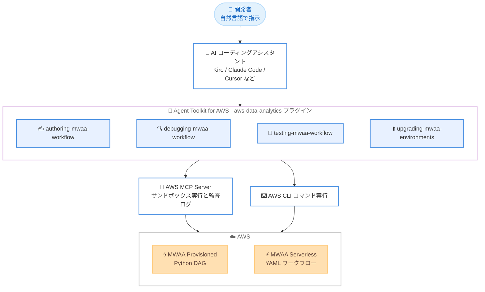

# Amazon MWAA - AI エージェントスキルの提供開始

**リリース日**: 2026 年 10 月 15 日
**サービス**: Amazon Managed Workflows for Apache Airflow (MWAA)
**機能**: Agent Toolkit for AWS との統合による AI エージェントスキル

📊 [このアップデートのインフォグラフィックを見る](https://takech9203.github.io/aws-news-summary/20261015-amazon-mwaa-ai-agent-skills.html)

## 概要

Amazon Managed Workflows for Apache Airflow (MWAA) が [Agent Toolkit for AWS](https://docs.aws.amazon.com/agent-toolkit/latest/userguide/what-is-agent-toolkit.html) と統合され、組み込みの AI エージェントスキルを提供するようになりました。エージェントスキルに対応した任意の AI コーディングアシスタント (Kiro、Claude Code、Amazon Q、Cursor、Codex など) を使用して、MWAA ワークフローの作成、デバッグ、テスト、および MWAA 環境のアップグレードを自然言語で実行できます。

提供されるスキルは authoring-mwaa-workflow、debugging-mwaa-workflow、testing-mwaa-workflow、upgrading-mwaa-environments の 4 つです。これらのスキルにより、AI アシスタントが MWAA と直接やり取りできるようになり、データパイプラインの構築と保守にかかる手作業を削減できます。たとえば、ETL パイプラインを自然言語で説明するだけで、authoring スキルがタスクの依存関係とエラーハンドリングを含む動作可能な DAG を生成します。

これらのスキルは Anthropic が公開しているオープンな Agent Skills 標準に準拠しているため、同標準をサポートするアシスタント間で共通に利用できます。MWAA Provisioned 環境と MWAA Serverless の両方で動作し、MWAA が利用可能なすべての AWS リージョンで提供されます。

**アップデート前の課題**

このアップデート以前に存在していた課題や制限は以下のとおりです。

- Airflow DAG の作成には Python と Airflow 固有の知識が必要で、タスクの依存関係やエラーハンドリングを手作業で実装する必要があった
- DAG の失敗、インポートエラー、ワーカーのメモリ不足、IAM 権限エラーなどのトラブルシューティングは、ログの確認や原因の切り分けを手動で行う必要があった
- Apache Airflow のバージョンアップグレード (特に 2.x から 3.x への移行) は、計画立案から実行まで多くの手順を手動で進める必要があった
- AI コーディングアシスタントを利用しても、MWAA 固有の運用手順やベストプラクティスを個別にプロンプトへ組み込む必要があった

**アップデート後の改善**

今回のアップデートにより可能になったことは以下のとおりです。

- 自然言語で要件を記述するだけで、Provisioned 環境向けの Python DAG や MWAA Serverless 向けの YAML ワークフローを作成・デプロイできるようになった
- 失敗した実行やタスクインスタンス、DAG が表示されない問題、インポートエラー、ワーカーのメモリ不足、IAM 権限エラーの根本原因を AI アシスタントが特定できるようになった
- デプロイ済みの DAG やワークフローのトリガー、完了までのモニタリング、修正後の再テストを AI アシスタントに任せられるようになった
- ブルーグリーンまたはインプレース戦略を用いた Apache Airflow バージョンアップグレード (2.x から 3.x を含む) を AI アシスタント主導で実行できるようになった

## アーキテクチャ図



開発者が自然言語で指示を出すと、AI コーディングアシスタントが aws-data-analytics プラグインの 4 つのスキルから適切なものを自動選択し、AWS MCP Server や AWS CLI を通じて MWAA 環境を操作します。

## サービスアップデートの詳細

### 主要機能

1. **authoring-mwaa-workflow (ワークフローの作成)**
   - 自然言語の説明から Apache Airflow DAG を作成し、Provisioned 環境へデプロイする
   - MWAA Serverless 向けには YAML 形式のワークフローを作成する
   - タスクの依存関係とエラーハンドリングを含む、動作可能な DAG を生成する

2. **debugging-mwaa-workflow (ワークフローのデバッグ)**
   - 失敗した実行やタスクインスタンスの根本原因を特定する
   - DAG が Airflow UI に表示されない問題、インポートエラーを調査する
   - ワーカーのメモリ不足 (OOM) エラーや IAM 権限エラーを診断する

3. **testing-mwaa-workflow (ワークフローのテスト)**
   - デプロイ済みの DAG やワークフローをトリガーし、完了までモニタリングする
   - 修正後の再テストを実行し、成功したかどうかを報告する

4. **upgrading-mwaa-environments (環境のアップグレード)**
   - Provisioned 環境を新しい Apache Airflow バージョンへアップグレードする (2.x から 3.x への移行を含む)
   - ブルーグリーン戦略またはインプレース戦略を選択できる
   - このスキルは Provisioned 環境のみ対応で、MWAA Serverless には対応していない

### スキル選択の仕組み

プロンプトでスキル名を明示する必要はありません。AI アシスタントがリクエストの内容に基づいて、適切なスキルを自動的に選択します。

## 技術仕様

### スキルの概要

| 項目 | 詳細 |
|------|------|
| 提供元 | Agent Toolkit for AWS の aws-data-analytics プラグイン (オープンソース、GitHub で公開) |
| 準拠標準 | Agent Skills オープン標準 (Anthropic が公開) |
| 対応アシスタント | Kiro、Claude Code、Amazon Q、Cursor、Codex など Agent Skills 対応アシスタント |
| 対象環境 | MWAA Provisioned (Python DAG) および MWAA Serverless (YAML)。upgrading スキルのみ Provisioned 限定 |
| 実行方式 | AWS CLI コマンドの実行。AWS MCP Server 併用によるサンドボックス実行と監査ログを推奨 |
| ドキュメント参照 | AWS MCP Server を通じて実行時に最新の AWS ドキュメントを取得 |

### 必要な IAM 権限

スキルは AWS CLI コマンドを実行して AWS リソースを操作するため、使用する IAM プリンシパルに以下のアクション名前空間の権限を、使用するリソースにスコープして付与する必要があります。

| アクション名前空間 | 対象 |
|------|------|
| `airflow` | MWAA 環境および Apache Airflow REST API |
| `airflow-serverless` | MWAA Serverless のワークフローと実行 |

## 設定方法

### 前提条件

1. Agent Toolkit for AWS の [Getting started](https://docs.aws.amazon.com/agent-toolkit/latest/userguide/quick-start.html) に記載された前提条件を完了していること
2. IAM プリンシパルに `airflow` または `airflow-serverless` 名前空間の権限を付与していること
3. Agent Skills に対応した AI コーディングアシスタント (Kiro、Claude Code、Cursor など) を利用できること

### 手順

#### ステップ 1: AWS MCP Server のセットアップ (推奨)

Agent Toolkit for AWS User Guide の Getting started に従い、AWS MCP Server をインストールしてコーディングアシスタントを設定します。スキルは AWS MCP Server を使用して、実行時に最新の AWS ドキュメントを取得し、サンドボックス実行と監査ログ付きで AWS CLI コマンドを実行します。

#### ステップ 2: aws-data-analytics プラグインのインストール

```bash
# Claude Code の場合
/plugin install aws-data-analytics@claude-plugins-official

# リポジトリから直接スキルをインストールする場合
npx skills add aws/agent-toolkit-for-aws/skills
```

Claude Code では公式プラグインマーケットプレイスから aws-data-analytics プラグインをインストールします。Kiro、Codex、Cursor などその他のアシスタントでは、`npx skills add` コマンドで GitHub リポジトリから直接スキルをインストールできます。

#### ステップ 3: 自然言語でプロンプトを実行

```text
# 作成の例
"日次のデータエクスポートを実行する Apache Airflow DAG を作成して、環境にデプロイして"

# テストの例
"デプロイしたばかりのパイプラインをスモークテストして"

# デバッグの例
"失敗した DAG の根本原因を調べて"

# アップグレードの例
"実行履歴を保持したままブルーグリーンアップグレードを計画して"
```

スキルのインストール後は、自然言語でプロンプトを与えるだけで MWAA の操作を実行できます。アシスタントがリクエストに応じて適切なスキルを自動選択します。

## メリット

### ビジネス面

- **開発生産性の向上**: データパイプラインの構築・保守にかかる手作業が削減され、エンジニアはビジネスロジックの設計に集中できる
- **学習コストの低減**: Airflow 固有の知識が浅いメンバーでも、自然言語による指示で DAG の作成やトラブルシューティングを進められる
- **運用リスクの軽減**: バージョンアップグレードがブルーグリーン戦略を含むガイド付きの手順で実行され、移行時の失敗リスクを抑えられる

### 技術面

- **オープン標準準拠**: Agent Skills 標準に準拠しているため、特定の AI アシスタントにロックインされず、複数のツールで同じスキルを再利用できる
- **安全な実行基盤**: AWS MCP Server との併用により、AWS CLI コマンドのサンドボックス実行と監査ログが利用できる
- **最新ドキュメントの参照**: スキルが実行時に AWS MCP Server 経由で最新の AWS ドキュメントを取得するため、古い情報に基づく誤った操作を防ぎやすい
- **Provisioned と Serverless の両対応**: Python DAG と YAML ワークフローの両方の作成形式をカバーしている

## デメリット・制約事項

### 制限事項

- upgrading-mwaa-environments スキルは Provisioned 環境のみ対応で、MWAA Serverless では使用できない
- スキルの利用には Agent Skills 標準に対応した AI コーディングアシスタントが必要
- スキルは AWS CLI コマンドを実行するため、IAM プリンシパルに適切な権限 (`airflow` / `airflow-serverless` 名前空間) を付与する必要がある

### 考慮すべき点

- AI アシスタントが AWS リソースを直接操作するため、権限は使用するリソースにスコープし、最小権限の原則に従って付与することが重要
- 本番環境への適用前に、生成された DAG やワークフローの内容をレビューし、テスト環境で検証することが推奨される
- サンドボックス実行と監査ログのために AWS MCP Server の併用が推奨されている

## ユースケース

### ユースケース 1: 自然言語からの ETL パイプライン構築

**シナリオ**: データエンジニアリングチームが、S3 からデータを取り込み、変換してデータウェアハウスへロードする日次 ETL パイプラインを新規構築したい。Airflow の経験が浅いメンバーも担当する。

**実装例**:
```text
"S3 バケットから CSV を取り込み、変換して Redshift にロードする
3 つのタスクをオーケストレーションするパイプラインを作成し、
毎時実行するようにスケジュールして"
```

**効果**: authoring-mwaa-workflow スキルがタスクの依存関係とエラーハンドリングを含む動作可能な DAG を生成・デプロイするため、ボイラープレートコードの記述時間を削減し、Airflow 経験の浅いメンバーの立ち上がりを早められる。

### ユースケース 2: 失敗した DAG の迅速なトラブルシューティング

**シナリオ**: 夜間バッチの DAG が失敗しており、ログの調査に時間がかかっている。インポートエラーなのか、ワーカーのメモリ不足なのか、IAM 権限の問題なのか切り分けが必要。

**実装例**:
```text
"失敗した DAG の根本原因を調べて"
"ワーカーがメモリ不足になるのはなぜ?"
"DAG が Airflow UI に表示されないのはなぜ?"
```

**効果**: debugging-mwaa-workflow スキルがログや環境設定を調査して根本原因を特定し、testing-mwaa-workflow スキルで修正後の再テストまで一貫して実行できるため、障害対応時間を短縮できる。

### ユースケース 3: Apache Airflow 2.x から 3.x への安全な移行

**シナリオ**: 既存の MWAA Provisioned 環境を Apache Airflow 2.x から 3.x へアップグレードしたいが、実行履歴の保持とダウンタイムの最小化が求められている。

**実装例**:
```text
"実行履歴を保持したまま、Apache Airflow 2 から 3 への
ブルーグリーンアップグレードを計画して"
```

**効果**: upgrading-mwaa-environments スキルがブルーグリーン戦略またはインプレース戦略によるアップグレード手順をガイドし、手動での移行計画立案にかかる工数と移行失敗のリスクを低減できる。

## 料金

AI エージェントスキル自体は、オープンソースの Agent Toolkit for AWS の一部として追加料金なしで利用できます。スキルが操作する MWAA 環境 (Provisioned または Serverless) の利用料金は、通常どおり発生します。詳細は [Amazon MWAA の料金ページ](https://aws.amazon.com/managed-workflows-for-apache-airflow/pricing/)を参照してください。

## 利用可能リージョン

Amazon MWAA が利用可能なすべての AWS リージョン (東京リージョン、大阪リージョンを含む) で利用できます。

## 関連サービス・機能

- **Agent Toolkit for AWS**: AWS サービス向けのエージェントスキルや MCP サーバーを提供するオープンソースツールキット。今回の MWAA スキルは aws-data-analytics プラグインとして提供される
- **AWS MCP Server**: スキルが実行時に最新の AWS ドキュメントを取得し、AWS CLI コマンドをサンドボックス実行と監査ログ付きで実行するために使用する
- **Amazon MWAA Serverless**: YAML 形式でワークフローを定義するサーバーレスの MWAA 実行環境。authoring、debugging、testing の各スキルが対応している
- **Kiro**: AWS が提供する AI 搭載 IDE。Agent Skills 標準に対応しており、今回の MWAA スキルを利用できる

## 参考リンク

- 📊 [インフォグラフィック](https://takech9203.github.io/aws-news-summary/20261015-amazon-mwaa-ai-agent-skills.html)
- [公式発表 (What's New)](https://aws.amazon.com/about-aws/whats-new/2026/10/amazon-mwaa-ai-agent-skills/)
- [ドキュメント: Using agent skills with Amazon MWAA](https://docs.aws.amazon.com/mwaa/latest/userguide/using-agent-skills.html)
- [Agent Toolkit for AWS ドキュメント](https://docs.aws.amazon.com/agent-toolkit/)
- [aws-data-analytics プラグイン (GitHub)](https://github.com/aws/agent-toolkit-for-aws/tree/main/plugins/aws-data-analytics)
- [AWS MCP Server ドキュメント](https://docs.aws.amazon.com/aws-mcp/latest/userguide/what-is-mcp-server.html)
- [料金ページ](https://aws.amazon.com/managed-workflows-for-apache-airflow/pricing/)

## まとめ

Amazon MWAA の AI エージェントスキルにより、ワークフローの作成からデバッグ、テスト、環境アップグレードまでを自然言語で実行できるようになり、データパイプライン運用の手作業が大幅に削減されます。オープンな Agent Skills 標準に準拠しているため、Kiro や Claude Code など普段使用している AI コーディングアシスタントでそのまま活用できます。MWAA を運用しているチームは、まず aws-data-analytics プラグインを開発環境にインストールし、テスト環境で DAG の作成やデバッグから試すことを推奨します。
