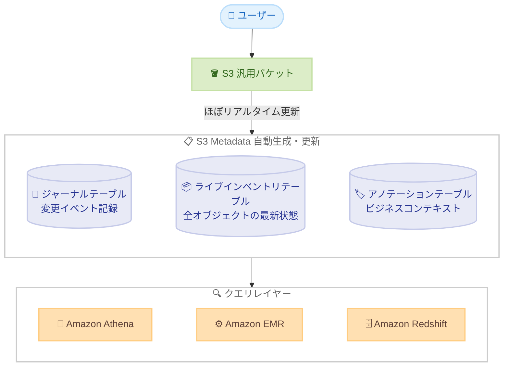

# Amazon S3 - S3 Metadata が 6 つの AWS リージョンで追加提供開始

**リリース日**: 2026 年 10 月 15 日
**サービス**: Amazon S3
**機能**: Amazon S3 Metadata (リージョン拡大)

📊 [このアップデートのインフォグラフィックを見る](https://takech9203.github.io/aws-news-summary/20261015-amazon-s3-metadata-six-additional-regions.html)

## 概要

Amazon S3 Metadata が、新たに 6 つの AWS リージョンで利用可能になりました。追加されたのはアジアパシフィック (ハイデラバード)、アジアパシフィック (マレーシア)、アジアパシフィック (ニュージーランド)、アジアパシフィック (台北)、アジアパシフィック (タイ)、メキシコ (中部) の各リージョンです。今回の拡大により、S3 Metadata は合計 38 の AWS リージョンで一般提供されることになりました。

S3 Metadata は、S3 に保存されたデータを即座に発見・理解するための機能です。オブジェクトのメタデータを自動的に収集し、ほぼリアルタイムで更新されるクエリ可能な Apache Iceberg テーブルとして提供します。新規オブジェクトと既存オブジェクトの両方に対してメタデータを自動的に収集するため、ビジネス分析やリアルタイム推論アプリケーションなどで S3 データをキュレーション・特定・活用できます。

さらに、S3 Metadata を拡張する Annotations (アノテーション) 機能も利用できます。オブジェクトごとに最大 1 GB の JSON、XML、YAML 形式のビジネスコンテキストを直接付与でき、これらのリージョンでは S3 Metadata のアノテーションテーブルを通じて大規模にクエリすることが可能です。

**アップデート前の課題**

今回追加された 6 リージョンでは、以前は以下の課題がありました。

- アジアパシフィックの新興リージョンやメキシコ (中部) では S3 Metadata を利用できず、S3 Inventory や独自のメタデータ管理システムを構築する必要があった
- データレジデンシー要件により特定リージョンにデータを保持する必要がある場合、S3 Metadata によるデータ発見の仕組みを導入できなかった
- 大量のオブジェクトから特定条件のデータを探すために、LIST オペレーションの繰り返しやカスタムインデックスの維持が必要だった

**アップデート後の改善**

- 追加された 6 リージョンでも、S3 オブジェクトのメタデータを自動収集し SQL でクエリできるようになった
- アノテーションテーブルを利用して、オブジェクトに付与したビジネスコンテキストを大規模にクエリできるようになった
- データレジデンシー要件のあるワークロードでも、リージョン内で完結するメタデータ管理と検索が可能になった

## アーキテクチャ図



S3 汎用バケットへのオブジェクト操作が S3 Metadata によって自動的に Apache Iceberg 形式のメタデータテーブルへ反映され、Amazon Athena などの分析サービスから SQL でクエリできる構成です。

## サービスアップデートの詳細

### 主要機能

1. **6 リージョンへの提供拡大**
   - アジアパシフィック (ハイデラバード)、アジアパシフィック (マレーシア)、アジアパシフィック (ニュージーランド)、アジアパシフィック (台北)、アジアパシフィック (タイ)、メキシコ (中部) で利用可能になった
   - 今回の拡大により、S3 Metadata は合計 38 の AWS リージョンで一般提供
   - データレジデンシー要件のあるリージョンでもメタデータ駆動のデータ発見が可能

2. **自動メタデータ収集とクエリ**
   - 新規オブジェクトと既存オブジェクトの両方に対してメタデータを自動的に収集
   - メタデータはほぼリアルタイムで更新され、読み取り専用のフルマネージド Apache Iceberg テーブルに保存
   - システム定義メタデータ (作成日時、ストレージクラスなど)、カスタムメタデータ (タグ、ユーザー定義メタデータなど)、イベントメタデータ (更新・削除イベントとリクエスト元アカウントなど) を記録

3. **Annotations によるビジネスコンテキストの付与**
   - JSON、XML、YAML 形式でオブジェクトごとに最大 1 GB のアノテーションを付与可能
   - アノテーションテーブルを有効化することで、アノテーションの内容を大規模に SQL でクエリ可能
   - アノテーションキーや内容に基づくオブジェクトの発見・取得、オブジェクト間でのアノテーションの相関分析が可能

## 技術仕様

### S3 Metadata のテーブル構成

| テーブル | 必須/任意 | 内容 |
|------|------|------|
| ジャーナルテーブル | 必須 | 設定作成後の変更イベント (アップロード、更新、削除など) をほぼリアルタイムで記録 |
| ライブインベントリテーブル | 任意 | バケット内の全オブジェクトとバージョンの最新状態を提供。有効化時にバックフィル処理が実行される |
| アノテーションテーブル | 任意 | オブジェクトに付与された最新のアノテーションを記録し、内容を直接クエリ可能にする |

### テーブルの保存と管理

| 項目 | 詳細 |
|------|------|
| 保存先 | AWS マネージド S3 テーブルバケット (`aws-s3` という名前、アカウント・リージョンごとに 1 つ) |
| テーブル形式 | Apache Iceberg (読み取り専用) |
| 暗号化 | デフォルトで SSE-S3。テーブル作成時に SSE-KMS (カスタマーマネージドキー) を選択可能 |
| メンテナンス | コンパクションや未参照ファイルの削除を Amazon S3 が自動実行 |
| レコード有効期限 | ジャーナルテーブルはレコード有効期限を設定可能 (最低 7 日間の保持が必要) |
| インベントリ更新 | バックフィル完了後、オブジェクトの更新は通常 1 時間以内に反映 |
| クエリ方法 | Amazon Athena、Amazon EMR、Amazon Redshift のほか、Apache Spark、Apache Trino など Iceberg 対応エンジン |

## 設定方法

### 前提条件

1. 対象リージョンに S3 汎用バケットが存在すること
2. メタデータテーブル設定の作成・管理に必要な IAM 権限 (s3:CreateBucketMetadataTableConfiguration など) を持っていること
3. クエリに Amazon Athena などを使用する場合、テーブルバケットと AWS 分析サービスの統合 (AWS Glue Data Catalog / AWS Lake Formation) が有効であること

### 手順

#### ステップ 1: メタデータテーブル設定の作成

```bash
aws s3api create-bucket-metadata-configuration \
  --bucket amzn-s3-demo-bucket \
  --metadata-configuration '{
    "JournalTableConfiguration": {
      "RecordExpiration": {
        "Expiration": "ENABLED",
        "Days": 30
      }
    },
    "InventoryTableConfiguration": {
      "ConfigurationState": "ENABLED"
    }
  }'
```

対象の汎用バケットにメタデータテーブル設定を作成します。ジャーナルテーブル (レコード有効期限 30 日) とライブインベントリテーブルを有効化しています。インベントリテーブルは有効化後にバックフィル処理が実行されます。

#### ステップ 2: 設定の確認

```bash
aws s3api get-bucket-metadata-configuration \
  --bucket amzn-s3-demo-bucket
```

作成したメタデータテーブル設定の内容とステータスを確認します。インベントリテーブルのステータスが Backfilling から Active に変わるとクエリ可能になります。

#### ステップ 3: Athena でメタデータをクエリ

```sql
-- 直近 1 日にアップロードされたオブジェクトを確認
SELECT key, size, storage_class, last_modified_date
FROM "b_amzn_s3_demo_bucket"."journal"
WHERE record_type = 'CREATE'
  AND record_timestamp > (current_timestamp - interval '1' day)
ORDER BY record_timestamp DESC;
```

ジャーナルテーブルに対して SQL クエリを実行し、直近にアップロードされたオブジェクトを一覧表示します。LIST オペレーションを繰り返すことなく、SQL だけで変更履歴を把握できます。

## メリット

### ビジネス面

- **データ発見の高速化**: 大量のオブジェクトから必要なデータを SQL で即座に特定でき、分析や AI/ML ワークロードのデータ準備時間を短縮できる
- **データレジデンシー対応**: アジアパシフィックの新興リージョンやメキシコでデータを保持する要件があっても、リージョン内でメタデータ管理を完結できる
- **運用コスト削減**: 独自のメタデータ管理システムやカスタムインデックスの構築・維持が不要になる

### 技術面

- **フルマネージドな Iceberg テーブル**: コンパクションなどのメンテナンスを Amazon S3 が自動実行し、運用負荷なしで最適なクエリ性能を維持できる
- **ほぼリアルタイムの更新**: オブジェクトの変更がほぼリアルタイムでジャーナルテーブルに反映され、鮮度の高いメタデータに基づいた処理が可能
- **豊富なクエリエコシステム**: Amazon Athena、Amazon EMR、Amazon Redshift に加え、Apache Spark や Apache Trino など Iceberg 対応エンジンからクエリできる

## デメリット・制約事項

### 制限事項

- ジャーナルテーブルは、メタデータテーブル設定を作成した後に発生した変更イベントのみを記録する (作成前のイベントは記録されない)
- メタデータテーブルは読み取り専用であり、Amazon S3 以外の IAM プリンシパルによる変更はできない (削除は可能)
- ジャーナルテーブルのレコード有効期限は最低 7 日間の保持が必要
- 利用可能なリージョンは 38 リージョンであり、すべての AWS リージョンでは利用できない

### 考慮すべき点

- ライブインベントリテーブルの有効化時にはバックフィル処理に対する課金が発生し、オブジェクト数によっては完了まで数時間かかる場合がある (最低 15 分)
- 10 億オブジェクトを超えるバケットでは、ライブインベントリテーブルに月額料金が発生する
- インベントリテーブルへの更新反映は通常 1 時間以内であり、ジャーナルテーブルと比較すると鮮度が低い点を考慮した使い分けが必要

## ユースケース

### ユースケース 1: AI/ML トレーニングデータのキュレーション

**シナリオ**: ハイデラバードリージョンに保存した大量の画像データから、特定のアノテーションが付与されたオブジェクトのみをモデルトレーニングに使用したい。

**実装例**:
```sql
SELECT o.key, o.size
FROM "b_training_data_bucket"."annotation" a
JOIN "b_training_data_bucket"."inventory" o
  ON a.key = o.key
WHERE a.annotation_key = 'label'
  AND a.annotation_content LIKE '%"verified": true%';
```

**効果**: 検証済みラベルを持つオブジェクトのみを SQL で抽出でき、トレーニングデータの準備時間を大幅に短縮できる。

### ユースケース 2: セキュリティ・コンプライアンス監査

**シナリオ**: メキシコ (中部) リージョンのバケットで、SSE-KMS で暗号化されていないオブジェクトを定期的に検出したい。

**実装例**:
```sql
SELECT key, encryption_status, storage_class
FROM "b_compliance_bucket"."inventory"
WHERE encryption_status != 'SSE-KMS';
```

**効果**: バケット全体をスキャンするカスタムスクリプトを実行することなく、暗号化ポリシーに準拠していないオブジェクトを即座に特定できる。

### ユースケース 3: データ変更の追跡とパイプライン連携

**シナリオ**: タイリージョンのデータレイクで、新規に到着したデータのみを下流の ETL パイプラインで処理したい。

**実装例**:
```sql
SELECT key, record_timestamp
FROM "b_datalake_bucket"."journal"
WHERE record_type = 'CREATE'
  AND record_timestamp > TIMESTAMP '2026-10-15 00:00:00'
ORDER BY record_timestamp;
```

**効果**: S3 イベント通知の個別処理や LIST オペレーションの繰り返しが不要になり、増分処理パイプラインをシンプルに実装できる。

## 料金

S3 Metadata の料金は、ジャーナルテーブルへの更新 (オブジェクト数ベース) と、メタデータテーブルのストレージに対して発生します。ライブインベントリテーブルを有効化する場合はバックフィル処理に対する課金があり、10 億オブジェクトを超えるバケットでは月額料金が発生します。詳細は [Amazon S3 の料金ページ](https://aws.amazon.com/s3/pricing/) を参照してください。

## 利用可能リージョン

今回のアップデートで以下の 6 リージョンが追加されました。

- アジアパシフィック (ハイデラバード)
- アジアパシフィック (マレーシア)
- アジアパシフィック (ニュージーランド)
- アジアパシフィック (台北)
- アジアパシフィック (タイ)
- メキシコ (中部)

今回の拡大により、S3 Metadata は合計 38 の AWS リージョン (東京・大阪リージョンを含む) で一般提供されています。最新のリージョン一覧は [ドキュメント](https://docs.aws.amazon.com/AmazonS3/latest/userguide/metadata-tables-restrictions.html#metadata-tables-regions) を参照してください。

## 関連サービス・機能

- **Amazon S3 Tables**: S3 Metadata のメタデータテーブルは AWS マネージド S3 テーブルバケットに Apache Iceberg 形式で保存される
- **Amazon Athena**: AWS Glue Data Catalog との統合により、メタデータテーブルを SQL で直接クエリできる
- **Amazon SageMaker Lakehouse**: テーブルバケットとの統合により、AWS 分析サービスからのテーブルデータの自動検出とアクセスを実現する
- **AWS Lake Formation**: メタデータテーブルへのアクセス制御を一元管理する

## 参考リンク

- 📊 [インフォグラフィック](https://takech9203.github.io/aws-news-summary/20261015-amazon-s3-metadata-six-additional-regions.html)
- [公式発表 (What's New)](https://aws.amazon.com/about-aws/whats-new/2026/10/amazon-s3-metadata-six-additional-regions/)
- [製品ページ (Amazon S3 Metadata)](https://aws.amazon.com/s3/features/metadata/)
- [ドキュメント (S3 Metadata tables overview)](https://docs.aws.amazon.com/AmazonS3/latest/userguide/metadata-tables-overview.html)
- [利用可能リージョン一覧](https://docs.aws.amazon.com/AmazonS3/latest/userguide/metadata-tables-restrictions.html#metadata-tables-regions)
- [料金ページ](https://aws.amazon.com/s3/pricing/)

## まとめ

Amazon S3 Metadata が 6 リージョンに拡大し、合計 38 リージョンで利用可能になりました。アジアパシフィックの新興リージョンやメキシコでデータレジデンシー要件を持つワークロードでも、自動収集されたメタデータとアノテーションを SQL でクエリするデータ発見の仕組みを導入できます。該当リージョンで S3 を利用している場合は、メタデータテーブル設定を有効化し、データ分析や AI/ML ワークロードのデータ準備の効率化を検討することを推奨します。
