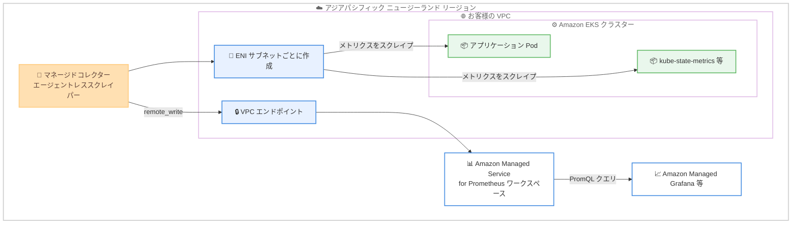

# Amazon Managed Service for Prometheus - Collector のアジアパシフィック (ニュージーランド) リージョン対応

**リリース日**: 2026 年 10 月 15 日
**サービス**: Amazon Managed Service for Prometheus
**機能**: Amazon Managed Service for Prometheus Collector (フルマネージドなエージェントレスコレクター) のアジアパシフィック (ニュージーランド) リージョン対応

📊 [このアップデートのインフォグラフィックを見る](https://takech9203.github.io/aws-news-summary/20261015-ams-prometheus-collector-apac-nz.html)

## 概要

Amazon Managed Service for Prometheus の Collector (フルマネージドなエージェントレスコレクター) が、アジアパシフィック (ニュージーランド) リージョンで利用可能になりました。ニュージーランドのお客様は、Prometheus 互換のモニタリングワークロードをリージョン内で実行できるようになり、ローカルワークロードに対する低レイテンシーの実現と、データを国内に保持するデータレジデンシー要件への対応が可能になります。

Amazon Managed Service for Prometheus Collector は、コンテナワークロードから Prometheus メトリクスを自動的に検出・収集するフルマネージドのスクレイパーです。お客様自身で収集エージェントを実行・運用する必要がありません。収集されたメトリクスは Amazon Managed Service for Prometheus ワークスペースに取り込まれ、クエリや分析に利用できます。このフルマネージドアプローチにより、収集インフラストラクチャの保守とスケーリングが不要になり、運用負荷が大幅に軽減されます。

**アップデート前の課題**

- アジアパシフィック (ニュージーランド) リージョンでは Collector が利用できず、EKS クラスターのメトリクス収集には Prometheus サーバーや AWS Distro for OpenTelemetry (ADOT) などのエージェントを自前で運用する必要があった
- 自前のスクレイパー運用では、エージェントのインストール、パッチ適用、スケーリング、高可用性の確保をお客様自身が行う必要があった
- データレジデンシー要件によりニュージーランド国内にデータを保持したいお客様は、マネージドなメトリクス収集の選択肢が限られていた

**アップデート後の改善**

- ニュージーランドリージョン内で Collector を利用でき、エージェントレスで EKS クラスターのメトリクスを収集可能になった
- 収集インフラストラクチャの管理・スケーリングが不要になり、運用負荷が軽減された
- モニタリングデータを国内に保持しながら、ローカルワークロードに対して低レイテンシーなメトリクス収集が可能になった

## アーキテクチャ図



マネージドコレクターは、スクレイパー作成時に指定したサブネットごとに ENI を作成し、その ENI 経由で EKS クラスター内のメトリクスをスクレイプします。収集したデータは VPC エンドポイントを通じて `remote_write` でワークスペースに送信されるため、データがパブリックインターネットを経由することはありません。

## サービスアップデートの詳細

### 主要機能

1. **エージェントレスなメトリクス収集**
   - Prometheus 互換メトリクスを自動的に検出・収集するフルマネージドスクレイパー
   - エージェントやスクレイパーのインストール、管理、パッチ適用、メンテナンスが不要
   - 信頼性が高く、安定した、高可用性のメトリクス収集を自動スケーリングで提供

2. **Amazon EKS クラスターとの統合**
   - EC2 と Fargate の両方で動作する Amazon EKS クラスターに対応
   - EKS が公開する API サーバーメトリクス、`kube-controller-manager` メトリクス、`kube-scheduler` メトリクスの収集に対応
   - Kubernetes 環境で動作する多数の Prometheus 互換エクスポーターのメトリクスを収集可能

3. **セキュアなデータ転送**
   - サブネットごとに作成される ENI を通じてメトリクスをスクレイプ
   - VPC エンドポイント経由の `remote_write` でワークスペースにデータを送信
   - スクレイプされたデータはパブリックインターネットを経由しない

4. **ニュージーランドでのデータレジデンシー対応**
   - メトリクスの収集から保存までをアジアパシフィック (ニュージーランド) リージョン内で完結可能
   - ローカルワークロードに対する低レイテンシーなモニタリングを実現

## 技術仕様

### Collector の主な仕様

| 項目 | 詳細 |
|------|------|
| 収集方式 | エージェントレスのマネージドスクレイパー (Pull 型) |
| 対象ワークロード | Amazon EKS クラスター (EC2 / Fargate)、Amazon MSK、Amazon OpenSearch Service |
| ネットワーク | サブネットごとに ENI を作成し、VPC 内でスクレイプを実行 |
| データ送信 | VPC エンドポイント経由の `remote_write` (パブリックインターネット非経由) |
| スクレイプ設定 | Prometheus 互換のスクレイプ設定 (scrape configuration) を指定可能 |
| モニタリング | ベンドログ (vended logs) によるコレクターの監視に対応 |

## 設定方法

### 前提条件

1. アジアパシフィック (ニュージーランド) リージョンに Amazon Managed Service for Prometheus ワークスペースを作成済みであること
2. メトリクス収集対象の Amazon EKS クラスターが存在すること
3. スクレイパーの作成に必要な IAM 権限 (`aps:CreateScraper` など) を持っていること

### 手順

#### ステップ1: ワークスペースの作成

```bash
aws amp create-workspace \
  --alias my-workspace \
  --region ap-southeast-6
```

アジアパシフィック (ニュージーランド) リージョンに Amazon Managed Service for Prometheus のワークスペースを作成します。メトリクスの保存・クエリ先となります。

#### ステップ2: スクレイパーの作成

```bash
aws amp create-scraper \
  --source eksConfiguration="{clusterArn='arn:aws:eks:ap-southeast-6:123456789012:cluster/my-cluster', securityGroupIds=['sg-xxxxxxxx'], subnetIds=['subnet-aaaa','subnet-bbbb']}" \
  --scrape-configuration configurationBlob=$(base64 -w0 scrape-config.yaml) \
  --destination ampConfiguration="{workspaceArn='arn:aws:aps:ap-southeast-6:123456789012:workspace/ws-xxxxxxxx'}" \
  --region ap-southeast-6
```

EKS クラスターをソース、ワークスペースを宛先としてマネージドスクレイパーを作成します。`scrape-config.yaml` には Prometheus 互換のスクレイプ設定を記述し、Base64 エンコードして渡します。指定したサブネットごとに ENI が作成されます。

#### ステップ3: メトリクスの確認

```bash
awscurl --service aps --region ap-southeast-6 \
  "https://aps-workspaces.ap-southeast-6.amazonaws.com/workspaces/ws-xxxxxxxx/api/v1/query?query=up"
```

ワークスペースの PromQL クエリ API に対して `up` メトリクスを問い合わせ、スクレイプ対象からメトリクスが収集されていることを確認します。Amazon Managed Grafana などの可視化ツールからも同様にクエリできます。

## メリット

### ビジネス面

- **データレジデンシー対応**: モニタリングデータをニュージーランド国内に保持でき、データ所在地に関する規制・コンプライアンス要件に対応しやすくなる
- **運用コストの削減**: 収集エージェントの構築・保守・スケーリングが不要になり、運用チームの負荷とコストを削減できる
- **低レイテンシー**: ニュージーランド国内のワークロードに対してリージョン内で収集・保存が完結し、レイテンシーが低減される

### 技術面

- **エージェントレス**: Prometheus サーバーや ADOT コレクターなどの収集基盤を自前で管理する必要がなく、パッチ適用やバージョン管理から解放される
- **自動スケーリングと高可用性**: メトリクス量の増減に応じてマネージド側で自動的にスケールし、高可用性が確保される
- **セキュアな通信**: ENI と VPC エンドポイントを利用した閉域構成で、スクレイプデータがパブリックインターネットを経由しない

## デメリット・制約事項

### 制限事項

- マネージドコレクターの収集対象は Amazon EKS クラスター (および Amazon MSK、Amazon OpenSearch Service との統合) が中心であり、任意の環境への汎用エージェントとして利用できるわけではない
- スクレイパー作成時にサブネットとセキュリティグループの指定が必要で、ENI を作成できるネットワーク設計が前提となる

### 考慮すべき点

- 既に Prometheus サーバーや ADOT コレクターで収集している場合、マネージドコレクターへの移行時はスクレイプ設定の互換性を確認する必要がある
- スクレイプ間隔や収集対象の設定はサンプル取り込み量に直結するため、コスト最適化の観点で設計する必要がある

## ユースケース

### ユースケース1: ニュージーランド国内の EKS ワークロードのモニタリング

**シナリオ**: ニュージーランドの金融機関や公共機関が、データ国内保持の要件を満たしつつ EKS クラスターのモニタリングを行いたい。

**実装例**:
```
1. ap-southeast-6 にワークスペースを作成
2. 国内の EKS クラスターをソースとしてマネージドスクレイパーを作成
3. Amazon Managed Grafana でダッシュボードを構築
```

**効果**: メトリクスの収集・保存・可視化を国内リージョンで完結し、データレジデンシー要件を満たしながら運用負荷の低いモニタリング基盤を構築できる。

### ユースケース2: 自前 Prometheus サーバーからの移行

**シナリオ**: EKS 上で Prometheus サーバーを自前運用しており、スケーリングや可用性の管理が負担になっている。

**実装例**:
```
1. 既存の prometheus.yml からスクレイプ設定を抽出
2. マネージドスクレイパーの scrape-configuration として設定
3. 並行稼働で収集内容を検証した後、自前 Prometheus サーバーを廃止
```

**効果**: 収集基盤の運用 (スケーリング、パッチ適用、高可用性確保) から解放され、ダッシュボードやアラートの改善に注力できる。

### ユースケース3: マルチリージョン展開での監視基盤の標準化

**シナリオ**: 複数のアジアパシフィックリージョンに EKS ワークロードを展開しており、各リージョンで同一構成のモニタリング基盤を利用したい。

**実装例**:
```
1. 各リージョンにワークスペースとマネージドスクレイパーを IaC で展開
2. ニュージーランドリージョンにも同一テンプレートを適用
3. Grafana で複数ワークスペースを横断的に可視化
```

**効果**: ニュージーランドを含む各リージョンで統一されたエージェントレス収集構成を実現し、監視基盤の運用を標準化できる。

## 料金

Amazon Managed Service for Prometheus の料金は、取り込んだメトリクスサンプル数、保存したメトリクス、実行したクエリサンプル数に基づく従量課金です。マネージドコレクター利用時は、コレクターが収集するサンプルに対して料金が発生します。最新の料金はリージョンにより異なる場合があるため、[料金ページ](https://aws.amazon.com/prometheus/pricing/)で確認してください。

## 利用可能リージョン

今回のアップデートにより、Amazon Managed Service for Prometheus Collector がアジアパシフィック (ニュージーランド) リージョンで利用可能になりました。その他の利用可能リージョンは [AWS リージョン別サービス一覧](https://aws.amazon.com/about-aws/global-infrastructure/regional-product-services/)を参照してください。

## 関連サービス・機能

- **Amazon EKS**: マネージドコレクターの主要な収集対象。EC2 と Fargate の両方のクラスターに対応
- **Amazon Managed Grafana**: ワークスペースに取り込んだメトリクスの可視化・ダッシュボード構築に利用
- **AWS Distro for OpenTelemetry (ADOT)**: エージェントを自前で運用する場合の代替収集手段。マネージドコレクターはこれらのエージェント運用を不要にする
- **Amazon MSK / Amazon OpenSearch Service**: マネージド Prometheus コレクターによるメトリクス収集統合が提供されている関連サービス

## 参考リンク

- 📊 [インフォグラフィック](https://takech9203.github.io/aws-news-summary/20261015-ams-prometheus-collector-apac-nz.html)
- [公式発表 (What's New)](https://aws.amazon.com/about-aws/whats-new/2026/10/ams-prometheus-collector-apac-nz/)
- [ドキュメント: Ingest metrics with AWS managed collectors](https://docs.aws.amazon.com/prometheus/latest/userguide/AMP-collector.html)
- [製品ページ: Amazon Managed Service for Prometheus](https://aws.amazon.com/prometheus/)
- [料金ページ](https://aws.amazon.com/prometheus/pricing/)

## まとめ

Amazon Managed Service for Prometheus Collector のアジアパシフィック (ニュージーランド) リージョン対応により、ニュージーランドのお客様はエージェントレスなメトリクス収集をリージョン内で利用でき、低レイテンシーとデータレジデンシー要件の両立が可能になりました。同リージョンで EKS ワークロードを運用しているお客様は、自前の収集エージェント運用からマネージドコレクターへの移行を検討することを推奨します。
