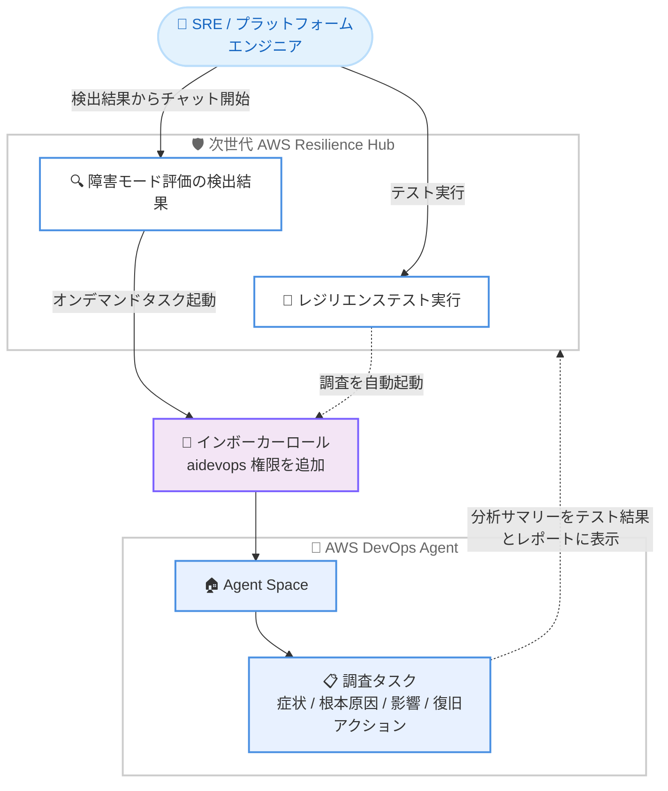

# AWS Resilience Hub - AWS DevOps Agent 連携による検出結果とテスト結果のレビュー

**リリース日**: 2026 年 10 月 15 日
**サービス**: AWS Resilience Hub
**機能**: AWS DevOps Agent による障害モード評価の検出結果レビューとレジリエンステスト結果の調査

📊 [このアップデートのインフォグラフィックを見る](https://takech9203.github.io/aws-news-summary/20261015-aws-devops-agent-test-results-aws-resilience-hub.html)

## 概要

次世代の AWS Resilience Hub が AWS DevOps Agent と統合され、障害モード評価 (FMA: Failure Mode Assessment) の検出結果のレビュー、検出結果を解決するための緩和策の実装、レジリエンステスト結果のレビューを AI エージェントで行えるようになりました。AWS Resilience Hub は、AWS 上で稼働するワークロードのレジリエンスを評価・強化するための AWS マネジメントコンソール上の一元的な場所であり、自動依存関係検出、生成 AI による障害モード分析、モジュール型レジリエンスポリシー、レジリエンステスト、組織全体のレジリエンス態勢レポートを提供します。

本アップデートでは 2 つの連携機能が提供されます。1 つ目は「レジリエンステストの調査」で、レジリエンステストを実行すると Resilience Hub が AWS DevOps Agent の調査を自動的に起動し、テストを観測して構造化された分析結果を返します。症状、根本原因、影響に加えて、ARC (Amazon Application Recovery Controller) のリージョン切り替えなどの観測された復旧アクションを把握できます。2 つ目は「障害モード評価の検出結果からの対話型エージェント分析」で、Resilience Hub コンソールの検出結果から、その検出結果のコンテキストが設定済みの状態で AWS DevOps Agent のオンデマンドタスクを直接開始できます。これにより、質問や調査を通じて緩和計画を作成できます。

プラットフォームエンジニアリングチームや SRE (Site Reliability Engineering) チームが対象ユーザーであり、レジリエンス上の課題の調査と対処を AI エージェントとの対話で効率化できる点が主要な価値です。

**アップデート前の課題**

このアップデート以前は、以下のような課題がありました。

- 障害モード評価で検出された問題について、根本原因の調査や緩和策の検討をエンジニアが手動で行う必要があった
- レジリエンステストの実行結果から、症状・根本原因・影響・復旧アクションを把握するには、ログやメトリクスを個別に確認する分析作業が必要だった
- Resilience Hub の検出結果と AWS DevOps Agent による調査が分離しており、検出結果のコンテキストを調査ツールに引き継ぐ仕組みがなかった

**アップデート後の改善**

今回のアップデートにより、以下が可能になりました。

- レジリエンステストの実行と同時に AWS DevOps Agent の調査が自動的に開始され、テスト完了後まもなく、判定 (verdict)、確信度、分析サマリーを含む構造化された分析結果を確認できるようになった
- 障害モード評価のすべての検出結果から「Chat with DevOps Agent」を選択するだけで、検出結果のコンテキストが引き継がれた対話型セッションを開始し、緩和計画を作成できるようになった
- テストレポートに DevOps Agent の調査セクションが含まれるようになり、テスト結果の共有と報告が容易になった

## アーキテクチャ図



Resilience Hub はサービスレベルで設定済みのインボーカーロールを引き受けて AWS DevOps Agent の Agent Space に接続し、検出結果からの対話型調査とレジリエンステストの自動調査を実行します。

## サービスアップデートの詳細

### 主要機能

1. **レジリエンステストの調査 (自動起動)**
   - レジリエンステストを実行すると、AWS DevOps Agent の調査がテスト実行と同時に自動的に開始される
   - テスト完了後まもなく、分析サマリーがテスト実行結果に表示され、テストレポートにも含まれる
   - 症状、根本原因、影響に加えて、ARC リージョン切り替えなどの観測された復旧アクションを把握できる
   - 調査結果には判定 (verdict)、確信度 (confidence)、分析サマリーが含まれ、リンクからフルセッションを開ける
   - DevOps Agent の判定は参考情報 (advisory) であり、テスト実行自体の結果が正式な判定として維持される

2. **障害モード評価の検出結果からの対話型エージェント分析 (オンデマンド)**
   - すべての障害モード評価の検出結果で「Chat with DevOps Agent」を選択可能
   - 検出結果のコンテキストがあらかじめ設定された対話型 DevOps Agent セッションが開く
   - 質問や調査を通じて検出結果を深掘りし、緩和計画を作成できる
   - API を使用する場合、各検出結果は同じセッションへの `investigationDeepLink` を返す

3. **テストレポートへの調査結果の統合**
   - 接続済みサービスのテストレポートには DevOps Agent の調査セクションとサマリーが含まれる
   - テストレポートの生成は DevOps Agent の調査完了時に完了する

## 技術仕様

### 連携の仕組み

| 項目 | 詳細 |
|------|------|
| 接続単位 | Resilience Hub のサービスごとに DevOps Agent の Agent Space を接続 |
| Agent Space ARN 形式 | `arn:aws:aidevops:{region}:{account-id}:agentspace/{agent-space-id}` |
| 認証方式 | サービスレベルで設定済みの既存インボーカーロール (リソース検出と同じクロスアカウントロール) を Resilience Hub が引き受ける |
| 調査対象リージョン | Agent Space は DevOps Agent がサポートするリージョンに作成する。Agent Space の作成リージョンに関係なく、任意のリージョンのリソースを調査可能 |
| 接続設定 | サービスの作成時または更新時に `devOpsAgentConfiguration` へ Agent Space ARN を指定 |
| 接続解除 | 空の DevOps Agent 設定 (`'{}'`) でサービスを更新 (Agent Space 自体には影響なし) |

### API変更履歴

| 日付 | サービス | 変更内容 |
|------|----------|----------|
| 2026/10/13 | [AWS Resilience Hub V2](https://awsapichanges.com/archive/changes/5f4e0c-resiliencehub.html) | 10 updated api methods - DevOps Agent 連携のサポート追加。サービスレベルで Agent Space ARN を指定し、Resilience Hub v2 から直接調査を起動可能に |

### インボーカーロールに追加する IAM 権限

インボーカーロールには、以下の最小権限ポリシーをインラインポリシーとして追加します。新しいロールの作成や信頼ポリシーの変更は不要です。

```json
{
  "Version": "2012-10-17",
  "Statement": [
    {
      "Sid": "ResilienceHubV2DevOpsAgentInvestigation",
      "Effect": "Allow",
      "Action": [
        "aidevops:CreateBacklogTask",
        "aidevops:GetBacklogTask",
        "aidevops:ListExecutions",
        "aidevops:ListJournalRecords",
        "aidevops:UpdateBacklogTask"
      ],
      "Resource": "arn:aws:aidevops:*:*:agentspace/*"
    },
    {
      "Sid": "ResilienceHubV2DevOpsAgentValidation",
      "Effect": "Allow",
      "Action": [
        "aidevops:GetAgentSpace",
        "aidevops:GetOperatorApp",
        "aidevops:ListAssociations"
      ],
      "Resource": "arn:aws:aidevops:*:*:agentspace/*"
    }
  ]
}
```

- `ResilienceHubV2DevOpsAgentInvestigation`: 調査を構成するバックログタスクの開始・ポーリング・更新・キャンセルと、ジャーナルレコードの読み取りを許可
- `ResilienceHubV2DevOpsAgentValidation`: Agent Space 接続の検証に使用する読み取り専用アクセスを許可

**重要**: AWS マネージドポリシーの `AIDevOpsAgentFullAccess` や `AIDevOpsOperatorAppAccessPolicy` は、Resilience Hub が呼び出すべきではない Agent Space の変更系アクションを許可するため、アタッチしないでください。上記のインラインポリシーが連携に必要な唯一の権限付与です。

## 設定方法

### 前提条件

1. DevOps Agent の Agent Space が作成済みであること。Agent Space は DevOps Agent コンソールで作成・設定し、その ARN を控えておく
2. リソース検出が設定済みの次世代 Resilience Hub サービスが存在すること。検出に使用するクロスアカウントインボーカーロールが存在している必要がある
3. Agent Space が DevOps Agent のサポート対象リージョンにあること

### 手順

#### ステップ1: インボーカーロールに DevOps Agent 権限を追加

```bash
aws iam put-role-policy \
  --role-name my-invoker-role \
  --policy-name ResilienceHubDevOpsAgentAccess \
  --policy-document file://resiliencehub-devops-agent-policy.json
```

前述の最小権限ポリシーを `resiliencehub-devops-agent-policy.json` として保存し、既存のインボーカーロールにインラインポリシーとして追加します。権限が不足している場合、接続はアクセス拒否エラーで失敗し、サービスの DevOps Agent ステータスが `FAILED` になります。

#### ステップ2: サービスを Agent Space に接続

```bash
aws resiliencehubv2 update-service \
  --service-arn <service-arn> \
  --dev-ops-agent-configuration '{"agentSpaceArn": "<agent-space-arn>"}'
```

既存のサービスの DevOps Agent 設定に Agent Space ARN を指定して接続します。サービスの新規作成時に指定することも可能です。コンソールの場合は、サービスを選択してサービス設定で DevOps Agent を構成します。

#### ステップ3: 接続ステータスを確認

```bash
aws resiliencehubv2 get-service \
  --service-arn <service-arn> \
  --query 'service.devOpsAgentConfiguration.status'
```

`GetService` を呼び出して `devOpsAgentConfiguration` フィールドを確認し、接続ステータスを検証します。

#### ステップ4: 検出結果またはテストから DevOps Agent を起動

接続完了後、障害モード評価の検出結果で「Chat with DevOps Agent」を選択して対話型調査を開始します。レジリエンステストでは調査が自動的に開始されるため、テスト完了後にテスト実行結果を開き、判定・確信度・分析サマリーを確認します。API の場合はテスト実行結果の `devOpsAgentInvestigation` ブロックを参照します。

## メリット

### ビジネス面

- **調査時間の短縮**: テスト結果の分析や検出結果の調査を AI エージェントが実施するため、エンジニアの分析工数を削減し、緩和策の実装により多くの時間を使える
- **レジリエンス改善サイクルの加速**: 検出から調査、緩和計画の作成までが一連の流れでつながり、組織のレジリエンス態勢の改善が加速する
- **レポートの充実**: テストレポートに AI による調査サマリーが含まれるため、ステークホルダーへの報告品質が向上する

### 技術面

- **コンテキスト引き継ぎ**: 検出結果のコンテキストが設定済みの状態でエージェントセッションが開始されるため、状況説明の手間なく調査に着手できる
- **構造化された分析**: 症状、根本原因、影響、観測された復旧アクション (ARC リージョン切り替えなど) が構造化されて提供される
- **最小権限設計**: 連携に必要な権限は 8 つの `aidevops` アクションに限定され、Agent Space やリソースを変更する権限は含まれない

## デメリット・制約事項

### 制限事項

- 次世代 (next generation) の Resilience Hub サービスが対象であり、リソース検出とインボーカーロールの設定が前提となる
- DevOps Agent の Agent Space を事前に作成しておく必要があり、Agent Space は DevOps Agent のサポート対象リージョンに作成する必要がある
- インボーカーロールに必要な `aidevops` 権限がない場合、接続は失敗し、ステータスが `FAILED` になる

### 考慮すべき点

- DevOps Agent の判定 (verdict) は参考情報であり、テスト実行自体の結果が正式な判定として扱われる
- 接続済みサービスでは、テストレポートの生成が DevOps Agent の調査完了まで待機するため、レポート生成の完了タイミングに影響する
- `AIDevOpsAgentFullAccess` などの広範なマネージドポリシーをインボーカーロールにアタッチしないよう注意が必要

## ユースケース

### ユースケース1: レジリエンステスト結果の自動分析

**シナリオ**: SRE チームがマルチリージョン構成のワークロードに対してリージョン切り替えのレジリエンステストを実行し、復旧動作が期待どおりであったかを検証したい。

**実装例**:
```bash
# テスト完了後、テスト実行結果から DevOps Agent の調査結果を確認
aws resiliencehubv2 get-service \
  --service-arn <service-arn> \
  --query 'service.devOpsAgentConfiguration'
# コンソールでテスト実行を開き devOpsAgentInvestigation の
# 判定・確信度・分析サマリーを確認
```

**効果**: テスト中の症状、根本原因、影響、ARC リージョン切り替えなどの復旧アクションが構造化された分析として自動的に得られ、手動のログ分析が不要になる。

### ユースケース2: 障害モード評価の検出結果に対する緩和計画の作成

**シナリオ**: プラットフォームエンジニアリングチームが障害モード評価で検出された単一障害点について、原因の深掘りと具体的な緩和策を検討したい。

**実装例**:
```
1. Resilience Hub コンソールで障害モード評価の検出結果を開く
2. [Chat with DevOps Agent] を選択
3. 検出結果のコンテキストが引き継がれたセッションで
   「この検出結果の影響範囲は?」「推奨される緩和策は?」と質問
4. 対話を通じて緩和計画を作成
```

**効果**: 検出結果の背景情報を手動で収集・説明することなく、対話形式で調査と緩和計画の作成を進められる。

### ユースケース3: 組織的なレジリエンスレポートの品質向上

**シナリオ**: 定期的なレジリエンステストの結果を経営層や監査向けのレポートとして共有しており、テスト結果の分析内容もレポートに含めたい。

**実装例**:
```
1. サービスを Agent Space に接続した状態でレジリエンステストを実行
2. テストレポートを生成
3. レポート内の DevOps Agent 調査セクションのサマリーを確認・共有
```

**効果**: AI による調査サマリーがテストレポートに自動的に含まれるため、レポート作成の工数を削減しつつ、分析の深さと一貫性を確保できる。

## 料金

本アップデートに関する追加料金の情報は、公式発表には記載されていません。AWS Resilience Hub および AWS DevOps Agent の利用料金が適用されるため、詳細は各サービスの料金ページで確認してください。

## 利用可能リージョン

AWS Resilience Hub は以下の AWS リージョンで利用可能です。

- 米国東部 (バージニア北部)
- 米国東部 (オハイオ)
- 米国西部 (オレゴン)
- カナダ (中部)
- 欧州 (アイルランド)
- 欧州 (ロンドン)
- 欧州 (フランクフルト)
- 欧州 (パリ)
- 欧州 (ストックホルム)
- アジアパシフィック (ムンバイ)
- アジアパシフィック (シンガポール)
- アジアパシフィック (シドニー)
- **アジアパシフィック (東京)**
- アジアパシフィック (ソウル)
- 南米 (サンパウロ)

なお、DevOps Agent は Agent Space の作成リージョンに関係なく、任意のリージョンのリソースを調査できます。

## 関連サービス・機能

- **AWS DevOps Agent**: 本連携の調査を実行する AI エージェント。Agent Space 内でバックログタスクとして調査を実行し、ジャーナルレコードとして分析結果を記録する
- **Amazon Application Recovery Controller (ARC)**: レジリエンステスト中のリージョン切り替えなどの復旧アクションとして、DevOps Agent の調査で観測対象となる
- **AWS Fault Injection Service (FIS)**: レジリエンステストの基盤となる障害注入の仕組みと関連し、テストシナリオの実行に関係する
- **AWS IAM**: インボーカーロールへの最小権限ポリシーの追加により、Resilience Hub が DevOps Agent を安全に呼び出すためのアクセス制御を提供する

## 参考リンク

- 📊 [インフォグラフィック](https://takech9203.github.io/aws-news-summary/20261015-aws-devops-agent-test-results-aws-resilience-hub.html)
- [公式発表 (What's New)](https://aws.amazon.com/about-aws/whats-new/2026/10/aws-devops-agent-test-results-aws-resilience-hub/)
- [ドキュメント: Working with AWS DevOps Agent in the next generation of Resilience Hub](https://docs.aws.amazon.com/resilience-hub/latest/userguide/next-gen-devops-agent-integration.html)
- [ドキュメント: Prerequisites](https://docs.aws.amazon.com/resilience-hub/latest/userguide/next-gen-devops-agent-prerequisites.html)
- [ドキュメント: Add DevOps Agent permissions to the invoker role](https://docs.aws.amazon.com/resilience-hub/latest/userguide/next-gen-devops-agent-invoker-role.html)
- [ドキュメント: Connect a service to the Agent Space](https://docs.aws.amazon.com/resilience-hub/latest/userguide/next-gen-devops-agent-connect.html)
- [ドキュメント: Investigate findings and test runs](https://docs.aws.amazon.com/resilience-hub/latest/userguide/next-gen-devops-agent-results.html)
- [AWS Resilience Hub 製品ページ](https://aws.amazon.com/resilience-hub/)

## まとめ

次世代の AWS Resilience Hub と AWS DevOps Agent の統合により、レジリエンステスト結果の自動分析と、障害モード評価の検出結果に対する対話型調査が可能になりました。レジリエンスの検出から調査、緩和計画の作成までが一連の流れでつながるため、SRE やプラットフォームエンジニアリングチームの運用効率が大きく向上します。次世代 Resilience Hub を利用している場合は、インボーカーロールへの最小権限ポリシーの追加と Agent Space の接続から始めることを推奨します。
