# AWS Lambda - Durable Execution SDK for Go の一般提供開始

**リリース日**: 2026 年 10 月 15 日
**サービス**: AWS Lambda
**機能**: AWS Lambda Durable Execution SDK for Go (一般提供)

📊 [このアップデートのインフォグラフィックを見る](https://takech9203.github.io/aws-news-summary/20261015-aws-lambda-durable-go-sdk-support.html)

## 概要

AWS Lambda Durable Execution SDK for Go が一般提供 (GA) になりました。Go 開発者は、Lambda durable functions を使用した耐障害性のある長時間実行ワークフローを、独自の進捗管理の仕組みを実装することなく Go コードで直接構築できるようになります。インフラストラクチャ自動化、承認ゲート付きのデプロイロールアウト、AI モデルを呼び出して人間のレビューを待機するパイプラインといったマルチステップアプリケーションが対象です。

Lambda durable functions は、Lambda のイベント駆動プログラミングモデルを拡張し、進捗を自動的にチェックポイントとして保存し、外部イベントの待機時には最長 1 年間実行を一時停止できる機能です。SDK には、進捗管理のための step、人間やエージェントをループに組み込むワークフローのためのコールバック統合、信頼性の高い関数チェーンのための durable invocation、効率的な一時停止のための wait が含まれています。これにより、Durable Execution SDK は JavaScript、TypeScript、Python、Java、C# (.NET) に加えて Go をサポートすることになりました。

本 SDK は Go 開発者が普段使用しているツールとそのまま連携します。`go get` で Go モジュールに追加し、`provided.al2023` ランタイム上に単一の静的バイナリとしてデプロイします。デプロイ前には、`durabletest` パッケージを使用してネットワークアクセスや AWS 認証情報なしでワークフロー全体をローカルテストでき、`durablelint` アナライザーで再開時にワークフローを壊す可能性のあるコードを事前に検出できます。

**アップデート前の課題**

- Durable Execution SDK は JavaScript、TypeScript、Python、Java、C# (.NET) 向けに提供されており、Go 開発者は Lambda durable functions をネイティブに利用できなかった
- Go で長時間実行のマルチステップワークフローを構築するには、独自の進捗管理 (チェックポイント保存や再開ロジック) を実装するか、AWS Step Functions などの外部オーケストレーションサービスを併用する必要があった
- 人間の承認待ちや外部イベント待ちを Go コードで表現するには、ポーリング用のインフラや状態管理用のデータストアを別途用意する必要があった

**アップデート後の改善**

- Go のネイティブな開発体験で Lambda durable functions を利用できるようになり、step、wait、コールバック、durable invocation を通常の Go コードとして記述できるようになった
- 進捗が自動的にチェックポイントとして保存され、障害発生時はリプレイにより完了済みの処理をスキップして再開できるため、独自の進捗管理の実装が不要になった
- `durabletest` パッケージにより、AWS 認証情報やネットワークアクセスなしでワークフロー全体をローカルマシンでテストできるようになった
- `durablelint` アナライザーにより、再開時にワークフローを壊す可能性のある非決定的なコードを静的解析で検出できるようになった

## アーキテクチャ図

```mermaid
flowchart TD
    subgraph Dev["💻 ローカル開発"]
        direction LR
        CODE["📝 Go コード<br/>durable.Context"]
        TEST["🧪 durabletest<br/>ローカルテスト"]
        LINT["🔍 durablelint<br/>静的解析"]
        CODE ~~~ TEST ~~~ LINT
    end

    subgraph Lambda["⚡ AWS Lambda"]
        FUNC["📦 静的バイナリ bootstrap<br/>provided.al2023 ランタイム"]
        subgraph Exec["🔁 durable execution"]
            STEP["🪜 Step<br/>自動リトライとチェックポイント"]
            WAIT["⏸️ Wait<br/>コンピュート課金なしで一時停止"]
            CB["🤝 Callback<br/>人間とエージェントの承認待ち"]
            INV["🔗 Invoke<br/>関数チェーン"]
            STEP --> WAIT --> CB --> INV
        end
        FUNC --> Exec
    end

    CP[("💾 チェックポイント<br/>最長 1 年間の実行状態")]
    EXT(["👤 外部システムと承認者"])

    Dev -->|go build と deploy| FUNC
    Exec -->|進捗を自動保存| CP
    CP -.->|リプレイで再開| Exec
    EXT -.->|コールバック応答| CB

    classDef layer fill:none,stroke:#CCCCCC,stroke-width:2px,color:#666666
    classDef input fill:#E9F7EC,stroke:#66BB6A,stroke-width:2px,color:#333333
    classDef process fill:#FFFFFF,stroke:#4A90E2,stroke-width:2px,color:#333333
    classDef internal fill:#E8F1FF,stroke:#4A90E2,stroke-width:2px,color:#333333
    classDef database fill:#E8EAF6,stroke:#C5CAE9,stroke-width:2px,color:#283593
    classDef user fill:#E3F2FD,stroke:#BBDEFB,stroke-width:2px,color:#1565C0

    class Dev,Lambda,Exec layer
    class CODE,TEST,LINT input
    class FUNC process
    class STEP,WAIT,CB,INV internal
    class CP database
    class EXT user
```



ローカルで開発・テスト・静的解析した Go コードを単一の静的バイナリとしてデプロイし、durable execution が step や wait の進捗をチェックポイントとして自動保存、障害や一時停止からリプレイで再開する流れを示しています。

## サービスアップデートの詳細

### 主要機能

1. **Step による進捗管理**
   - `durable.Step` / `durable.StepAsync` でビジネスロジックをラップすると、結果が自動的にチェックポイントとして保存される
   - 組み込みリトライをサポートし、デフォルトは指数バックオフ。`NoRetry` やカスタムの `RetryConfig` も指定可能
   - 実行セマンティクスは `AtLeastOncePerRetry` (デフォルト、step 本体は冪等であるべき) と `AtMostOncePerRetry` から選択可能

2. **Wait による効率的な一時停止**
   - `durable.Wait` / `durable.WaitAsync` で、Lambda のコンピュートを保持せずに実行を一時停止できる
   - 待機中はコンピュート料金が発生しないため、数時間から数日の待機を含むワークフローでもコスト効率が高い
   - 最小待機時間は 1 秒で、秒単位に切り上げられる

3. **コールバック統合**
   - `CreateCallback` と `WaitForCallback` により、人間の承認やエージェントの応答など外部システムからのイベントを待機できる
   - 外部システムは `SendDurableExecutionCallbackSuccess` / `Failure` API でコールバックを解決する
   - タイムアウトとハートビートをサポート

4. **Durable invocation による関数チェーン**
   - `Invoke` により、別の durable function を独立した実行として信頼性高く呼び出せる

5. **並行処理のサポート**
   - `Go`、`RunInChildContext`、`Map`、`Parallel`、`ParallelMixed` などの並行処理プリミティブを提供
   - `All`、`AllSettled`、`Any`、`Race`、`Join`、`Select` といったコンビネータも利用可能

6. **ローカルテストと静的解析**
   - `durabletest` パッケージの `NewLocalRunner` により、ネットワークアクセスや AWS 認証情報なしで、複数回の呼び出しをまたぐ実行をローカルで再現してテストできる。サービス上限 (step 結果 262,144 バイトなど) も検証される
   - `durablelint` アナライザーが、リプレイ時にワークフローを壊す可能性のある非決定的なコードパターンを検出する

## 技術仕様

### SDK の構成

| 項目 | 詳細 |
|------|------|
| モジュール | `github.com/aws/aws-durable-execution-sdk-go` |
| 必要な Go バージョン | Go 1.24 以降 |
| ランタイム | `provided.al2023` (静的バイナリ `bootstrap` としてデプロイ) |
| 主要パッケージ | `durable` (コア)、`durable/durabletest` (ローカルテスト)、`analysis` (durablelint)、`insight` (可観測性プラグイン) |
| バージョニング | SDK 本体は semver v1。`insight` と `analysis` は pre-v1 で破壊的変更の可能性あり |
| 最大実行期間 | 最長 1 年 (durable functions の仕様) |
| ライセンス | Apache-2.0 |

### 必要な IAM 権限

実行ロールには CloudWatch Logs への権限に加えて、以下の権限が必要です。

```json
{
  "Effect": "Allow",
  "Action": [
    "lambda:CheckpointDurableExecution",
    "lambda:GetDurableExecutionState"
  ],
  "Resource": "*"
}
```

## 設定方法

### 前提条件

1. Go 1.24 以降の開発環境
2. AWS アカウントと Lambda 関数をデプロイできる IAM 権限
3. AWS SAM CLI または CloudFormation などのデプロイツール (関数定義に `DurableConfig` の指定が必要)

### 手順

#### ステップ 1: SDK の追加

```bash
go get github.com/aws/aws-durable-execution-sdk-go
```

Go モジュールに Durable Execution SDK を追加します。通常の Go 依存関係と同じ方法で管理できます。

#### ステップ 2: ハンドラーの実装

```go
package main

import (
	"fmt"
	"time"

	"github.com/aws/aws-durable-execution-sdk-go/durable"
)

func handler(ctx durable.Context, _ any) (string, error) {
	name, err := durable.Step(ctx, "fetch-name", func(_ durable.StepContext) (string, error) {
		return "world", nil
	})
	if err != nil {
		return "", err
	}
	if err := durable.Wait(ctx, "cooldown", 2*time.Second); err != nil {
		return "", err
	}
	return durable.Step(ctx, "format", func(_ durable.StepContext) (string, error) {
		return fmt.Sprintf("hello, %s", name), nil
	})
}

func main() {
	durable.Start(handler)
}
```

`durable.Context` を受け取るハンドラーを実装し、`durable.Start` で登録します。`Step` でラップした処理は自動的にチェックポイントされ、`Wait` はコンピュート課金なしで実行を一時停止します。

#### ステップ 3: ローカルテストと静的解析

```bash
go test ./...
```

`durabletest` パッケージの `NewLocalRunner(handler).RunUntilComplete(event)` を使用したテストを実行します。複数回の呼び出しをまたぐリプレイ動作を、AWS 認証情報やネットワークアクセスなしでローカルに再現できます。あわせて `durablelint` アナライザーを実行し、リプレイ時に問題となる非決定的コードを検出します。

#### ステップ 4: ビルドとデプロイ

```bash
CGO_ENABLED=0 GOOS=linux GOARCH=amd64 go build -o bootstrap main.go
```

Linux 向けの静的バイナリ `bootstrap` をビルドし、`provided.al2023` ランタイムの Lambda 関数としてデプロイします。関数定義には保持期間や実行タイムアウトを指定する `DurableConfig` を設定します。

## メリット

### ビジネス面

- **開発工数の削減**: 進捗管理、リトライ、障害復旧の仕組みを独自実装する必要がなくなり、ビジネスロジックの開発に集中できる
- **コスト効率**: wait による一時停止中はコンピュート料金が発生せず、承認待ちなどで数日間待機するワークフローでも実際の処理時間分のみの支払いで済む
- **人間参加型ワークフローの実現**: 承認ゲート付きデプロイや人間のレビューを待つ AI パイプラインを、追加のインフラなしで構築できる

### 技術面

- **ネイティブな Go 体験**: `go get` での導入、単一静的バイナリへのビルド、通常の Go 関数と同じデプロイフローなど、既存の Go 開発ワークフローと自然に統合できる
- **ローカルテスト可能**: `durabletest` により、チェックポイントとリプレイを含むワークフロー全体を CI やローカルマシンで検証でき、デプロイ前に品質を確保できる
- **静的解析による安全性**: `durablelint` が、再開時にワークフローを壊す非決定的なコード (順序が不定な map のイテレーションなど) を事前に検出する

## デメリット・制約事項

### 制限事項

- ランタイムは `provided.al2023` (カスタムランタイム) を使用する必要がある
- Go 1.24 以降が必要
- `insight` プラグインと `analysis` (durablelint) モジュールは pre-v1 であり、リリース間で破壊的変更が入る可能性がある
- wait の最小時間は 1 秒で、秒単位に切り上げられる

### 考慮すべき点

- リプレイの一貫性を保つため、durable operation は毎回同じ順序で作成する必要がある (map のキーはソートする、非決定的な処理は step 本体の中に閉じ込める、など)
- デフォルトの `AtLeastOncePerRetry` セマンティクスでは step 本体が複数回実行される可能性があるため、冪等に実装する必要がある
- `durable.Context` はゴルーチンに紐づいており、誤用すると `ErrWrongGoroutine` / `ErrWrongContext` エラーで失敗する
- 社内の標準が Step Functions の場合は、ワークフローがビジネスロジックと密結合しているか、ビジュアル設計や 220 以上のサービス統合が必要かといった観点で使い分けを検討する

## ユースケース

### ユースケース 1: 承認ゲート付きのデプロイロールアウト

**シナリオ**: 本番環境へのデプロイを段階的に実行し、各ステージの間に運用担当者の承認を挟みたい。

**実装例**:
```go
cb, _ := durable.CreateCallback[string](ctx, "approval")
_, _ = durable.Step(ctx, "notify-approver", func(_ durable.StepContext) (any, error) {
	return nil, notifyApprover(cb.ID()) // 承認者に通知
})
result, err := durable.WaitForCallback(ctx, cb) // 承認を待機
```

**効果**: 承認待ちの間はコンピュート課金なしで一時停止し、承認後に自動的に再開する。ポーリング用のインフラや状態管理用データベースが不要になる。

### ユースケース 2: 人間のレビューを待つ AI パイプライン

**シナリオ**: AI モデルを呼び出してコンテンツを生成し、人間のレビューを経てから公開する多段パイプラインを Go で構築したい。

**実装例**:
```go
draft, _ := durable.Step(ctx, "generate", func(_ durable.StepContext) (string, error) {
	return invokeModel(prompt) // AI モデル呼び出し
})
cb, _ := durable.CreateCallback[Review](ctx, "human-review")
review, _ := durable.WaitForCallback(ctx, cb) // 人間のレビューを待機
```

**効果**: モデル呼び出しの結果がチェックポイントに保存されるため、障害時も再呼び出しが発生しない。レビュー待ちは最長 1 年間、課金なしで待機できる。

### ユースケース 3: インフラストラクチャ自動化

**シナリオ**: リソースのプロビジョニング、完了のポーリング、後続設定という複数ステップのインフラ自動化を、リトライとロールバックを含めて信頼性高く実行したい。

**実装例**:
```go
id, _ := durable.Step(ctx, "provision", provisionResource)
_ = durable.WaitForCondition(ctx, "ready", func(c durable.StepContext) (bool, error) {
	return isReady(id) // 完了をポーリング
})
_, _ = durable.Step(ctx, "configure", func(_ durable.StepContext) (any, error) {
	return nil, configure(id)
})
```

**効果**: 各ステップの完了状態が保存されるため、途中で失敗しても完了済みの処理をスキップして安全に再開できる。ポーリング間の待機にコンピュート料金は発生しない。

## 料金

SDK 自体は Apache-2.0 ライセンスのオープンソースで、追加料金なしで利用できます。Lambda durable functions の利用料金は AWS Lambda の料金体系に従います。wait による一時停止中はコンピュート料金が発生せず、実際の処理時間に対してのみ課金されます。詳細は [AWS Lambda 料金ページ](https://aws.amazon.com/lambda/pricing/)を参照してください。

## 利用可能リージョン

Lambda durable functions のリージョン別の提供状況は、[AWS Capabilities by Region](https://builder.aws.com/build/capabilities) ページで確認できます。

## 関連サービス・機能

- **AWS Lambda durable functions**: 本 SDK の基盤となる機能。チェックポイントとリプレイにより最長 1 年間の durable execution を実現する
- **AWS Durable Execution SDK (他言語)**: JavaScript、TypeScript、Python、Java、C# (.NET) 向けの SDK も提供されており、今回の GA で Go が追加された
- **AWS Step Functions**: グラフベースの DSL やビジュアルデザイナーでワークフローを定義するスタンドアロンのオーケストレーションサービス。220 以上のサービス統合が必要な場合に適する
- **AWS SAM / AWS CloudFormation**: durable function のデプロイに使用。関数定義に `DurableConfig` を指定する

## 参考リンク

- 📊 [インフォグラフィック](https://takech9203.github.io/aws-news-summary/20261015-aws-lambda-durable-go-sdk-support.html)
- [公式発表 (What's New)](https://aws.amazon.com/about-aws/whats-new/2026/10/aws-lambda-durable-go-sdk-support/)
- [Lambda durable functions 開発者ガイド](https://docs.aws.amazon.com/lambda/latest/dg/durable-functions.html)
- [AWS Durable Execution SDK 開発者ガイド](https://docs.aws.amazon.com/durable-execution/)
- [AWS Lambda Durable Execution SDK for Go (GitHub)](https://github.com/aws/aws-durable-execution-sdk-go)
- [AWS Capabilities by Region](https://builder.aws.com/build/capabilities)
- [AWS Lambda 料金ページ](https://aws.amazon.com/lambda/pricing/)

## まとめ

AWS Lambda Durable Execution SDK for Go の一般提供により、Go 開発者も進捗管理の独自実装なしで、最長 1 年間実行できる耐障害性のあるマルチステップワークフローを構築できるようになりました。`durabletest` によるローカルテストと `durablelint` による静的解析が開発体験を支えており、既存の Go ツールチェーンにそのまま組み込めます。承認ゲートや人間参加型の AI パイプラインを Go で構築しているチームは、GitHub の SDK と開発者ガイドから評価を始めることを推奨します。
