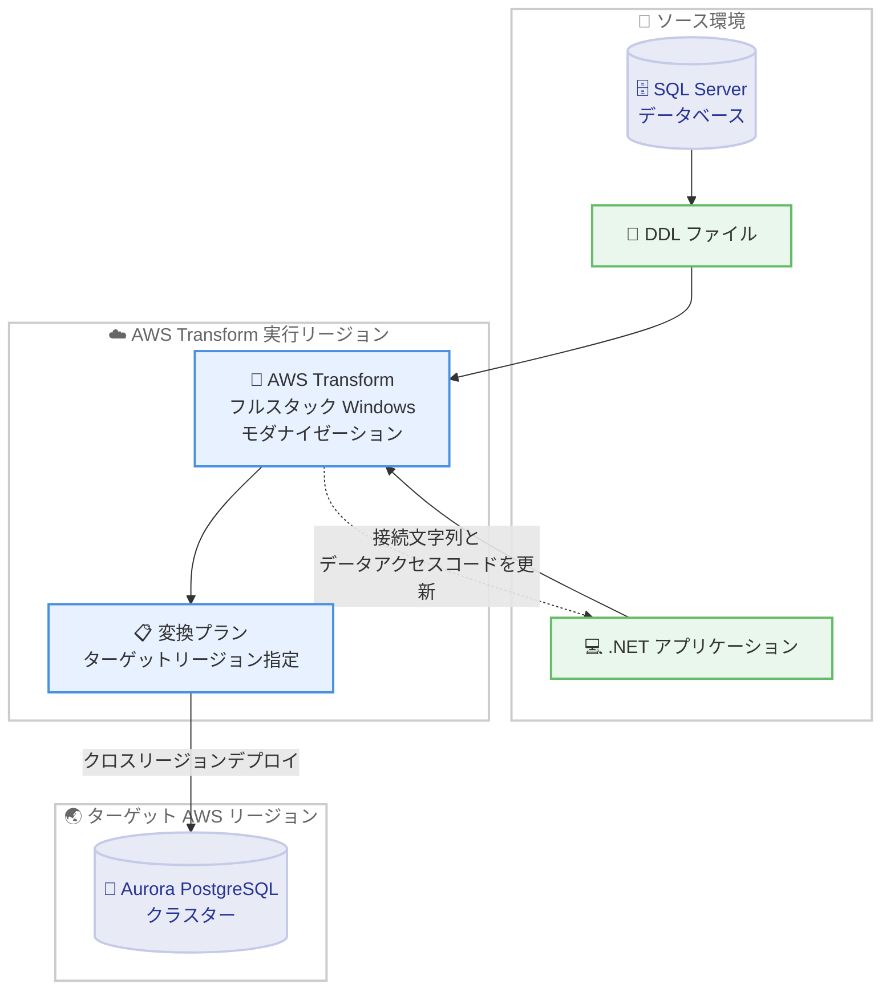

# AWS Transform - フルスタック Windows モダナイゼーションの Aurora PostgreSQL クロスリージョンデプロイ対応と 7 リージョン拡大

**リリース日**: 2026 年 10 月 15 日
**サービス**: AWS Transform
**機能**: フルスタック Windows モダナイゼーションにおける Aurora PostgreSQL クロスリージョンデプロイと利用可能リージョンの拡大

📊 [このアップデートのインフォグラフィックを見る](https://takech9203.github.io/aws-news-summary/20261015-aws-transform-full-stack-aurora-cross-region.html)

## 概要

AWS Transform のフルスタック Windows モダナイゼーションが、SQL Server から変換した Amazon Aurora PostgreSQL データベースのクロスリージョンデプロイに対応しました。あわせて、利用可能リージョンが 7 つ追加され、合計 8 リージョンで利用できるようになりました。

AWS Transform for SQL Server モダナイゼーションは、Microsoft SQL Server データベースと、それに依存する .NET アプリケーションを Amazon Aurora PostgreSQL へモダナイズする AI 搭載サービスです。今回のアップデートにより、SQL Server の DDL (Database Design Language) ファイルをアップロードし、変換プラン内でターゲット AWS リージョンを指定することで、変換後の Aurora PostgreSQL クラスターを AWS Transform の実行リージョンとは異なるリージョンへデプロイできるようになりました。同じワークフローの中で、依存する .NET アプリケーションの接続文字列や ADO.NET、Entity Framework のデータアクセスコードも PostgreSQL 互換に更新されます。

データレジデンシー (データ所在地) 要件、レイテンシー要件、ディザスタリカバリ要件を持つお客様が、モダナイズ後のデータベースのデプロイ先をより柔軟にコントロールできるようになる点が、このアップデートの主要な価値です。

**アップデート前の課題**

このアップデート以前には、以下の課題や制限がありました。

- 以前は AWS Transform のフルスタック Windows モダナイゼーションの利用可能リージョンが限られており、利用リージョンの近くでしか変換ワークフローを実行できなかった
- 変換後の Aurora PostgreSQL クラスターのデプロイ先リージョンを柔軟に選択できず、データレジデンシーやレイテンシーの要件を満たすには追加の移行作業が必要だった
- ディザスタリカバリ用に別リージョンへデータベースを配置したい場合、変換後に手動でクラスターを再構築・移行する必要があった

**アップデート後の改善**

今回のアップデートにより、以下が可能になりました。

- SQL Server の DDL ファイルをアップロードし、変換プランでターゲットリージョンを指定するだけで、変換後の Aurora PostgreSQL クラスターを別リージョンへ直接デプロイできるようになった
- 米国東部 (バージニア北部) に加え、欧州 (フランクフルト)、欧州 (ロンドン)、アジアパシフィック (ムンバイ)、アジアパシフィック (ソウル)、アジアパシフィック (東京)、アジアパシフィック (シドニー)、カナダ (モントリオール) の 7 リージョンが追加され、合計 8 リージョンで利用できるようになった
- データレジデンシー、レイテンシー、ディザスタリカバリの各要件に合わせて、モダナイズ後のデータベース配置を 1 つのワークフローで完結できるようになった

## アーキテクチャ図



SQL Server の DDL ファイルをアップロードし、変換プランでターゲットリージョンを指定すると、変換後の Aurora PostgreSQL クラスターが AWS Transform の実行リージョンとは異なるリージョンへデプロイされます。同時に、依存する .NET アプリケーションの接続文字列とデータアクセスコードも PostgreSQL 互換に更新されます。

## サービスアップデートの詳細

### 主要機能

1. **Aurora PostgreSQL のクロスリージョンデプロイ**
   - SQL Server の DDL ファイルをアップロードし、変換プラン内でターゲット AWS リージョンを設定可能
   - データベースを変換した上で、変換結果の Aurora PostgreSQL クラスターを AWS Transform の実行リージョンとは異なるリージョンへデプロイ
   - データレジデンシー、レイテンシー、ディザスタリカバリの各要件に対応

2. **.NET アプリケーションの PostgreSQL 互換化**
   - 同一ワークフロー内で、依存する .NET アプリケーションを PostgreSQL 互換に変換
   - 接続文字列を新しいターゲット PostgreSQL データベースに合わせて自動更新
   - ADO.NET および Entity Framework のデータアクセスコードを更新

3. **利用可能リージョンの拡大 (7 リージョン追加)**
   - 従来の米国東部 (バージニア北部) に加え、欧州 (フランクフルト)、欧州 (ロンドン)、アジアパシフィック (ムンバイ)、アジアパシフィック (ソウル)、アジアパシフィック (東京)、アジアパシフィック (シドニー)、カナダ (モントリオール) が追加
   - 東京リージョンを含む合計 8 リージョンで利用可能に

## 技術仕様

### フルスタック Windows モダナイゼーションの主な仕様

公式ドキュメントによると、AWS Transform for SQL Server モダナイゼーションは以下をサポートしています。

| 項目 | 詳細 |
|------|------|
| ソースデータベース | Microsoft SQL Server 2008 R2 ～ 2022 (Express / Standard / Enterprise の全エディション) |
| ソースのホスト環境 | Amazon RDS for SQL Server、Amazon EC2 上の SQL Server、AWS 外のホスト環境 |
| ターゲットデータベース | Amazon Aurora PostgreSQL (PostgreSQL 15 以降互換) |
| スキーマ変換 | テーブル、ビュー、インデックス、制約、リレーションシップを自動変換 |
| ストアドプロシージャ変換 | T-SQL を PL/pgSQL へ AI 支援で変換 |
| データ移行 | AWS DMS を利用し、整合性検証付きで移行 (オプトアウトも可能) |
| 対応 .NET バージョン | .NET 6 / 7 / 8 / 10 (.NET Framework 4.x 以前は非対応) |
| 対応 ORM | Entity Framework 6.3 ～ 6.5、EF Core 1.0 ～ 10.0、ADO.NET |
| プロバイダー変更 | SQL Server プロバイダーを Npgsql に置換 |
| 対応リポジトリ | GitHub、GitLab、Bitbucket、Azure DevOps、Amazon S3 |

### クロスリージョンデプロイのワークフロー

| ステップ | 内容 |
|----------|------|
| 1. DDL アップロード | SQL Server の DDL ファイルを AWS Transform にアップロード |
| 2. ターゲットリージョン指定 | 変換プラン内でデプロイ先の AWS リージョンを設定 |
| 3. データベース変換 | スキーマとコードオブジェクトを Aurora PostgreSQL 向けに変換 |
| 4. クロスリージョンデプロイ | 変換結果の Aurora PostgreSQL クラスターをターゲットリージョンへデプロイ |
| 5. アプリケーション更新 | 接続文字列、ADO.NET、Entity Framework のコードを PostgreSQL 互換に更新 |

## 設定方法

### 前提条件

公式ドキュメントに記載されている主な前提条件は以下のとおりです。

1. 管理者アクセス権を持つ AWS アカウントと、IAM Identity Center の有効化
2. 必要なサービスロールの作成と、適切なネットワーク構成を持つ VPC
3. ソース SQL Server への接続に必要な権限 (VIEW DEFINITION および VIEW DATABASE STATE) を持つデータベースユーザー
4. .NET アプリケーションの場合は .NET 6 以降 (.NET Framework 4.x 以前は、先に AWS Transform for .NET でアップグレードが必要)

### 手順

#### ステップ 1: AWS Transform でジョブを開始する

AWS Transform のウェブエクスペリエンスにサインインし、フルスタック Windows モダナイゼーション (SQL Server モダナイゼーション) のジョブを作成します。ソースコードリポジトリ (GitHub、GitLab、Bitbucket、Azure DevOps、Amazon S3 など) を接続します。

#### ステップ 2: DDL ファイルをアップロードし、ターゲットリージョンを指定する

SQL Server データベースの DDL ファイルをアップロードし、変換プラン内でデプロイ先となるターゲット AWS リージョンを設定します。この設定により、変換後の Aurora PostgreSQL クラスターが指定したリージョンにデプロイされます。

#### ステップ 3: 変換とデプロイを実行する

変換プランに沿ってスキーマ変換、ストアドプロシージャ変換、アプリケーションコードの更新を実行します。Human-in-the-loop のチェックポイントで変換結果をレビュー・承認しながら進めることができます。変換完了後、Aurora PostgreSQL クラスターがターゲットリージョンにデプロイされ、.NET アプリケーションの接続文字列とデータアクセスコードが更新されます。

## メリット

### ビジネス面

- **データレジデンシー要件への対応**: 各国・各地域のデータ所在地要件に合わせて、モダナイズ後のデータベースを適切なリージョンに配置できる
- **ディザスタリカバリ戦略の実現**: 変換とあわせて DR 要件に沿ったリージョンへのデプロイを計画でき、移行後の再配置作業が不要になる
- **SQL Server ライセンスコストからの脱却**: SQL Server から Aurora PostgreSQL への移行により、商用ライセンスコストを削減できる

### 技術面

- **ワークフローの一元化**: データベース変換、クロスリージョンデプロイ、アプリケーションコード更新を 1 つのワークフローで完結できる
- **レイテンシーの最適化**: アプリケーションの利用拠点に近いリージョンへデータベースをデプロイすることで、アクセスレイテンシーを低減できる
- **東京リージョンを含む 8 リージョンでの利用**: 日本のお客様も国内リージョンで変換ワークフローを実行できるようになった

## デメリット・制約事項

### 制限事項

- .NET Framework 4.x 以前のアプリケーションは直接サポートされず、先に AWS Transform for .NET で .NET 6 以降へのアップグレードが必要
- ターゲットデータベースは Amazon Aurora PostgreSQL (PostgreSQL 15 以降互換) に限定される
- AWS ホストのソースデータベースを使用する場合、公式ドキュメントではデータベースと AWS Transform が同一リージョンにあることが要件とされている (クロスリージョンデプロイはデプロイ先の指定に関する機能)

### 考慮すべき点

- データ移行をオプトアウトした場合でも、エージェントログ、評価結果、SQL スキーマファイルなどのメタデータや処理アーティファクトはサービス利用リージョンに保存されるため、厳格なデータレジデンシー要件がある場合は注意が必要
- アーティファクトは独自の KMS キーで暗号化でき、TTL 期間が設定されるため、保存ポリシーを事前に確認することを推奨
- 変換後のストアドプロシージャやアプリケーションコードは、Human-in-the-loop チェックポイントでのレビューとテストが重要

## ユースケース

### ユースケース 1: データレジデンシー要件を満たすデータベースモダナイゼーション

**シナリオ**: 金融機関が SQL Server ベースの基幹システムを Aurora PostgreSQL へモダナイズするにあたり、規制によりデータベースを国内リージョンに配置する必要がある。

**実装例**:
```text
1. AWS Transform で SQL Server の DDL ファイルをアップロード
2. 変換プランでターゲットリージョンに アジアパシフィック (東京) を指定
3. 変換後の Aurora PostgreSQL クラスターを東京リージョンへデプロイ
4. .NET アプリケーションの接続文字列を東京リージョンのクラスターに更新
```

**効果**: 規制要件を満たしつつ、手動での再配置作業なしにモダナイゼーションを完了できる。

### ユースケース 2: ディザスタリカバリを考慮したマルチリージョン構成

**シナリオ**: グローバル企業が SQL Server からのモダナイゼーションにあわせて、本番環境とは別のリージョンに DR 用のデータベース環境を整備したい。

**実装例**:
```text
1. 変換プランで DR 戦略に沿ったターゲットリージョンを指定
2. 変換結果の Aurora PostgreSQL クラスターを DR 対象リージョンへデプロイ
3. Aurora の機能 (Aurora Global Database など) と組み合わせてマルチリージョン構成を構築
```

**効果**: モダナイゼーションと DR 構成の整備を同時に進められ、事業継続性を強化できる。

### ユースケース 3: ユーザー拠点に近いリージョンへのレイテンシー最適化デプロイ

**シナリオ**: アジア太平洋地域のユーザー向け .NET アプリケーションのデータベースを、ユーザー拠点に近いリージョンへ配置してレイテンシーを低減したい。

**実装例**:
```text
1. SQL Server の DDL ファイルをアップロードし、変換プランを作成
2. ターゲットリージョンにユーザー拠点へ近いリージョンを指定
3. 同一ワークフローで .NET アプリケーションの ADO.NET / Entity Framework コードを更新
```

**効果**: アプリケーションとデータベース間、およびユーザーとの距離を最適化し、応答性能を改善できる。

## 料金

AWS Transform の料金詳細は、公式の製品ページを参照してください。なお、変換先にデプロイされる Amazon Aurora PostgreSQL クラスターや、データ移行に使用される AWS DMS などの AWS リソースには、各サービスの通常の利用料金が発生します。

## 利用可能リージョン

今回の拡大により、AWS Transform のフルスタック Windows モダナイゼーションは以下の 8 リージョンで利用可能になりました。

- 米国東部 (バージニア北部)
- 欧州 (フランクフルト)
- 欧州 (ロンドン)
- アジアパシフィック (ムンバイ)
- アジアパシフィック (ソウル)
- アジアパシフィック (東京)
- アジアパシフィック (シドニー)
- カナダ (モントリオール)

## 関連サービス・機能

- **Amazon Aurora PostgreSQL**: モダナイゼーションのターゲットデータベース。PostgreSQL 15 以降互換のクラスターがデプロイされる
- **AWS Database Migration Service (DMS)**: ストレージオブジェクトの変換とデータ移行を支える基盤サービス
- **AWS Transform for .NET**: .NET Framework アプリケーションをクロスプラットフォーム .NET へモダナイズするエージェント。SQL Server モダナイゼーションの前提となる場合がある

## 参考リンク

- 📊 [インフォグラフィック](https://takech9203.github.io/aws-news-summary/20261015-aws-transform-full-stack-aurora-cross-region.html)
- [公式発表 (What's New)](https://aws.amazon.com/about-aws/whats-new/2026/10/aws-transform-full-stack-aurora-cross-region)
- [AWS Transform 製品ページ (Windows)](https://aws.amazon.com/transform/windows/)
- [AWS Transform for full-stack Windows ドキュメント](https://docs.aws.amazon.com/transform/latest/userguide/windows-full-stack.html)
- [SQL Server モダナイゼーション ドキュメント](https://docs.aws.amazon.com/transform/latest/userguide/sql-server-modernization.html)

## まとめ

AWS Transform のフルスタック Windows モダナイゼーションが Aurora PostgreSQL のクロスリージョンデプロイに対応し、東京リージョンを含む 8 リージョンへ拡大されたことで、データレジデンシー、レイテンシー、ディザスタリカバリの各要件に沿った SQL Server モダナイゼーションが 1 つのワークフローで実現できるようになりました。SQL Server から Aurora PostgreSQL への移行を検討しているお客様は、変換プランでのターゲットリージョン指定を活用し、デプロイ先の設計を含めたモダナイゼーション計画を立てることを推奨します。
